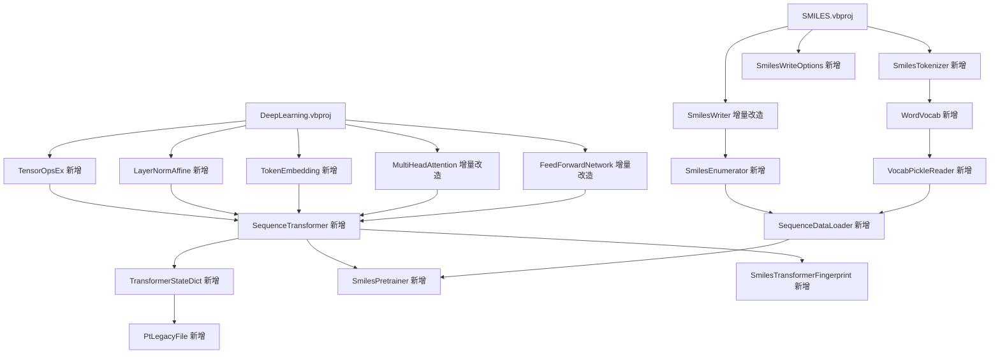

## 用户需求

在现有 VB.NET 底层库中补齐 8 个 P0 组件，使 `smiles-transformer` 的移植具备与 PyTorch 版**语义一致、权重可加载**的能力，并保留现有英西翻译 demo 的行为不变。

## 产品概述

不新增界面。交付物是底层库的新增与增量改造：SMILES 语法层（分词、随机枚举、芳香/立体写出）、深度学习层（可训练序列 Transformer、算子反向、权重键名映射）、序列化层（legacy PT 读取），以及一个控制台测试程序。

## 核心功能

- **分词器**：复刻 Python `utils.split` 的字符级拆分（`%nn`、二字母元素、`+2/-2`、方括号原子逐字符拆散）。
- **词表**：固定 `&lt;pad&gt;/&lt;unk&gt;/&lt;eos&gt;/&lt;sos&gt;/&lt;mask&gt;` 为 0-4，先字典序再稳定频次降序；支持自建 JSON 与只读 Python `vocab.pkl`。
- **写出与枚举**：同一分子可随机生成多条合法 SMILES；可选择芳香小写与手性/顺反记号输出；默认参数下输出与现状逐字节一致。
- **序列模型**：整序列并行前向的自编码 Transformer（无因果掩码、逐位置词表投影、post-LN + 仿射 LayerNorm），含 NLL(ignore_index) 训练步与 4H 指纹。
- **算子**：GELU 及其反向、可训练仿射 LayerNorm、逐位置线性层、NLL、多项式采样。
- **权重映射**：覆盖 `nn.Transformer` 全部 state_dict 键，支持严格校验与缺失/多余键报告；支持读取 torch 1.2 时代的 legacy `.pkl`。
- **数据管道**：按批读取、shuffle、pad 到 220、`sos/eos` 包裹；预训练脚手架输出 loss/ppl 与最优权重。

## 技术栈

- 语言与框架：VB.NET，`net10.0`，纯托管（无原生依赖）。
- 复用项目：`SMILES.vbproj`、`DeepLearning.NET6.vbproj`、`TensorFlow.vbproj`、`MLDataStorage.vbproj`、`binarydata-netcore5.vbproj`、`Core.vbproj`、`Math.NET5.vbproj`。
- 新建项目：`src/GCModeller/data/MoleculeKit/SMILES/SMILES.DeepLearning/`，`RootNamespace = SMRUCC.genomics.Molecule.SMILES.DeepLearning`，`AssemblyName` 同名。
- 测试：console 项目 + `DebugAudit`（`Microsoft.VisualBasic.Core\src\ApplicationServices\Debugger\DebugAudit.vb`）生成 JSON 报告。

## 实现方案

整体策略是「底层库新增主实现、原文件只做向后兼容的增量改造」，把与论文数值一致性相关的逻辑集中在新增类里，避免污染既有英西翻译 demo。

**关键决策与理由**

1. **分词器放在 SMILES 项目而非复用图解析器**：Python 的 token 是字符串切片（`[N+]` 会被拆成 `[ N + ]`），与图上的原子/键 token 集合不同；复刻切片算法才能与官方 `vocab.pkl` 对齐。
2. **随机枚举必须改在遍历层**：`MorganRanks()` 是拓扑不变量，随机重排原子下标后写出结果不变。因此给 `SmilesBuilder` 注入「起点 + 邻居顺序 + 环闭合号顺序」的随机化策略，并缓存每个原子的随机键以保证树结构稳定。
3. **新模型不复用 `TransformerModel`/`OutputLayer`/`Embedding`**：三者分别是逐词解码、压平投影、字符串小写键，均与 `TrfmSeq2seq` 语义冲突。
4. **`MultiHeadAttention` 增加可选 bias 而不是重写**：torch 的 `in_proj_bias`/`out_proj.bias` 必须落地，加可选参数后旧调用行为不变（默认 `Nothing`）。
5. **`FeedForwardNetwork` 增加 `ActivationKind`**：ReLU 为默认值，GELU 走新反向；避免复制一份 FFN。
6. **LayerNorm 独立实现**：现有 `AddNorm*` 是有偏方差、eps 在 sqrt 内、无仿射参数，无法承载 torch 权重；新类严格对齐「无偏方差 + `1/(sqrt(var)+eps)` + γ/β」。
7. **权重映射集中在一处**：`TransformerStateDict` 单点负责 fused QKV 拆分、Linear 转置、buffer 校验与严格模式，便于用单测锁死。
8. **legacy PT 读取独立成模块**：`PtFile` 只认新式 zip；新增 `PtLegacyFile` 复用 `MinimalPickleUnpickler` + `PtPickleFactory` 的 storage 回调，避免改动既有 zip 解析路径。

**性能与可靠性**

- 前向/反向复杂度：自注意力 `O(B·T²·H)`，FFN `O(B·T·H·dff)`；T=220、H=256 时单批内存约 `B·T·H·8 ≈ 450KB`（B=1），需重点控制的是**一次性分配**与**每步缓存**，故 `Encode` 按 100 分块。
- `Tensor` 仅 fp64：加载 fp32 权重为无损提升，但内存与算力约 2 倍；不做 fp32 快路径，避免引入双份反向实现。
- 全量 1.7M 语料预训练定位为「不现实」，交付目标为「加载官方权重推理/特征提取 + 万级样本微调验证」。

**风险与对策**

- 官方 `trfm_*.pkl` 可能是 torch 1.2 legacy 格式 → 提供 `PtLegacyFile.Open`，并在失败时给出明确的“请用现代 torch 转存”提示。
- 随机展开顺序会破坏 `@/@@` 手性语义 → 随机模式下默认关闭立体输出，需立体时使用“手性原子固定原邻居顺序”模式。
- `MorganRanks` 破同分依赖原子下标 → 严格 canonical 排序降级为 P1，不阻塞关键路径。

## 架构设计



分层约定：`SMILES` 只负责语法与分子图；`DeepLearning` 只负责张量、层与权重格式；`SMILES.DeepLearning` 负责把两者组装成业务流程（语料、词表、训练、指纹导出）。

## 目录结构

```text
src/GCModeller/data/MoleculeKit/SMILES/SMILES/
├── SmilesSyntax/
│   ├── SmilesTokenizer.vb          # [NEW] 复刻 utils.split：HashSet 首字符 + 二字母表，返回 String()；SplitJoined 返回空格串。要求逐行等价 Python 的边界（len-1 循环 + 末尾补一个、%nn 越界截断、空串返回空数组）。
│   ├── SmilesWriteOptions.vb       # [NEW] StartAtom/Seed/RandomizeNeighborOrder/EmitAromatic/EmitStereo 五个开关；提供 Default 只读实例。
│   ├── SmilesWriter.vb             # [MODIFY] 增加 Write(graph, Optional options) 重载；SmilesBuilder 接受 options；起点选择、邻居顺序随机键缓存、环闭合号乱序；atomSymbol 支持芳香小写与 @/@@；bondSymbol 支持芳香省略与 /\。默认参数下输出必须逐字节不变。
│   └── SmilesEnumerator.vb         # [NEW] Randomize(smiles)/RandomizeAll：Parse → 随机 options → Write，解析失败返回 Nothing；内部持有 seeded Random。

src/runtime/sciBASIC#/Data_science/MachineLearning/DeepLearning/Transformer/
├── TensorOpsEx.vb                  # [NEW] Gelu/GeluBackward；LayerNormForward/Backward（无偏方差、eps 在 sqrt 外、γ/β）；LinearForward/LinearBackward；NllLoss(ignoreTarget, ByRef dLogits)；LogSoftmaxLastDim；Multinomial。
├── LayerNormAffine.vb              # [NEW] 可训练仿射 LN 层：Gamma/Beta 张量 + 两个 Optimizer；Forward 缓存 mean/invStd；Backward 累加 dGamma/dBeta 并回传 dX。
├── TokenEmbedding.vb               # [NEW] 索引查表：[V,H] 权重 + [B,T] ids → [B,T,H]；反向按 (b,t) scatter 累加；预计算标准正弦 PE（sin/cos(pos/10000^(2i/d))）作为 [1,T,H] buffer，训练时对 PE 输出做 dropout。
├── MultiHeadAttention.vb           # [MODIFY] 增加可选 Qb/Kb/Vb/Wob（默认 Nothing）；前向 VecAdd，反向 VecAddBackward 累加；Cache 记录 bias 梯度。旧构造重载保留。
├── FeedForwardNetwork.vb           # [MODIFY] 增加 ActivationKind { ReLU, GELU }（默认 ReLU）；Backward 按类型选 Heaviside 或 GeluBackward。旧行为不变。
├── SequenceTransformer.vb          # [NEW] TrfmSeq2seq 等价实现：Forward(ids)/Predict/TrainStep/Encode/ZeroGradients；nLayers× 编码器与解码器（解码器自注意力无因果掩码 + 交叉注意力），post-LN + 仿射 LN，末端 encoder.norm/decoder.norm，out = Linear(H,V) + log_softmax。Encode 返回 [B,4H] 并按 100 分块。
└── TransformerStateDict.vb         # [NEW] Apply(model, state, strict)/Export(model)；fused in_proj 按 Q|K|V 三等分再按 head 切并转置；Linear 权重转置；pe buffer 只校验；MissingKeys/UnexpectedKeys 报告。

src/runtime/sciBASIC#/Data_science/MachineLearning/MLDataStorage/PT/
└── PtLegacyFile.vb                 # [NEW] 读取 torch 1.2 legacy（非 zip）存档：用 MinimalPickleUnpickler + PtPickleFactory 的 storage 回调把 _rebuild_tensor_v2 还原为 Tensor；返回 PtStateDict；与 PtFile 的 zip 路径互不影响。

src/GCModeller/data/MoleculeKit/SMILES/SMILES.DeepLearning/
├── SMILES.DeepLearning.vbproj      # [NEW] net10.0，引用 SMILES、DeepLearning.NET6、TensorFlow、MLDataStorage、binarydata-netcore5、Core、Math.NET5。
├── Corpus/
│   ├── WordVocab.vb                # [NEW] Pad/Unk/Eos/Sos/Mask 索引常量；IToS/SToI/Freqs；FromCorpus（字典序 + 稳定频次降序、maxSize+5、minFreq）；ToSeq/FromSeq（sos/eos 包裹 + pad 到 seqLen）；SaveJson/LoadJson。
│   ├── VocabPickleReader.vb        # [NEW] 用 MinimalPickleUnpickler 读 vocab.pkl，从 PythonObject.State 取 stoi/itos/freqs，值统一 Convert.ToInt32；失败抛带原因的 InvalidDataException。
│   └── SequenceDataLoader.vb       # [NEW] Shuffle/Batches：索引洗牌、按 batch 取样本、每条走 SmilesEnumerator（可选）+ SmilesTokenizer + WordVocab.ToSeq，产出 ids(B,T) 与 lengths；支持 dropLast 与固定 seed。
├── Features/
│   └── SmilesTransformerFingerprint.vb  # [NEW] 由 vocSize/model 参数构造；Encode(smiles As String()) → Double(,)（内部 pad/collate 到 220）；ExportCsv 输出 header + 矩阵，便于下游 RanFog/Logistic。
├── Trainer/
│   └── SmilesPretrainer.vb         # [NEW] 训练循环：每 epoch 重建 loader、Adam(lr=1e-4, step 递增)、每 N 步验证 nll/ppl、最优 loss 存 PtStateDict、Console 与 DebugAudit 双通道日志。
└── test/
    ├── test.vbproj                 # [NEW] OutputType=Exe，引用 SMILES.DeepLearning 与 Core。
    └── Program.vb                  # [NEW] 七个用例：Tokenizer 对齐、Vocab 断言、写出器回归与枚举、算子数值/梯度、模型前向与 Python golden 对齐、StateDict 覆盖率与 Encode 余弦、端到端小样本微调；使用 DebugAudit.Check/AreEqual/Snapshot/SaveReport。
```

## 关键接口

```
Public Class SmilesWriteOptions
    Public Property StartAtom As Integer?
    Public Property Seed As Integer?
    Public Property RandomizeNeighborOrder As Boolean
    Public Property EmitAromatic As Boolean
    Public Property EmitStereo As Boolean
    Public Shared ReadOnly Property [Default] As SmilesWriteOptions
End Class

Public Class SequenceTransformer
    Public Sub New(vocabSize As Integer, Optional hiddenSize As Integer = 256,
                   Optional nLayers As Integer = 4, Optional nHeads As Integer = 4,
                   Optional dff As Integer = 256, Optional seqLen As Integer = 220,
                   Optional dropout As Double = 0.1)
    Public Function Forward(ids As Integer(,), Optional isTraining As Boolean = False) As Tensor
    Public Function TrainStep(ids As Integer(,), learningRate As Double, step As Integer) As Double
    Public Function Predict(ids As Integer(,)) As Tensor
    Public Function Encode(ids As Integer(,), Optional chunkSize As Integer = 100) As Double(,)
    Public Sub LoadStateDict(state As PtStateDict, Optional strict As Boolean = True)
    Public Function StateDict() As PtStateDict
End Class
```

## 实施说明

- **形状约定**：外部 `ids(batch, time)`，内部张量统一 `[B,T,H]`；`nn.Linear.weight` 是 `[out,in]`，VB 内部存 `[in,out]`，映射时转置；`nn.Embedding.weight` 形状一致不转置。
- **数值对齐**：LayerNorm 无偏方差 + `eps=1e-5` 且在 sqrt 外；GELU 用 tanh 近似且反向含 `(1-tanh²)` 项；NLL 分母为非 ignore 元素数，不可沿用现有 `AddNormEps=0.001`。
- **回归保护**：`SmilesWriter` 默认参数、`FeedForwardNetwork` 默认 ReLU、`MultiHeadAttention` 默认无 bias，三处必须能被现有英西翻译 demo 与原有测试无感通过。
- **日志**：训练器输出 `epoch/step/loss/ppl`，不打印张量内容；异常信息带键名与形状，便于定位权重不匹配。
- **不改动**：`TransformerModel`、`Embedding`、`OutputLayer`、`DecoderLayer` 保持原样，避免影响既有 demo；新模型完全并行实现。