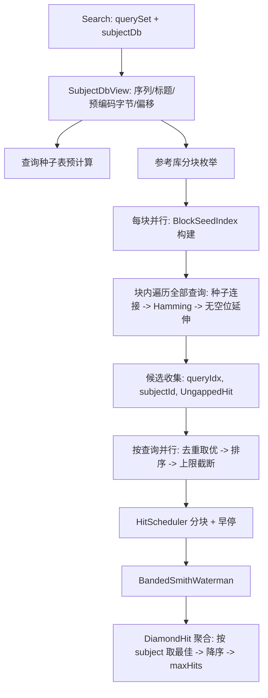

## 需求概述

针对 GCModeller 中已实现的 DIAMOND 风格 blastp 搜索（`SequenceAlignment` 项目），修复当前多查询并行中的严重缺陷，并大幅提升两个蛋白序列集合（查询集 vs 参考库）批量比对的吞吐性能。用户已确认允许深度优化、允许更强的剪枝、速度优先的内存策略，并要求额外提供控制台基准程序量化优化效果。

## 核心功能

- 修复并行搜索正确性缺陷：消除并行查询间共享可变状态导致的竞态与结果污染，使同一输入多次运行结果稳定一致。
- 重构多查询并行调度：参考库索引不再在全量库上一次构建并阻塞所有线程，改为内存可控、可真正并行、可扩展的分块处理。
- 显著提升端到端速度：在 687MB / 134 万条 / 5.92 亿残基的参考库与约 4300 条查询集上，搜索从不可用或数十分钟级降到分钟级以内。
- 结果语义保持：每条查询对每个参考序列保留最佳 HSP，按原始得分降序，`maxHitsPerQuery` 截断；允许极弱命中被剪枝。
- 保持对外 API 兼容：R# 侧 `diamond(mode)` 与 `diamond_search(query, subject, max_hits)` 调用方式、返回的 m8 风格命中集合结构不变。
- 提供可复现的验证手段：控制台基准程序输出优化前后耗时、命中条数、内存峰值等量化报告。

## 一、技术栈

- 语言/运行时：VB.NET on .NET 10（沿用 `SequenceAlignment.vbproj`，`TargetFrameworks=net10.0`，`Rsharp_app_release|x64` 配置）
- 并行：System.Threading.Tasks（`Parallel.For` / `ParallelOptions`）替代现有 PLINQ `SelectMany`
- 数据模型：`SMRUCC.genomics.SequenceModel.FASTA.FastaSeq`
- 打分/比对：现有 `SMRUCC.genomics.Analysis.SequenceAlignment.BestLocalAlignment.Blosum` 与 `GSW(Of Char)`/`SmithWaterman`
- 基准测试：新增 console 工程，使用 `Microsoft.VisualBasic` 的 `DebugAudit`（Watch/Mark/Check/SaveReport）生成报告

## 二、现状诊断（已实测确认，是性能问题的根因）

1. 参考库规模：`G:\cell-render\data\KO.fasta` = 1,344,407 条序列 / 591,911,814 残基（均长 440，最长 17,474）。当前 `ReferenceIndex` 用 `Dictionary(Of Long, List(Of SubjectHit))` 对**整库**建索引，`Fast` 模式 2 个形状 ≈ 11.8 亿索引项，内存需求数十 GB，必然换页/GC 抖动。
2. 并行失效：`DiamondBlastp.SearchSingleCore` 把 `refIdx.Build(subjectSeqs, seed)` 放在 `SyncLock cache` **内部**（DiamondBlastp.vb 153-159 行），首个线程建全库索引期间其余线程全部阻塞，实测并行度趋近 1。
3. 数据竞争：`LeftMostSeedFilter` 是 `DiamondBlastp` 实例字段（85 行），被所有并行查询线程并发 `Reset()/Keep()`，产生竞态与跨查询状态污染，结果不可复现。
4. 重复分配：每查询都执行 `subjects.Select(Function(s) s.SequenceData).ToArray`（139-140 行），4300 查询 × 134 万序列量级的重复拷贝。
5. 无效分配：`ReferenceIndex.Lookup` 未命中即 `New List(Of SubjectHit)`；`QueryIndex.HashJoin` 为多层 `Yield` 迭代器状态机。
6. 热路径查表过慢：`ReducedAlphabet.Map` 用 `Dictionary` 做 `ContainsKey` + 索引器两次哈希；`Blosum.GetDistance` 走 `Index(Of String).IndexOf(Char.ToUpper(...))` 字符串查找；`HammingFilterSse` 每个 48aa 窗口都分配 `Byte()` 并逐字节拷贝进 `Vector128.Create(...)`。
7. 伪 SIMD：`UngappedExtensionAvx2` 大量使用 `Vector256.WithElement/GetElement`（等价逐元素标量），真正开销是每 lane 的 BLOSUM 查表。
8. 昂贵 SW 泛滥：`BandSW.Align` 每个候选都 `New SmithWaterman(...).BuildMatrix()`（内部 `RectangularArray.Matrix` 生成 `Double()()` 锯齿矩阵）并 `Matches(...).ToList`；同一 subject 常被多个候选重复做 SW。

## 三、实现方案（关键决策）

### 3.1 参考库分块遍历（核心架构变更）

将"整库建索引 × 每查询"改为"分块建索引 × 全查询"：

- 把参考库按残基预算切成若干块（默认 `BlockResidues = 4_000_000`，592M 残基 → 约 148 块）；
- 每块只对**当前形状**构建一次紧凑索引，构建完立即处理全部查询，然后释放复用缓冲；
- 峰值索引内存从数十 GB 降到 `块残基 × 每项开销`（约 80MB 量级），且块间天然并行。

理由：索引构建代价与总残基线性相关，分块不增加总工作量，却把内存与 GC 压力彻底解耦，并让"建索引"和"处理查询"都在并行区间内完成。

### 3.2 紧凑种子索引（替代 Dictionary(Of Long, List)）

新 `BlockSeedIndex` 使用链式哈希的扁平数组：

- `codes() As Long`（种子编码）、`vals() As Long`（`(subjectId << 32) Or position` 打包）、`nexts() As Integer`（同桶链）、`heads() As Integer`（桶头，容量取 `nextPow2(entries × 2)`）；
- 构建：一次线性扫描 + 头插，无任何 per-key 集合分配；
- 连接：以查询种子驱动，`code → 桶 → 链`，链上直接产出 `(subjectId, position)`，无迭代器、无临时 List；
- 频率剪枝：链长超过 `SeedFrequencyCap`（默认按块残基自适应，如 `max(64, blockResidues \ 50000)`）的编码直接跳过，抑制低复杂度/重复序列导致的链爆炸。

### 3.3 两阶段流水线（候选生成 + 局部比对）

- 阶段 A（按块并行，块内遍历全部查询）：种子连接 → 48aa Hamming 初筛 → BLOSUM62 无空位延伸 → 仅保留通过 `MinUngappedScore` 的候选，按 `(queryIdx, subjectId, UngappedHit)` 收集；
- 阶段 B（按查询并行）：按 subjectId 去重取最高无空位得分 → 降序 → 取 `MaxSwPerQuery`（默认 `max(250, 8 × maxHits)`）→ 沿用 `HitScheduler` 分块 + `ShouldStop` 早停 → 带状 SW → `DiamondHit` → 按得分降序、`maxHits` 截断。
- 如此每对 (query, subject) 最多做一次 SW，避免现有的重复 SW 与重复 `DiamondHit` 构造。

### 3.4 热路径查表化

- `ReducedAlphabet`：新增 `Byte(255)` 映射表（一次性静态初始化），`Map` 改为单次数组索引；新增 `EncodeTo(seq, buffer, offset)` 填充式编码，返回 `Byte()`；为整个参考库预计算一份扁平 `Byte()` + 每条序列起始偏移（约 592MB，符合"速度优先"），Hamming 与无空位延伸直接访问，不再逐字符映射。
- `Blosum`：增加惰性构建、只读的 `Integer(255*255)` 快速打分表（含大小写展开，用 `Integer.MinValue` 作无效哨兵回退到原逻辑并保留原有异常行为），`GetDistance` 走单次索引；`GSW` 构建矩阵时的 `getIndex` 也可复用该表。
- `SeedEncoder`：新增无迭代器的 `EncodeSeeds(seq, seed, codes, positions)` 填充 API，原 `EnumerateSeeds` 迭代器保留供外部兼容。
- 伪 SIMD 修正：VB.NET 不支持 `Span(Of T)` / ref struct / ByRef 返回，无法做真正的向量加载，故把 `UngappedExtensionAvx2` 与 `HammingFilterSse` 内部替换为高度优化的标量实现（快速 BLOSUM 表 + 预编码字节数组 + 手工展开 + 早退），对外类名与 `ExtendBatch`/`Distance` 签名保持不变。

### 3.5 轻量带状 Smith-Waterman

新增 `BandedSmithWaterman`：以种子对角线为中心、带宽 `2 × BandMargin + 1`，使用扁平 `Integer()` 缓冲（每线程复用），线性 gap 或 affine gap 与现有 `GSW` 的 `MISMATCH_SCORE/INDEL_SCORE` 约定保持一致；只回填最优路径所需信息，产出与 `BandHit` 完全相同的坐标与片段。`BandSW.Align` 改为委托它，保留 `BandSW`/`BandHit` 公共 API。要求对随机抽样的候选同时跑 `SmithWaterman` 与 `BandedSmithWaterman`，断言得分/坐标一致（日志记录不一致样本，便于定位）。

### 3.6 调度与配置

- `ParallelScheduler`：改为 `Parallel.For` + 分块（`chunkSize = ceil(count / (DOP × 4))`），`DegreeOfParallelism` 支持显式传入（默认 `Environment.ProcessorCount`），保留 `IDiamondScheduler.Run(queries, subjectDb, perQuery)` 签名；`DistributedScheduler` 的本地回退同步改造。
- 新增 `DiamondSearchOptions`：`BlockResidues`、`SeedFrequencyCap`、`MaxSwPerQuery`、`DegreeOfParallelism`、`EnableBandSw`，并提供一个可选重载 `Search(querySet, subjectDb, options, maxHitsPerQuery)`；原有两个 `Search` 签名行为不变（内部使用默认 options）。

## 四、性能与复杂度

- 种子连接：`O(总残基 × 形状数)` 次哈希插入（线性，分块后局部性更好）+ `O(查询残基 × 形状数 × 块数)` 次桶查找（约 4.4 亿次轻量查找，可通过块大小/形状数调节）。
- 内存：一个块索引 + 查询种子表（约 18MB）+ 候选缓冲，峰值数百 MB 量级；参考库缩减编码 592MB（速度优先策略下接受）。
- 局部比对：调用次数由"每候选一次"降为"每 (query, subject) 至多一次且上限 `MaxSwPerQuery`"，且单次成本由 `m × n` 降为 `band × n`，并用扁平缓冲区消除每次调用的矩阵分配。

## 五、架构设计



## 六、目录结构（G:\GCModeller\src\GCModeller\analysis\SequenceToolkit\SequenceAlignment）

```
SequenceAlignment/
├── Diamond/
│   ├── DiamondBlastp.vb              # [MODIFY] 重写多查询入口与两阶段编排；移除共享 leftMost 字段与 SyncLock 内建索引；单查询 Search 复用同一核心；查询种子表预计算；候选收集与最终聚合；进度日志限流
│   ├── SubjectDbView.vb              # [NEW] 参考库共享只读视图：Seq()/Titles()/扁平缩减编码 Byte()/Offsets()/分块枚举 BlockRange；一次性构建，全程只读
│   ├── BlockSeedIndex.vb             # [NEW] 分块紧凑种子索引：codes/vals/nexts/heads 数组、Build(seqs, offsets, range, seed)、FindSeeds(codes, positions, callback)、链长上限剪枝、缓冲复用
│   ├── DiamondSearchOptions.vb       # [NEW] 搜索参数对象（BlockResidues、SeedFrequencyCap、MaxSwPerQuery、DegreeOfParallelism、EnableBandSw）与默认值
│   ├── BandedSmithWaterman.vb        # [NEW] 轻量带状 SW：扁平缓冲、按线程复用、与 GSW 同 gap 约定、输出 BandHit 坐标与片段
│   ├── BandSW.vb                     # [MODIFY] Align 委托 BandedSmithWaterman；保留 BandHit/BandSW 公共 API；MinScore 语义不变
│   ├── SeedIndex.vb                  # [MODIFY] 保留 SubjectHit/SeedPair/ReferenceIndex/QueryIndex 公共 API（DiamondDemo 等仍可编译）；内部改为基于 BlockSeedIndex，Lookup 未命中不再分配
│   ├── SeedEncoder.vb                # [MODIFY] 新增填充式 EncodeSeeds(seq, seed, codes, positions)；保留原迭代器 API
│   ├── ReducedAlphabet.vb            # [MODIFY] Map 改 256 项 Byte 查表；新增 EncodeTo(seq, buffer, offset) 与 EncodeAll(seqs, offsets)
│   ├── HammingFilter.vb              # [MODIFY] 增加基于预编码 Byte() + 偏移的 Distance/Pass 重载（热路径）；字符串版委托新实现
│   ├── HammingFilterSse.vb           # [MODIFY] 移除逐窗口分配与 Vector128.Create 拷贝，改为复用缓冲的标量快速实现；类名与接口签名不变
│   ├── IHammingFilter.vb             # [MODIFY] 增加 Byte() 版本方法声明（默认实现保持字符串重载可用）
│   ├── UngappedExtension.vb          # [MODIFY] 使用 Blosum 快速打分表；得分累加循环展开；提供 Byte() 预编码重载
│   ├── UngappedExtensionAvx2.vb      # [MODIFY] 去掉 WithElement/GetElement 伪 SIMD，改为标量批量实现；保留 ExtendBatch 签名与结果一致
│   ├── HitScheduler.vb               # [MODIFY] 增加数组版 Schedule(ordered) 避免 LINQ 排序分配；保留 BlockSize/MinUngappedScore/ShouldStop
│   ├── ParallelScheduler.vb          # [MODIFY] 改 Parallel.For 分块调度，支持 DegreeOfParallelism；保留 IDiamondScheduler.Run
│   ├── DistributedScheduler.vb       # [MODIFY] 本地回退走新的分块并行实现
│   └── DiamondHit.vb                 # [MODIFY] 保持 FromBandHit 语义；避免同一 hit 重复构造（由聚合阶段保证）
└── SmithWaterman/Matrix/Blosum.vb    # [MODIFY] 增加惰性快速打分表（Integer(255*255)，含大小写），GetDistance 走表并保留无效字符回退

G:\GCModeller\test\benchmark\diamond_blastp\
├── DiamondBench.vbproj               # [NEW] console 基准工程：net10.0、Exe、Platforms=AnyCPU;x64、Configurations 含 Rsharp_app_release，ProjectReference 指向 SequenceAlignment.vbproj
└── Program.vb                        # [NEW] 基准入口：加载两个 fasta、预热、计时搜索、统计命中条数与内存峰值；全部通过 DebugAudit 的 Watch/Mark/Check 记录并 SaveReport 输出测试报告
```

## 七、关键接口（仅签名）

```
Public Class SubjectDbView
    Public ReadOnly Property Count As Integer
    Public ReadOnly Property Titles As String()
    Public ReadOnly Property Reduced As Byte()            ' 扁平缩减编码
    Public ReadOnly Property Offsets As Integer()         ' 每条序列起始偏移
    Public Shared Function Build(subjects As IList(Of FastaSeq)) As SubjectDbView
    Public Iterator Function Blocks(blockResidues As Integer) As IEnumerable(Of (start As Integer, [end] As Integer))
End Class

Public Class BlockSeedIndex
    Public Sub Build(view As SubjectDbView, range As (start As Integer, [end] As Integer), seed As SpacedSeed, Optional capacityHint As Integer = 0)
    Public Function FindSeeds(queryCodes As Long(), queryPositions As Integer(), frequencyCap As Integer, sink As ICandidateSink) As Integer
    Public Sub Dispose()
End Class

Public Class DiamondSearchOptions
    Public Property BlockResidues As Integer = 4_000_000
    Public Property SeedFrequencyCap As Integer = 0            ' 0 = 按块自适应
    Public Property MaxSwPerQuery As Integer = 0               ' 0 = max(250, 8 * maxHits)
    Public Property DegreeOfParallelism As Integer = 0         ' 0 = ProcessorCount
    Public Property EnableBandSw As Boolean = True
End Class
```

## 八、实施注意

- **VB 语言约束**：不可使用 `Span(Of T)`、`stackalloc`、`Unsafe`/`MemoryMarshal` 引用加载、ByRef 返回；因此所有"SIMD"改造必须落实为查表 + 展开 + 数组索引的标量实现，向量指令相关保留但不作为性能假设。
- **线程安全**：杜绝任何跨查询共享的可变字段；`LeftMostSeedFilter`、候选缓冲、SW 缓冲均按 (块, 查询) 或按查询创建。全局只读对象（`SubjectDbView`、快速 BLOSUM 表）在并行开始前构建完成。
- **向后兼容**：保留 `Search(FastaSeq, IEnumerable, Integer)`、`Search(IEnumerable, IEnumerable, IDiamondScheduler, Integer)`、`IDiamondScheduler`、`BandHit`、`DiamondHit`、`ReferenceIndex/QueryIndex/SeedPair` 等公开符号；`SensitivityMode` 与 `SpacedSeeds` 不变。
- **日志**：保留 `debug` 扩展用法，但进度输出改为"每 N 条查询/每块一次"，避免 4300 行逐条日志；异常信息包含块范围与查询标题，不输出完整序列内容。
- **内存管理**：块索引缓冲通过 `Array.Resize`/`Array.Clear` 复用，避免每块大数组分配；`DiamondSearchOptions.BlockResidues` 可按可用内存调低。
- **爆炸半径**：改动集中在 `Diamond` 目录与 `Blosum.vb`；不改 `workbench/R#` 的 `diamond`/`diamond_search` 导出签名，保证 R# 脚本零改动即可跑通。

## 九、构建与验证

1. 编译：`dotnet build G:\GCModeller\src\GCModeller.slnx -c Rsharp_app_release -p:Platform=x64`，确认 `G:\GCModeller\assembly\net10.0\SMRUCC.genomics.Analysis.SequenceAlignment.dll` 时间戳更新。
2. 端到端：在 `G:\GCModeller\src\R-sharp\App\net10.0` 执行 `./R#.exe G:\GCModeller\test\demo\sequencekit\diamond.R --attach G:\GCModeller --debug=none`，比对输出 CSV 行数与耗时。
3. 基准：`dotnet build` 并运行 `DiamondBench`，用 `DebugAudit` 报告记录：总耗时、阶段耗时（索引构建/连接/延伸/局部比对）、命中条数、峰值工作集内存，并对同一输入重复运行确认结果稳定（消除竞态）。

## Agent Extensions

### SubAgent

- **code-explorer**
- Purpose: 在改造前用 "medium" 深度扫描全仓库对 `DiamondBlastp`、`DiamondHit`、`ReferenceIndex`、`BandSW`、`LeftMostSeedFilter`、`UngappedExtension` 等符号的引用点（含 `workbench/R#`、其它分析模块、测试工程），确认可安全重构的边界与必须保留的公开 API。
- Expected outcome: 输出一份引用清单（文件路径 + 符号 + 调用方式），作为兼容性约束直接落到实现中，避免编译断裂或行为回归。

### Skill

- **lsp-code-analysis**
- Purpose: 对 `DiamondBlastp.Search`、`Blosum.GetDistance`、`HammingFilter.Distance` 做定义/引用/实现层次分析，确认重载与接口实现（`IHammingFilter`、`IDiamondScheduler`）的全部实现类，避免新增重载后遗漏实现。
- Expected outcome: 得到精确的符号引用与实现列表，确保接口扩展（如 `IHammingFilter` 的 Byte() 重载）覆盖所有实现，且改动影响面完全受控。