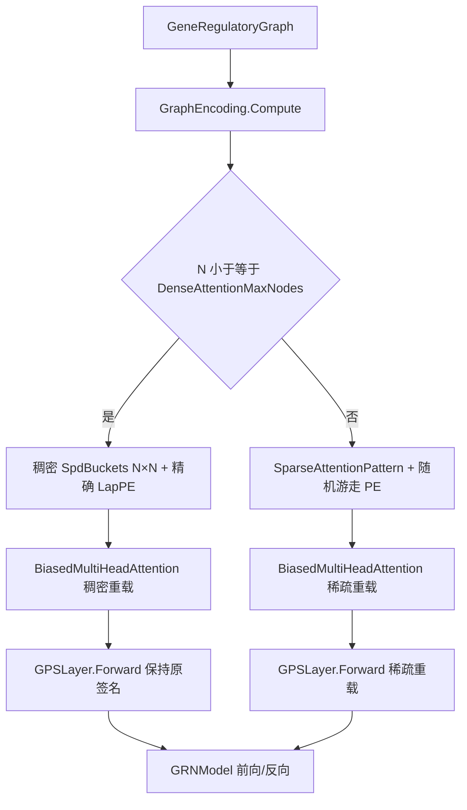

## 用户需求

GPS（GNN + Transformer）基因调控网络模型在小数据集上可正常训练，但在人基因组（60273 个基因）上训练时崩溃：先打印“基因数 60273 超过 LapPE 稠密分解上限 1500，位置编码置零”，随后在第一个训练样本的前向传播中抛出 `OverflowException`（`SIMDTensorF.MatMul` → `MixedPrecisionOps.MatMul` → `TensorOps.BatchedMatMul` → `BiasedMultiHeadAttention.Forward` → `GPSLayer.Forward` → `GRNModel.Forward` → `GPSTrainer.TrainMaskedSample`）。需要修复该问题，使模型能够正常处理大型人基因组数据的训练，并按 `Rsharp_app_release|x64` 编译 `GCModeller.slnx` 部署到 `G:\GCModeller\assembly`，再用 `R# G:\Erica\test\hsa_gps.R --attach G:\GCModeller --debug=none` 实测验证。

## 产品概述

保持模型对外接口与现有行为不变的前提下，为大基因规模引入可伸缩的注意力与图编码机制：小数据继续走原有精确实现（结果逐位一致），大数据自动切换到稀疏近似路径，从而在有限内存下完成全基因组规模的训练、评估与虚拟扰动。修复后训练日志需明确展示当前规模、所选路径与资源估算。

## 核心功能

- 大图注意力：保留全部基因，每个基因仅与固定数量候选基因（自身、图邻域、高连接枢纽、随机长程链接）计算注意力，避免构造 N×N 分数矩阵。
- 自动路径切换：基因数不超过阈值时沿用原稠密注意力与精确拉普拉斯位置编码；超过阈值时走稀疏注意力与可扩展位置编码，按配置可调。
- 可扩展位置编码：大图用随机游走/热核近似替代被跳过的稠密特征分解；先验图无边时给出明确说明并置零。
- 图编码内存治理：大图不再分配 N×N 的最短路径桶矩阵，改为稀疏候选模式并保留距离桶语义（自身/近距/超距/不连通）。
- 数值溢出防护：张量形状与矩阵乘结果长度使用 64 位校验，超限时抛出可读异常而非底层溢出。
- 兼容与验证：既有自测全部通过；新增稀疏与稠密等价性、梯度校验、大图位置编码等自测；完成编译部署并跑到首个训练 epoch 完成。

## 技术栈

- 语言/运行时：VB.NET，.NET 10（`G:\GCModeller\src\GCModeller.slnx`，配置 `Rsharp_app_release`，平台 `x64`）。
- 张量后端：`runtime\sciBASIC#\Data_science\MachineLearning\TensorFlow`（`Tensor` 双精度主体 + `TensorF` 单精度内核 + `MixedPrecisionOps` 混合精度外观）。
- 注意力算子复用：`Transformer\TensorOps.vb`（`BatchedMatMul`、`SoftmaxLastDim`、`SoftmaxBackward`、`Accumulate`、`TransposeLastTwo` 等）。
- 图结构：`SMRUCC.genomics.Analysis.GEARS.Graph.GeneRegulatoryGraph`（`Graph.Edges` 的 `Source`/`Target`）。
- 训练：`GPSTrainer`（Adam + 全局梯度裁剪 + 梯度检查点重算）。
- 测试：`GPS\test` 控制台自测工程（`Function Main(args As String()) As Integer`）。
- 无新增第三方依赖；不引入新框架、不改包格式。

## 根因分析

1. `Model\BiasedMultiHeadAttention.Forward` 为每个头构造 `[N,N]` 注意力分数与权重：N=60273 时 3.63e9 元素，双精度 29 GB/头，即使单精度也 14 GB/头，且 `Cache.Probs` 必须为反向传播逐层逐头保留。
2. `SIMDTensorF.MatMul`（`Compute\SIMDTensorF.vb:624`）用 Int32 计算 `Dim r(m * n - 1) As Single`，元素数超过 `Int32.MaxValue` 直接抛 `OverflowException`；同型问题存在于 `SIMDTensor.vb:229`、`SIMDTensorH.vb:514` 与 `Tensor`/`TensorF`/`TensorH` 的形状构造（`shape.Aggregate(1, Function(a,b) a*b)`）。
3. `Graph\GraphEncoding.vb` 的 `ComputeSpdBuckets`（:155-204）分配 `Integer(N-1,N-1)`（N=60273 约 14.5 GB）并逐节点全图 BFS；`ComputeLapPe`（:213-293）在 N 超过 `LapPeMaxNodes=1500` 时把位置编码置零。两者都是 O(N²)/O(N³)，必须为大图改走稀疏路径。
4. 测试脚本 `hsa_gps.R` 显式传 `maxGenes = 0`（`ExpressionPreprocess.SelectGenes` 中 0 表示不过滤）且 `build_gps(NULL, ...)` 的 `prior=NULL` → 图无任何边、全部基因孤立。因此稀疏候选集在“空图”下必须有意义（靠自环 + 随机长程链接），否则全局注意力退化为恒等。

## 实现策略

### 决策 1：稠密/稀疏双路径，按规模自动分派

- 新增配置 `DenseAttentionMaxNodes`（默认 1024）：`n` 不超过该值时沿用现有稠密实现，现有自测与小数据结果完全不变；超过时 `GraphEncoding` 构造 `SparseAttentionPattern`，`SpdBuckets` 置 `Nothing`。
- 在 `GraphEncoding` 上新增 `IsSparse`、`Pattern`，`GRNModel` 按 `IsSparse` 分派到 `GPSLayer`/`BiasedMultiHeadAttention` 的稀疏重载，不改动既有稠密重载签名（保证测试与外部调用零回归）。
- 复杂度：稠密 O(N²·d)，稀疏 O(N·B·d + N·d²)，B 为每基因候选数（默认 32）；注意力缓存由 N² 降为 N·B。

### 决策 2：稀疏候选集（BigBird 式：邻域 + 枢纽 + 随机）

对每个基因 i（固定 c = min(B, N) 个候选，桶语义与稠密一致：0=自身、1..spdMax=距离、spdMax+1=超距、spdMax+2=不连通）：

1. 自身（桶 0）。
2. **图邻域**：预算截断的 BFS（无向邻接，深度 ≤ `spdMax`，按边迭代顺序确定性展开，最多 G = max(1, B - R - H) 个），距离写入桶。
3. **高连接枢纽**：按（入度+出度）取 top-H（仅在图中存在边时启用，桶记为不连通，代表远程先验调控）。
4. **随机长程链接**：用 `New Random(seed)` 确定性抽取补齐剩余槽位（含邻域/枢纽不足的余量），保证空图时仍有 B-1 个长程候选，避免注意力退化为恒等。

- 存储：`Targets[N,c]`、`Buckets[N,c]`（Int32），以及反向索引 `ReverseOffsets[N+1]` + `ReverseSources[N*c]`（元素编码 `source*c + slot`）用于 dK/dV 无锁散射。
- 规模：N=60273、c=32 时每张表约 7.7 MB，全部索引约 31 MB。

### 决策 3：稀疏前向/反向（避免写竞争与逐节点分配）

- 前向（每个头）：对 i 求 `score_j = (q_i·k_j)/sqrt(dk) + bias[bucket_j, h]`，对 c 个候选做 softmax，`out_i = Σ p_j·v_j`；`Probs` 扁平化为 `[N*c]` 并缓存。
- 反向（每个头）：`dProbs_j = dOut_i·v_j`；标准 softmax 反向得 `dScore_j`；`dQ_i = Σ dScore_j·scale·k_j`（按 i 分块并行，无冲突）；`dK_j/dV_j` 通过反向索引按 j 分块并行（每行只被一个线程写）；偏置表梯度按桶串行累加（O(N·c)，可忽略）。全程保持双精度。
- 内存回收：`Qf/Kf/Vf` 仍为 `[N,dk]`，不构造 `[N,c,dv]` 张量，改用索引直读，避免 N·c·d 级拷贝。

### 决策 4：可扩展位置编码（大图随机游走/热核近似）

- 小图（N ≤ `LapPeMaxNodes=1500`）保持现有精确 `EigenvalueDecomposition` 分支不变。
- 大图且图有边时：以无向 `P = D^-1·A` 为转移矩阵，取 K = `PeDim` 个固定种子 Rademacher 向量 r_k ∈ {+1,-1}^N，惰性随机游走迭代 `v ← (v + P·v)/2`（T = max(1, min(8, 2·spdMax)) 步）；按平稳分布 π = deg/Σdeg 去均值（去掉常数/平稳分量）；Gram-Schmidt 正交化并逐列单位化；范数低于 1e-9 的列丢弃并相应缩减 `LapPeDim`。成本 O(K·T·|E| + K²·N)，结果写回现有 `LapPe` 形状 `[N, K]`，`GRNModel`/`peProj` 无需改动。
- 大图但**无任何边**时，任何图结构位置编码都无定义：`LapPeDim=0`，打印“先验图无连边，随机游走位置编码无定义，位置编码置零；度编码与基因嵌入仍然生效”。

### 决策 5：溢出防护与诊断

- `Tensor`/`TensorF`/`TensorH` 的 `New(ParamArray shape)`、`New(data, shape)`、`Wrap`：形状乘积用 `CLng` 累乘，超过 `Integer.MaxValue` 时抛出含形状与元素数的 `ArgumentOutOfRangeException`。
- `SIMDTensorF.MatMul`、`SIMDTensor.MatMul`、`SIMDTensorH.MatMul`：输出元素数改为 Long 校验，超限抛出 `NotSupportedException`，消息提示“注意力/矩阵规模超出单数组上限，请使用稀疏路径或降低规模”。
- `GraphEncoding.Compute` 结束打印一行诊断：基因数、注意力模式、候选构成（自身/邻域/枢纽/随机）、SPD 桶数、注意力缓存估算（`N×c×8×heads×layers`）。

## 架构设计



- 组件关系：`GPSConfig` 决定分派阈值与候选预算 → `GraphEncoding` 产出稠密桶矩阵或稀疏候选模式 → `BiasedMultiHeadAttention` 两条数值路径共享同一组投影参数与偏置表 → `GPSLayer`/`GRNModel` 仅做分派，训练器与持久化层零改动。
- 兼容性：`GPSFile` 只持久化 `config + expression + prior + 参数`，图编码按配置确定性重算；新增配置属性走反射序列化，旧包缺失字段保留默认值，包格式与版本号不变。

## 实施要点

- 保持 `BiasedMultiHeadAttention.Forward(input, spdBuckets As Integer(,))`、`GPSLayer.Forward(input, graph, spdBuckets As Integer(,), isTraining)` 原样；新增 `SparseAttentionPattern` 重载，避免测试与外部调用回归。
- 重载分派处必须显式类型化，例如 `Dim global_ As Tensor = If(useAttn, attn.Forward(input, pattern), input)`，防止 `Nothing`/`If` 造成重载歧义。
- `Cache` 增加 `Pattern` 字段；稀疏时 `Probs` 为 `[N*c]`，`Backward` 依 `Pattern Is Nothing` 分支。
- 所有直接写入 `Tensor.Data` 的路径结束前调用 `MarkHostModified()`。
- 并行用“分块 `Parallel.For` + 每块自有 scratch 数组”，禁止在逐节点循环内分配数组；避免 `Microsoft.VisualBasic.Parallel` 名称遮蔽（必要时全限定 `System.Threading.Tasks.Parallel`）。
- 候选集构建必须确定性（固定种子 + 稳定的边迭代顺序），保证前向/反向与多次运行一致；训练前只构建一次并复用。
- 大图不得再构造 N×N 的 `Integer` 或 `Double` 张量；任何新增缓存都要给出 O(N·c·d) 上界。
- 未知/空图的分支要显式处理（枢纽集合为空、随机链接可能重复、c 大于 N 时退化为全连接并自动使用稠密路径语义）。
- VB 陷阱：`Next/Step/Call/Index/Sub/Failure` 不能作标识符；Module 成员不能写 `Shared`；XML 注释续行必须以 `'''` 开头；局部变量勿与类型同名（`file`、`path`、`error` 等）。
- 不修改 `GPSConfig.MaxGenes` 默认值（脚本显式传 0）；不改 `gps_config` 既有参数顺序，新参数追加在末尾。
- `src\workbench\R#\biosystem\gpsTools.vb` 若开启文档生成，新增参数必须补 XML 注释，否则产生 CS/VB 警告。

## 性能与资源预估（N=60273、c=32、d=32、heads=4、layers=3、window=4）

- 注意力缓存：`N×c×8 × heads × layers ≈ 185 MB`（原稠密方案需 TB 级，不可行）。
- 索引与候选表：约 31 MB；图邻域 BFS 为预算截断，总代价 O(N·c)。
- 随机游走 PE：`8 × 8 × |E|`，空图时为 O(N)。
- 单样本计算量：注意力 O(N·c·d) 与 FFN/投影 O(N·d²) 同量级，主要由后者主导；单 epoch 预计数分钟到数十分钟，本次验证以“完成首个 epoch”为准。

## 目录结构

```
G:\GCModeller\src\GCModeller\sub-system\GPS\
├── Graph\
│   ├── GraphEncoding.vb            # [MODIFY] Compute 中新增稠密/稀疏分派；新增 IsSparse、Pattern 属性；大图跳过 N×N ComputeSpdBuckets；ComputeLapPe 按规模分派到精确分解或 RandomWalkPe；新增 BuildSparsePattern、RandomWalkPe、正交化/去均值辅助函数与构造期诊断输出。
│   └── SparseAttentionPattern.vb   # [NEW] 稀疏候选模式：Targets[N,c]、Buckets[N,c]、ReverseOffsets[N+1]、ReverseSources[N*c]、CandidateCount；Build 实现预算截断 BFS、top-H 枢纽、确定性随机长程补齐与桶编号；提供按节点读取候选/桶与反向索引访问器。
├── Model\
│   ├── BiasedMultiHeadAttention.vb # [MODIFY] Cache 增加 Pattern、Probs 支持 [N*c]；新增 Forward(input, pattern) 与稀疏反向（dQ 按 i 分块并行、dK/dV 走反向索引按 j 分块并行、偏置表梯度串行聚合）；保留原稠密 Forward/Backward 分支不变。
│   ├── GPSLayer.vb                 # [MODIFY] 新增 Forward(input, graphData, pattern, isTraining) 重载，注意力支路显式类型化调用；Backward 不变。
│   └── GRNModel.vb                 # [MODIFY] Forward/Backward 按 graphEncoding.IsSparse 分派稠密或稀疏层调用；其余逻辑（梯度检查点重算、初始嵌入、GRU、解码）不动。
├── Config\
│   └── GPSConfig.vb                # [MODIFY] 新增 DenseAttentionMaxNodes=1024、AttentionNeighbors=32、AttentionRandomLinks=8、AttentionHubGenes=8；同步 Validate（正值、randomLinks+hubGenes 小于 neighbors）、Clone、ToString。
├── test\
│   └── Program.vb                  # [MODIFY] 新增自测：候选集覆盖满(N)时稀疏与稠密前向/反向数值等价(≤1e-9)、稀疏路径有限差分梯度、大图随机游走 PE 形状/单位范数/可复现/有限、大图 SpdBuckets 为空且桶范围合法/自身桶为 0；Main 中注册执行。
└── GPS.vbproj                      # [UNCHANGED] SDK 风格自动包含新增 .vb 文件，无需改工程。

G:\GCModeller\src\workbench\R#\biosystem\
└── gpsTools.vb                     # [MODIFY] gps_config 末尾追加 denseAttentionMaxNodes / attentionNeighbors / attentionRandomLinks / attentionHubGenes 四个可选参数并写入配置对象，补 XML 注释。

G:\GCModeller\src\runtime\sciBASIC#\Data_science\MachineLearning\TensorFlow\
├── Tensor.vb                       # [MODIFY] New(ParamArray shape)/New(data, shape)/Wrap 的形状乘积改 CLng 校验，超限抛出含形状信息的明确异常。
├── TensorF.vb                      # [MODIFY] 同上（单精度）。
├── TensorH.vb                      # [MODIFY] 同上（半精度）。
└── Compute\
    ├── SIMDTensorF.vb              # [MODIFY] MatMul 输出元素数改用 Long 校验（修复 line 624 的 Int32 溢出），超限抛出可读异常。
    ├── SIMDTensor.vb               # [MODIFY] 同上（line 229 的 flat(m*n-1)）。
    └── SIMDTensorH.vb              # [MODIFY] 同上（line 514）。
```

## 关键代码结构

```
Namespace Graph
    ''' <summary>大图稀疏注意力候选模式：每个节点固定 c 个候选及其 SPD 桶编号。</summary>
    Public Class SparseAttentionPattern
        Public ReadOnly Property NGene As Integer
        Public ReadOnly Property CandidateCount As Integer          ' c = min(AttentionNeighbors, N)
        Public ReadOnly Property Targets As Integer(,)              ' [N, c]
        Public ReadOnly Property Buckets As Integer(,)              ' [N, c]，0=自身 1..spdMax=距离 spdMax+1=超距 spdMax+2=不连通
        Public ReadOnly Property ReverseOffsets As Integer()        ' [N+1]
        Public ReadOnly Property ReverseSources As Integer()        ' [N*c]，source * c + slot

        Public Shared Function Build(adjacency As List(Of Integer)(),
                                     degree As Integer(),
                                     n As Integer,
                                     spdMax As Integer,
                                     bucketCount As Integer,
                                     neighbors As Integer,
                                     randomLinks As Integer,
                                     hubGenes As Integer,
                                     seed As Integer) As SparseAttentionPattern
    End Class
End Namespace
```