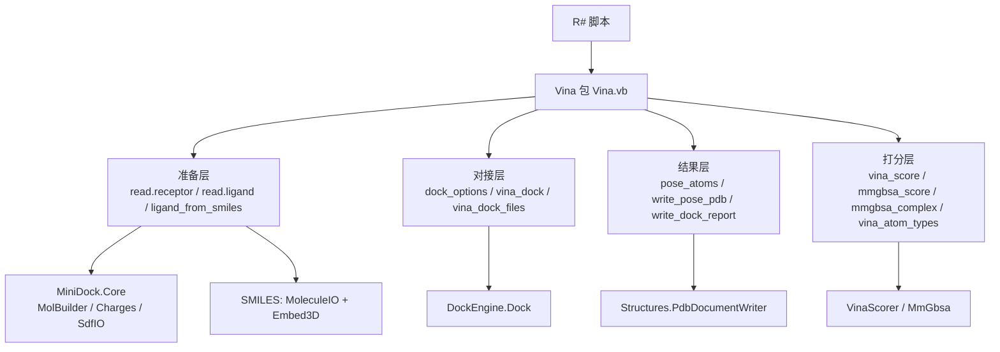

## 产品概述

把 MiniDock 的分子对接能力（受体/配体准备、Vina 打分对接、MM-GBSA / Nwat-MMGBSA 重打分、结果输出）导出为 R# 脚本可直接调用的 `Vina` 包 API，使脚本可以完成「读取结构 → 准备分子 → 设置搜索盒 → 对接 → 重打分 → 输出位姿 PDB 与 JSON 报告」的完整链路。

## 核心功能

- **结构与配体准备**：读取受体 PDB、读取配体（SDF/MOL/PDB 自动识别），也支持直接由 SMILES 结构式生成带 3D 坐标的对接用分子；自动完成原子类型分配与电荷分配
- **对接搜索**：可配置搜索盒中心与半宽、独立搜索次数、每次扰动步数、输出位姿数、位姿去重 RMSD 阈值、随机种子
- **一站式对接**：既支持「分步：准备 → 对接」，也支持「一步：给两个文件（或 SMILES）直接出结果」
- **MM-GBSA 重打分**：可对最优若干位姿做重打分，并支持 Nwat-MMGBSA 保留界面水；也可对复合物 PDB 的每个 MODEL 帧逐帧打分
- **低层打分**：单个复合物的 Vina 单点评分、原子类型参数表查询，便于脚本自行组合实验
- **结果呈现**：位姿以表格形式查看（排名、Vina 得分、分子间/内能、可旋转键数、MM-GBSA 各项分解），可导出位姿坐标表、位姿 PDB 文件与 JSON 对接报告；在控制台直接打印分子对象可看到原子数、类型构成与净电荷摘要

## 交互与呈现

- 脚本中打印受体/配体分子对象时输出一条紧凑摘要；打印对接结果时输出位姿表
- 所有文件读写失败、结构为空、配体缺少配体原子等情况均以可读的错误提示返回，不中断脚本

## 技术栈

- 语言/平台：VB.NET，.NET 10.0（沿用 `molecular_kit.vbproj` 现有配置）
- 宿主：R# 脚本运行时（`SMRUCC.Rsharp`，已被引用）
- 上游算法库：`MiniDock.vbproj`（`SMRUCC.genomics.Molecule.VinaDock.Core/.Model`）、`RCSB-PDB.vbproj`（结构读写与 PDB 写出）、`SMILES.vbproj`（SMILES 解析与 3D 坐标嵌入）
- 工程文件不改动：`molecular_kit.vbproj` 已引用上述全部项目

## 实现方案

采用与同工程 `molecular_tools.vb`、`pdbTools.vb` 完全一致的包编写范式：

1. 用 `<Package("Vina", Category:=APICategories.ResearchTools, Publisher:="xie.guigang@gcmodeller.org")>` 修饰 `Vina` 模块（保留文件已有包名）；
2. `Sub Main()` 中注册转换器与控制台格式化器：`VinaMolecule` → 原子表、`LigandResult` → 位姿表、`MmGbsaResult` → 单行表；并为这三者挂控制台格式化器；
3. 其余能力以 `<ExportAPI("...")>` 平铺导出，命名沿用 R# 习惯（`read.receptor`、`read.ligand`、`ligand_from_smiles`、`dock_options`、`vina_dock`、`vina_dock_files`、`pose_atoms`、`write_pose_pdb`、`write_dock_report`、`vina_score`、`mmgbsa_score`、`mmgbsa_complex`、`vina_atom_types`）。

关键决策与理由：

- **不重写算法**：全部对接、打分、MM-GBSA 逻辑复用 MiniDock；R# 层只做参数解析、流程编排、结果转表与错误包装，避免算法出现第二份实现。
- **重打分编排需在 R# 层复刻**：`DockEngine.Dock` 内部不执行 `DockOptions.Mmgbsa/Nwat/MmgbsaTop`，重打分是 MiniDock 命令行层逐位姿调用的编排逻辑，因此封装函数必须显式完成「位姿原子重建 → 电荷按序映射 → `MmGbsaRescore` → 回填 DTO」。
- **`dock_options` 构造器 + `vina_dock(options=)`**：与同工程 `chem_theme()` 的模式一致，脚本可复用同一套参数对象，同时 `vina_dock` 仍保留同名平铺参数以支持简写调用。
- **SMILES 配体走 `molecular` 包的能力**：`MoleculeIO.Parse` → `MoleculeGraph.Embed3D`（加氢 + 3D 嵌入）→ 转 `VinaMolecule`（原子元素/电荷/坐标 + 键级），再走与 SDF 相同的类型分配与 PEOE 电荷流程，保证与文件配体行为一致。
- **错误以 `Message` 返回**：所有入口先做空值/空结构/文件存在性校验，异常统一 `RInternal.debug.stop`，不让异常穿透脚本。

性能与可靠性：

- 受体重建打分网格是一次性 O(N) 构造成本，位于 `VinaScorer` 构造中；R# 层不做逐原子重复遍历，`as.data.frame` 均为单次线性遍历。
- `vina_score` 使用 `VinaScorer.Evaluate` 单点模式（传入空的扭转轴/分支数组与长度 6 的梯度数组），只计分子间项，避免重复实现配对循环。
- `mmgbsa_complex` 对多 MODEL 帧逐帧处理，帧数多时内存随帧数线性增长，采用「逐帧读取 → 打分 → 转表行」的流式写法，不缓存全部帧。
- 位姿 PDB 输出复用 `PdbDocumentWriter.Save(Of Atom)`，不自行格式化 PDB 文本。

## Implementation Notes（执行要点）

- **命名冲突**：用别名隔离上游命名空间（`Imports VinaCore = SMRUCC.genomics.Molecule.VinaDock.Core`、`Imports VinaModel = ...VinaDock.Model`、`Imports Structures = SMRUCC.genomics.Data.RCSB.PDB.Structures`），模块自身名为 `Vina`，`getMolecule` 之类通用名需加前缀避免歧义。
- **VB 保留字**：参数名不得使用 `dim`、`sub` 等关键字，必要时写成 `[dim]`。
- **类型约束**：`StructureIO.ReadPdb(Of T As {Atom, New}, TMol As {Molecule(Of T), New})` 必须写全两个泛型参数为 `VinaAtom, VinaMolecule`；`PdbDocumentWriter.Save(Of T As {Atom, New})` 传 `Molecule(Of Atom)`。
- **`VinaAtom.FromReceptor`**：配体侧原子必须置 `False`，受体侧保持默认 `True`，否则 MM-GBSA 与打分语义会错。
- **MM-GBSA 电荷映射**：位姿重建的 `VinaAtom` 电荷按「位姿原子下标 = 配体原子下标」映射，越界补 0，与 MiniDock 命令行行为保持一致。
- **JSON 报告**：`DockParameters.Weights` 取 `{-0.0356, -0.00516, 0.84, -0.0351, -0.587}`，`TemperatureMetropolis` 取 `Math.Round(293.15 * 0.001987, 4)`，序列化用 `JsonIgnoreCondition.WhenWritingNull`；输出目录不存在时自动创建。
- **文档注释**：每个导出函数写 `<summary>/<param>/<returns>/<example>`，XML 文档是 R# 帮助系统的数据来源。
- **影响面控制**：只新增 `Vina.vb` 内容，不改动 MiniDock/RCSB/SMILES 上游项目，不改工程文件，不动 `molecular_tools.vb` 与 `pdbTools.vb`。

## 架构设计



分层内参数解析（选项对象、路径、可选值默认）集中在私有帮助函数中，导出函数只做校验与编排。

## 目录结构

```
src/workbench/R#/molecular_kit/
└── Vina.vb   # [MODIFY] 唯一改动文件（当前为 6 行空骨架 <Package("Vina")> Module Vina）
              # 1) Imports 别名 + Package 特性 + Sub Main() 注册（VinaMolecule/LigandResult/MmGbsaResult 的 dataframe 转换与控制台格式化）
              # 2) 准备层：readReceptor / readLigand / ligandFromSmiles；私有 prepareReceptor / prepareLigand / moleculeFromSmiles
              # 3) 对接层：dockOptions / vinaDock / vinaDockFiles；私有 getDockOptions(args|参数, env)、rescoreMmgbsa(receptor, ligand, result, opts)
              # 4) 结果层：vinaToFrame / poseAtoms / writePosePdb / writeDockReport；私有 poseToMolecule
              # 5) 打分层：vinaScore / mmgbsaScore / mmgbsaToFrame / mmgbsaComplex / vinaAtomTypes
              # 要求：全部导出函数带 XML 文档与 <example>；空输入/文件缺失返回 Message；不吞掉算法异常而是包装为可读消息
```

## Key Code Structures

```
' 对接参数对象构造器（脚本可复用）
<ExportAPI("dock_options")>
Public Function dockOptions(Optional exhaustiveness As Integer = 8,
                            Optional steps_per_run As Integer = 30,
                            Optional num_modes As Integer = 9,
                            Optional min_rmsd As Double = 1.5,
                            <RRawVectorArgument> Optional box_center As Object = Nothing,
                            Optional box_half As Double = 12.0,
                            Optional seed As Integer = 0,
                            Optional mmgbsa As Boolean = False,
                            Optional nwat As Integer = 0,
                            Optional mmgbsa_top As Integer = 3,
                            Optional env As Environment = Nothing) As Object

' 核心对接（分步调用）
' 返回值：VinaModel.LigandResult，或 Message
Public Function vinaDock(receptor As VinaCore.VinaMolecule,
                         ligand As VinaCore.VinaMolecule,
                         options As Object, args As list, env As Environment) As Object

' JSON 报告组装（复用 Model.DockReport / DockParameters）
Private Function buildReport(result As VinaModel.LigandResult,
                             opts As VinaCore.DockOptions,
                             receptorAtoms As Integer,
                             mode As String) As VinaModel.DockReport
```

## Agent Extensions

### SubAgent

- **code-explorer**
- Purpose: 在编写 `Vina.vb` 之前，用 medium 力度复核 MiniDock、RCSB-PDB、SMILES 三处被调用成员的精确签名（`DockEngine.Dock/MmGbsaRescore`、`VinaScorer.Evaluate`、`Charges`、`SdfIO.ReadSdf`、`StructureIO.ReadPdb(Of T,TMol)`、`PdbDocumentWriter.Save`、`MoleculeGraph.Embed3D`），避免实现期猜测导致反复返工
- Expected outcome: 一份「类型全名 + 方法签名 + 文件路径:行号」的核对清单，使 `Vina.vb` 首轮编译即通过