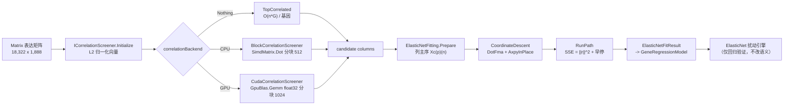

## 产品概述

针对大规模基因表达矩阵（约 18,322 基因 × 1,888 样本）上弹性网络（elastic net）调控网络拟合耗时长的问题做系统性性能优化，在保证数值结果可对拍的前提下，把单次全量拟合从小时级压缩到分钟级，并为后续更大规模数据预留 GPU 加速通道。

## 核心功能

- **单基因求解器提效**：把设计矩阵改为列主序连续存储，坐标下降的内积与残差更新改走核心库已有 SIMD 算子，消除跨行访问与重复拷贝。
- **路径求解提效**：用残差平方和直接给出每步 R²，并在非零系数超出上限时提前结束正则化路径，避免跑满整条 alpha 网格。
- **候选筛选提效**：把"每个基因各自扫全表算相关"改为一次分块矩阵乘法得到全局相关，再按行取 top-k；筛选结果与原有逻辑等价。
- **可选 GPU 加速**：相关筛选支持 float32 GPU 分块矩阵乘后端；无可用显卡、显式关闭或初始化失败时自动回退 CPU，结果集合保持一致。
- **默认参数调整**：每个目标基因的候选调控因子数 1000→300、alpha 步数 50→20，开箱即用即获得主要收益。
- **可观测性**：输出单基因平均耗时、总耗时、分配字节数、实际执行的路径步数、top-k 筛选阶段耗时，便于判断优化是否生效。

## 边界与约束

- `ElasticNetFitting` 等求解器的**公开方法签名与默认行为语义保持不变**（仅内部布局与实现变化）；已有的调用方不需要改动。
- 关闭新开关（`correlationBackend = Nothing`、`gpu = FALSE`）时，候选集合与拟合结果与优化前逐位一致。
- 不改变扰动引擎 `ElasticNet`（CellPhenotype）的任何既有语义。
- GPU 侧只做相关筛选，不实现坐标下降的 CUDA 内核。

## 技术栈

- 语言/运行时：VB.NET / .NET 10.0（沿用现有工程，不改目标框架）。
- 求解器：`runtime/sciBASIC#/Data_science/Mathematica/Math/ElasticNet`（`ElasticNetFitting` / `ElasticNetPath` / `ElasticNetFit`）。
- SIMD：`Microsoft.VisualBasic.Core` 的 `Microsoft.VisualBasic.Math.SIMD` 命名空间，**复用已有算子，不另写一套向量代码**。
- GPU：`ILCuda`（`CudaEngine`、`DeviceBuffer(Of T)`、`GpuBlas.Gemm`、`LaunchPlanner`、`KernelSources`）。
- 上层：`Network.Regulons`（GRN 拟合与候选筛选）、`TRNtoolkit`（R# 导出）、`CellPhenotype`（扰动引擎，仅回归验证）。
- 无新增第三方依赖。

## 实现思路

### 关键决策 1：列主序 + 零冗余拷贝（P0）

当前 `ElasticNetData.X` 是行主序 `(n)(p)`，坐标下降里的 `rho += X(i)(j) * residual(i)` 是跨行访问，每次跳到另一个 8 KB 之外的缓存行，且 JIT 无法向量化。改为列主序 `Xc(p)(n)`（每列一个长度 n 的连续 `Double()`）后：

```
rho_j  = SIMDIntrinsics.DotFma(Xc(j), residual)          ' 连续 + FMA
residual = SIMDIntrinsics.AxpyInPlace(-delta, Xc(j), residual)
sse    = SIMDIntrinsics.SumSquaresFma(residual)
```

同时新增 `Prepare(vectors As Double()(), y, columns As Integer(), standardize)` 入口，直接从表达矩阵的列构建标准化缓冲，**不再经过** `BuildDesign`→`ToRows`→`Prepare` 的三次 n×p 拷贝（18,322 基因 × 15 MB ≈ 276 GB 分配）。旧入口保留，公开签名不变。

### 关键决策 2：R² 与路径早停（P0）

- 收敛后 `SSE = ‖residual‖²`，每步 O(n) 而非 O(n·p)（省掉每个 alpha 一次 1.9 M 乘加）。
- 非零系数个数随 alpha 减小单调不减，而 `PickPathStep` 只要"非零 ≤ maxFeatures 的最后一步"，因此在 `nonZero > 2 × maxFeatures` 时即可终止路径（留一倍余量给 `EnforceMaxFeatures` 裁剪）。安全性由"早停解 = 跑满解的同一 step"逐基因断言保证。
- `BackTransform` 只对最终选中步执行，`beta`/`residual` 缓冲复用。

### 关键决策 3：候选筛选抽象（P1/P2）

新增 `ICorrelationScreener`（`Initialize` + `Query(target, topK, minAbsR)`），`GrnFittingOptions.correlationBackend` 为空即走原 `TopCorrelated`（逐位一致）。两种实现：

- `BlockCorrelationScreener`（CPU）：对已 L2 归一化的向量分块做 `SimdMatrix.Dot`（512 行一块，结果 512×18,322 ≈ 75 MB），每行取 |r| top-k 并按 `minAbsR` 过滤、排除自身，把 18,322 次全表扫描降为一次 GEMM。
- `CudaCorrelationScreener`（GPU，独立工程）：float32 上传（约 138 MB 可常驻），按 1024 行分块 `GpuBlas.Gemm`，主机端取 top-k；`TryCreate()` 失败（无卡/显存不足/nvcuda 缺失）返回 `Nothing`，调用方自动回退。

### 关键决策 4：默认参数 300 / 20

`elasticNet.maxCandidates` 1000→300、`numberOfAlphas` 50→20（R# 与 `elastic_fit.R` 同步）。成本对 p 线性、对 alpha 步数线性，这两项在无任何低层改造时即可带来约 6~8 倍收益；用户已接受结果不再逐位复现。

### 性能预期（18,322 × 1,888，50/20 alpha）

| 阶段 | 现状 | P0 | P0+P1 | P0+P1+GPU |
| --- | --- | --- | --- | --- |
| 单基因求解 | ~1 s 量级 | 8~15× | 8~15× | 8~15× |
| 候选筛选（全局） | 634 G 乘加、每基因重复 | 不变 | 一次 GEMM，~10× | ~3× 于 CPU GEMM |
| 端到端 | 数小时 | 十几分钟 | 数分钟 | 数分钟（同量级，留扩展余量） |


瓶颈说明：改造后主导项是 `O(Steps × nnz)` 的坐标下降，属 SIMD 友好的连续访存，CPU 已接近内存带宽上限；GPU 的收益集中在相关性筛选这一"纯 GEMM"阶段，因此不在 CD 上做 CUDA 内核。

## 实现注意

- **公开签名不变**：`ElasticNetFitting.Fit` / `RegularizationPath` / `CrossValidate` 的参数与返回类型保持不变；`ElasticNetData` 是 `Friend`，布局改造封闭在 `ElasticNet.vbproj` 内。
- **SIMD 算子只有 `Double()` 重载**（无 Span），因此列主序必须是"每列一个 `Double()`"，不能传二维数组切片。
- **能力探测**：`SIMDIntrinsics` 内部已按 `SimdCapabilities.IsFma` 回退到 `SimdReduce`；调用方无需分支，但新增算子必须遵守同一约定。
- **早停边界**：`maxFeatures <= 0`（不限制）时不早停；`maxFeatures` 很小时至少执行 2 步，避免 alpha_max 处全零导致误判。
- **线程安全**：`ICorrelationScreener` 初始化后只读，`Query` 可被 `Parallel.For` 并发调用；`Initialize` 只在 `Fit()` 前调用一次，`Dispose` 由 `Fit()` 的 `Try/Finally` 负责。
- **GPU**：`GpuBlas.Gemm` 目前仅支持 `Single()`，且矩阵存储顺序需按其 CUDA 源码确认（A 为 m×k、B 为 k×n）；上传前把中心化/归一化的向量按所需布局排列；分块控制在 1024×18,322（75 MB）以内；所有失败路径必须回退而不是抛出。
- **内存**：列主序缓冲每基因 n×p 仍是 15 MB，但改为一次分配 + 复用（`beta`/`residual` 缓存），不再跨 alpha 重新分配。
- **性能测量**：必须在 `-c Release` 下进行；Debug 下 SIMD 未优化，结论无效。
- **工程注册**：新工程需同时加入 `GCModeller.slnx` 与 `GCModeller/models/Networks/RegulonNetwork.slnx`，否则 CI 不构建。
- **文档注释**：`GenerateDocumentationFile=True`，所有新增 Public 成员需 XML 注释（内部不能出现 `--`）。
- VB 陷阱：`Step`/`Next`/`Call`/`Index` 为保留字；局部变量不得与函数名仅大小写不同（曾因 `Norm` vs `norm` 报 BC30690）；`ReadOnly` 字段只能在构造函数赋值；`Module` 成员不能 `Shared`；`Math` 可能被同名模块遮蔽。

## 架构设计



### 模块划分

- **求解器内核模块**（`ElasticNet` 工程）：列主序数据容器、SIMD 坐标下降、路径求解与早停、结果回填。
- **候选筛选模块**（`Network.Regulons`）：`ICorrelationScreener` 契约、默认实现（原逻辑）、CPU 分块 GEMM 实现。
- **GPU 后端模块**（新增 `Network.Regulons.Cuda`）：float32 相关筛选实现与 `TryCreate` 回退工厂。
- **接线模块**（`TRNtoolkit` + `elastic_fit.R`）：`gpu` 开关、默认参数 300/20。

## 目录结构

```
g:/GCModeller/src/
├── runtime/sciBASIC#/Data_science/Mathematica/Math/ElasticNet/
│   ├── ElasticNetFitting.vb        [MODIFY] `ElasticNetData` 增加列主序 `Xc(p)(n)` 字段；
│   │                                        新增 `Prepare(vectors, y, columns, standardize)` 入口（直接读源列，不再经
│   │                                        BuildDesign/ToRows 三次拷贝）；`CoordinateDescent` 改用
│   │                                        `SIMDIntrinsics.DotFma` / `AxpyInPlace` / `SumSquaresFma`；
│   │                                        `RunPath` 用 `SSE=||r||^2` 计算 R²、按 `nonZero > 2*maxFeatures` 早停；
│   │                                        `BackTransform` 仅对选中步执行、复用 `beta`/`residual` 缓冲
│   └── ElasticNetPath.vb           [MODIFY] 新增 `Steps` / `StoppedEarly` 只读属性，暴露实际执行的路径步数
│
├── GCModeller/models/Networks/Network.Regulons/LinearRegression/
│   ├── GrnOptions.vb               [MODIFY] `maxCandidates` 默认 -1 保持；新增 `correlationBackend As ICorrelationScreener`
│   │                                        （默认 Nothing，等价旧行为）与 `screenerTopK` 说明
│   ├── GeneRegulatoryNetwork.vb    [MODIFY] `FitGene` 在 `correlationBackend` 非空时改调 `Query`；
│   │                                        `Fit()` 的 Try/Finally 中 Initialize/Dispose 后端；
│   │                                        `FitElasticNet` 走新的列主序 `Prepare` 入口
│   ├── ICorrelationScreener.vb     [NEW]    接口（Initialize/Query/Dispose）+ `DefaultCorrelationScreener`
│   │                                        （包装现有 `TopCorrelated`，用于逐位回退对比）
│   └── BlockCorrelationScreener.vb [NEW]    CPU 分块 GEMM 实现：按 512 行分块 `SimdMatrix.Dot`，
│                                            每行取 |r| top-k、`minAbsR` 过滤、排除自身；结果集合需与
│                                            `DefaultCorrelationScreener` 一致
│
├── GCModeller/models/Networks/Network.Regulons.Cuda/        [NEW PROJECT]
│   ├── Network.Regulons.Cuda.vbproj                         引用 Network.Regulons + ILCuda
│   └── CudaCorrelationScreener.vb                            float32 上传 + 1024 行分块 `GpuBlas.Gemm` +
│                                                             主机端 top-k；`TryCreate()` 失败返回 Nothing
│
├── GCModeller/models/Networks/RegulonNetwork.slnx             [MODIFY] 注册新工程
├── GCModeller.slnx                                            [MODIFY] 注册新工程
│
├── workbench/R#/TRNtoolkit/Linear.vb   [MODIFY] `elastic_net` 的 `candidates` 1000→300、`alphas` 40→20；
│                                                 新增 `gpu = FALSE` 参数：TRUE 时 `CudaCorrelationScreener.TryCreate()`，
│                                                 为空打印 warning 并回退；TRNtoolkit.vbproj 引用新工程
└── K:/hsa_grn/20261021/elastic_fit.R   [MODIFY] `--candidates` 300、`--alphas` 20，新增 `--gpu` 并透传
```

## 关键代码结构

```
' Network.Regulons/LinearRegression/ICorrelationScreener.vb
''' <summary>候选调控因子的相关性筛选后端。</summary>
Public Interface ICorrelationScreener : Inherits IDisposable
    ''' <summary>一次性注入向量（已按需要做中心化/归一化），之后 Query 只读且可并发调用。</summary>
    Sub Initialize(vectors As Double()())
    ''' <summary>返回与 target 相关性绝对值最大的 topK 个基因行号（排除 target 自身，按 |r| 降序）。</summary>
    Function Query(target As Integer, topK As Integer, minAbsR As Double) As Integer()
End Interface
```

```
' ElasticNet/ElasticNetFitting.vb（内部结构，Friend）
Friend Class ElasticNetData
    Friend N As Integer
    Friend P As Integer
    ''' <summary>标准化之后的特征矩阵，列主序：Xc(j)(i) 表示第 j 列第 i 个样本。</summary>
    Friend Xc As Double()()
    Friend Y As Double()
    Friend Means As Double()
    Friend Scales As Double()
    Friend ColumnScale As Double()
    Friend YMean As Double
End Class
```

```
' Network.Regulons/LinearRegression/GrnOptions.vb（新增字段）
''' <summary>候选筛选后端；为空时使用内置的 TopCorrelated（行为与原实现逐位一致）。</summary>
Public Property correlationBackend As ICorrelationScreener = Nothing
```

## SubAgent

- **code-explorer**
- Purpose: 在改造 `ElasticNetFitting` 内部结构（行主序 → 列主序）与新增 `ICorrelationScreener` 之前，穷举确认 `ElasticNetFitting` / `ElasticNetData` / `TopCorrelated` 的全部调用点（含 `Network.Regulons`、`Moira`、`GPS`、`test` 工程、R# 导出层与 `_smoketest`），避免破坏共用契约与漏改消费者。
- Expected outcome: 一份"文件绝对路径 + 行号 + 用途"的调用点清单，明确哪些调用方依赖 `X` 的行主序布局、哪些只用公开方法；据此确定列主序改造的最小封闭范围，以及新工程与 R# 接线需要同步修改的文件集合。