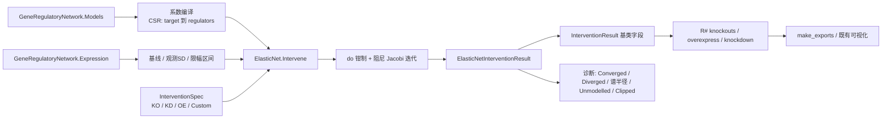

## 用户需求

在 CellPhenotype 项目中，为基于 Elastic Net 推断出的基因调控网络（`GeneRegulatoryNetwork`）实现虚拟扰动引擎，把当前仅有空桩实现的 `ElasticNet` 类变成可用于计算敲除、敲降、过表达实验的扰动模型，并实现 BNLearn 的 `InsilicoPerturbationExperiment` 接口，使 R# 既有 API（`knockouts`、`overexpress`、`knockdown`）可直接调用。

## 产品概述

将“每个基因一条线性回归方程”的调控网络视为可干预的系统：对任意基因施加扰动后，计算网络达到稳态时全部基因的表达变化，输出与贝叶斯网络扰动实验同构的结果对象，可直接进入既有的结果导出与可视化流程。

## 核心功能

- 三种扰动语义（乘性比例）：敲除表达量归零；敲降保留指定比例（默认 20%）；过表达提升到默认 3 倍基线；另支持自定义目标值。
- 传播方式：默认沿调控边级联至稳态，且被扰动基因被锁定、不被上游回补；同时给出仅一阶直接效应的结果用于对照。
- 结果指标：野生型基线、扰动后表达、变化量、百分比变化、标准化效应量、显著性标记、受影响基因数、逐步变化轨迹。
- 不确定性：可指定抽样次数，按各基因回归残差标准差加入噪声并重复抽样，由分布计算扰动后均值与显著性。
- 诊断信息：是否收敛、是否发散、系数矩阵谱半径、被限幅的基因、从未作为调控因子出现的基因（避免被误读为“无调控”）。
- 鲁棒性：目标基因不在网络中时，严格模式报错，非严格模式降级返回野生型并标记未定义（与既有引擎一致）。
- 兼容性：结果对象与现有贝叶斯网络扰动结果结构一致，既有导出器与前端可视化无需改动即可消费。

## 技术栈

- 语言与运行时：VB.NET / .NET 10.0（沿用 `CellPhenotype.vbproj`，`OptionStrict Off`、`GenerateDocumentationFile=True`）。
- 上游模型：`SMRUCC.genomics.Model.Network.Regulons.LinearRegression.GeneRegulatoryNetwork` / `GeneRegressionModel`（`Network.Regulons.vbproj`，已被 `CellPhenotype.vbproj` 引用）。
- 契约层：`SMRUCC.genomics.Analysis.BNLearn.InsilicoPerturbationExperiment` 与 `Intervention.InterventionResult` / `InterventionSpec` / `InterventionMode`（`BNLearn.vbproj`，已被引用）。
- 无新增第三方依赖；不修改 BNLearn 任何文件，不修改 `InterventionResult` 定义。

## 实现思路

将每个基因的回归方程 `x_t = c_t + Σ_r β_{t,r}·x_r` 作为结构方程，用 Pearl 的 do 算子实现干预：被扰动基因在每一轮迭代中被强制回设为目标值（等价于删除其入边），其余基因按 Jacobi 迭代求解干预后的稳态。

```
x_t^(k+1) = x_t^(k) + λ · [ (c_t + Σ_r β_{t,r}·x_r^(k)) − x_t^(k) ]
```

由于所有模型都带截距且在同一批样本上最小二乘拟合，样本均值本身就是近似不动点，因此以基线起步的迭代等价于对 Δ 做 `Δ^(k+1) = B·Δ^(k)`，第 1 步即为一阶直接效应，后续步为多跳传播。

### 关键决策与权衡

1. **乘性扰动语义**（用户已确认）：KO 为 0、KD 为 `residual × baseline`、OE 为 `fold × baseline`。不使用 `InterventionSpec.GetInterventionValue` 的 mean±k·SD 公式，因为线性尺度下 `mean − 2·SD` 会产生负表达。代价是与 bnlearn 引擎数值不可直接横向对比，已在 XML 注释中注明。
2. **默认级联 + 可选一阶**：级联是对 BN 引擎“按拓扑序一次性联合采样”在线性有环图上的等价物；`Steps = 1` 或 `Propagation = OneHop` 退化为一阶。两种结果同时返回（`FirstOrderDelta`），便于判断多跳贡献。
3. **阻尼 + 发散保护**：横截面数据拟合出的 B 不保证 `ρ(B) < 1`（近共线链上 β 可接近 1），因此迭代必须带阻尼、步数上限、NaN/溢出检测与观测区间限幅；发散时不返回 NaN，而是回退到一阶结果并置 `Diverged = True`。
4. **双坐标系**：系数所在空间（`standardize=False` 为原始表达量，`True` 为 z-score）与报告空间（恒为原始表达量）严格分离；换算锚点为 `Expression` 的行均值与样本标准差（ddof = n−1，与 `Standardize` 一致）。否则 R# 导出表与热图量纲会错乱。
5. **直接遍历 `Models` 而非 `Regulations()`**：后者会按 `minAbsWeight`/pvalue 过滤并去重，破坏扰动计算；`Models.regulators` 含全部候选（未选中者权重为 0），只在编译系数表时剔除 `|β| = 0`。
6. **一次性编译为 CSR 系数表**：`Intervene` 热路径只访问局部数组，复杂度 `O(Steps × nnz)`，内存 `O(n + nnz + Steps × n)`；20k 基因 × 50 步在毫秒到秒级，支持并发多次调用（无共享可变状态）。
7. **结果对象继承而非复制**：新增 `ElasticNetInterventionResult : Inherits InterventionResult` 承载诊断字段，接口仍返回基类，`InterventionComparisonExporter` 等既有消费者无需改动。

## 实现注意

- `ElasticNet.vb` 当前**没有 Namespace 声明**，实际全名为 `SMRUCC.genomics.Analysis.CellPhenotype.ElasticNet`（由 RootNamespace 提供）。保持这一形态，不要新增 Namespace，否则 R# 反射类型名会变。
- 类名 `ElasticNet` 与库命名空间 `Microsoft.VisualBasic.Data.Bootstrapping.ElasticNet` 同名，本文件**禁止** Import 后者，否则二义。
- `Regulations()` 的 `pvalueCutoff` 对 ElasticNet 恒为 1，与此无关；本引擎不使用它。
- `GeneRegressionModel.rmse = Sqrt(sse / N)`，为 0 或 NaN 时噪声项退化为 0。
- 常基因（样本标准差为 0）：`Standardize` 会把它变成全零向量，z↔raw 换算必须守卫除零。
- `Models` 中 `IsValid = False` 的基因按“无模型”处理（保持基线），在诊断字段中报告，不抛异常。
- 候选池截断（`maxCandidates` 默认 1000、`maxRegulatorsPerGene` 默认 20）导致部分基因从未成为调控因子；这类基因的扰动效应恒为 0，必须写入 `UnmodelledRegulatorGenes`，不能静默。
- `nSamples` 的蒙特卡洛代价为 `nSamples × Steps × nnz`，`Steps` 是上限且带收敛提前退出；`nSamples` 小于等于 0 时走确定性路径（R# 的 `knockouts` 不传该参数，即恒为 0）。
- `DynamicTrajectory` 必须是 `Double(步骤数, nGene−1)()`，每个元素为长度 1 的数组，与 `BnInterventionAnalyzer.DynamicIntervention` 完全一致；由 `RecordTrajectory` 开关控制以节省内存。
- `InterventionResult.ToString()` / `GetTopChangedGenes()` / `NAffected` 会直接读 `Spec`、`GeneNames`、`FoldChanges`、`IsSignificant`，返回前这些数组必须全部非空且长度一致。
- 构建验证时加 `-p:GeneratePackageOnBuild=false`，避免触发 NuGet 打包。
- VB 陷阱：`Step`、`Next`、`Call`、`Index`、`Error` 为保留字；局部变量不得与所在函数名仅大小写不同；XML 注释内不得出现连续两个减号；`Math` 可能被同工程同名模块遮蔽，必要时写 `System.Math`。

## 架构设计



调用链：R# `knockouts(model, genes)` 对每个基因调用 `KnockoutGene`，后者构造 `InterventionSpec` 并转入统一的 `Intervene(spec, nSamples)`。

## 目录结构

```
G:\GCModeller\src\GCModeller\
├── models\Networks\Network.Regulons\LinearRegression\
│   └── GeneRegulatoryNetwork.vb      # [MODIFY] 仅新增只读访问器
└── sub-system\CellPhenotype\
    └── ElasticNet.vb                 # [MODIFY] 整体实现扰动引擎
```

- `GeneRegulatoryNetwork.vb` [MODIFY]：在现有 `Genes` / `Size` / `Options` 属性区附近追加 `Expression As Matrix`（返回 `raw`）、`Vectors As Double()()`（返回 `vectors`，standardized 时为 z-score）、`Baseline As Double()`（`vectors` 的样本均值，standardized 时约为 0）、`BaselineSD As Double()`（`vectors` 的样本标准差，ddof = n−1，standardized 时为 1）。后两者惰性计算并缓存在 `Private` 字段中，纯增不改，`Fit()`、`Regulations()`、`CoefMatrix()` 行为不变，全部成员带 XML 注释。
- `ElasticNet.vb` [MODIFY]：文件内依次定义 `PropagationMode` 枚举、`ElasticNetPerturbationOptions`、`ElasticNetInterventionResult`、`ElasticNet` 主类。主类负责：构造时编译 CSR 系数表与 raw/模型双坐标系缓存；`Intervene` 做扰动取值、do 钳制、阻尼级联、一阶效应、限幅与收敛诊断；`nSamples` 大于 0 时做高斯残差蒙特卡洛并聚合分布；最后装配 `InterventionResult` 全部字段。另提供组合扰动、`SimulateCascade`、`EstimateSpectralRadius`（20 次幂迭代，结果缓存）。

## 关键代码结构

```
Public Enum PropagationMode
    Cascade
    OneHop
End Enum

Public Class ElasticNetPerturbationOptions
    Public Property Propagation As PropagationMode = PropagationMode.Cascade
    Public Property Steps As Integer = 50
    Public Property Damping As Double = 1.0
    Public Property Tolerance As Double = 1.0E-06
    Public Property KnockdownResidual As Double = 0.2
    Public Property OverexpressionFold As Double = 3.0
    Public Property ClampToObserved As Boolean = True
    Public Property SignificanceZ As Double = 0.5
    Public Property RecordTrajectory As Boolean = True
    Public Property RandomSeed As Integer = 42
End Class

Public Class ElasticNetInterventionResult : Inherits InterventionResult
    Public Property FirstOrderDelta As Double()
    Public Property Steps As Integer
    Public Property Converged As Boolean
    Public Property Diverged As Boolean
    Public Property SpectralRadius As Double
    Public Property ClippedGenes As String()
    Public Property UnmodelledRegulatorGenes As String()
    Public Property InterventionValue As Double
    Public Property Standardized As Boolean
End Class

Public Class ElasticNet : Implements InsilicoPerturbationExperiment
    Public Sub New(net As GeneRegulatoryNetwork, Optional options As ElasticNetPerturbationOptions = Nothing)
    Public Sub New(expr As Matrix, Optional grnOptions As GrnFittingOptions = Nothing,
                   Optional options As ElasticNetPerturbationOptions = Nothing)
    Public ReadOnly Property Network As GeneRegulatoryNetwork
    Public Property Strict As Boolean = True
    Public Property Baseline As Double()
    Public Function Intervene(spec As InterventionSpec, Optional nSamples As Integer = 0) As InterventionResult
    Public Function Intervene(specs As IEnumerable(Of InterventionSpec), Optional nSamples As Integer = 0) As InterventionResult
    Public Function SimulateCascade(spec As InterventionSpec, steps As Integer) As InterventionResult
    Public Function EstimateSpectralRadius() As Double
End Class
```

## 边界与异常处理

- 目标基因不在 `Network.Genes` 中：`Strict = True` 抛 `MissingMemberException`；`False` 时打印警告、返回野生型副本并置 `Undefined = True`（对齐 `BnInterventionAnalyzer`）。
- `Steps` 小于 1 按 1 处理；`Damping` 夹到 (0, 1]；`KnockdownResidual` 夹到 [0, 1)。
- 迭代出现 NaN/Inf 或超出观测区间外扩阈值：中止、`Diverged = True`、以 `FirstOrderDelta` 回填结果。
- `Custom` 模式下 `spec.Value` 视为原始尺度绝对值，负值按 0 处理。
- 空 `specs` 集合抛 `ArgumentException`；重复基因名合并为同一钳制集合。

## 验证方案

- `dotnet build GCModeller\models\Networks\Network.Regulons\Network.Regulons.vbproj -c Debug -p:GeneratePackageOnBuild=false` 与 `dotnet build GCModeller\sub-system\CellPhenotype\CellPhenotype.vbproj -c Debug/Release -p:GeneratePackageOnBuild=false`：0 错误、0 新增警告。
- 在系统临时目录（不进入仓库）建一个一次性控制台程序引用编译产物，跑完即删：

1. 解析网络 `t = c + β·g`：敲除 g 后一阶结果须等于 `−β × baseline_g`；
2. 链式 `g 到 a 到 b`：`Steps = 2` 时 `Δb` 约等于 `β_ab × β_ga × Δg`；
3. 无出边基因扰动：全部 `Δ` 为 0，且该基因出现在 `UnmodelledRegulatorGenes`；
4. 人为构造 `β = 1.2` 的强正反馈环：确认 `Diverged = True` 且结果中无 NaN；
5. 结果结构：`ToString()`、`GetTopChangedGenes(5)`、`NAffected` 均正常，`GeneNames` 长度与各数组一致。