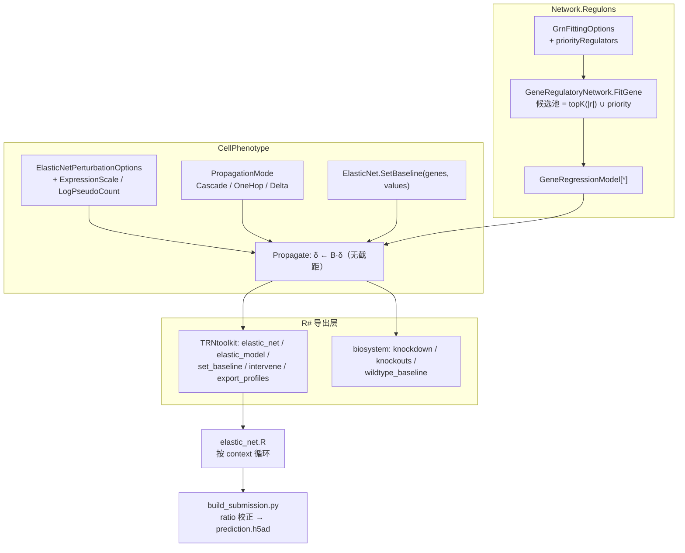

## 产品概述

让基于弹性网络（elastic_net）拟合出的线性基因调控网络，真正可以用于 VCC 2026 的虚拟敲降实验：给定任一细胞背景（context）的未扰动表达谱，预测 300 个 CRISPRi 敲降靶基因在下游基因上的表达变化，产出可直接进入提交流程的结果矩阵。

## 核心功能

- **按表达数值空间正确施加扰动**：训练矩阵是取过对数的表达值，敲降/过表达必须在反变换后的线性空间按比例换算再变换回来；敲除目标为 0。
- **按外部背景条件化**：可以把 context 的未扰动表达谱作为基线注入模型，三个 context 得到三套不同结果。
- **结果与背景无关的净效应**：只用"扰动后减去同背景下的对照"的差值传播，消除模型把外部背景拉回自身平均水平带来的系统性偏移。
- **时间/资源可控**：批量敲降 300 个基因时，单个基因缺失不会中断整批作业，并显式报告被跳过的基因。
- **紧凑结果导出**：直接输出"基因 × 扰动条件"的矩阵，而不是十张 CSV；不再需要为每个扰动生成整套差异分析表。
- **候选调控因子优先**：转录因子列表作为候选池的"优先项"而非"限制项"，保证非转录因子的敲降仍然有下游响应。
- **诊断可见**：收敛性、系数矩阵谱半径、被限幅的基因、没有任何出边（不会产生下游变化）的基因都会被如实报告。

## 边界与约束

- 不改变现有默认行为：不显式指定时，仍按线性空间、级联传播、严格模式运行。
- 不影响贝叶斯网络、GPS、GEARS 等共用同一扰动结果结构的其它引擎。
- 线性模型只给出平均效应，不产生单细胞异质性；提交所需的按细胞计数需在下游由对照细胞重采样得到。

## 技术栈

- 语言/运行时：VB.NET / .NET 10.0（沿用现有工程，不改目标框架）
- 涉及工程：`Network.Regulons.vbproj`、`CellPhenotype.vbproj`、`workbench/R#/TRNtoolkit`、`workbench/R#/biosystem`
- 脚本层：R#（`R#.exe`）+ 已有的 Python 提交构建脚本
- 无新增第三方依赖；不修改 BNLearn 的 `InterventionResult`/`InterventionSpec`

## 实现思路

线性模型 `x_t = c_t + Σ β_{r,t}·x_r`（系数空间与训练矩阵一致，即 `log2(y+1)`）本身可以做事后干预推理，但当前实现有三处会在 VCC 数据上失真的地方，逐一用**默认关闭的新选项**修掉：

### 关键决策 1：表达式尺度（修正 log 空间的敲降语义）

在 `ElasticNetPerturbationOptions` 增加 `ExpressionScale { Linear, Log2Plus1 }` 与 `LogPseudoCount`（默认 `Linear`/`1.0`，完全向后兼容）。扰动目标值改为"反变换 → 施加比例 → 变换回去"：

```
y   = if Log2Plus1: max(0, 2^x - pseudo) else x
tgt = Knockout→0 | Knockdown→residual*y | Overexpression→fold*y | Custom→spec.Value
x'  = if Log2Plus1: log2(max(0, tgt) + pseudo) else tgt
```

对照：`x=8`（≈255 CPM）时 80% 敲降的真实目标值是 `log2(0.2·255+1)=5.68`，当前实现给 `0.2·8=1.6`，Δ 被放大 2.8 倍；敲除在 `log2(y+1)` 空间恰好正确，过表达同理严重偏大。

### 关键决策 2：Δ 传播模式（消除 context 漂移）

新增 `PropagationMode.Delta = 2`：以 `δ=0` 起步，被扰动基因钳制 `δ_g = target − baseline_g`，迭代 `δ ← B·δ`（**不含截距**），输出 `MutantMeans = baseline + δ`。

依据：级联 `x ← c + Bx` 对两个同起点运行做差满足 `Δ(k+1)=B·Δ(k)`，所以"只迭代 Δ"与"跑一次无扰动对照再相减"严格等价，且免疫外部 context 的回归到均值漂移（该漂移在训练均值处为 0，换外部背景后不为 0）。复杂度不变：`O(Steps × nnz)`。

配套必须同步修正三处：中心化限幅要在绝对量 `baseline+δ` 上判断、蒙特卡洛要把 `baseline` 加回再换算回原始尺度、轨迹记录同理。

### 关键决策 3：基线对齐下沉到引擎

`Baseline` 当前要求长度严格相等，R# 侧无法方便地传"命名向量"。新增 `SetBaseline(genes As String(), values As Double())`：按 `Genes` 做大小写不敏感对齐，缺失基因保留训练均值（不抛异常），多余基因忽略。R# 的两个导出（TRNtoolkit 与 bnlearn 的 `wildtype_baseline`）共用它。

### 关键决策 4：TF 是"优先"不是"限制"

`GrnFittingOptions` 新增 `priorityRegulators As String()`；`FitGene` 在 `TopCorrelated` 之后把这些基因追加进候选集（排除 target 自身、去重）。理由：300 个扰动靶点里大部分不是 TF，若用既有 `regulators`（语义是"限定"）把候选池压到约 1.6k 个 TF，非 TF 基因将没有任何出边，敲降它们时除自身外全基因组 Δ 恒为 0，会毁掉约 80% 的预测。代价是单基因候选数略增（`maxCand + |priority|`），可接受。

### 关键决策 5：紧凑导出

`make_exports` 面向人工审阅（10 张 CSV，300 条件约数百 MB~GB）。新增 `export_profiles(model, genes, file)` 直接写 `Gene, control, cond1..condN`，以及 `profiles_matrix(model, genes)` 返回 `Matrix`，供提交脚本直接消费。

## 架构设计



## 实现注意

- `Propagate` 新增 `deltaMode` 分支时，`clamps` 字典继续以**绝对模型空间值**传入，函数内部自行换算为 `δ`，避免调用方出现两套约定。
- `InterveneCore` 中 `mutantMeans = ToRaw(final)` 在 Delta 模式下必须是 `ToRaw(modelBaseline + final)`；发散回退路径（`AddDelta(baseline, firstOrder)`）本身就是 delta 语义，保持不变。
- `RunMonteCarlo` 在 Delta 模式下 `ToRaw` 之前要加回 `modelBaseline`，否则野生型/突变型会出现 `rawMean` 级的偏移。
- `RecordTrajectory` 在 Delta 模式下记录的是 δ，转 `DynamicTrajectory` 时必须加回基线。
- 新选项全部默认关闭；`Validate()` 增加 `LogPseudoCount > 0` 校验；`ToString()` 增加尺度与传播模式摘要。
- R# 侧对 `new("elastic_net.options")` 无法逐项赋属性，所以 `elastic_model` 必须提供显式可选参数（`scale`、`propagation`、`steps`、`damping`、`knockdown_residual`、`strict`），内部构造并克隆 options。
- `elastic_net()` 增加 `TF=`（写入 `priorityRegulators`）、`standardize`、`minAbsCorrelation`，并删除/修复从未使用的 `top` 参数。
- `ElasticNet.Strict` 默认保持 `True`；R# 批量调用显式传 `strict = FALSE`，并把 `MissingGenes` 汇总写 `skipped_perts.txt`。
- 性能：单次扰动为 `O(Steps × nnz)`；18,322 基因、约 18 万条边、50 步约 10M 次乘法，300 个扰动在秒级；谱半径幂迭代结果已缓存，不会每次重算。

## 目录结构

```
g:/GCModeller/src/
├── GCModeller/sub-system/CellPhenotype/
│   └── ElasticNet.vb                    [MODIFY] 新增 ExpressionScale/Log2Plus1 与 LogPseudoCount；
│                                                  InterventionTarget 改为反变换→比例→变换；
│                                                  新增 PropagationMode.Delta 与 Propagate 的 deltaMode 分支
│                                                  （限幅在绝对量上判断）；RunMonteCarlo 与轨迹按 delta 修正；
│                                                  新增 SetBaseline(genes, values) 对齐重载；Validate/ToString 更新
├── GCModeller/models/Networks/Network.Regulons/LinearRegression/
│   ├── GrnOptions.vb                    [MODIFY] GrnFittingOptions 新增 priorityRegulators As String()，
│   │                                              并在 ToString 中体现（与现有 regulators 的"限定"语义并列说明）
│   └── GeneRegulatoryNetwork.vb         [MODIFY] 构造函数预解析 priorityPool；FitGene 在 TopCorrelated 之后
│                                                 追加 priority 基因（排除自身、去重）；纯增量，不改既有拟合结果
└── workbench/R#/
    ├── TRNtoolkit/Linear.vb             [MODIFY] elastic_model 增加 strict/scale/propagation/steps/damping/
    │                                              knockdown_residual 参数；新增 set_baseline、intervene、
    │                                              export_profiles、profiles_matrix、gene_names；
    │                                              elastic_net 增加 TF/standardize/minAbsCorrelation，修复死参数 top
    └── biosystem/bnlearn.vb             [MODIFY] wildtype_baseline 增加 ElasticNet 分支（复用引擎 SetBaseline），
                                                   保持 BNLearnWorkflow/BlockBayesianNetwork 行为不变

K:/hsa_grn/20261021/elastic_net.R        [MODIFY] 按 context 循环：反推归一化常数 S → CPM → log2(x+1) →
                                                 中位数校准 → set_baseline → knockdown(strict=FALSE) →
                                                 export_profiles；输出 skipped_perts.txt
K:/hsa_grn/20261020-1/predicts/build_submission.py
                                         [MODIFY] ratio 由 2^Δ 改为 (2^(x_wt+Δ)−1)/(2^x_wt−1)，零对照基因单列处理并 clip
```

## 关键代码结构

```
Public Enum ExpressionScale
    Linear = 0        ' x 即线性表达量（默认，保持既有行为）
    Log2Plus1 = 1     ' x = log2(y + LogPseudoCount)
End Enum

Public Enum PropagationMode
    Cascade = 0
    OneHop = 1
    Delta = 2         ' 只迭代变化量，等价于“突变 − 同背景对照”
End Enum

' ElasticNet 新增
Public Sub SetBaseline(genes As String(), values As Double())   ' 按基因名对齐，缺失保留训练均值
Public Property ExpressionScale As ExpressionScale              ' 位于 ElasticNetPerturbationOptions

' R# 新增/调整
elastic_model(grn, opts := nothing, strict := TRUE, scale := "linear",
              propagation := "cascade", steps := 50, damping := 1.0,
              knockdown_residual := 0.2) As ElasticNet
set_baseline(model, genes, values) As ElasticNet
intervene(model, gene, mode, value) As InterventionResult
export_profiles(model, genes, file) As Boolean
profiles_matrix(model, genes) As Matrix
elastic_net(x, candidates := 1000, maxreg := 10, l1_ratio := 0.7, alphas := 40,
            mutual := FALSE, TF := NULL, standardize := FALSE, min_abs_r := 0) As list
```

## 验证方案

1. 构建四个工程（Debug/Release）：`Network.Regulons`、`CellPhenotype`、`TRNtoolkit`、`biosystem`，0 错误，新增代码 0 警告。
2. 临时控制台对拍工程（跑完删除）：

- 回归保护：`ExpressionScale.Linear` + `Cascade` 下全部既有断言与改动前逐位一致；
- `Log2Plus1`：`x=8, residual=0.2` → 目标值 `log2(0.2·(2^8−1)+1)`，敲除仍为 0；
- `Delta` 与"绝对级联的 突变−对照"在 `1e-9` 内一致（含 a↔b 反馈环、触发限幅、发散回退三种场景）；
- `Delta` 下把 `Baseline` 整体平移 ±2，各基因 `FoldChanges` 的漂移 < `1e-6`；
- `Strict=False` + 不存在的基因 → `Undefined=True`、`MissingGenes` 正确、不抛异常；
- `priorityRegulators`：优先基因必定出现在候选集中，且未启用时拟合结果与改动前一致。

3. 端到端（R#）：3 个扰动 × 3 个 context 冒烟，三个 context 的 `WildtypeMeans` 互不相同、Δ 非零、无 NaN、`Converged`/`SpectralRadius` 可读；再跑 300 × 3 全量并检查耗时与输出矩阵尺寸。
4. 部署提醒：R# 从 `G:\etc\r_env\library\GCModeller\lib\assembly\` 加载包，需要把新编译的 `biosystem.dll`、`SMRUCC.genomics.Analysis.CellPhenotype.dll`、`SMRUCC.genomics.Model.Network.Regulons.dll` 复制过去。

## Agent Extensions

### SubAgent

- **code-explorer**
- Purpose: 在修改 `ElasticNet`/`elastic_model`/`wildtype_baseline`/`GrnFittingOptions` 的签名与语义前，穷举确认全仓库调用点（含 GPS、GEARS、BNLearn、其它 R# 包与测试工程），避免破坏共用契约
- Expected outcome: 得到一份精确的受影响文件清单与调用点位置，确保新增选项默认关闭即可零回归，并据此调整 `Propagate`/`Baseline` 的改动范围