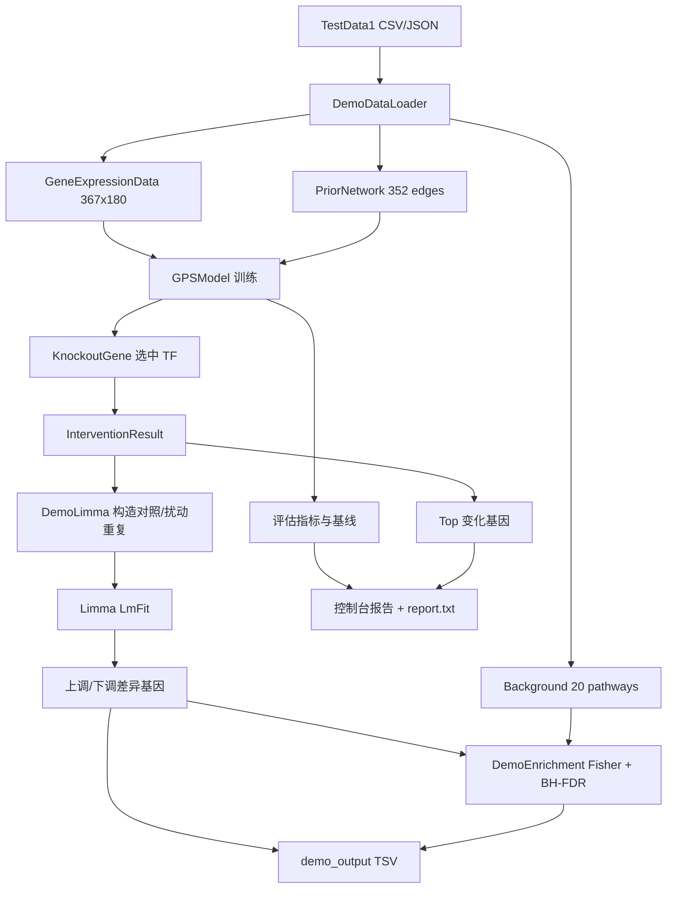

## 产品概述

在 GPS 测试工程中新增一个基于 `demo/TestData1` 真实数据的端到端 DEMO，串起「时序表达矩阵 + 先验调控网络 → GPS 模型训练 → 虚拟敲除 → Limma 差异表达 → Fisher 通路富集」的完整分析链路，并在控制台与 TSV 文件中输出可核查结果。

## 核心功能

- **数据加载**：解析 367 基因 × 180 样本的时序表达矩阵（从列名 `T{h}h_Rep{k}` 还原时间点与生物学重复）、352 条先验调控边（`activation`/`repression` 映射为激活/抑制并保留置信度与证据）、20 条通路的基因集定义。
- **模型训练**：用全部基因构建调控图与图编码，按时间严格切分训练/验证/测试；输出预训练与微调损失曲线、R²、方向准确率、图外基因子集 R²，并同时给出历史持续性基线作为对照。
- **虚拟扰动**：自动选取先验网络中出度最大的转录因子（可由命令行指定）执行虚拟敲除，输出全基因组表达变化量与 Top 上调/下调基因。
- **差异分析**：将模型对照预测与扰动预测构造为 in-silico 重复样本，转线性尺度后交给 Limma（内部再取 log2），得到 logFC、t 统计量、P 值与校正 P 值；按 `|logFC|` 与 `adj.P` 阈值筛出上调/下调基因，阈值不满足时回退取显著度最高的部分基因并给出提示。
- **通路富集**：以 Fisher 精确检验评估差异基因在 20 条通路中的富集程度，补 Benjamini-Hochberg FDR，输出通路名、富集比例、P 值、FDR 与命中基因，并分别对上调集与下调集各做一次富集。
- **结果落盘**：`demo_output/` 下输出 Limma 全表、上调/下调子集、富集全表、显著富集表与汇总报告文本。
- **运行方式**：`--demo` 触发，支持 `--epochs`、`--tf`、`--samples`、`--topN`、`--out` 覆盖参数；无参数时仍执行原有 87 项自测，行为不变。

## 补充说明

- DEMO 会在输出中明确标注：扰动样本的重复是为统计检验构造的技术重复（高斯噪声），不是实测生物学重复；报告中的 logFC 处于模型处理后的表达尺度，用于通路层面的方向与富集判断。

## Tech Stack Selection

- **语言/框架**：VB.NET，net10.0，控制台 Exe（`GPS.Test.vbproj`，RootNamespace=`GPS.Test`）
- **模型层**：既有 `GPS.vbproj` 门面 `GPSModel`（训练、评估、虚拟扰动接口）
- **差异分析**：`HTS_matrix-netcore5.vbproj` 的 `SMRUCC.genomics.Analysis.HTS.DataFrame.Matrix` / `DataFrameRow` / `Limma.LmFit`（经验贝叶斯调节的线性模型）
- **实验设计**：`designer-netcore5.vbproj` 的 `SampleInfo` / `DataAnalysis`（把样本按分组名组织成 control/experiment 两组）
- **通路富集**：`Fisher.NET5.vbproj`（RootNamespace `SMRUCC.genomics.Analysis.HTS.GSEA`）的 `Background` / `Cluster` / `BackgroundGene` / `Enrichment.Enrichment`
- **FDR 校正**：`Math.NET5.vbproj` 的 `FDR(Of T As IStatFDR)` 扩展（BH 法）；`EnrichmentResult` 已实现 `IStatFDR`，可直接套用
- **JSON 解析**：`System.Text.Json.JsonDocument`（全限定引用，避免与 sciBASIC 的 `JsonElement` 产生歧义）

## Implementation Approach

**总体策略**：DEMO 全部代码落在 `GPS/test` 下，不改动 `GPS.vbproj` 的任何模型代码；新增三个职责单一的辅助模块（数据加载、Limma 适配、富集适配）+ 一个编排入口，通过命令行开关与既有自测共存。

**关键决策**：

1. **两套精度尺度必须显式转换**。`Limma.LmFit` 内部对输入矩阵取 `log(2)`，而 GPS 输出的 `WildtypeMeans` / `MutantMeans` 已经是 log2 量级；因此 DEMO 在构造 Matrix 时先做 `2^x` 还原为线性尺度，Limma 的 logFC 才回到 log2 单位，避免"对 log 值再取 log"造成的口径错误。报告中将该 logFC 标注为模型处理尺度下的 log2 变化。
2. **in-silico 重复的设计**。虚拟扰动是确定性点估计，而 Limma 需要 `df = n − 2` 的残差自由度：DEMO 为对照组（模型对照预测）与处理组（扰动预测）各生成 `nSamples` 个样本，噪声标准差取 `noiseRatio × GeneSDs`（默认 0.05）。这样两组共享同一噪声尺度，logFC 主要由真实扰动效应驱动，P 值反映效应相对噪声的稳定性，且输出中显式说明这是技术重复。
3. **分组顺序决定谁是对照**。`DataAnalysis.experiment = designs(0)`、`control = designs(1)`，`DataGroup` 的组顺序 = 样本输入顺序。DEMO 必须先放入处理组样本、再放入对照组样本，否则 logFC 符号整体翻转。
4. **富集背景规模必须显式设置**。`Background.size` 是超几何检验的 N，若不设置会回退为"通路成员并集大小"，系统性夸大显著性；DEMO 显式设为参与建模的基因数（367）。
5. **通路集合不走过滤捷径**。`Enrichment` 的 `cutSize` 默认 3 会剔除成员数 ≤3 的通路；DEMO 传 `cutSize:=0`、`outputAll:=True`、`showProgress:=False`，保证 20 条通路全部参与且不输出 Tqdm 进度条。
6. **数据目录多候选探测**。测试工程的可执行文件位于 `bin/...` 下，`dotnet run` 与直接运行 exe 的当前目录不同：实现从 `AppContext.BaseDirectory` 逐级向上查找包含 `demo\TestData1\gene_expression_matrix.csv` 的目录，并支持环境变量 `GPS_DEMO_DATA` 覆盖；找不到时给出明确异常信息而非静默跳过。
7. **规模与耗时控制**。367 基因的全局注意力为 O(N²)，DEMO 默认取 `DModel=32 / NLayers=2 / NHeads=4 / FfnDim=64 / GruHidden=24 / Window=4`，56 个滑窗、微调默认 8 轮（约 450 个训练步），并允许 `--epochs` 调整；训练前打印"窗口数 × 轮数"预估，便于用户判断耗时。

**性能要点**：图编码与预处理一次性完成并复用；Limma 只对 2×n 个样本求解（n≤20，成本可忽略）；富集只遍历 20 条通路；DEMO 的瓶颈在模型训练，通过小网络 + 少轮次 + 可选参数控制。

## Implementation Notes

- **回归控制**：`Program.Main` 在解析参数时优先判断 `--demo`；不传参数时保持原有 87 项自测路径完全不变。`GPS.vbproj` 与底层库零改动，只给测试工程加三个 ProjectReference。
- **VB 陷阱**：`sample`、`single`、`next`、`Set`、`Step`、`Sub` 不能作标识符；`Matrix` 与 `Math.LinearAlgebra` 同名，用别名 `Imports HTSMatrix = SMRUCC.genomics.Analysis.HTS.DataFrame.Matrix`；`Background` 建议别名 `Imports EnrichBackground = SMRUCC.genomics.Analysis.HTS.GSEA.Background` 以区分同名概念。
- **CSV 解析**：`File.ReadAllLines` + 按逗号切分即可（数据无引号/内嵌逗号）；首行首列是 `Gene`；时间点用正则 `^T([0-9]+(?:\.[0-9]+)?)h_Rep(\d+) 解析，解析失败的列直接报错而不是静默赋 0。
- **数值安全**：`2^x` 前对 x 做 `[-1024, 1024]` 夹断，避免极端值溢出为 Infinity 后污染 Limma 的线性拟合；噪声按基因 SD 缩放并保证非负。
- **日志**：沿用测试工程既有的 `Console.WriteLine` 分节输出（`[数据] / [训练] / [评估] / [扰动] / [Limma] / [富集]`），每节只打印关键数值与 Top 列表，完整数据落盘。
- **可核查性**：DEMO 内部包含断言（数据规模、先验边数、训练结果有限、扰动结果非 Undefined、Limma 行数等于基因数、富集返回非空、输出文件存在且非空），失败时打印明确原因并返回非零退出码。

## Architecture Design



## Directory Structure

```
g:\GCModeller\src\GCModeller\sub-system\GPS\test\
├── GPS.Test.vbproj                       # [MODIFY] 新增 Fisher.NET5、HTS_matrix、designer 三个 ProjectReference
├── Program.vb                            # [MODIFY] Main 顶部解析 --demo 与参数，命中后调用 DemoTestData1.Run 并返回其退出码；无参数路径保持原样
├── DemoTestData1.vb                      # [NEW] DEMO 编排入口：解析参数、串联各步骤、分节打印、写汇总报告、返回退出码
├── Demo\
│   ├── DemoDataLoader.vb                 # [NEW] 目录探测；表达矩阵 CSV → GeneExpressionData（时间点/重复解析）；先验网络 CSV → PriorNetwork（activation/repression→Effector）；pathway_info.json → Fisher Background（size=基因数）；提供数据概况统计
│   ├── DemoLimma.vb                      # [NEW] 由对照/扰动向量 + 基因 SD 生成 in-silico 重复；2^x 线性化并夹断；构建 HTS_matrix（处理组列在前、对照组列在后）与 SampleInfo/DataAnalysis；调用 LmFit；按阈值筛选上调/下调并支持回退；导出 TSV
│   └── DemoEnrichment.vb                 # [NEW] 调用 Background.Enrichment（cutSize=0、outputAll=True、showProgress=False）；应用 BH-FDR；按 P 值排序；分别处理全部/上调/下调基因集；导出 TSV 与控制台摘要
└── demo_output\                          # [NEW] 运行时输出目录（limma_all.tsv、limma_up.tsv、limma_down.tsv、enrichment_all.tsv、enrichment_significant.tsv、report.txt）
```

## Key Code Structures

```
Public Module DemoTestData1
    ''' 返回 0 表示 DEMO 成功；非 0 表示断言失败或数据缺失
    Function Run(args As String()) As Integer
End Module

Public Module DemoDataLoader
    Function ResolveDataDirectory() As String
    Function LoadExpressionMatrix(file As String) As GeneExpressionData
    Function LoadPriorNetwork(file As String) As PriorNetwork
    Function LoadPathways(file As String, universeSize As Integer) As EnrichBackground
End Module
```