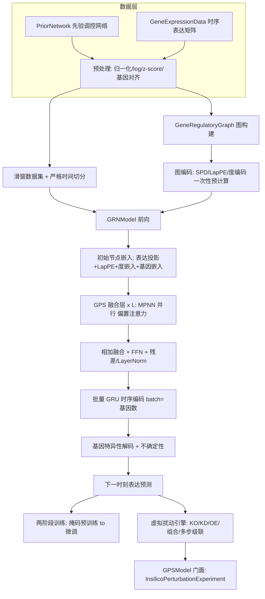

## 产品概述

基于先验调控网络与时序基因表达矩阵的 GNN+Transformer 融合基因表达调控网络模型：局部消息传递沿先验调控边聚合邻居信息，全局自注意力经最短路径空间偏置感知图拓扑并捕捉长程调控，批量时序编码器学习表达动态，基因特异性解码器预测下一时刻全基因组表达；训练完成后支持敲除/敲低/过表达等虚拟扰动实验，模拟扰动在全基因组的级联响应。计算热点采用单精度张量、精度敏感环节采用双精度张量的混合精度架构。

## 核心功能

- **数据管线**：表达矩阵文库归一化、log 转换与逐基因 z-score 标准化；基因集对齐（先验图外基因保留为孤立节点参与注意力）；时序滑窗切片与严格按时间切分的训练/验证/测试划分，杜绝时间泄漏
- **图结构编码**：拉普拉斯位置编码（LapPE）、最短路径距离矩阵（SPD，超距截断 + 不连通基因对专用桶）、入度/出度中心性嵌入；全部一次性预计算并缓存
- **融合主干**：GPS 并行融合层堆叠（边类型感知的稀疏消息传递支路 ∥ 带 Graphormer 空间偏置的全局多头注意力支路，相加融合后经 FFN 与残差/LayerNorm）
- **时序与解码**：以基因数为批量的 GRU 时序编码器处理窗口内各时刻嵌入；每基因独立线性解码器输出下一时刻表达，附不确定性估计
- **两阶段训练**：掩码重建自监督预训练 → 下一时刻预测微调；复合损失（autofocus 指数加权 + 方向感知 + 稀疏正则 + 先验距离正则）、梯度裁剪、按验证集早停
- **评估与消融**：MSE/R²/Pearson/top-20 差异基因 MSE/方向准确率；先验图外基因子集单独报告 R²；完整模型与纯时序、纯 GNN、纯 Transformer、无空间偏置的消融对比
- **虚拟扰动**：单基因敲除/敲低/过表达、多基因组合扰动（协同/拮抗度量）、多步递归时间级联模拟；结果统一映射为标准干预结果结构（野生型/扰动型均值、倍数变化、Z 值、显著性、动态轨迹）
- **混合精度**：权重、LayerNorm 统计量、损失、优化器状态保持双精度；GEMM 与 softmax 等热点算子临时降单精度计算；精度决策可观测、可整体回退

## Tech Stack Selection

- **语言/框架**：VB.NET，net10.0，Option Strict On（沿用 GCModeller/sciBASIC# 工程惯例）
- **张量计算**：`TensorFlow.vbproj` 的 `Tensor`（FP64）与 `TensorF`（FP32）双精度栈；默认 SIMD CPU 后端，宿主注册 `CudaTensorF`/`CudaTensor` 后自动获得 CUDA GPU 加速（GPS 库本身不引用 ILCudaTensor，后端注册由宿主/测试工程负责）
- **混合精度**：复用既有 `MixedPrecisionOps` 外观（MatMul/BatchedMatMul/SpMM，判据不成立自动回退双精度）+ `MixedPrecisionPolicy`（ComputeBound/MemoryBound/MustDouble 语义分类）+ `MixedPrecisionDiagnostics`（加速/回退计数）
- **模型组件复用**：DeepLearning 的 Transformer 算子层（BatchedMatMul 已内置 facade、AddNorm、FFN、Dropout）、GNN 的 `GRULayer`（batch=基因数的批量序列语义）与 `TimeSeriesUtils`、GEARS 的 `GeneRegulatoryGraph` 与 `GEARSConvLayer`（既有手写反向）、Math 库的 `EigenvalueDecomposition`
- **数据与接口**：BNLearn 的 `PriorNetwork`/`GeneExpressionData`/`InsilicoPerturbationExperiment`/`InterventionResult`
- **零新增依赖**：`GPS.vbproj` 已引用全部所需工程（DeepLearning、GNN、TensorFlow、BNLearn、GEARS、Math.NET5、Core）

## Implementation Approach

**总体策略**：分层组装，底层库零改动。所有新代码落在 GPS 工程内；MPNN 支路、GRU、图构建、AddNorm/FFN 直接复用既有稳定组件；仅"带空间偏置的多头注意力""GPS 融合层""基因嵌入（gather/scatter）""per-gene 解码器"四个组件新写，均采用手写前向+显式反向模式（与 Transformer 迁移后的工程惯例一致），并做有限差分数值梯度校验。

**关键决策与取舍**：

1. **偏置注意力新写类而非改旧类**：`MultiHeadAttention` 无加性偏置通道且被既有代码依赖，新增 `BiasedMultiHeadAttention`（照抄其结构，增加 `biasTable[spdBuckets, nHeads]` 可学习参数与 SPD 索引矩阵输入），`Backward` 中把 `dScore` 按 SPD 桶 scatter-add 回偏置表梯度——旧类一行不改，回归风险为零。
2. **混合精度边界**：存储全 FP64；GEMM 一律走 `MixedPrecisionOps.MatMulOr`；softmax 前向经本地 helper（规模达标时转 `TensorF` 走 `computeKernelF.Softmax` 再转回，规避 SIMDTensor 未 override 双精度 Softmax 的短板）；softmax 反向、LayerNorm、损失、优化器、图编码、gather/scatter 保持 FP64（MustDouble 语义）。无需 AMP loss scaling——临时降精度模式下梯度在双精度域累加。
3. **SPD 偏置内存控制**：SPD 以整型桶索引矩阵 `[N,N]` 存储；每层每头 softmax 前临时生成偏置切片 `[N,N]`（FP32）；跨层共享同一张量表，可按 FP32 缓存 `[heads,N,N]`（N=2000、8 头约 128MB，一期可接受；N≥5000 留待二期稀疏化）。
4. **时序编码复用 GRULayer**：其 `Forward(input[batch,inputSize], hidden)`/`ForwardSequence([w,batch,inputSize])` 的 batch 维恰好等于基因数，把 `[w,N,d_model]` 序列一次喂入即得"逐基因 GRU"的批量等价实现，无需重写。
5. **规模约束**：第一期 N≤2000（高变异基因预过滤），`spd_max_dist=5` 截断；全基因组稀疏注意力（Exphormer/Performer 式）列入二期。

**性能要点**：图编码一次性预计算缓存；SPD 偏置张量每前向物化一次跨层共享；训练循环复用中间缓冲（参照 `GearsBatchWorkspace` 思想）避免每步分配；稀疏 MPNN 聚合 O(|E|·d)；GPU 场景常驻权重需 PinDevice（否则每步 D2H 回读，fp32 链反慢于双精度 SIMD）。热点复杂度：单层前向 O(L·(N·d² + N²·d))，N=2000/d=128 时约每层 0.7 GFLOP，CPU SIMD 秒级、GPU 亚秒级。

## Architecture Design



**数据流**：输入经预处理与图编码后进入模型；初始嵌入=表达值线性投影+LapPE 投影+入/出度嵌入+基因身份嵌入；每层 GPS 并行执行局部 MPNN（沿先验入边稀疏聚合，边类型感知）与全局偏置注意力（scores+SPD 偏置），相加后过 FFN 与 AddNorm；堆叠 L 层后按时间维过批量 GRU；每基因独立解码为下一时刻表达。扰动时改写输入侧表达（或删边）后前向，与对照基线差分得到扰动效应。

## Implementation Notes

- **回归控制**：GNN/GEARS/TensorFlow/DeepLearning/BNLearn 五个底层工程零改动；`GPS.vbproj` 仅新增 test 目录的 Compile 排除（SDK 风格自动包含，须排除测试目录）；GPSTest 作为独立子工程（参照 GEARS/test 模式），GPU 对拍测试引用 ILCudaTensor 并用 assembly\bin 产物。
- **手写反向验证**：每个新层（偏置注意力/GPS 层/基因嵌入/per-gene 解码）必须过有限差分梯度校验后才能进训练链。
- **对拍验证**：`MixedPrecisionPolicy.Enabled=False`（纯 FP64）与 `True`（热点 FP32）两种模式整模前向对拍，相对误差 ≤1e-5；诊断计数断言热点确实走了单精度路径。
- **VB 陷阱**：`next`/`Step`/`Call`/`error`/`sub`/`set` 不得作标识符；Module 成员默认 Private 不能 Shared；局部变量不得遮蔽类型名（file/path）；XML 注释不得含 `--`；`resources.Where(...).Count()` 替代被 Count 属性遮蔽的扩展方法。
- **日志**：训练进度沿用 `Console.WriteLine` + `printEvery` 节流（GEARSTrainer 模式），不打印基因名明细等大 payload。
- **文档**：GPS 工程补 readme.md（架构、用法、GPU 后端注册方式、规模约束），与 GEARS readme 风格一致。

## Directory Structure

```
g:\GCModeller\src\GCModeller\sub-system\GPS\
├── GPS.vbproj                        # [MODIFY] 加 test 目录 Compile 排除；其余引用已齐全
├── method.md                         # 已有算法指导文档
├── readme.md                         # [NEW] 架构说明、用法、GPU 注册、规模约束
├── Config\
│   └── GPSConfig.vb                  # [NEW] 超参容器（N/PE维/SPD截断/d_model/层数/头数/FFN/dropout/窗长/GRU隐层/学习率/各 lambda/autofocus gamma）
├── Data\
│   ├── ExpressionPreprocess.vb       # [NEW] CPM 归一化/log2(x+1)/逐基因 z-score/高变异基因过滤；FP64
│   └── TimeSeriesWindowDataset.vb    # [NEW] 滑窗样本生成 + 严格时间切分 train/val/test（禁随机打乱）
├── Graph\
│   └── GraphEncoding.vb              # [NEW] SPD（BFS+截断+不连通桶）、LapPE（复用 EigenvalueDecomposition）、度中心性；一次性预计算缓存
├── Model\
│   ├── BiasedMultiHeadAttention.vb   # [NEW] Graphormer 偏置多头注意力：scores=QKᵀ/√d+biasTable[SPD]，含偏置查表 scatter-add 反向
│   ├── GPSLayer.vb                   # [NEW] GPS 并行融合层：GEARSConvLayer ∥ BiasedMHA → 相加 → FFN → AddNorm，显式反向
│   ├── GeneEmbedding.vb              # [NEW] 基因身份嵌入表（gather 前向 + scatter-add 梯度，第一期 CPU 手写）
│   ├── BatchGRU.vb                   # [NEW] 包装 GRULayer 的 [w,N,d] 批量时序编码（或直接复用其 ForwardSequence）
│   ├── PerGeneDecoder.vb             # [NEW] 每基因独立线性读出（权重 [N,d] 按行 gather 点积）+ 不确定性头（softplus）
│   └── GRNModel.vb                   # [NEW] 完整模型：初始嵌入 → GPS×L → GRU → 解码；实现 GNNModel 基类（GetParameters/GetGradients/SetTraining）
├── Training\
│   ├── LossFunctions.vb              # [NEW] autofocus(|e|^(2+γ))/方向感知/L1/先验距离复合损失及梯度；FP64
│   ├── GPSTrainer.vb                 # [NEW] 两阶段训练（掩码重建预训练→下一时刻微调）+梯度裁剪+早停；沿用 optimizer.Step/ZeroGrad 模式
│   └── Evaluation.vb                 # [NEW] MSE/R²/Pearson/top20 MSE/方向准确率 + 消融开关（去图/去注意力/去偏置）
├── Perturbation\
│   └── VirtualPerturbationEngine.vb  # [NEW] 单步/组合/多步级联扰动；输出填 InterventionResult（含 DynamicTrajectory）
├── GPSModel.vb                       # [NEW] 门面类：加载 PriorNetwork+GeneExpressionData、训练入口、Implements InsilicoPerturbationExperiment
└── test\
    └── (GPSTest 子工程)              # [NEW] 数值梯度/ fp32-fp64 对拍/数据管线/端到端 smoke 自测
```

## Key Code Structures

超参容器（新模块间共享的配置契约）：

```
Public Class GPSConfig
    Public Property NGenes As Integer                 ' 建模基因数（预过滤后）
    Public Property PeDim As Integer = 16             ' LapPE 维度
    Public Property SpdMaxDist As Integer = 5         ' SPD 截断距离（桶数 = 该值 + 2）
    Public Property DModel As Integer = 128           ' 隐藏维度
    Public Property NLayers As Integer = 3            ' GPS 融合层数
    Public Property NHeads As Integer = 8             ' 注意力头数
    Public Property FfnDim As Integer = 256           ' FFN 中间维度
    Public Property Dropout As Double = 0.1
    Public Property Window As Integer = 5             ' 时序窗长
    Public Property GruHidden As Integer = 128        ' GRU 隐层维度
    Public Property LearningRate As Double = 0.0001
    Public Property LambdaL1 As Double = 0.0001       ' 稀疏正则权重
    Public Property LambdaPrior As Double = 0.01      ' 先验距离正则权重
    Public Property LambdaDir As Double = 0.5         ' 方向感知损失权重
    Public Property AutofocusGamma As Double = 1.0    ' autofocus 指数（2+gamma）
End Class
```

偏置注意力契约（文本约定，避免过早固定签名）：构造函数接收 `dk/dv/nrHeads/embeddingSize/spdBuckets`；前向除输入 `H[N,d]` 外接收 SPD 桶索引矩阵 `Integer[N,N]`（不连通对填专用桶），内部查表生成每头偏置并加到缩放点积得分上；反向除参数梯度外须把得分梯度按 SPD 桶聚合回偏置表。GPS 融合层前向接收 `H[N,d]` + `GEARSConvLayer` 所需的图数据 + 共享 SPD 索引，输出 `H[N,d]`，反向逆序回传。