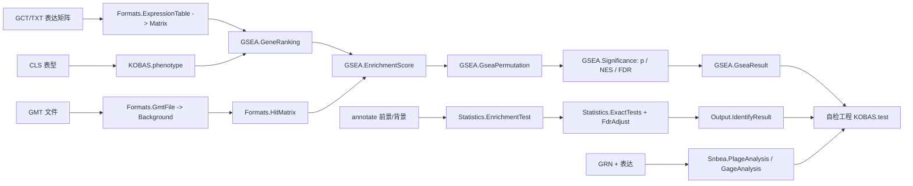

## 用户需求

将 KOBAS 3.0 源码（`C:\Users\Administrator\Downloads\kobas-3.0.3.tar_20261027153940\kobas-3.0\src\kobas`，Python 2）中**与富集计算算法有关的代码**翻译为 VB.NET，落地到 `G:\GCModeller\src\GCModeller\annotations\GSEA\GSEA\KOBAS`（当前仅有 `phenotype.vb`）。

## 产品概述

在 GSEA 库中新增一套 KOBAS 风格的富集计算能力：既能做基于表达矩阵 + 表型分组的 **GSEA**（基因排序、加权 running sum、表型标签置换零分布、NES、名义 p、FDR），也能做基于前景/背景基因列表的**四种统计检验富集**（超几何、Fisher 精确、二项、卡方），并提供富集结果通路相似度聚类与结果表整理；同时补齐 SNBEA 子网络富集的本地化实现。

## 核心功能

- **输入格式**：GMT 基因集（跳过 `#` 注释行、重复 ID 取首个）、GCT/TXT 表达矩阵、CLS 表型（复用既有 `phenotype`）、KOBAS annotate 结果文件（`query\tlink1|name1|url!...` 或 `None`）。
- **GSEA 主流程**：`snr` / `ttest` 两种基因排序（总体标准差 ddof=0、稳定降序）、权重 0/1/2/任意正数、ES 与 running-sum、ES 索引与核心基因、表型标签置换零分布、名义 p、NES、FDR、结果表与 top20 明细。
- **统计检验富集**：超几何上尾、Fisher greater、精确二项上尾、带 Yates 校正的卡方（期望频数 < 10 自动退回 Fisher）、BH/BY/QVALUE/None 多重校正。
- **通路相似度与聚类**：`kappa` / `Jaccard` 相似度矩阵、簇自检与合并、簇重要性评分（`-log10 p` 乘积开 n 次方）。
- **结果整理**：按通路名停用词集合去重分组、排序、序列化（不含 Web 超链接）。
- **SNBEA**：GMT/表达/表型/GRN 读取、基因集尺寸过滤、PLAGE 打分 + limma 差异分析、GAGE 上尾近似、结果合并排序。
- **可执行验证**：独立 net10.0 控制台自检工程，合成数据断言 + R（`Rscript.exe`）交叉验证统计检验与 p 值校正 + GSEA 数值与手算基准比对。

## 边界与取舍

- 不翻译：`dbutils.py` / `read_gmt_db` / `distr_from_*`（SQLite 数据库）、`annot.py` 的 BLAST 部分、`output.py` 的超链接与 annotate 文本输出、`gsea.py` 的 matplotlib 绘图、`config.py`。
- 原实现缺陷一律**按标准算法修正并加注释说明差异**（miss 步长分母、Fisher 列联表、argsort 并列稳定性、连带 else 分支、基因集尺寸边界、卡方 Yates 校正）。

## 技术栈

- 语言/框架：VB.NET，`net10.0`（与 `gsea-netcore5.vbproj` 一致），SDK 风格工程；`DocumentationFile` 已开启，公开成员必须写 XML 注释。
- 目标工程：`annotations\GSEA\GSEA\gsea-netcore5.vbproj`（RootNamespace `SMRUCC.genomics.Analysis.HTS.GSEA`，SDK 默认通配，新 `.vb` 自动纳入编译）。
- 复用依赖：
- `analysis\HTS_matrix\HTS_matrix-netcore5.vbproj`：`Formats.Gct.LoadFile/AsMatrix`、`Formats.CLS.ParseFile`、`Matrix.LoadData`、`Limma.LmFit`。
- `annotations\GSEA\FisherCore\Fisher.NET5.vbproj`：`Background` / `Cluster` / `BackgroundGene`、`Enrichment.calcResult` 的标准 2x2 列联表范式。
- `Math.NET5.vbproj`（新增直接引用）：`SingularValueDecomposition`（SNBEA 的 PLAGE）与 `Microsoft.VisualBasic.Math.FalseDiscoveryRate`（BH/BY）。
- `stats-netcore5`：`FishersExactTest.FishersExact(...).greater_pvalue`（单尾 Fisher）。

## 实现策略

分四层落地，全部放在 `KOBAS` 命名空间下，与既有 `phenotype.vb` 同命名空间：

1. **Formats 层（纯解析）**：GMT → `Background`；GCT/TXT → `Matrix`；annotate 文件 → `AnnotationEntry`；构建「基因集 × 排序基因」命中矩阵并按命中数过滤。不引入新数据模型替代 `Background/Cluster`，仅做适配。
2. **算法层**：GSEA 拆成「排序 → running sum → 置换 → 显著性」四个纯函数模块，便于单测与复用；统计检验以「精确上尾函数」为原子，再组合成 `Hyper/Binom/Chi/Fisher` 四种检验对象。
3. **聚合层**：`KobasGsea` 与 `EnrichmentTest` 作为门面，串起 Options → Result，输出到既有 `Matrix`/表结构，避免新增序列化体系。
4. **验证层**：独立控制台工程 + R 参考脚本，对比容差 `1e-10`；R 缺失时输出 SKIP 且不判失败。

## 关键技术决策

- **不修改既有库源码**：`GSVA\plage.vb` 的 `Module plage` 是 Friend，跨工程不可见；为避免加 `GSVA` 引用造成耦合，改在 KOBAS 内用 `SingularValueDecomposition` 重写等价 PLAGE（行 z-score → 第一右奇异向量；宽矩阵走转置取 U），并在注释标注与 `GSVA::plage` 的对应关系。
- **命名避让**：根命名空间已存在 `Public Module GSEA`（FisherCore，秩置换语义），KOBAS 侧一律用 `KobasGsea` / `GseaRanking` 等前缀，且置于 `Namespace KOBAS` 内，杜绝二义。
- **数值口径对齐 numpy**：`rank_pro` 的标准差用总体标准差（ddof=0），降序排序改为**稳定排序**（并列按原始基因顺序），否则与 KOBAS 输出不可复现。
- **缺陷修正清单（写入 XML 注释的 `<remarks>`）**：

1. miss 步长 `1/(N - k)`，`k` 为该基因集在排序列表中的命中数（原实现误用基因集总数）。
2. Fisher/卡方使用标准 2x2 表 `[[a, n1-a],[m2-a, N-m2-n1+a]]`，与 `Enrichment.calcResult` 一致；富集方向取 `greater`。
3. ES 权重分支改为单一 `Select Case`（0→1，2→平方，其余→`|r|^w`），消除连带 `else`。
4. `snbea` 基因集尺寸边界统一为闭区间 `[min, max]`。
5. 卡方显式实现 Yates 连续性校正，并在任一期望频数 < 10 时退回 Fisher。
6. QVALUE 用 Storey π0（λ=0.5 网格）本地实现，注明与 R `qvalue` 的差异。

- **性能**：命中矩阵用 `Boolean()()` 行连续存储；running sum 与置换内层只做一维扫描（O(S·G)），置换循环复用预分配的基因索引数组与洗牌缓冲，避免每轮重新分配；基因集集合用 `HashSet(Of String)` 建索引，命中判定 O(1)。真实规模（万级基因 × 千级基因集 × 千次置换）为分钟级，符合既有 GSEA 实现量级。
- **确定性**：置换使用显式种子（Fisher-Yates），两次运行结果逐位一致，便于断言。
- **错误处理**：空基因集/全被过滤/前景非背景子集等情形抛出带明确信息的异常（对应 KOBAS 的 `GmtvalueErr` / `StatError`），不做静默降级。

## 架构设计



## 目录结构

```
GCModeller/annotations/GSEA/GSEA/
├── gsea-netcore5.vbproj            # [MODIFY] 新增 Math.NET5.vbproj 引用（SVD / FDR）
└── KOBAS/
    ├── phenotype.vb                # [KEEP] 既有 CLS 表型模型，新代码复用
    ├── Formats/
    │   ├── GmtFile.vb              # [NEW] GMT 解析：跳过 # 行、重复 ID 取首个、列数 < 3 报错；Load -> Background（Cluster/BackgroundGene），支持 min/max 尺寸过滤
    │   ├── HitMatrix.vb            # [NEW] GeneSetHits + 命中矩阵构建；输入基因列表与 Background，输出 Boolean()() 与命中数，按 [min,max] 过滤，全过滤抛异常
    │   ├── ExpressionTable.vb      # [NEW] .gct / .txt 统一读取入口（复用 Gct.LoadFile / Matrix.LoadData），按 phenotype.ClassLabel 对齐样本顺序
    │   └── AnnotateFile.vb         # [NEW] KOBAS annotate 输出解析：AnnotationEntry{Query,Links}、GetHeader(abbr/idmapping/fgnum)、Iterator（遇 20 个 '-' 停止、跳过 # 行）
    ├── GSEA/
    │   ├── GeneRanking.vb          # [NEW] RankingMethod{Snr,TTest} + RankedGene{GeneID,Score,Index}；rank_pro 等价实现，ddof=0，稳定降序
    │   ├── RunningSum.vb           # [NEW] 加权 running sum、ES（绝对值最大偏离）、ES 索引、RES 数组；miss 步长按命中数修正
    │   ├── EnrichmentScore.vb      # [NEW] 批量 ES：权重归一化 NR=Σw·hit，逐基因集输出 ES/ESIndex/RES
    │   ├── GseaPermutation.vb      # [NEW] 表型标签置换零分布（Fisher-Yates + 种子）、ES_for_permutation 等价实现
    │   ├── Significance.vb         # [NEW] NominalP（同号条件分母）、Normalize（NES 与零分布归一化）、Fdr（同号计数比）
    │   ├── GseaOptions.vb          # [NEW] Method/Weight/Permutations/MinSize/MaxSize/Seed
    │   ├── GseaResult.vb           # [NEW] 基因集结果（ID/Name/Description/Size/ES/NES/PValue/FDR/RES/CoreGenes）
    │   └── KobasGsea.vb            # [NEW] 门面：Compute(matrix, phenotype, background, options) -> GseaResult()；串起排序→ES→置换→显著性
    ├── Statistics/
    │   ├── ExactTests.vb           # [NEW] HypergeometricUpperTail / FisherGreater（调 FishersExactTest.greater_pvalue）/ BinomialUpperTail（对数伽马累加）/ ChiSquareYates（含期望<10 退回 Fisher）
    │   ├── FdrAdjust.vb            # [NEW] FdrMethod{BH,BY,QValue,None} 统一入口；BH/BY 复用 FalseDiscoveryRate，QValue 本地 Storey π0
    │   ├── TermDistribution.vb     # [NEW] Term -> HashSet(Of String) 分布（等价 KOBAS Distr/DistrGnum），支持从 annotate 或 Background 构建
    │   ├── TwoSampleTest.vb        # [NEW] HyperTest/BinomTest/ChiTest/FisherTest 四种检验，前景非背景子集抛异常，输出 EnrichmentRow
    │   └── EnrichmentTable.vb      # [NEW] 表结构：Term/Database/ID/InputNumber/BackgroundNumber/PValue/CorrectedPValue/Input；Sort/AddFdr/序列化
    ├── Similarity/
    │   ├── TermSimilarity.vb       # [NEW] MakeMatrix(交集/差集四格)、Kappa、Jaccard、对称相似度矩阵
    │   └── TermClustering.vb       # [NEW] ClusterInit(TestSelf)、TestTwo 合并判据、ClusterIter、CalculateScore（-log10 p 乘积开 n 次方）
    ├── Output/
    │   └── IdentifyResult.vb       # [NEW] STOPLIST 去重分组（重名加 @@ 前缀）、排序、写出 TSV（不含超链接）
    └── Snbea/
        ├── SnbeaData.vb            # [NEW] GMT 读取（跳过 #、重复 ID 取首）、基因集尺寸过滤（闭区间）、GRN TSV 读取（FROM/TO/TYPE）
        ├── PlageAnalysis.vb        # [NEW] PLAGE（行 z-score + SVD 第一右奇异向量，宽矩阵走转置）+ Limma.LmFit 得到 P.Value，结果合并排序
        ├── GageAnalysis.vb         # [NEW] GAGE 风格：逐基因 moderated t 聚合 z=Σt/√n + 正态上尾 p，注释标注与 R gage 的近似关系
        └── SnbeaResult.vb          # [NEW] 统一结果模型（GeneSet/SetSize/Statistic/PValue/AdjustedPValue/Description）

GCModeller/annotations/GSEA/
├── KOBAS.test/                     # [NEW] 独立自检工程（必须放在库工程目录之外，避免 SDK 通配把测试编进库）
│   ├── KOBAS.test.vbproj           # [NEW] net10.0 Exe，引用 gsea-netcore5 / Fisher.NET5 / HTS_matrix / stats / Math.NET5
│   ├── Program.vb                  # [NEW] 入口：--all / --stats / --gsea / --similarity / --snbea，输出断言统计与退出码
│   ├── KobasSelfTest.vb            # [NEW] 断言框架（check/pass/fail）+ 合成数据构造
│   ├── StatisticsTest.vb           # [NEW] 统计检验与 FDR 断言（含 R 对拍驱动、SKIP 逻辑）
│   ├── GseaTest.vb                 # [NEW] GSEA 手算基准、running sum 归零、ES∈[-1,1]、p∈(0,1]、确定性复跑
│   ├── SimilarityTest.vb           # [NEW] kappa/Jaccard 与聚类合并断言（KOBAS sim.py __main__ 参考矩阵）
│   └── reference/
│       └── kobas_reference.R       # [NEW] R 侧基准：fisher.test / binom.test / chisq.test / p.adjust 输出 TSV
└── GSEA.sln                        # [MODIFY] 登记 KOBAS.test 工程
```

## 关键代码结构

仅列三个必须精确的契约，其余以文本描述实现。

```
Namespace KOBAS
    ''' <summary>基因集命中矩阵：行=基因集，列=按表达排序后的基因</summary>
    Public Class HitMatrix
        Public Property Genes As String()
        Public Property GeneSets As GeneSetHits()
        Public Property Mask As Boolean()()
    End Class

    Public Class GeneSetHits
        Public Property ID As String
        Public Property Names As String
        Public Property Description As String
        Public Property HitCount As Integer
    End Class
End Namespace
```

```
Namespace KOBAS.Statistics
    Public Enum FdrMethod
        BH
        BY
        QValue
        None
    End Enum

    ''' <summary>多重检验校正，返回与输入同序的 q 值</summary>
    Public Function Adjust(pvalues As IEnumerable(Of Double), method As FdrMethod) As Double()
End Namespace
```

```
Namespace KOBAS.GSEA
    Public Function Compute(matrix As SMRUCC.genomics.Analysis.HTS.DataFrame.Matrix,
                            pheno As KOBAS.phenotype,
                            background As GSEA.Background,
                            options As GseaOptions) As GseaResult()
End Namespace
```

## 执行要点

- 现有 `phenotype.vb` 的 `labels` 是 `Integer()` 变量而非属性，可直接用于分组；`sample0/sample1` 由构造器统计，避免重复计算。
- `Gct.AsMatrix()` 的 `sampleID` 顺序以 GCT 表头为准，需与 `phenotype.labels` 索引严格同序；不一致时按样本名重排或显式报错。
- `Background.size` 在导入 GMT 时应设为「基因集成员并集大小」而非行数，GSEA 的 N 取排序列表长度（表达矩阵行数），二者语义不同，不可混用。
- 置换内层不要重建 `RankedGene()` 对象数组，直接交换 `Double()` 分数与 `Integer()` 索引，降低 GC 压力。
- XML 注释中避免出现连续 `--`；`Module` 级注释不能使用 `<paramref>`。
- VB 陷阱：局部变量不得与类型/属性同名（`matrix`/`file`/`path`/`fit`/`index`/`step`/`next`/`shared`）；`Math` 可能被遮蔽需 `System.Math`；`If(cond, array, Nothing)` 需 `DirectCast`；`Count` 属性会遮蔽 `Enumerable.Count`。
- 验证方式：`dotnet build gsea-netcore5.vbproj` 与 `dotnet build KOBAS.test.vbproj` 均 0 错误；`KOBAS.test.exe --all` 退出码 0；R 对拍容差 `1e-10`，R 不存在时记 SKIP 不影响退出码。

## Agent Extensions

### SubAgent

- **code-explorer**
- Purpose: 在实现前快速定位 KOBAS Python 各算法函数的完整依赖链（例如 `ES_all` 对 `hit_matrix`/`sort_r` 的形状假设、`sim.py` 的簇合并边界、`snbea.py` 的 R 调用参数），并核对 `Matrix`/`Background`/`Cluster`/`FishersExactTest`/`Limma` 的实际公开签名与命名空间。
- Expected outcome: 输出一份可执行的符号与签名清单，确保翻译代码不出现虚构 API、不误用 `gsva`/`plage` 的 Friend 可见性。

### Skill

- **lsp-code-analysis**
- Purpose: 对 `gsea-netcore5.vbproj` 中新增类型做语义级检查（定义-引用、重载解析、命名空间冲突），特别是确认 `KobasGsea` 与既有 `Public Module GSEA`、`Methods`、`plage` 无二义，以及 `FishersExactTest`/`FalseDiscoveryRate` 的调用签名正确。
- Expected outcome: 生成符号引用报告与重载解析结论，消除编译期二义性与可见性错误。