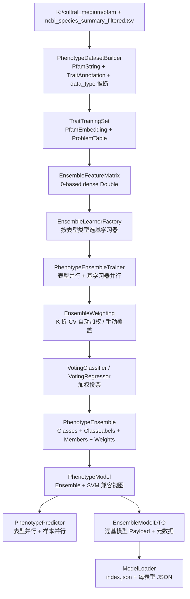

## 用户要求

将 `metaTraits.vbproj` 的表型预测从「每种表型一个 SVM 模型」升级为「基于 Bootstrapping/Ensemble 框架的加权投票集成学习」，同时覆盖分类预测与数值回归。

### 追加要求（本次新增）

使用 `K:\cultral_medium\pfam` 中的 Pfam 数据，以及 `K:\cultral_medium\ncbi_species_summary_filtered.tsv` 中的微生物表型数据，做模型的真实数据训练测试。

## 产品概览

每个生物学表型对应一个独立的集成模型。训练时按表型数据类型动态选择多个异质基学习器并行训练，再用交叉验证分别评估各基学习器并归一化为投票权重；预测时并行调用全部基学习器，分类按加权概率投票输出类别，回归按加权平均输出数值。模型可完整落盘并在新进程中加载复用，原有 SVM 单模型路径保持可用。

## 核心功能

- 按表型类型动态组合基学习器：多分类用朴素贝叶斯 + SVM；二分类再加逻辑回归 + XGBoost；回归用随机森林 + 岭回归 + MLR + 贝叶斯回归 + SVR + XGBoost
- 并行训练：表型之间并行、同一表型内基学习器并行，且避免与算法库内部并行嵌套
- 自动加权：K 折交叉验证评估各基学习器（分类用准确率，回归用 1-RMSE 或 R²），归一化为投票权重；支持调用方传入固定权重覆盖
- 并行预测：单基因组多表型并行、批量样本并行；分类输出概率向量与置信度，回归输出加权值
- 集成模型持久化：逐基模型 DTO + 集成元数据（算法、超参、权重、类别顺序、SVM 兼容模型），加载时重建集成器
- 兼容性：保留 `PhenotypeModel.Model As SVMModel` 兼容视图与原 `PhenotypeSVMTrainer`，既有 `ModelLoader` 仓库可同时容纳 SVM 与集成模型
- 基学习器失败隔离：单个算法训练失败只剔除该成员并记录原因，不影响整个集成模型
- 真实数据训练测试：用 `K:\cultral_medium\pfam` 的 33 个物种 Pfam 注释 + `K:\cultral_medium\ncbi_species_summary_filtered.tsv` 的表型标注，跑通「数据集构建 → 并行训练 → 加权 → 保存/加载往返 → 预测 → 评估」的端到端流程

## 技术栈

- 语言与框架：VB.NET，.NET 10.0，SDK 风格工程
- 目标项目：`g:\GCModeller\src\GCModeller\analysis\metaTraits\metaTraits.vbproj`（`RootNamespace = SMRUCC.genomics.Analysis.metaTraits`）
- 集成框架：`g:\GCModeller\src\runtime\sciBASIC#\Data_science\MachineLearning\Bootstrapping\Bootstrapping.vbproj`，命名空间为扁平的 `Microsoft.VisualBasic.MachineLearning.Bootstrapping.Ensemble`
- 算法来源：`machine_learning-netcore5.vbproj`（SVM、随机森林）、`DataMining.NET5.vbproj`（朴素贝叶斯）、`linear-netcore5.vbproj`（逻辑回归、岭回归、线性回归）、`xgboost.vbproj`
- 复用类型：`IClassifier` / `IRegressor` / `IClassifierLearner` / `IRegressorLearner`、`VotingClassifier` / `VotingRegressor`、`CrossValidation`、`EnsembleMetrics`、`ProbabilityMath`、`LabelEncoder`
- 测试：`metaTraits\test\test.vbproj`（Exe）＋ `DebugAudit`（`Microsoft.VisualBasic.ApplicationServices.Debugging.DebugAudit`）
- 项目引用：`metaTraits.vbproj` 第 24-34 行已包含全部所需引用，**预期无需修改 vbproj**

## 实现策略与关键决策

### 1. 特征契约统一为 0-based 稠密向量

Ensemble 只接受 `Double()`（0-based）。现有 `PfamEmbedding.ToNodes` 返回 1-based 稀疏 `Node()`（SVM 专用，稀疏省略 0 会破坏 RangeTransform），因此新增 `PfamEmbedding.ToVector(profile) As Double()` 与 `ToMatrix(rows, dimensionNames) As Double()()`，并与 `dimensionNames` 严格同序。训练矩阵由 `TraitTrainingSet.problems` 直接构造，避免逐表型重复扫描。

### 2. SVM 基学习器自行适配，不复用 `SvmClassifierLearner`

`Ensemble\Adapters\ClassificationAdapters.vb` 中的 `SvmClassifierLearner` 内部只调用 `Training.Train`，**不保存 `RangeTransform`**，且概率依赖全局 `Parameter.probability`；直接使用会与现有训练质量不一致。因此在 metaTraits 内实现 `ScaledSvmClassifierLearner` / `ScaledSvmRegressorLearner`：`Fit` 内部完成 `RangeTransform.Compute/Scale`、`Parameter.probability = True`、`Training.Train`，返回包装 `IClassifier`/`IRegressor` 的适配器，并保留 `SVMModel` 供 `SvmModelJSON` 序列化。这样既保留与 `PhenotypeSVMTrainer` 一致的特征缩放，又天然复用现有 SVM 持久化路径。

### 3. 并行策略：外层并行，内层禁用

- 表型维：`TrainAll` 与 `PredictAll` 用 `Parallel.For`，结果按表型顺序回填，保证输出稳定。
- 基学习器维：`VotingClassifier` 新增 `Parallel`（与 `VotingRegressor` 对称）；CV 加权时也只在外层按 learner 并行。
- 样本维：`VotingClassifier.PredictBatch`、`VotingRegressor.PredictBatch` 增加样本维并行（样本独立、`trained` 只读，最安全）；`PredictProbability` 保留顺序（内部有累加缓冲）。
- 嵌套控制：外层并行时把 `ParameterSelection.Threads` 设为 1，避免线程数相乘。
- 复杂度：训练约 O(L×K×n×d + L×n×d)，预测约 O(T×L×d)（L 基学习器数、K 折数、n 样本、d 特征维、T 表型数）；n×d 稠密矩阵为 MB 级，可接受。

### 4. 权重估计：CV 指标归一化 + 手动覆盖

`EnsembleWeighting.EstimateWeights` 用 `CrossValidation.StratifiedKFold`（分类）或 `KFold`（回归）做 K 折，逐 learner 计算准确率 / `1 - RMSE/std` / R²，负值截断为 0；全为 0 时退化为等权。最终交由 `ProbabilityMath.NormalizeWeights` 归一化。若调用方提供 `ManualWeights` 且长度匹配，则跳过自动估计。权重写入模型元数据。

### 5. 标签映射必须显式保存

`VotingClassifier.Train` 内部会用 `LabelEncoder.Fit` 重新编码并排序类别。为避免类别顺序与原始标签文本错位，传入的 `y` 使用我们自定义的顺序编码 0..n-1（源自 `Problem.Y` 的 `ColorClass.factor`，其顺序为排序后的 factor），并同时保存 `Classes As Double()` 与 `ClassLabels As String()`；`LabelEncoder` 对已排序的 0..n-1 编码保持顺序不变，从而保证概率向量与标签文本严格对齐。

### 6. 持久化：逐基模型 DTO + 集成元数据

`PhenotypeModelIndex` 增加 `model_family`（`"svm"` / `"ensemble"`）、`ensembleMode`、`baseModelCount`、`weights`、`classes`、`classLabels`、`baseModels`；`EnsembleMember` 保存 `Algorithm`、`Kind`、`Weight`、`CVScore`、`Status`、`ErrorMessage`、`Parameters` 与算法专用 `Payload`。落盘仍为每表型一个 JSON 文件：

```
<dir>/index.json
<dir>/pfam_vocabulary.json
<dir>/{nnnnn}_{name}.json      ← 集成元数据 + 各基模型 Payload
```

`sensor` 注册表按算法分派：`svm` → 现有 `SvmModelJSON`；`logistic`/`ridge`/`mlr`/`lasso` → 系数与超参；`naive-bayes` / `random-forest` / `xgboost` → 先核实其可导出状态（`Bayesian`、`RanFog`、`GBM`），能导出则存结构/二进制，确实不可导出时该成员标记不可持久化并在加载时按元数据重建（记录警告），其余成员照常加载。`SaveDirectory` 中 `TypeOf model.Model.transform Is RangeTransform` 的硬校验改为按 `model_family` 分派，避免集成模型被误降级为 `skipped`。

### 7. 兼容与降级

- `PhenotypeModel` 新增 `Ensemble As PhenotypeEnsemble`，保留 `Model As SVMModel`；`IsTrained()` 改为二者任一非空；`Predict(Node())` 在存在 `Ensemble` 时把 1-based `Node()` 转稠密 `Double()` 后走集成预测，否则走原 SVM 路径 —— `PhenotypePredictor`、`ModelEvaluation`、`FeatureSelection` 无需改签名即可工作。
- `TraitPrediction` 字段语义：分类时 `votes` 承载概率向量、`confidence` 取最大概率、`value` 取 argmax factor、`predict` 取对应标签文本；回归时 `value`/`score` 为加权值、`confidence = 1.0`。`GetBooleanResult` 与 `Export.ToReport` 不受影响。
- R# 的 `train.phenotype_models` 默认改用 `PhenotypeEnsembleTrainer`，并新增可选 `estimator` / `weights` 参数；返回类型仍是 `Dictionary(Of String, PhenotypeModel)`，`save/load/make_predicts/phenotype_result` 保持原签名。
- 原 `PhenotypeSVMTrainer`、`ParameterSearch`、`CrossValidation` 保持不变，供兼容与调参使用。

### 8. 真实数据训练测试（新增）

#### 数据事实（已核实）

- `K:\cultral_medium\pfam\` 下共 33 个物种目录（`Aspergillus_oryzae`、`Carnobacterium_divergens`、`Carnobacterium_maltaromaticum`、`Debaryomyces_hansenii`、`Enterococcus_faecium`、`Kocuria_rhizophila`、`Kocuria_varians`、`Lacticaseibacillus_casei`、`Lacticaseibacillus_rhamnosus`、`Lactiplantibacillus_pentosus`、`Lactiplantibacillus_plantarum`、`Lactobacillus_acidophilus`、`Latilactobacillus_curvatus`、`Latilactobacillus_sakei`、`Leuconostoc_mesenteroides`、`Micrococcus_luteus`、`Pediococcus_acidilactici`、`Pediococcus_pentosaceus`、`Penicillium_chrysogenum`、`Pichia_kudriavzevii`、`Rhodotorula_mucilaginosa`、`Saccharomyces_cerevisiae`、`Staphylococcus_carnosus`、`Staphylococcus_equorum`、`Staphylococcus_saprophyticus`、`Staphylococcus_simulans`、`Staphylococcus_succinus`、`Staphylococcus_xylosus`、`Tetragenococcus_halophilus`、`Weissella_cibaria`、`Weissella_viridescens`、`Yarrowia_lipolytica`、`Zygosaccharomyces_rouxii`）。
- 每个物种目录下有 `Pfam.csv`，列头为 `ProteinId,Length,Description,Pfam-string,Domain.Ids`，可直接 `$"{d}/Pfam.csv".LoadCsv(Of PfamString)(mute:=True)` 读取（与 `MetaFunction\test\metaTraitsTest.vb:52-59` 的 `LoadPfamSets` 一致）。
- `K:\cultral_medium\ncbi_species_summary_filtered.tsv` 为 19 列表格：`taxon_id, taxon_name, trait_name, unit, database_count, total_observations, consensus_value, consensus_count, consensus_percentage, minimum, median, mean, maximum, discrete_values, databases, group_1, group_2, ontology_ids, taxon_lineage`；`TraitAnnotation.ParseTable(file)` 即 `file.LoadCsv(Of TraitAnnotation)(mute:=True, tsv:=True)`，字段名与列名一一对应。
- 物种匹配由 `PfamEmbedding.NormalizeSpeciesName` 完成（仅保留字母数字并小写），`Carnobacterium_divergens` 与 `Carnobacterium divergens` 自动匹配；`TraitProblemBuilder.Build`（L93-107、L126-131）会剔除没有 Pfam 数据或没有标签的物种。
- **关键缺口**：仓库中不存在 `phenotype_traits_and_types.csv`（全库搜索 0 命中），且 `TraitAnnotation` 没有 `data_type` 字段；`TraitProblemBuilder.Build` 需要 `IEnumerable(Of PhenotypeTrait)` 且依赖 `trait.GetDataType()`。
- **样本规模**：33 个基因组即每个表型最多 33 行训练样本，缺失标签会进一步减少，属于小样本场景；`Pfam-string` 可能为空（示例文件首行即为空），`CountDomains` 为 0 的基因组会被 `Build` 自动剔除。

#### 处理方案

- 新增 `PhenotypeTraits.InferTable(annotations As IEnumerable(Of TraitAnnotation)) As PhenotypeTrait()`：按 `trait_name` 去重，`unit` / `group_1` / `group_2` 直接映射，`data_type` 按以下顺序推断：

1. `consensus_value` 为 `true`/`false`（忽略大小写）→ `boolean`
2. `discrete_values` 非空且去掉 `k=v` 后不是数值 → `categorical`
3. `mean`/`median` 可解析为数值且 `consensus_value` 为 `NA`/空 → `numeric`（由 `PhenotypeTraits.IsNumericValue` 判定）
4. 其余 → `Unknown`，该表型不进入训练

- 新增 `PhenotypeDatasetBuilder`（`Traitar\Modules\`）封装真实数据装配：`LoadPfamSets(dir) `→ `PhenotypeTraits.InferTable(TraitAnnotation.ParseTable(tsv))` → `TraitProblemBuilder.CreateEmbedding(pfams, minGenomes:=1, PfamEncoding.NormalizedCount)` → `TraitProblemBuilder.Build(...)`，并返回数据集摘要（基因组数、表型数、有效样本数、被剔除的物种/表型计数）。
- `PhenotypeEnsembleTrainer` 增加小样本守卫：`MinSamples`（默认 8）、`Folds = Min(Folds, Max(2, samples \\ 2))`、单类别/样本不足 → `skipped`；支持 `TraitFilter`（表型名前缀/正则）与 `TopN` 限制本次训练的表型数量，保证测试可在分钟级完成。

#### 流程与输出

- 流程：`LoadPfamSets` → `InferTable` → `CreateEmbedding` → `Build` → `PhenotypeEnsembleTrainer.TrainAll` → `ModelLoader.SaveDirectory` → `ModelLoader.LoadDirectory` → `PhenotypePredictor.PredictSorted` → `ModelEvaluation.EvaluateAll`。
- 输出：模型仓库写到参数指定目录（默认 `K:\cultral_medium\ensemble_models`，测试可覆盖到 test 输出目录下 `real_data_models\`）；报告写 DebugAudit JSON。
- 断言（不追求高精度，只验证流程与结构）：数据集 `SampleCount > 0`、有效表型数 > 0、至少 1 个模型 `trained`、分类模型基学习器数量符合数据类型规则（多分类 2 个、二分类 4 个）、回归模型包含 6 个基学习器、权重之和为 1、保存/加载往返后预测一致、并行预测与串行预测一致（浮点容差）、SVM 兼容视图可预测、被剔除的物种/表型计数有记录。

## 执行要点（防回归）

- `PfamEmbedding.ToNodes` 是 1-based 稀疏，**不要**把它直接喂给 Ensemble；必须新增 `ToVector`（0-based 稠密、按 `dimensionNames` 填充缺失为 0）。
- `VotingClassifier.Train` 的 `y` 必须是 0..n-1 且顺序已排序，否则概率向量与 `ClassLabels` 会错位。
- 逻辑回归与 XGBoost 分类器仅支持二分类，必须按 `classes.Length` 守卫；随机森林无分类适配器，不要尝试接入分类。
- 单个 learner 的 `Fit` 必须 `Try/Catch` 隔离；失败成员写入 `Status/ErrorMessage` 并剔除，若全部失败则整模型 `skipped`，不能抛出中断训练。
- 权重全 0、预测出现 NaN/Inf、样本数少于 2 折、单类别标签等边界必须有明确降级路径。
- `ModelLoader.LoadDirectory` 顺带修复 `KeyFeatures` 不还原的问题。
- 并行训练时 `ParameterSelection.Threads = 1`；`Parallel.For` 的写回必须是不同槽位，避免竞态。
- 测试对比并行/串行时，对随机森林等含内部随机性的算法用容差或指标对比，不做逐位相等断言。
- 不修改 FisherCore、GSEA 等无关项目；Bootstrapping 的改动仅限 Voting 两个类的并行能力。
- 真实数据缺 `data_type`，推断规则必须显式且可测试；**不要假设 `phenotype_traits_and_types.csv` 存在**。
- 33 个物种是小样本场景：CV 折数、并行、单类别守卫都要自适应；测试不应断言高精度。
- 真实训练耗时可能达到分钟级，测试应支持 `TopN`/`TraitFilter` 限制规模，并记录各阶段耗时。
- 读取 `K:` 盘数据失败（路径不存在/权限）时，测试应明确标记跳过并记录原因，而不是抛异常中断整个测试报告。

## 架构设计



## 目录结构

```
g:/GCModeller/src/runtime/sciBASIC#/Data_science/MachineLearning/Bootstrapping/
└── Ensemble/Voting/
    ├── VotingClassifier.vb                  # [MODIFY] 新增 Parallel 属性；Train 改为 Parallel.For；PredictBatch 样本维并行
    └── VotingRegressor.vb                   # [MODIFY] PredictBatch 样本维并行（保留既有 Parallel 训练开关）

g:/GCModeller/src/GCModeller/analysis/metaTraits/
├── Traitar/
│   ├── Models/
│   │   ├── PhenotypeModel.vb                # [MODIFY] 新增 Ensemble 属性；IsTrained/Predict 支持集成路径与 Node→Double 转换；保留 Model As SVMModel
│   │   ├── PhenotypeEnsemble.vb             # [NEW] 集成模型运行时：Mode、Voting、Classes、ClassLabels、Members、Weights、FeatureCount，PredictProbability/Predict、FromDTO/ToDTO
│   │   └── EnsembleModelDTO.vb              # [NEW] EnsembleMember/EnsembleModelDTO + 按算法的 Payload 序列化注册表（SvmModelJSON、线性族系数、树模型结构/二进制）
│   ├── Modules/
│   │   ├── PhenotypeEnsembleTrainer.vb      # [NEW] TrainAll/TrainOne：表型并行、特征矩阵构造、基学习器并行训练、CV 加权、失败隔离、SVM 兼容视图回填；小样本守卫、TraitFilter/TopN
│   │   ├── EnsembleLearnerFactory.vb        # [NEW] 按 TraitDataType/classCount 生成 IClassifierLearner()/IRegressorLearner()；ScaledSvm*Learner；算法注册与超参默认值
│   │   ├── EnsembleWeighting.vb             # [NEW] EstimateWeights：StratifiedKFold/KFold + Accuracy/RMSE/R2，负值截断、全零等权、手动覆盖
│   │   ├── EnsembleFeatureMatrix.vb         # [NEW] ToMatrix/ToVector：dimensionNames 对齐的 0-based 稠密矩阵与 Node→Double 转换
│   │   ├── PhenotypeDatasetBuilder.vb       # [NEW] 从真实数据构建 TraitTrainingSet：LoadPfamSets + TraitAnnotation.ParseTable + data_type 推断 + 数据集摘要
│   │   ├── PhenotypePredictor.vb            # [MODIFY] 新增 PredictAll 表型并行；PredictGenome 委托；保持原签名
│   │   └── ModelEvaluation.vb               # [MODIFY] 兼容集成模型评估，补充 logloss/混淆矩阵可选指标
│   ├── PfamEmbedding.vb                     # [MODIFY] 新增 ToVector(profile) As Double()
│   ├── PhenotypeTraitType.vb                # [MODIFY] 新增 InferTable(annotations) 表型定义推断
│   ├── ModelLoader.vb                       # [MODIFY] index 增加 model_family/权重/类别/基模型清单；SaveDirectory 按 family 分派；LoadDirectory 重建集成器并还原 KeyFeatures
│   └── ReportJSON.vb                        # [MODIFY] 可选新增 model_family/baseModelCount，便于报告标注（加性、不破坏兼容）
└── test/
    ├── Program.vb                           # [MODIFY] 改为 console 测试入口：DebugAudit.Reset/Run/Dump/SaveReport/退出码；包含真实数据测试开关
    ├── EnsembleTrainingTest.vb              # [NEW] 内联合成数据集：二分类、三分类、回归；覆盖并行一致性、权重、持久化往返、预测映射、SVM 兼容视图
    └── RealDataTrainingTest.vb               # [NEW] 使用 K:/cultral_medium 的 Pfam 与表型 TSV：构建数据集、训练、保存/加载、预测、评估、DebugAudit 报告

g:/GCModeller/src/workbench/R#/annotationKit/metaTraits.vb
    # [MODIFY] train.phenotype_models 默认使用 PhenotypeEnsembleTrainer，新增可选 estimator/weights 参数
```

## 关键代码结构

```
Public Enum EnsembleMemberKind
    Classifier = 0
    Regressor = 1
End Enum

Public Class EnsembleMember
    Public Property Algorithm As String
    Public Property Kind As EnsembleMemberKind
    Public Property Weight As Double
    Public Property CVScore As Double
    Public Property Status As String
    Public Property ErrorMessage As String
    Public Property Parameters As Dictionary(Of String, Double)
    Public Property Payload As String
End Class

Public Class PhenotypeEnsemble
    Public Property Mode As String
    Public Property Voting As VotingMode
    Public Property Classes As Double()
    Public Property ClassLabels As String()
    Public Property Members As EnsembleMember()
    Public Property Weights As Double()
    Public Property FeatureCount As Integer

    Public Function PredictProbability(x As Double()) As Double()
    Public Function PredictValue(x As Double()) As Double
End Class
```

```
Public Class PhenotypeEnsembleTrainer
    Public Property Parallel As Boolean = True
    Public Property Folds As Integer = 5
    Public Property Seed As Integer = 42
    Public Property AutoWeight As Boolean = True
    Public Property ManualWeights As Double()
    Public Property Verbose As Boolean = True
    Public Property MinSamples As Integer = 8
    Public Property TopN As Integer = 0
    Public Property TraitFilter As String

    Public Function TrainAll(dataset As TraitTrainingSet) As Dictionary(Of String, PhenotypeModel)
    Public Function TrainOne(dataset As TraitTrainingSet, trait As PhenotypeTrait) As PhenotypeModel
End Class

Public Class PhenotypeDatasetBuilder
    Public Shared Function LoadPfamSets(dir As String) As Dictionary(Of String, PfamString())
    Public Shared Function FromRealData(pfamDir As String, traitTable As String,
                                        Optional minSamples As Integer = 8,
                                        Optional encoding As PfamEncoding = PfamEncoding.NormalizedCount) As RealDataDataset
End Class
```

## Agent Extensions

### SubAgent

- **code-explorer**
- Purpose: 在实现前核实基模型序列化与 SVM 概率输出的精确契约：`SVMPrediction` 是否暴露 `probabilities`、`Parameter.probability` 的行为、`Bayesian`/`RanFog`/`GBM`/`LogisticFit`/`RidgeFit`/`MLRFit` 可导出的 Public 状态或 Save/Load API，以及 `VotingClassifier`/`VotingRegressor` 的精确改动点。
- Expected outcome: 产出「算法 → 序列化方案」对照表与可编译的字段/方法签名清单，消除 DTO 设计与并行改造中的返工风险。

- **code-explorer**（真实数据）
- Purpose: 核实 `K:\cultral_medium\ncbi_species_summary_filtered.tsv` 的列取值分布（boolean/categorical/numeric 各自占比、`discrete_values` 格式、`consensus_value` 缺失率），以及 33 个 `Pfam.csv` 的非空率与结构域规模，用于定稿 `InferTable` 的推断规则与样本阈值。
- Expected outcome: 产出「表型类型推断规则 + 各类型可用表型数量 + 每表型有效样本数分布」清单，保证真实数据测试不会因数据集为空或样本过少而失败。