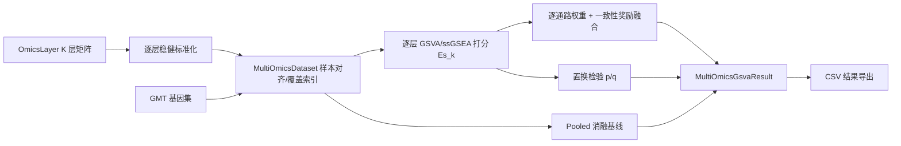

## 产品概述

在 GCModeller 的多组学分析体系中新增一套「多组学基因集变异分析（moGSVA）」能力：把多个组学层（mRNA、甲基化、蛋白等）的表达/丰度矩阵按样本对齐后拼接，在**各组学内部独立**做分布估计与通路富集打分，再把各组学的通路活性按可配置策略加权融合，并显式刻画跨组学方向一致性，最终产出可直接用于下游分析的样本级通路活性矩阵、组学贡献分解表与显著性表。

## 核心功能

- **多组学输入与对齐**：接受任意数量的组学层，每层为「特征 × 样本」矩阵并与跨组学共享的样本轴严格对齐（样本错位、缺失样本、层内重复特征均需处理并给出提示）；同时保留「特征 → 所属组学 → 通路」的三元索引。
- **组学内稳健标准化**：提供不引入外部依赖的逐层标准化选项（分位数归一化、秩变换到 [0,1]、稳健 z 分数、以及对数化），保证量纲差异大的组学不会主导结果；标准化只在组学内部进行，不跨组学混合。
- **组学特异富集打分**：对每个组学层单独计算「通路 × 样本」的富集分数（支持高斯核/泊松核/经验分布的 GSVA 打分，也支持 ssGSEA 打分），某层缺失该通路成员时该层自动跳过而不是记零分。
- **可配置融合层**：逐通路给出组学权重，支持等权、方差倒数加权、信息熵加权、互信息一致性加权，并可叠加「组学特征数平衡项」，权重自动归一化。
- **跨组学一致性建模**：对每通路每样本计算各组学方向的一致程度，作为奖励项对融合分数加成，矛盾时打折；保证融合分数仍落在与原方法相同的取值范围内。
- **组学贡献分解**：输出每条通路在每个样本上由哪个组学主导（各层加权贡献及其占比），无需表型标签即可解释通路活性来源。
- **显著性评估**：通过打乱「特征 → 通路」映射（保持组学归属不变）构建零分布，输出逐通路 p 值与多重检验校正后的 q 值。
- **消融对照**：内置「把拼接矩阵当作单组学直接做一次 GSVA」的对照结果，用于量化分组学打分的必要性。
- **结果导出**：样本×通路活性矩阵、逐组学分项矩阵、通路×组学权重表、组学贡献表、显著性表，均为可读表格，便于与既有工具衔接。

## 验收方式

以真实 TCGA COAD 数据集（真实 mRNA 层 + 由真实矩阵确定性派生的甲基化层与蛋白层）作为主案例运行完整流程，另加一组可控信号的合成数据校验融合逻辑正确性；同时与 R 侧单组学 GSVA（逐层打分后取平均）做逐元素基线比对，并尝试调用 MOGSA / multiGSEA 做对照（环境不具备时给出明确的跳过标记而不阻断测试）。

## 技术栈

- 语言/运行时：VB.NET（net10.0），沿用 moGSVA.vbproj 现有 `RootNamespace = SMRUCC.genomics.Analysis.HTS.GSVA`、`AssemblyName = SMRUCC.genomics.Analysis.HTS.moGSVA`。
- 复用依赖（不修改源码）：`GSVA.vbproj`（单组学 `GSVA.gsva` / `Methods` / `KCDFs` / `colRanksLast`）、`HTS_matrix`（`Matrix`/`DataFrameRow`/`SaveMatrix`）、`FisherCore`（`Background`/`Cluster`/`BackgroundGene`）、`DataStorage`（`NpyFile`/`NpyArray`，仅测试项目使用）、`Math.NET5`（`FalseDiscoveryRate.BHCorrection`）、`Core`（`Math.Information.Entropy`、`Correlations`）。
- 测试/R：`GSVA/test/test.vbproj`（Exe，入口 `ArabidopsisThalianaTest.Main`）+ `Rscript.exe`（R 4.5.0，已装 GSVA/BiocManager/MOFA2，未装 mogsa/multiGSEA）。

## 实现思路

核心策略是「不重写 GSVA 内核，只在其上叠一层组学维度」：

1. **逐层复用**：每层独立构造 `Matrix`，直接调用既有 `GSVA.gsva(expr, background, method, kcdf, min_sz, max_sz, ...)`。这天然满足「分布估计在组学内部进行」的方法学要求，并继承该实现对 R GSVA 已达成 1e-10 逐元素一致的优势（现成证据：`test/ArabidopsisThaliana.vb` 的 `REF_TOLERANCE`）。
2. **在结果层融合**：融合只作用于「通路 × 样本」分数矩阵之间，与打分方法解耦，因此同一套融合/统计代码可服务 GSVA、ssGSEA 两条打分路径，也便于扩展 plage/zscore。
3. **逐通路权重**：每条通路用自己可用的组学集合计算权重（`|S_k| = 0` 的层从权重向量中移除后重归一化），从而自然规避「某通路在蛋白层无注释」的覆盖不均问题，且全程不产生 NaN。
4. **融合公式落地**：等权/方差/熵/互信息/平衡项先算出基础权重并归一化得 `ES_raw = Σ w_k·ES_k`（λ=0 时严格等于「分开做再平均」的基线）；一致性奖励采用归一化乘性形式
`ES_multi = ES_raw · (1 + λ·a) / (1 + λ)`，其中 `a ∈ [-1,1]` 为各层符号一致度。相比 method.md 的加性写法，该形式在 `λ=0` 时与加性基线完全等价，同时保证 `|ES_multi| ≤ |ES_raw|`（不越出 [-1,1]），可被测试断言覆盖。
5. **置换检验的成本控制**：置换只打乱特征→通路映射，表达式矩阵不变；为避免对 14464×160 反复做核密度估计，置换路径默认使用 ssGSEA（基于秩、O(n log n)）作为统计量，并支持 `MaxPathways`/`GeneSubset` 限制规模；测试用小 B（如 50–100）与缩小的基因/通路子集，生产可放大。
6. **确定性**：派生组学层与置换全部使用 `Random(seed)`，同种子两次运行结果必须逐位相同（可断言）。

性能预期：真实数据 14464×160 × 337 通路，逐层 GSVA 约秒级；融合为 `O(P·M·K)`；置换为 `O(B·P·M·K)`（B、P 可裁剪）。

## 实现说明（执行要点）

- **不跨组学拼接后重算**：`pooled` 只在消融对照里出现（特征 ID 加 `omics:` 前缀避免撞名），主流程绝不把多层堆叠后做一次 GSVA。
- **层内重复特征**：gene symbol 重复会让 `expr.rownames.Indexing`（`Index(Of String)`）出问题，建层时必须按基因聚合（取行均值）并 warning。
- **异常与空集**：`GSVA.gsva` 在「映射后基因集为空」或 `expr.size < 2` 时会抛 `InvalidProgramException`，逐层调用需 try/catch，把该层记为不可用并继续，而不是整体失败。
- **保证有界**：融合结果统一做 `[-1,1]` 截断前的数值健康检查（NaN/Inf 检测），权重 ≤ 0 或全零时回退等权。
- **日志**：沿用项目既有 `.info/.warning/.debug` 信息输出风格，打印每层特征数、通路覆盖数、被跳过的通路数、置换进度；不打印矩阵内容（避免刷屏）。
- **影响面控制**：仅新增 moGSVA 源文件；`GSVA.vbproj`、`HTS_matrix`、`DataStorage` 的既有代码零改动；测试项目只新增文件 + 入口分派一处小改动。
- **测试数据适配须防御式**：`r160_subtype.npy` 是 `|O` 对象数组（pickle 协议 3），本机无 Python 3，只能用 `NpyFile` 读。测试代码必须按「类型 + 形状」识别：取最大的二维数值数组作为表达矩阵，取长度等于行数/列数的字符串数组分别作为特征名/样本名，缺失时回退（样本名用 `sampleid_list.txt`，长度须 160 校验）；若特征名与 `kegg_v3.gmt` 基因符号交集不足（例如行名是 Entrez ID），则按固定种子把 gmt 基因符号确定性地分配给矩阵行并打印 warning，保证测试可跑且可复现。

## 架构设计



模块职责：`Omics` 负责数据与标签对齐；`PerOmics` 负责逐层打分与覆盖统计；`Fusion` 负责权重与一致性；`Statistics` 负责置换与多重检验；`Ablation` 负责 pooled 对照；`MultiOmicsGsva` 为门面。

## 目录结构

```
annotations/GSEA/moGSVA/
├── NamespaceDoc.vb                      # [NEW] 命名空间说明（含方法学出处与公式索引）
├── MultiOmicsGsvaOptions.vb             # [NEW] 运行配置：打分方法/核函数/最小最大通路尺寸/融合策略/λ/随机种子/置换次数/是否算 pooled
├── MultiOmicsGsvaResult.vb              # [NEW] 结果模型：scores(pathway×sample)、layerScores(逐层)、weights(通路×组学)、contributions(通路×样本×组学)、consistency、pValues/qValues、coverage、pooledBaseline
├── MultiOmicsGsva.vb                    # [NEW] 门面模块：Compute(dataset, geneSets, options) 串起 打分→融合→统计→消融；另暴露 Recompute(固定权重) 便于消融实验
├── Omics/
│   ├── OmicsLayer.vb                    # [NEW] 单层模型：Name/Expr(Matrix)/FeatureCount/SampleCount；行去重聚合、按基因/样本取子集、ToMatrix 重建
│   ├── OmicsNormalization.vb            # [NEW] 无/分位数/秩单位化/稳健z/对数 五个标准化器，仅作用于层内
│   ├── MultiOmicsDataset.vb             # [NEW] K 层容器：样本轴校验与重排、构建 (feature, omics, gene) 特征表、拼接视图(前缀ID)、每通路每层成员数 |S_k| 索引
│   └── GeneSetTable.vb                  # [NEW] 极简 GMT 解析（跳过 # 注释，ID/描述/成员）→ Background；同时提供 pathway→layer 成员统计
├── PerOmics/
│   ├── OmicsScoreTable.vb               # [NEW] 「通路×样本」分数表 + 缺失层掩码 + 每层覆盖通路集合
│   └── OmicsScorer.vb                   # [NEW] 逐层调用 GSVA.gsva；最小最大尺寸过滤、空集/单基因集保护、异常捕获与告警、耗时记录
├── Fusion/
│   ├── FusionMethod.vb                  # [NEW] Enum FusionMethods{Equal,Variance,Entropy,MutualInformation,Balanced} + IOmicsWeighter 接口
│   ├── WeightCalculators.vb             # [NEW] 五种权重实现（方差倒数、基于分箱的香农熵、基于分箱互信息矩阵的层间一致性权重、1/log2(2+|S_k|) 平衡项及其组合）
│   ├── ConsistencyReward.vb             # [NEW] 逐通路逐样本符号一致度 a_j（加权成对符号乘积的均值）与归一化乘性奖励
│   └── MultiOmicsFusion.vb              # [NEW] 权重归一化/空层剔除/ES_raw/ES_multi/贡献分解(含占比)的统一入口
├── Statistics/
│   ├── PermutationTest.vb               # [NEW] 特征→通路映射置换零分布；固定种子；MaxPathways/GeneSubset/打分方法可配；逐通路经验 p 值
│   └── MultipleTesting.vb               # [NEW] 包装 FalseDiscoveryRate.BHCorrection，输出与输入同序的 q 值
├── Ablation/
│   └── PooledBaseline.vb                # [NEW] 拼接矩阵（前缀ID）做一次单组学 GSVA，与逐层平均对比，输出差异诊断
└── IO/
    └── MultiOmicsResultWriter.vb        # [NEW] 导出 scores/layer_scores/weights/contributions/significance/coverage 六张 csv（复用 Matrix.SaveMatrix 与既有 tsv/csv 写出习惯）

annotations/GSEA/GSVA/test/
├── MoGsvaData.vb                        # [NEW] 数据适配：NpyFile 防御式解析 r160_subtype.npy、sampleid_list.txt、kegg_v3.gmt；构建 mRNA/甲基化/蛋白三层（确定性派生）；另建可控信号合成数据集（可配置激活层与通路）
├── MoGsvaBaseline.vb                    # [NEW] R 基线驱动：写出逐层矩阵 csv 与 genesets tsv → 调 Rscript → 读回逐层参考与平均基线 → 逐元素比对；管理 mogsa/multiGSEA 的可选安装与 SKIP 语义
├── MoGsvaTest.vb                        # [NEW] 断言集合与 Run()：数据/对齐/覆盖、与 R 逐元素、等权=平均、各权重性质、一致性方向性、空层重归一化、pooled 差异、置换 p 值、确定性复跑
├── ArabidopsisThaliana.vb               # [MODIFY] Main 增加参数分派：args(0) 以 "--" 开头时处理 --mogsva/--install-baselines，其余分支保持原 dataDir 行为不变
├── reference/mogsva_reference.R         # [NEW] GSVA 逐层打分 + 平均基线；mogsa/multiGSEA 存在则算、缺失则打印 SKIP 并按开关尝试 BiocManager::install
└── test.vbproj                          # [MODIFY] 无需新增引用（datastorage/moGSVA/GSVA 已就绪），仅在必要时补 NoWarn/OutputPath 说明；StartupObject 保持不变
```

## 关键代码结构（契约示例）

```
Public Enum FusionMethods
    Equal
    Variance
    Entropy
    MutualInformation
    Balanced
End Enum

Public Class MultiOmicsGsvaOptions
    Public Property Method As Methods = Methods.gsva
    Public Property Kcdf As KCDFs? = KCDFs.Gaussian
    Public Property Fusion As FusionMethods = FusionMethods.Equal
    Public Property ConsistencyLambda As Double = 0.25
    Public Property BalanceFeatureSize As Boolean = True
    Public Property MinSize As Integer = 5
    Public Property MaxSize As Integer = 500
    Public Property Permutations As Integer = 0
    Public Property Seed As Integer = 20261026
End Class

' 门面（模块名不用 GSVA，避免与既有同名模块冲突）
Public Function Compute(dataset As MultiOmicsDataset,
                        geneSets As Background,
                        options As MultiOmicsGsvaOptions) As MultiOmicsGsvaResult
```

## Agent Extensions

### Skill

- **lsp-code-analysis**
- 用途：在实现前定位并确认可复用 API 的精确签名与可用性，包括 `GSVA.gsva` 重载与可选参数、`Matrix` 的样本/行子集与 `SaveMatrix` 扩展、`FalseDiscoveryRate.BHCorrection`、`Math.Information.Entropy`、`Correlations`、`NpyArray.AsObjectArray/AsDouble/AsMatrix`。
- 预期产出：一份「可直接调用、无需再猜签名」的复用点清单，避免编译期返工与臆造 API。

### SubAgent

- **code-explorer**
- 用途：在写测试与 R 驱动前，快速核查 `GSVA/test` 现有断言工具（`check`/`println`/`compareOneReference`/`ensureReference`/`locateScript`）与 `reference/gsva_reference.R` 的调用约定，以及 `DataStorage/test/NumpyTest.vb` 中读取同一份 `r160_subtype.npy` 的既有写法。
- 预期产出：测试侧可复用工具清单与 R 脚本调用/输出文件命名约定，保证新增测试与既有基线测试风格统一、互不破坏。