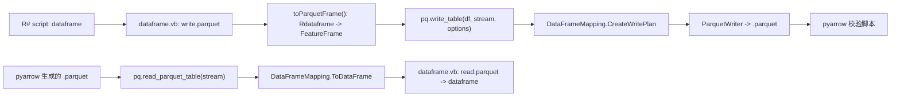

## 产品概述

基于已有的 `Parquet.vbproj`（纯 VB.NET 的 Apache Parquet 读写实现），在 R# 语言的 base 库 `utils/dataframe.vb` 中新增 Parquet 文件格式的读写 API，使 R# 脚本可以把 `dataframe` 对象写成 `.parquet` 文件，也可以把 `.parquet` 文件读成 `dataframe` 对象。完成后用 `C:\ProgramData\anaconda3\python.exe`（已装 pyarrow 14.0.2）做文件格式对拍验证，修复对拍中暴露的 Parquet 库缺陷，并同步更新项目中不准确的描述文本。

## 核心功能

- **`write.parquet(x, file, ...)`**：把 R# `dataframe` 写出为 Parquet 文件。支持写文件路径、可写 `Stream`、以及不传 `file` 时返回原始字节向量。
- 列类型映射：整型/长整型/单精度/双精度/逻辑/字符串/日期时间列分别映射到 Parquet 的 INT32/INT64/FLOAT/DOUBLE/BOOLEAN/BYTE_ARRAY(STRING)/TIMESTAMP_MILLIS 物理类型。
- 行名（rownames）默认写为索引列，读取时可还原；可用参数关闭。
- 可配置压缩算法（none/snappy/gzip）、行组大小（row group size）、是否写统计信息。
- 缺失值处理：数值列的 `NA`/NaN、字符串列的 `NA` 都写成 Parquet 的 null 槽位（对应定义级别低于最大定义级别），而不是空字符串或 0。
- **`read.parquet(file, ...)`**：把 Parquet 文件（含 pyarrow/pandas 生成的文件）读取为 R# `dataframe`。
- 自动按 schema 还原列类型；带 null 的整型列按浮点 + NaN 还原（并在文档中说明这一降级规则）。
- 索引列自动还原为行名，可用参数关闭以保留为普通列。
- 支持多行组、字典编码、DELTA 系列编码、BYTE_STREAM_SPLIT、DataPageV1/V2，以及 UNCOMPRESSED/SNAPPY/GZIP 压缩。
- 出错时返回可读的错误消息，不崩溃；空表（0 行）保留表结构，不丢列。
- **对拍测试**：新增 Python 侧生成/校验脚本与 VB 控制台测试套件，互相验证双方产出的 `.parquet` 文件，覆盖数值、布尔、字符串（含空串与 null）、日期时间、多行组、多种压缩、字典编码、嵌套 list/map/struct、空表与单行表；测试结果统一记录到测试报告。
- **库缺陷修复**：修复导致无法编译的工程引用、以及会造成数值错误/异常/数据损坏的解码与类型映射问题；补齐描述文本（工程元数据、命名空间文档、与实现不符的注释）。

## 技术栈选择

- 语言/运行时：VB.NET（`Option Strict On`），`net10.0`，与现有工程一致（SDK 11.0.100 可编译）。
- 上游依赖：`g:/GCModeller/src/runtime/sciBASIC#/Data/BinaryData/Parquet/Parquet.vbproj`（程序集 `Microsoft.VisualBasic.DataStorage.Parquet`，根命名空间同名）。
- R# 侧：`SMRUCC.Rsharp` 运行时 + `<Package>`/`<ExportAPI>` 元数据机制，`SMRUCC.Rsharp.GetFileStream` 统一处理 file/stream 参数。
- 对拍工具：`C:\ProgramData\anaconda3\python.exe` + pyarrow（已安装 14.0.2，缺失时测试程序自动尝试安装或跳过并记录）。
- 测试报告：`.../Microsoft.VisualBasic.Core/src/ApplicationServices/Debugger/DebugAudit.vb`（现有 `Parquet/test` 工程已在用）。

## 实现方案

### 1) R# 侧 API（核心）

在 `g:/GCModeller/src/R-sharp/Library/base/utils/dataframe.vb` 的 `Module dataframeTools`（`<Package("dataframe")>`）内新增，与相邻的 `write.dataframe`/`read.dataframe` 保持同一 package 与命名风格：

- `read.parquet(file, row_names, env)`：`GetFileStream(file, FileAccess.Read, env, is_filepath:=auto_close)` → `pq.read_parquet_table(stream)`（需新增 Stream 重载，见下）→ `DataFrameMapping.ToDataFrame(schema, columns, numRows)` → 逐列写入 `Rdataframe.columns`（直接复用 `FeatureVector.vector`，已是强类型数组，零拷贝）→ 依据 schema 是否含 `__index__` 决定是否设置 `rownames`。
- `write.parquet(x, file, compression, row_group_size, row_names, stats, env)`：`GetFileStream(file, FileAccess.Write, ...)` → 私有转换器 `toParquetFrame(x, env)` 构造 `Microsoft.VisualBasic.Data.Framework.DataFrame` → `pq.write_table(model, stream, options)`。
- **关键决策：不复用 `anyToFeatureFrame`**。因为它经 `MathDataSet.toFeatureSet` → `FeatureVector.CheckSupports`，而后者只支持 Integer/Short/Long/Single/Double/Boolean/String，会直接拒绝 `Date`/`TimeSpan` 列（抛 "Not supports"）；而 Parquet 写端（`DataFrame.Mapping.CreateLeafNode`）本身支持 Date→TIMESTAMP_MILLIS。因此新写一个专用转换器，按列元素类型分派：7 种基础类型走 `FeatureVector.FromGeneral`，`Date`/`TimeSpan` 走 `FeatureVector` 的 `IEnumerable(Of DateTime)`/`IEnumerable(Of TimeSpan)` 构造器；`Object()`/混合类型列统一转字符串（`NA` 保留为 null）并记录提示消息。
- **NA 归一化**：写前把 `GetType(Void)`（R# 字面量 NA）与 `Nothing` 归一化——字符串列为 `Nothing`（Parquet null），数值列为 `Double.NaN`；读回时数值 null → `Double.NaN`、字符 null → `Nothing`，与 R# 的 `is.na` 语义一致。
- **标量列**：用 `x.getVector(name, fullSize:=True)` 一次性取满长度数组，避免逐行取值。
- 参数校验与错误返回统一走 `RInternal.debug.stop(...)` / `Message.InCompatibleType(...)`，并保证 `auto_close` 分支才关闭流（复用 `read.feather`/`write.feather` 的既有范式）。

### 2) 上游库的必要改造

- `pq.vb`：新增 `read_parquet_table(input As Stream)`、`read_metadata(input As Stream)`、`read_schema(input As Stream)` 重载（读端不关闭调用方流），使 R# 侧可直接在流上取 schema（用于判断 `__index__` 与列路径）。
- `ParquetWriter.Write`：入口加"非 seekable 输出流 → 先写 MemoryStream 再整体复制"的兜底（读端已有 `EnsureSeekable`，写端缺失会导致 `stream.Position` 抛 `NotSupportedException`）。
- `ParquetOptions.Clone()`：对 `NestedColumns` 做字典级拷贝，避免 `Defaults` 共享状态被污染。
- `test/test.vbproj`：修正两处错误的 ProjectReference 相对层级（`..\..\..\Microsoft.VisualBasic.Core\src\Core.vbproj` 需 4 级、`..\..\DataFrame\...` 需 3 级，已用 Test-Path 验证原路径不存在，`test/bin/*` 为空也佐证从未编译成功）。

### 3) 测试策略（先建立对拍，再修缺陷）

- `test/pyarrow/gen_fixture.py`：在临时目录生成覆盖类型矩阵的 `.parquet` 文件（含 `use_dictionary`、`data_page_version`、`column_encoding=DELTA_*`、小 `row_group_size`、`compression=none/snappy/gzip`、`timestamp('ms'/'us')`、`date32`、`decimal128`、`binary`、`list`/`map`(含 null value)/`struct`、0 行与单行表）。
- `test/pyarrow/verify_vb_output.py`：读取 VB 写出的 `.parquet`，把 schema/行列值以 JSON 输出（null 显式标注），供 VB 断言。
- `test/PyArrowInteropTests.vb`：用 `Process` 调用 python（可配置路径，缺失则记 SKIP），对 VB 自身读到 vs pyarrow 期望值、VB 写出 vs pyarrow 解析结果做双向断言；每个断言写入 `DebugAudit`，最终与既有 12 个套件一起汇总为 `parquet-test-report.json`。
- 已知会被对拍命中、需修复的缺陷（按优先级）：`Encodings/BitPacking.vb` 的 `1 << b` 在 bitWidth=32 时溢出为负数（影响 DELTA 系列与词典索引）；`Nested/JsonAssembler.AssembleMap` 中 value 为 null 时 `valueIndex` 无条件自增导致后续 value 全错位；`DataFrame.Mapping` 的 DECIMAL 列走 `Convert.ToDouble(Byte())` 必崩；无 STRING 逻辑类型的 BYTE_ARRAY/FLBA 被强解 UTF8 导致乱码；UINT_8/16/32/64 未处理导致 `uint32` 读成负数；`ToDataFrame` 的表名文本 `parquet[{cols} x {rows}]` 维度写反。

### 4) 端到端脚本验证

用 `-c Rsharp_app_release -p:Platform=x64` 构建 `base.NET5.vbproj`（输出到 `R-sharp/App/net10.0/`），新增 `R-sharp/test/unitTest/parquet.R`：R# 内构造含数值/字符串(含 NA)/逻辑/日期列的 dataframe → `write.parquet` → 调 python 校验 → `read.parquet` 回读并逐列比对 → 再读一个 pyarrow 生成的嵌套文件。用 `R#.exe` 执行，输出 PASS/FAIL。

## 实施注意事项

- **性能**：整体为 O(行数×列数) 单遍处理；读端 `ToDataFrame` 已直接复用 `FeatureVector.vector`，R# 侧不再复制数组。列向量只取一次（`getVector(..., fullSize:=True)`），避免在循环里反复展开标量列。`RowGroupSize` 默认 100 万行且每列单页，大表内存峰值由行组决定——文档中提示用户对超大表调小 `row_group_size`。
- **兼容性/影响范围**：`ReadRleBitPackedHybrid`、`UnpackValue`、`ValueCast.ToTypedArray` 是被所有解码路径共享的热点代码，修改必须保持既有 12 个测试套件全绿；`ToTypedArray` 的签名已带 `node`，UINT 处理基于 `node.Converted`/`node.Logical`，不新增重载。
- **健壮性**：所有新增/修改的解码路径在长度不足、bitWidth 越界、字典索引越界时抛 `ParquetException`（带列路径），不返回静默错值；python 缺失只降级为 SKIP 并写入报告，不使整个测试套件失败。
- **不引入无关重构**：不改变 `FeatureVector`/`Microsoft.VisualBasic.Data.Framework` 的公共契约（`CheckSupports` 保持原样），不改动 R# 核心 `dataframe` 类，不做与本次无关的格式化。

## 架构设计



分层：R# 绑定层（`dataframe.vb`）只做参数解析、流生命周期、NA 归一化与对象转换；格式层（Parquet 工程）只负责 schema/编码/压缩。两者通过 `Microsoft.VisualBasic.Data.Framework.DataFrame` 解耦，不把 R# 类型泄漏进格式层。

## 目录结构

```
g:/GCModeller/src/
├── R-sharp/
│   ├── Library/base/
│   │   ├── base.NET5.vbproj                  # [MODIFY] 增加 Parquet.vbproj 的 ProjectReference；PackageTags 补 parquet；Description 补格式说明
│   │   └── utils/dataframe.vb                # [MODIFY] 新增 read.parquet / write.parquet 与 toParquetFrame、toRDataframe、NA 归一化等私有辅助；补充 XML 文档（base.xml 依赖）
│   └── test/unitTest/parquet.R               # [NEW] R# 端到端脚本：写 parquet -> python 校验 -> 读回比对 -> 读 pyarrow 嵌套文件
└── runtime/sciBASIC#/Data/BinaryData/Parquet/
    ├── pq.vb                                 # [MODIFY] 新增 read_parquet_table/read_metadata/read_schema 的 Stream 重载；补充 XML 注释
    ├── ParquetWriter.vb                      # [MODIFY] 非 seekable 输出流兜底；修正页/统计相关过时注释
    ├── ParquetOptions.vb                     # [MODIFY] Clone 深拷贝 NestedColumns；修正属性文档描述
    ├── WritePlan.vb                          # [MODIFY] 清理未使用的 TypeDefinition 语义或补注释说明
    ├── DataFrame.Mapping.vb                  # [MODIFY] 修正表名维度文本；修复 DECIMAL/二进制/UINT 的读取映射；导出可复用的列转换入口
    ├── Columns/DataColumn.vb                 # [MODIFY] ValueCast.ToTypedArray 支持 UINT_8/16/32/64（基于 node.Converted/Logical 做无符号化）
    ├── Encodings/BitPacking.vb               # [MODIFY] UnpackValue 用 Long 位移避免 bitWidth=32 溢出；bitWidth 越界校验
    ├── Nested/JsonAssembler.vb               # [MODIFY] AssembleMap 按定义级别推进 valueIndex，修复 null value 错位；缺列容错
    ├── NamespaceDoc.vb                       # [MODIFY] 更新命名空间与能力描述文本
    ├── Parquet.vbproj                        # [MODIFY] 更新 Title/AssemblyTitle/Description/PackageTags（去掉未实现能力表述，补 SNAPPY/GZIP、DataPageV1/V2、DELTA 等）
    └── test/
        ├── test.vbproj                       # [MODIFY] 修正两处错误的 ProjectReference 层级；把 pyarrow 脚本设为 CopyToOutputDirectory
        ├── Program.vb                        # [MODIFY] 注册 PyArrow 对拍套件；报告文件名/摘要文本中文化
        ├── PyArrowInteropTests.vb            # [NEW] pyarrow 双向对拍套件（Process 调用 python，断言写入 DebugAudit）
        ├── Frames.vb                         # [MODIFY] 增加 Date/TimeSpan/含 NA 字符串等夹具，供对拍复用
        └── pyarrow/
            ├── gen_fixture.py                # [NEW] 生成覆盖类型矩阵/编码/压缩/嵌套的 .parquet 夹具
            └── verify_vb_output.py           # [NEW] 解析 VB 写出的 .parquet 并输出 JSON 供 VB 断言
```

## 关键代码结构

```
' g:/GCModeller/src/R-sharp/Library/base/utils/dataframe.vb  (Module dataframeTools)
<ExportAPI("read.parquet")>
<RApiReturn(GetType(Rdataframe))>
Public Function readParquet(<RRawVectorArgument> file As Object,
                            Optional row_names As Boolean = True,
                            Optional env As Environment = Nothing) As Object

<ExportAPI("write.parquet")>
<RApiReturn(GetType(Boolean))>
Public Function writeParquet(<RRawVectorArgument> x As Object, file As Object,
                             Optional compression As String = "snappy",
                             Optional row_group_size As Integer = 1000000,
                             Optional row_names As Boolean = True,
                             Optional stats As Boolean = True,
                             Optional env As Environment = Nothing) As Object
```

```
' 私有转换入口（同文件内），把 R# dataframe 转为格式层可消费的模型
Private Function toParquetFrame(x As Object, rowNames As Boolean, env As Environment) As Object
' 成功返回 Microsoft.VisualBasic.Data.Framework.DataFrame，失败返回 Message
```