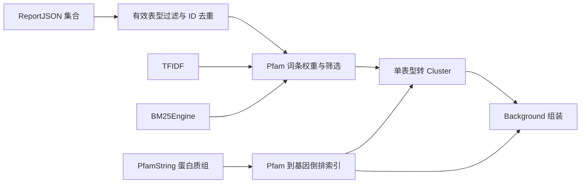

## User Requirements

基于某微生物基因组已完成的全套生物学表型注释结果，构建一份可直接用于转录组／蛋白质组富集分析的知识背景。每条表型作为一个功能聚类；该聚类的成员可以是该表型关联的关键蛋白质结构域，也可以是基因组中携带这些结构域的基因；全部表型聚类汇总为一个知识背景对象。构建过程中需对结构域词条做重要性打分与筛选，并提供两种可切换的打分方式。

## Product Overview

输入为一个基因组的全部表型注释报告（含每条表型的关键结构域清单及其相关性、重要性信息），以及可选的目标基因组蛋白质结构域注释。输出为一个知识背景对象：包含若干以表型为单位的功能聚类，每个聚类带有成员集合与表型描述信息；背景同时记录全基因组规模、名称、构建时间与说明，便于后续富集计算直接使用。数据呈现为「表型—结构域—基因」三层关联，聚类按表型分类组织，成员携带结构域命中信息。

## Core Features

- 单条表型注释转换为一个功能聚类，保留表型标识、名称、分类、预测结果与置信度等描述信息
- 两种成员粒度：结构域级（仅用表型注释）与基因级（联合基因组结构域注释，默认）
- 结构域词条重要性打分：两种策略可切换（默认其一），支持按排名上限或分数阈值筛选
- 全量表型汇总为背景对象：自动跳过未训练／无关键结构域的表型、保证聚类标识唯一、按预测阴阳性不过滤、记录正确的全基因组规模
- 提供控制台测试与测试报告生成，覆盖两种背景、两种打分策略、筛选与边界情况

## Tech Stack Selection

- **语言／框架**：VB.NET，.NET 10.0，SDK 风格工程。沿用目标项目 `GSEA.KB.NET5.vbproj` 的 `RootNamespace` = `SMRUCC.genomics.Analysis.HTS.GSEA.KnowledgeBase`（父类命名空间 `SMRUCC.genomics.Analysis.HTS.GSEA` 中的 `Cluster`／`Background`／`BackgroundGene`／`BackgroundSize` 因此可直接访问，无需额外 Imports，与 `BBHLibrary.vb`、`KEGGCompounds.vb` 一致）。
- **复用既有依赖（均已引用，无需改 vbproj）**：
- `analysis\metaTraits\metaTraits.vbproj`：`SMRUCC.genomics.Analysis.metaTraits.Traitar.ReportJSON`、`...Traitar.Modules.KeyFeature`、`...Traitar.PredictionResults`、`...Traitar.PfamEmbedding`。
- `annotations\GSEA\FisherCore\Fisher.NET5.vbproj`：`SMRUCC.genomics.Analysis.HTS.GSEA.Cluster`／`Background`／`BackgroundGene`／`Enrichment.BackgroundSize`。
- `runtime\sciBASIC#\nlp\NLP\NLP.NET.vbproj`：`Microsoft.VisualBasic.Data.NLP.TFIDF` 与 `Microsoft.VisualBasic.Data.NLP.BM25.BM25Engine`／`IdfVariant`／`SearchResult`／`TermContribution`。
- `core\Bio.Assembly\biocore-netcore5.vbproj`：`SMRUCC.genomics.ProteinModel.PfamString`。
- `runtime\sciBASIC#\Microsoft.VisualBasic.Core\src\Core.vbproj`：`Microsoft.VisualBasic.ApplicationServices.Debugging.DebugAudit`、`NamedValue`、`Microsoft.VisualBasic.Linq`／`Text.Xml.Models` 扩展。
- **测试**：`test\test.vbproj`（`OutputType=Exe`）＋ `DebugAudit`（`Test`／`AreEqual`／`Mark`／`Watch`／`Dump`／`ToJson`／`SaveReport`／`FailureCount`）。

## Implementation Approach

**策略**：把「一条表型 = 一篇文档、一个关键 Pfam = 一个词条」作为统一中间表示，TF-IDF 与 BM25 两套算法各自只负责产出统一的「PfamId → 权重」结果，下游的「单表型 → Cluster」与「全表型 → Background」组装完全共用；两种成员粒度仅仅是成员构造策略不同。这样满足 SoC／DRY，后续新增第三种打分算法不会波及组装层。

**关键技术决策与权衡**：

1. **统一权重中间层**：避免两套算法各自耦合 Cluster 构造，输出统一排序后的词条得分序列，便于共用 topN／阈值筛选与两种成员映射。
2. **配置对象而非多个 Optional 参数**：本项目既有 builder 仅用少量 `Optional` 参数；此处两个入口共享 6 个以上参数（算法、topN、阈值、k1、b、名称）且需规避两个 `CreateBackground` 重载的签名歧义，改用一个可省略、带默认值的 `PhenotypeBackgroundOptions`。这是最小必要的新模式，理由充分；对外仍保留 `Optional options = Nothing` 的省略调用习惯。
3. **tf 编码约束**：`TFIDF.Add(id, counter As Dictionary(Of String, Integer))` 只接受整数 tf，而 `KeyFeature.Importance`／`PearsonCorrelation` 为 Double。采用「基础 1 ＋ 量化后的归一化重要性」作为整数 tf，再乘 IDF，兼顾 API 约束与「重要性 × 稀有度」语义；BM25 侧以重复插入词条体现 tf，由 `K1`／`B` 做词频饱和与长度归一。
4. **基因级映射用倒排索引**：一次构建 `PfamId → 基因集合` 索引，避免对每个表型重复遍历全蛋白质组（N+1）。
5. **`Background.size` 语义**：基因级取「全基因组唯一基因数」，而非 `clusters.BackgroundSize`（后者只统计聚类成员去重数，会低估超几何检验的 universe；`FisherCore\Enrichment.vb:73-77` 注释已明确此约束）。结构域级取全部唯一 PfamId 数。

**性能**：预计算 IDF 字典（TF-IDF 路径不循环调用 `TfidfVectorizer` 触发重复 `DF` 扫描，把 O(V×P) 降为 O(V＋词条总数)；BM25 在 `BuildIndex()` 后 `GetIdf` 为 O(1)）；倒排索引构建 O(总 token 数)；整体 O(P×F ＋ G ＋ V)，空间 O(V ＋ G ＋ 命中数)，其中 P 表型数、F 每表型关键特征数、G 基因数、V 词表大小。

**避免技术债**：不改动既有构建器、FisherCore／metaTraits／NLP 任何代码；返回 `Background` 对象由调用方落盘（`GetXml.SaveTo(out)`），与 `KEGGCompounds.vb`／`BBHLibrary.vb` 完全一致；SDK 工程默认包含新目录 `.vb` 文件，预期无需修改 vbproj。

## Implementation Notes（执行要点）

- **命名空间坑**：`ReportJSON` 全名 `SMRUCC.genomics.Analysis.metaTraits.Traitar.ReportJSON`，`KeyFeature` 为 `...Traitar.Modules.KeyFeature`（R# 的 `workbench\R#\annotationKit\metaTraits.vb:63-66` 已印证）；`PfamString` 以 metaTraits 链路所用的 `SMRUCC.genomics.ProteinModel.PfamString` 为准，**不要**误用旧位置 `SMRUCC.genomics.Data.Xfam.Pfam.PfamString`（`analysis\Metagenome\MetaFunction\test\metaTraitsTest.vb:10` 是历史引用）。`Cluster`／`Background` 在本项目内无需 Imports。
- **TF-IDF 顺序**：`Add` 会清空 `m_words` 缓存，故 `SetWords` 必须在所有 `Add` 之后调用；`Words` 按字典序，`TfidfVectorizer(id)` 与之同序。推荐自建 `IDF` 缓存字典直接算 `tf * idf`，不要对每个词反复调用 `IDF(v)`（内部是全文档线性扫描）。
- **BM25 大小写**：`AddDocument`／`Search` 内部对 token 做 `ToLowerInvariant()`，`TermContribution.Term` 也是小写；PF 编号须统一小写传入并维护「小写 → 原始 PfamId」映射；`docId` 为 Integer，用表型序号；`BuildIndex()` 之后才有 `GetIdf`。
- **健壮性**：跳过 `status = "skipped"` 与 `KeyFeatures` 为 `Nothing`／空的表型；筛选后词条为空时仍纳入该表型但产出**空数组**成员（不可为 `Nothing`，`Cluster.getSize()` 直接取 `members.Length`）；`Cluster.ID` 必须唯一（`Background.Item`／`GetClusterTable` 用 `ToDictionary(Function(c) c.ID)`），对空或重名 `phenotypeId` 加序号后缀；成员基因去重，同一基因命中多个 Pfam 时聚合到 `term_id`。
- **Pfam 解析**：复用 `Traitar.PfamEmbedding.ParsePfamId`（去版本、去 ChouFasman `[...]`、校验 `^PF\d+、`ToUpper`）或 `PfamString.Domains`，避免重复正则与脏数据。
- **筛选语义**：先按 `MinScore` 过滤，再按 `TopN` 截取；`TopN <= 0` 表示不限制；描述信息汇总 `category`（`group_1/group_2` 可拆主／次分类）、`unit`、`predict`、`confidence`、`cvScore`、`sampleCount` 与入选词条。
- **日志与影响面**：库代码不写日志（与既有 builder 一致）；测试用 `DebugAudit` 只记录计数与摘要，不 dump 大对象；`Check`／`Snapshot`／`Capture` 带 `Conditional("DEBUG")`，断言优先用 `Test`／`AreEqual`／`Mark` 以保证 Release 也生效。范围不含 CLI／R# 入口，不改 vbproj（库工程已 `<Compile Remove="test\**" />`）。

## Architecture Design

分四层，全部落在单一新目录内，无跨项目改动：

1. **输入适配层**：`ReportJSON()` 有效性过滤与 ID 去重；`PfamString()` 解析为 Pfam→基因倒排索引。
2. **权重层**：TF-IDF／BM25 两个适配器 → 统一 `PfamTermScore` 序列 + `topN`／`minScore` 筛选。
3. **组装层**：单条 `ReportJSON` + 词条得分 → `Cluster`；两种成员构造策略（结构域级／基因级）。
4. **输出层**：聚类集合 → `Background`（`size`、名称、`build`、`comments`、XML 序列化标记由既有模型提供）。



## Directory Structure

### 目录结构总览

在目标项目新增 `PhenotypeBackground\` 子目录（与 `Metabolism\`、`OntologyBackground\` 并列）承载 3 个 `Public Module`；改造 `test\Program.vb` 并新增测试文件；vbproj 预期不改。

```
g:/GCModeller/src/GCModeller/annotations/GSEA/GSEA.KnowledgeBase.Extensions/
├── PhenotypeBackground/
│   ├── TermWeighting.vb            # [NEW] 权重层。定义 PfamWeightingMethod 枚举、PhenotypeBackgroundOptions 配置、PfamTermScore 统一结果；实现两个适配器：TFIDF（Add/SetWords 顺序、自建 IDF 缓存、整数 tf 编码）与 BM25Engine（Integer docId、小写词条映射、BuildIndex、GetIdf/TermContribution）；实现 MinScore 过滤 + TopN 截取，输出按权重降序的词条序列。
│   ├── PhenotypeClusters.vb        # [NEW] 组装层。实现单条 ReportJSON 到 Cluster 的 AsCluster 扩展方法；两种成员构造：结构域级用 New BackgroundGene(pfamId, description)，基因级用 PfamString.ProteinId 与 BackgroundGene.TermSet 聚合命中 Pfam；实现 PfamString 解析与 Pfam 到基因倒排索引构建（复用 PfamEmbedding.ParsePfamId），保证 members 非空、成员去重、ID/names/category/description 填充完整。
│   ├── PhenotypeBackground.vb      # [NEW] 对外入口。实现 AsCluster 的公开包装与两个 CreateBackground 扩展重载（结构域级：reports；基因级：reports + proteins）；负责表型有效性过滤、ID 唯一化、聚类汇总、Background.size（全基因组唯一基因数／唯一 Pfam 数）、name/id/build/comments 设置；不写文件，返回 Background 对象。
├── test/
│   ├── Program.vb                  # [MODIFY] 由 Hello World 改为测试入口：Reset DebugAudit、调用各测试用例、Console 输出 Dump 摘要、SaveReport 生成 JSON 测试报告、按 FailureCount 设置退出码。
│   ├── PhenotypeBackgroundTest.vb  # [NEW] 内联构造模拟 ReportJSON（trained/skipped、空 KeyFeatures、重名 phenotypeId、阴阳性混合）与模拟 PfamString（含版本号、ChouFasman 脏数据、重复结构域）；用 DebugAudit.Test/AreEqual/Mark/Watch 覆盖两种背景入口、两种算法、TopN/MinScore、跳过无效表型、members 非 Nothing、size 与 ID 唯一、基因命中正确性、GetXml 序列化不抛异常。
├── GSEA.KB.NET5.vbproj             # [不改｜仅验证] 已引用 metaTraits/NLP/FisherCore/biocore/Core；SDK 默认包含新目录 .vb；仅当编译报缺失引用时才补。
└── test/test.vbproj                # [不改｜仅验证] 已引用上述全部工程与 GSEA.KB.NET5.vbproj。
```

## Key Code Structures（仅列关键契约，接口级，无实现体）

```
Public Enum PfamWeightingMethod
    TFIDF = 0
    BM25 = 1
End Enum

Public Class PhenotypeBackgroundOptions
    Public Property Method As PfamWeightingMethod = PfamWeightingMethod.TFIDF
    Public Property TopN As Integer = 20
    Public Property MinScore As Double = 0.0
    Public Property K1 As Double = 1.2
    Public Property B As Double = 0.75
    Public Property GenomeName As String = "Unknown"
End Class

Public Class PfamTermScore
    Public Property PfamId As String
    Public Property Description As String
    Public Property Weight As Double
    Public Property Importance As Double
End Class
```

```
' 公开入口，均为扩展方法，位于 Public Module，返回既有 FisherCore 类型
Public Function AsCluster(report As ReportJSON, terms As IEnumerable(Of PfamTermScore), options As PhenotypeBackgroundOptions) As Cluster
Public Function CreateBackground(reports As IEnumerable(Of ReportJSON), Optional options As PhenotypeBackgroundOptions = Nothing) As Background
Public Function CreateBackground(reports As IEnumerable(Of ReportJSON), proteins As IEnumerable(Of PfamString), Optional options As PhenotypeBackgroundOptions = Nothing) As Background
```

## Agent Extensions

### SubAgent

- **code-explorer**
- Purpose：实施前复核跨项目类型全名（Traitar／FisherCore／biocore／NLP／DebugAudit）、`TFIDF.Add`／`SetWords` 与 `BM25Engine` 的精确签名，以及现有 builder 的 Imports 与调用惯例。
- Expected outcome：产出可直接引用的 Imports 清单与 API 调用契约，消除命名空间与大小写映射错误，避免编译阶段返工。