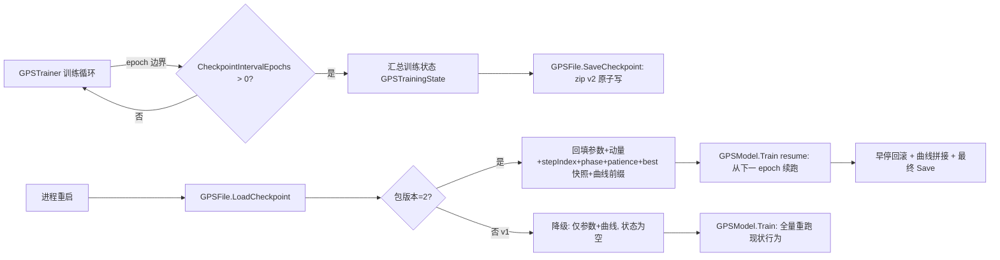

## 产品概述

为 GPS（GNN + Transformer 基因表达调控网络）训练管线增加周期性 checkpoint 与中断恢复续训能力，使训练进程意外中止后，可从最近一次 checkpoint 精确恢复全部训练状态并继续跑完，而不是只能热启动重跑。

## 核心功能

- 周期性 checkpoint：按 epoch 边界（间隔可配置）将模型包原子落盘，含权重、Adam 一阶/二阶矩、全局训练步计数、阶段进度（预训练/微调已完成轮数）、早停状态（patience、最优 epoch 参数快照）与损失曲线前缀。
- 精确恢复续训：从 checkpoint 重建模型后，恢复上述全部状态，从下一 epoch 继续；利用固定随机种子保证数据洗牌顺序与 dropout 序列可复现，续训轨迹与未中断运行逐位一致。
- 完整训练收尾：续训跑完后同样执行早停回滚、损失曲线拼接（历史前缀 + 新段）、最终模型保存。
- 向后兼容：默认关闭（间隔 0）时行为与现状逐位一致；v1 旧包（无新条目）加载时自动降级为现状语义，不报错。
- 顺手修复已发现的回滚缺陷：微调阶段最优 epoch 为第 0 轮时不回滚到最优参数的问题。

## 技术栈选择

- 语言/框架：VB.NET（Option Strict On），.NET 10，复用 GPS 工程（`sub-system/GPS/GPS.vbproj`）与运行时库 sciBASIC#（`src/runtime/sciBASIC#`），不引入新依赖。
- 序列化：沿用既有约定——包结构 zip + `System.Text.Json`（config/manifest/training.json）+ `G17` 文本 TSV（参数与新增的动量表），保证 double 往返无损。
- 测试：沿用 `sub-system/GPS/test/Program.vb` 的 `Check`/`CheckNear` 自测范式。

## 实现方法

总体策略：把"训练状态"提升为一等公民并纳入现有模型包。保存端在 epoch 边界把 trainer 的全部可变状态连同权重一起走 `GPSFile` 的原子写路径；加载端先按 config + expression + prior 重建派生结构，再依次回填参数、优化器动量、训练进度。默认（未配置 checkpoint）时代码路径与现状完全一致。

关键决策与权衡：

- **epoch 粒度而非 step 粒度**：训练循环单线程，epoch 边界天然无撕裂；step 粒度 IO 开销与文本序列化成本不可接受。代价是 epoch 内进度丢失（最多损失一个 epoch 的计算），在计划中向用户明示。
- **改 sciBASIC# 的 `Optimizer` 而非反射**：`_m/_v` 为 Private，GPS 侧无法访问；改为在 `Optimizer.vb` 增加 Public 只读动量访问器与 `Restore` 方法，属纯增量公开成员，不影响任何既有调用点。
- **包版本升到 2 且读取端宽容**：`PackageVersion=2`；加载时对缺失的 `optimizer.tsv`/扩展字段按 v1 降级处理，保证旧包可用。
- **checkpoint 失败不中断训练**：遵循 Harness 日志"写盘失败降级"的既有模式，落盘异常仅警告并继续训练，绝不因 checkpoint 让训练崩溃。

## 实现注意事项

- **性能**：动量表与参数表同尺寸，包体积约翻倍（zip Optimal 压缩后可控）；仅在 epoch 边界写盘，热路径（单步训练）零额外开销。瓶颈仍在训练本身；`Shuffle` 每 epoch 拷贝窗口列表是既有行为，本次不动。
- **精确续训的确定性前提**：`GPSTrainer.rand = New Random(config.Seed + 7919)`、`GRNModel.rand = New Random(config.Seed)`，种子来自 config 且随包持久化；因此恢复后洗牌序列与 dropout 序列可复现。测试需固定 `TensorOps.Seed` 消除混合精度路径的随机性。
- **回滚 bug 修复**：`Finetune` 回滚条件由 `result.BestEpoch > 0` 改为独立的"已发生快照"标志（epoch 为 0 基，第 0 轮最优时原条件不回滚）。
- **原子性与安全**：复用 `Save` 的 tmp + move 原子替换；训练为单线程，无需额外加锁。
- **爆炸半径控制**：`GPSConfig` 新属性经既有反射自动进出 config.json；`Optimizer` 仅增公开成员；`Train()` 原签名保持兼容，续训能力经新重载/新参数暴露。

## 架构设计

数据流：训练循环（GPSTrainer）→ epoch 边界触发 checkpoint 委托 → GPSModel 汇总（参数 + 动量 + trainer 状态 + 曲线前缀）→ GPSFile.SaveCheckpoint 原子写 zip v2；恢复：GPSFile.LoadCheckpoint → 重建 GPSModel → 回填参数/动量/状态 → GPSModel.Train(resume) 从下一 epoch 续跑 → 收尾（早停回滚 + 曲线拼接 + 最终保存）。



## 目录结构

```
g:/GCModeller/src/GCModeller/sub-system/GPS/
├── Config/GPSConfig.vb                 # [MODIFY] 新增 CheckpointPath(String, 默认空) 与 CheckpointIntervalEpochs(Integer, 默认0)；经既有反射自动持久化，无需改 GPSFile 的配置序列化逻辑。
├── Training/GPSTrainer.vb              # [MODIFY] ① Pretrain/Finetune 增加起始 epoch 与恢复状态参数，支持从中间轮次继续；② 暴露 StepIndex 与 RestoreState(GPSTrainingState)；③ Finetune 用 hasSnapshot 标志替换 BestEpoch>0 回滚条件；④ epoch 边界回调 OnCheckpoint（内部或经 GPSModel 挂接）；⑤ 损失曲线前缀拼接（历史 pretrainLoss + 新段）。
├── Training/GPSTrainingState.vb        # [NEW] 训练状态载体：Phase(Pretrain/Finetune)、PretrainEpochsDone、FinetuneEpochsDone、StepIndex、Patience、BestEpoch、BestValidationLoss、BestParameters(名称→Double())、PretrainLoss/TrainLoss/ValidationLoss 历史数组；提供 ToJson/FromJson。
├── Model/ParameterStore.vb             # [MODIFY] 新增 SaveMomenta()/RestoreMomenta(tsv)：内部参数走 entry.State 的动量访问器，外部梯度参数走 _externalM/_externalV；逐项校验名称与元素个数，不匹配立即报错（与 ApplyParameters 同一风格）。
├── GPSModel.vb                         # [MODIFY] ① Train 增加 resume 重载：接收 GPSTrainingState，跳过已完成阶段、续跑剩余轮次、拼接曲线；② 挂接 checkpoint：按 cfg.CheckpointIntervalEpochs 在 epoch 边界调用 GPSFile 保存（异常降级警告）；③ 保留原 Train 签名与默认行为。
├── GPSFile.vb                          # [MODIFY] ① PackageVersion 1→2；② 新增条目 optimizer.tsv（name<TAB>shape<TAB>m值<TAB>v值）与扩展 training.json（stepIndex/phase/epochsDone/patience/best 快照/曲线）；③ SaveCheckpoint(model, path, state) 复用 Save 原子写；④ Load 读取新条目，缺失时按 v1 降级；⑤ manifest 增加 checkpoint 元信息字段。
├── src/runtime/sciBASIC#/Data_science/MachineLearning/DeepLearning/Transformer/Optimizer.vb  # [MODIFY] 新增 Public ReadOnly 动量访问器（一阶/二阶矩张量）与 Public RestoreMomenta(m, v)；纯增量公开成员，写 XML 注释（该库 GenerateDocumentationFile 要求）。
└── test/Program.vb                     # [MODIFY] Main 增加调用 TestCheckpointResume：默认关闭不落盘、中断-恢复轨迹与连续训练逐位一致、v1 包降级、动量往返、best epoch=0 回滚修复，共 5 组断言。
```

## 关键代码结构

新增训练状态载体（其余函数签名在正文已说明，此处仅给最关键的跨模块契约）：

```
''' <summary>
''' 可持久化的训练状态：从 checkpoint 恢复续训所需的全部 trainer 侧状态。
''' </summary>
Public Class GPSTrainingState

    ''' <summary>中断时所处阶段（0=预训练, 1=微调）</summary>
    Public Property Phase As Integer

    ''' <summary>预训练/微调各自已完成的 epoch 数</summary>
    Public Property PretrainEpochsDone As Integer
    Public Property FinetuneEpochsDone As Integer

    ''' <summary>全局参数更新步数（Adam 偏置校正依据）</summary>
    Public Property StepIndex As Integer

    ''' <summary>早停耐心计数与最优 epoch 快照</summary>
    Public Property Patience As Integer
    Public Property BestEpoch As Integer
    Public Property BestValidationLoss As Double
    Public Property BestParameters As Dictionary(Of String, Double())

    ''' <summary>历史损失曲线前缀（续训时与新段拼接）</summary>
    Public Property PretrainLoss As Double()
    Public Property TrainLoss As Double()
    Public Property ValidationLoss As Double()

End Class
```