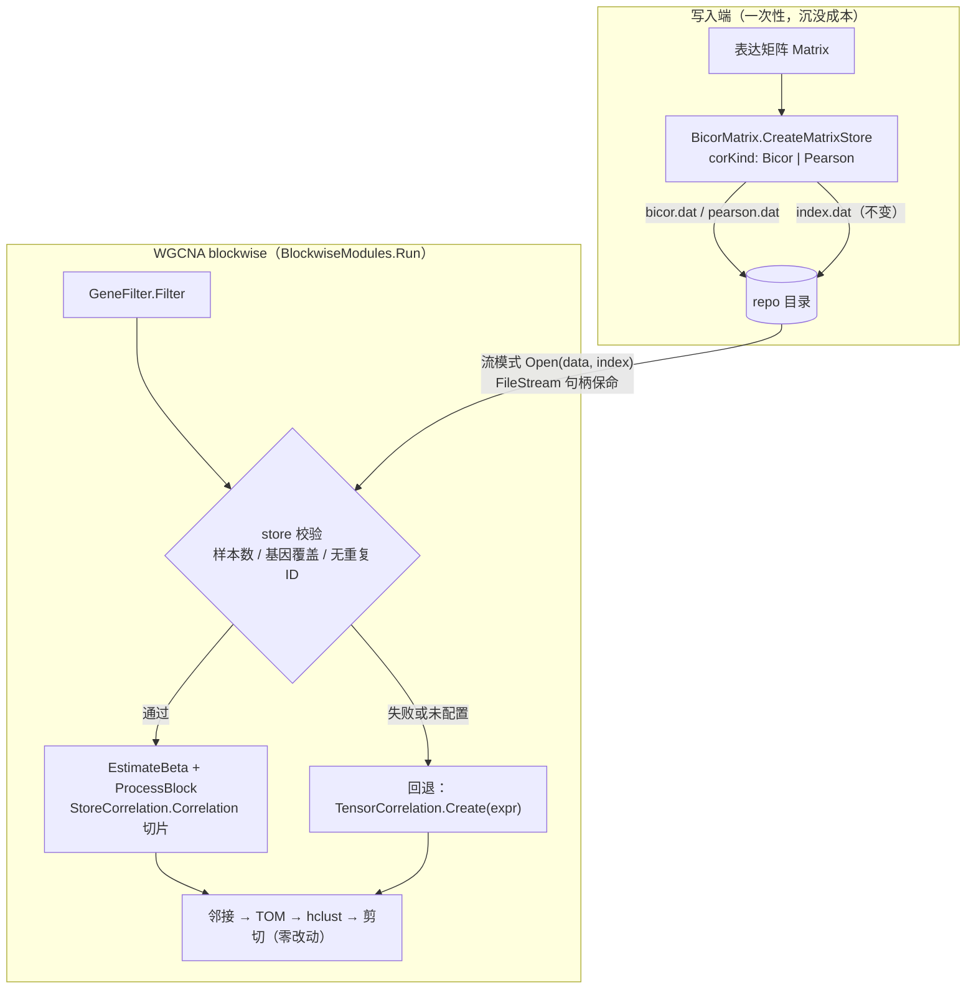

## User Requirements

将预先计算的相关矩阵存储（CorrelationMatrixStore，由 BicorMatrix.CreateMatrixStore 生成）接入 WGCNA 分块计算流程，使 blockwiseModules 直接复用磁盘上的相关矩阵，无需从表达矩阵重算，节省计算时间。已确认的约束：

- store 内相关类型（bicor/pearson）通过数据文件名判别：`{repo}/bicor.dat` 或 `{repo}/pearson.dat`，索引为 `{repo}/index.dat`；不更改存储格式。
- 写入端相关计算函数可配置（bicor 或 pearson），默认 bicor，保持现有行为。
- 基因集合错位在实际使用中应不存在（store 可能由已过滤矩阵生成），但仍必须校验；校验失败回退重算而非中断。
- 样本数校验保留；样本内容一致性由调用方保证。

## Product Overview

WGCNA 分析管线获得“相关矩阵存储”这一可选输入源：配置指定 store 目录后，分块流程从磁盘 store 切片装配块内相关子矩阵；store 缺失、不完整或与输入不匹配时自动回退到表达矩阵重算，分析结果可用性不变。

## Core Features

- 写入端可配置：CreateMatrixStore 支持 bicor/pearson 两种相关类型，按约定文件名落盘
- 读取端组件：以流模式打开 store（管理文件句柄生命周期），按基因 ID 映射行号
- 子矩阵装配：逐行读取 + 列切片生成块内 B×B 相关矩阵（对称化、NaN→0、对角线 1），经既有 FromBuffer 接口注入管线
- 消费接入：blockwise 的 beta 估计与逐块处理优先使用 store；校验（基因覆盖、样本数、输入无重复基因 ID）失败或未配置时回退重算并输出诊断日志
- 缓存指纹同步：模块映射缓存指纹纳入相关矩阵存储来源
- R 入口透传：write_bicor 支持指定相关类型，并让随后运行的 WGCNA 复用刚写入的 store
- 验证：benchmark 支持 store 读写与两种路径的数值/耗时对比

## 技术栈选型

零新增依赖，沿用现有栈：

| 层次 | 选型 | 说明 |
| --- | --- | --- |
| 语言/工程 | VB.NET，net10.0 | `annotations/WGCNA/WGCNA/WGCNA.vbproj`，SDK-style（新 .vb 自动纳入编译，无需手改 vbproj）；`GenerateDocumentationFile=True`（新 Public 成员必须 XML 注释）；`GeneratePackageOnBuild=True`（公开 API 只做向后兼容增量） |
| 相关矩阵存储 | `CorrelationMatrixWriter` / `CorrelationMatrixStore` | sciBASIC# `Data_science/.../Correlation/Persistency.vb`，WGCNA 工程已间接引用 |
| 相关计算 | `Bicor.BiweightMidcorrelation` / `Correlations.GetPearson(x,y)` | 两参数签名均可绑 `Func(Of Double(), Double(), Double)` |
| 消费接缝 | `TensorCorrelation.FromBuffer(buffer, size, sampleSize)` | 既有公共工厂，注释即“用于分块内部的子矩阵装配” |
| 验证 | `annotations/WGCNA/benchmark` 控制台工程 | 已有 `--mode blockwise`、timing.csv 分段耗时、peak RSS 输出 |


**不改动**：`Persistency.vb`（共享存储格式）、`Analysis.Run`（旧的全矩阵非分块路径），控制 blast radius。

## 实现思路

三段式：

1. **写入端可配置化**：`CreateMatrixStore` 末尾追加 `Optional corKind`（默认 Bicor），数据文件按 `{repo}/bicor.dat` / `{repo}/pearson.dat` 命名，索引仍为 `{repo}/index.dat`（沿用 writer 流模式构造的双文件布局）；第 29-36 行逐对计算改为委托分发。文件名约定判别类型，零存储格式改动。
2. **读取端新组件** `StoreCorrelation.vb`：`CorrelationStoreHandle` 以流模式 `Open(data, index, storePath:=...)` 打开，**以字段持有两个 FileStream**（store 流模式不拥有外部流，只提取 SafeFileHandle 走 RandomAccess，丢失引用被 GC 回收会关句柄）；`MapGenes` 按基因 ID（OrdinalIgnoreCase）映射输入行→store 行；`Correlation` 对每个输入行 `ReadRow` 全行 + 列切片，装配 B×B 行主 `Double()` 子矩阵（镜像上三角保证严格对称、NaN→0、对角线置 1），经 `FromBuffer` 注入既有管线。
3. **消费接入**：`BlockwiseModules.Run` 在 GeneFilter 之后打开并校验 store（样本数相等、全部基因覆盖、输入无重复基因 ID）；通过则把 `EstimateBeta`（BlockwiseModules.vb:378）与 `ProcessBlock`（:410）两处 `TensorCorrelation.Create(expr)` 换成“有 store 走切片、否则原路径”；校验失败或未配置时 warning 回退重算。下游邻接/TOM/hclust/剪切及 Partition/MergeCloseModules/ModuleEigengene/ModulePhenotype 零改动。

### 关键决策与权衡

- **文件名约定 vs index 元数据**：用户明确否决改存储格式。代价是歧义需显式处理——同 repo 下两个数据文件并存且未指定类型时 `Open` 抛歧义异常，由 Run 捕获回退。
- **按基因 ID 映射而非假定行序一致**：store 可能建自未过滤矩阵（超集场景，filterTopN 开启时就是这样），ID 映射同时覆盖同集合与超集场景；成本 O(B) 字典查找，可忽略。
- **回退而非抛错**：store 是纯优化项，任何不匹配（缺文件/索引损坏/基因缺失/样本数不符）都降级到既有重算路径，仅记 warning。
- **默认值保持现状**：`corKind` 默认 Bicor，TRN.vb:151 现有调用行为逐字不变；`config.correlationStore` 默认 Nothing，现有调用方零影响。

### 性能与复杂度（如实评估）

- store 路径每轮运行需完整解压一遍 store（N 次 `ReadRow` × N 个 Float，Brotli 解压），约 O(N²) 解压开销；GEMM 重算路径每轮 O(N·B·m) 乘加。B≪N 时两者同量级甚至 GEMM 更优——**净收益在两类场景**：(a) store 沉没成本已付（TRN.vb `write_bicor` 写完 store 后立刻经 `WriteModuleMap` 跑完整 WGCNA，重算浪费就发生在这一处）；(b) 同一数据多次运行/多下游共享。benchmark 用 timing.csv 的 cor 分段实测两种路径。
- 内存：子矩阵 B² doubles 与现路径相同；`ReadRow` 每行 transient N 个 Single；无额外 n² 物化。
- 并发：`maxConcurrentBlocks>1` 时多线程并发 `ReadRow` 安全（SafeFileHandle + `RandomAccess` 无锁，`RowLruCache` 内部有锁，Persistency.vb:663-665 文档明示）。
- 数值预期：Float32 存储约 1e-7 精度；Pearson store 与 GEMM 重算数学等价、末位有差（SIMD 归约 vs 串行求和）；bicor 与 Pearson 语义不同属预期。验证 cor 子矩阵对拍 tolerance 取 1e-5 量级，模块划分用 ARI 比对。

### 执行注意（防回归）

- **日志**：复用 `VBDebugger.EchoLine` + `config.verbose`。成功打印 kind/N/SampleN/基因覆盖数；回退打印具体原因（数据文件缺失/索引缺失/基因缺失数/样本数不符/同 repo 双文件歧义）。不打印大 payload。
- **句柄保命**：`CorrelationStoreHandle` 以字段持有两个 FileStream，`Dispose` 先 Dispose store 再关流；store 用毕（逐块循环结束）立即释放，eigengene/merge/phenotype 阶段不持有。
- **指纹同步**：`WGCNAModuleMap.ComputeFingerprint`（WGCNAModuleMap.vb:194-198）的 config 文本追加 `correlationStore`，避免“同数据不同相关来源”的模块缓存误命中。
- **向后兼容**：所有签名变更均为末尾追加 Optional 参数；`write_bicor` 的 `corKind` 追加在参数列表末尾，保持 R# 位置参数调用兼容。

## 架构设计



数据流：store 行读 + 列切片 → B×B 行主 `Double()` → `TensorCorrelation.FromBuffer` → `WeightedNetwork.AbsCorrelation/BuildAdjacency` → TOM → 聚类/剪切；表达矩阵仍供 Partition、eigengene、membership 消费。

## 目录结构

```
g:/GCModeller/src/GCModeller/
├── annotations/WGCNA/WGCNA/
│   ├── BicorMatrix.vb                # [MODIFY] 写入端。新增 CorrelationKind 枚举；CreateMatrixStore 末尾追加 Optional corKind（默认 Bicor，行为不变）；数据文件按类型命名 bicor.dat/pearson.dat，索引仍 index.dat；第 29-36 行逐对计算改为 Func(Of Double(),Double(),Double) 委托分发（Pearson 绑两参数重载，禁止绑含 ByRef 可选参数的 6 参重载）。新 Public 成员补 XML 注释。
│   ├── StoreCorrelation.vb           # [NEW] 读取端组件（命名空间 SMRUCC.genomics.Analysis.HTS.WGCNA）。CorrelationStoreHandle：流模式 Open（探测 bicor.dat/pearson.dat，双文件并存且未指定类型时抛歧义；索引缺失抛 FileNotFoundException），字段持有两个 FileStream 保命，暴露 Store/Kind/Repo，IDisposable。StoreCorrelation 模块：MapGenes（基因 ID→store 行号，缺失或输入重复返回 Nothing）、Correlation（逐行 ReadRow+列切片→对称化→NaN→0→对角线 1→FromBuffer，sampleSize 取 store.SampleN）。
│   ├── WGCNAConfig.vb                # [MODIFY] 新增 Public Property correlationStore As String = Nothing（store 目录；空=现状重算），带 XML 注释。
│   ├── WGCNAModuleMap.vb             # [MODIFY] ComputeFingerprint 的 config 文本追加 correlationStore，防止不同相关来源的模块缓存互串。
│   └── Algorithm/BlockwiseModules.vb # [MODIFY] Run：GeneFilter 后打开 store+校验（样本数/基因覆盖/重复 ID），失败 warning 回退；逐块循环结束立即 Dispose store；新增私有 CorrelationOf(store,rowMap,inputRows,input) 帮助函数收敛两处调用点；EstimateBeta(:378) 与 ProcessBlock(:410) 改走该帮助函数；ProcessBlock 签名增加 store/rowMap 参数（私有，无兼容影响）；verbose 日志记录 store 使用/回退原因。
├── workbench/R#/cytoscape_toolkit/bioModels/TRN.vb  # [MODIFY] write_bicor 末尾追加 Optional corKind（默认 Bicor）透传给 CreateMatrixStore；将 repo 传给 WriteModuleMap 使其在跑 WGCNA 前注入 wgcnaOpts.correlationStore（克隆配置避免改写调用方对象），兑现“写完 store 立刻复用的 WGCNA”这一核心受益点。
└── annotations/WGCNA/benchmark/Program.vb  # [MODIFY] 验证控制台。新增 --store <repo>（复用）、--writestore <repo>（缺失则从过滤后矩阵创建，corKind 与后续运行一致）、--dumpcor（首块 store 子矩阵 vs GEMM 重算的最大绝对差）；summary.txt 增加 store 诊断（kind/N/SampleN/基因覆盖/cor 分段耗时对比）；实现小型 ARI 用于两轮运行模块划分比对。
```

## 关键代码结构

```
''' 相关矩阵存储中保存的相关系数类型（由数据文件名判别：bicor.dat / pearson.dat）
Public Enum CorrelationKind
    Bicor
    Pearson
End Enum

' BicorMatrix.vb（[MODIFY]，签名末尾追加，默认值保持现有行为）
Public Sub CreateMatrixStore(x As Matrix, repo As String,
                             Optional type As CorrelationEncodings = CorrelationEncodings.Float32,
                             Optional corKind As CorrelationKind = CorrelationKind.Bicor)
```

```
' StoreCorrelation.vb（[NEW]，接口级定义）
Public Class CorrelationStoreHandle : Implements IDisposable
    Public ReadOnly Property Store As CorrelationMatrixStore
    Public ReadOnly Property Kind As CorrelationKind
    Public ReadOnly Property Repo As String
    ' expectKind 非空时要求对应数据文件存在；双文件并存且未指定时抛歧义异常
    Public Shared Function Open(repo As String, Optional expectKind As CorrelationKind? = Nothing) As CorrelationStoreHandle
End Class

Public Module StoreCorrelation
    ' 输入基因 ID → store 行号；任一缺失或输入存在重复 ID 时返回 Nothing
    Public Function MapGenes(store As CorrelationMatrixStore, geneIds As String()) As Integer()
    ' 逐行 ReadRow + 列切片 → 对称化 + NaN→0 + 对角线 1 → TensorCorrelation.FromBuffer
    Public Function Correlation(store As CorrelationMatrixStore, storeRows As Integer()) As TensorCorrelation
End Module
```

```
' WGCNAConfig.vb（[MODIFY]）
''' 预先计算的相关矩阵存储目录；为空时按现状从表达矩阵重算，
''' 非空时校验（基因覆盖/样本数）失败自动回退重算。
Public Property correlationStore As String = Nothing
```

## SubAgent: code-explorer

- Purpose: 改造 TRN.vb 前，以 medium 彻底程度摸清 `write_bicor` 下方 `WriteModuleMap`（TRN.vb:159 起）的完整实现——如何构造 WGCNAConfig、如何调用 blockwise、结果如何落盘，确定注入 `correlationStore` 的最小改法与配置克隆点。
- Expected outcome: 产出 WriteModuleMap 调用链与配置构造位置清单，使 store 注入不破坏现有行为（含 wgcnaOpts 为 Nothing 时的默认配置路径）。

## Skill: lsp-code-analysis

- Purpose: 构建验证阶段用语义分析核对公开 API 向后兼容性——确认 `CreateMatrixStore`、`BlockwiseModules.Run`、`Analysis.RunBlockwise` 全部调用点未因签名变更破坏，并确认新增 Public 成员 XML 文档齐全（GenerateDocumentationFile=True 要求）。
- Expected outcome: 输出兼容性核查结论（无破坏性调用点、无缺失文档），作为零警告构建前置门禁。