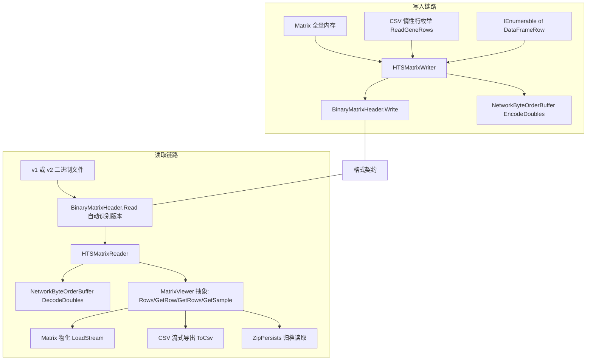

## 产品概述

对 `HTS_matrix-netcore5.vbproj` 的超大型矩阵 IO 能力做审查与补强：在保留现有 CSV 解析性能与二进制随机访问的基础上，补齐"边算边写"的流式二进制生成、"按需取数"的流式惰性读取，以及 CSV 与二进制之间的直通转换，使 GB 级矩阵无需整表驻留内存即可读写。

## 现状审查结论

- 二进制**没有流式生成**：只能把完整 `Matrix` 交给 `BinaryMatrix.Save` 整表落盘。
- 二进制**没有可用的流式惰性读取**：`LoadStream` 全量载入；`HTSMatrixReader` 虽名为随机读，但缓冲区偏移传错（`Read(buffer, scan0, ...)`）导致每次必抛异常，且忽略 `Read` 返回值、非线程安全、逐基因一次 seek。
- CSV **读**已是真流式（逐行迭代 + 批量并行解析 + 预读流水线），但结果仍汇总成整表；**写**已逐行输出；缺"惰性行枚举"与"CSV→二进制"直通。
- 二进制头部无版本号/编解码标记/索引，同一份头部被 `BinaryMatrix`、`HTSMatrixReader`、`ZipPersists` 各自手写解析，是缺陷反复出现的根因。

## 核心功能

1. **流式二进制生成**：给出样本与特征名后，可逐行、逐块写入；不需要持有整表数据；写入完成时才落定行数与特征名（支持边读边算的未知行数场景）；中途异常自动回滚，不留下被误认为合法的半成品文件。
2. **流式惰性读取**：按行号 O(1) 随机取行、按区间批量取行、按样本列整列读取、按基因名取表达向量、逐行惰性枚举（内存只随"块"增长）；同一实例支持并发随机访问；非可定位流（zip 解压流）也能顺序读。
3. **CSV 与二进制互转**：CSV 转二进制时峰值内存为单行级别；二进制转 CSV 时逐行写出；两者都不需要整表驻留。
4. **可选压缩**：写入时可选择不压缩 / gzip / zlib；压缩后仍保留"按块随机访问"能力，代价可预期。
5. **格式演进与兼容**：新文件带版本号；旧版本文件仍可直接读取，无需迁移；旧程序读到新文件会立即明确报错而非静默读错数据。
6. **验证**：提供覆盖往返一致性、随机访问、并发读取、格式兼容、损坏检测、转换等价性的可重复测试，并生成机器可读的测试报告。

## 技术栈选择

- **语言/框架**：VB.NET，目标框架沿用 `net10.0`（与 `HTS_matrix-netcore5.vbproj` 一致），不引入 C# 项目、不新增 NuGet 依赖。
- **复用现有基础设施**：
- `Microsoft.VisualBasic.Core`：`NetworkByteOrderBuffer`（网络字节序编解码）、`Text.IO.BufferedLineReader`、`LineIterators/IterateAllLines`（惰性文本流）、`Index(Of String)`（名称到序号的索引）。
- `System.IO.Compression`：`GZipStream` / `ZLibStream`（.NET 内置）。
- `System.Buffers.ArrayPool(Of Byte)`、`Stream.ReadExactly`（.NET 7+，替代手写 `readFully`）。
- **注意**：VB 编译器不支持 `ReadOnlySpan(Of T)` 作为参数/局部变量（`File/Reader.vb` 注释已说明），零分配 API 一律以 `(buffer As Byte(), offset As Integer, count As Integer, target As Double(), targetOffset As Integer)` 形态设计。

## 实现思路

### 1. 把"头部读写"收敛为唯一实现（消除重复解析）

v1 的头部被三处重复解析（`BinaryMatrix.readMatrix`、`HTSMatrixReader` 构造函数、`ZipPersists.readBinaryMatrix`），这是缺陷反复出现的根因。新增 `BinaryMatrixHeader` 作为**唯一**的头部编解码器，`BinaryMatrix`、`HTSMatrixReader`、`HTSMatrixWriter`、`ZipPersists` 全部复用。

### 2. v2 布局设计（关键决策：换 magic 而不是插版本号）

v1 头部紧随 magic 的是 `BinaryWriter.Write(String)`（7-bit 长度前缀）。若在 magic 后直接插 `Int32` 版本号，旧读取器会把它当字符串长度前缀继续解析，最终在 JSON 反序列化处抛出难以理解的异常——比明确报错更糟。

因此 **v2 使用另一个 21 字节 magic**，保证：

- 旧读取器读到 v2 文件时，第一次 21 字节比较即失败 → `InvalidDataException("invalid magic header string!")`，**立即 fail-fast**；
- 新读取器只需读 21 字节并与两个已知 magic 比较即可判定版本，**无需回退流位置**，对不可 seek 的流同样成立；
- 长度相同（21 字节），`BinaryMatrix.MagicHeader` 常量与 `ZipPersists` 中的 `Encoding.ASCII.GetBytes(...)` 用法不受影响。

```
v1 magic : "GCModeller/HTS_matrix"   (21 bytes, 保持不动, BinaryMatrix.MagicHeader)
v2 magic : "GCModeller/HTS_bin/v2"   (21 bytes, BinaryMatrixHeader.MagicV2)
```

v2 身体布局（**定长整数一律小端**，与 v1 的 `nsamples/nfeatures` 一致；**矩阵数据区仍是网络字节序的大端 double**——这个 v1 已有的"头部小端、负载大端"约定必须原样保留）：

```
[21]  magic  = "GCModeller/HTS_bin/v2"
[i32] version = 2
[i32] flags   bit0..3 codec(0=none,1=gzip,2=zlib), bit8 hasBlockIndex, bit9 featureIdsInTrailer
[1]   dtype   (0 = double, 预留 float32)
[3]   reserved = 0
[str] tag
[i32] nsamples
[i32] nfeatures      (-1 表示"写入方尚未落定"，仅在未 Complete 的文件中出现)
[i32] blockRows      (压缩分块行数；0 = 单块)
[str] sampleIdsJson  (JSON 数组)
[str] featureIdsJson (JSON 数组；flags.bit9 置位时写 "[]"，真实列表在文件尾部)
[i64] blockOffsets[nblocks + 1]   (仅 bit8 置位；相对数据区起点, 便于文件搬迁)
[data] 按块排列的行数据
[str] featureIdsJson (仅 bit9 置位；位于数据区之后，位置可由头部确定性算出)
```

**无需回填的确定性设计**：`blockOffsets` 与尾部特征名位置都可由 `nfeatures/blockRows/nsamples` 直接算出，只有 `nfeatures`（未知行数场景）与 `blockOffsets`（压缩场景）需要在 `Complete()` 时 seek 回填，因此：

- 非压缩：不写 `blockOffsets`，行定位 `dataStart + row * blockSize`，**O(1) 且在不可 seek 的流上也能顺序读**；
- 压缩：要求输出流可 seek（否则显式抛 `NotSupportedException` 并提示改用非压缩），换取"块级随机访问"。

### 3. 写入：`HTSMatrixWriter`

- 内部 `ArrayPool(Of Byte)` 缓冲一整块，凑满一块（压缩时 = `blockRows` 行，非压缩时 = 一个大缓冲）后一次性编码+写出，减少小 I/O。
- `Complete()`：flush 尾块 → 回填 `blockOffsets`/`nfeatures`/尾部特征名 → `Flush`；**未 Complete 即 Dispose 视为失败**：可 seek 时把流截断回头部起点（`CreateFile` 场景同时删除文件），并抛/记录明确错误，杜绝"半成品被下游当合法文件读"。
- 写入时校验每行特征名顺序与 `values.Length == nsamples`（严格模式），把"行列错位"从读取期提前到写入期。

### 4. 读取：`HTSMatrixReader`（重写）

- 用 `Stream.ReadExactly` 取代 `Read` + 忽略返回值（`ZipPersists` 里手写 `readFully` 也一并删除）。
- 随机访问按 `dataStart + row * blockSize` 直接定位；`SyncLock` 串行化"定位+读取"，`ArrayPool` 复用缓冲区，消除 LOH 抖动；`SyncLock` 内不做解码，避免长时间持锁。
- 压缩模式：块缓存（默认保留 2 块，`Dictionary(Of Integer, Double()())` + 简单 LRU），顺序枚举时顺序解压，随机访问时按块解压后切片 → 正确性优先、内存有界。
- `CanRandomAccess` 能力标记：可 seek + 非压缩 = True；压缩 + 有块索引 = True（块级）；不可 seek = False（仅 `Rows()` 顺序读，反向访问抛 `NotSupportedException` 并给出提示）。
- `GetSample(ordinal)` 不能逐行 8 字节读（n 次系统调用），改为**按字节预算分块读**（默认每次读约 1 MB 的连续行块，`rowsPerChunk = max(1, 1MB \ blockSize)`），再从块中抽取该列。
- `GetGeneExpression(geneID(), sampleOrdinal)`：先排序去重请求的行号，再按偏移取单值（用 `DecodeDouble(buffer, offset)` 零分配解码），减少随机寻道次数。

### 5. 零分配编解码（扩展 runtime）

在 `NetworkByteOrderBuffer` 上**只做加法**，现有 `encode/decode` 委托签名保持不变：

- `Public Function DecodeDouble(buffer As Byte(), offset As Integer) As Double` —— 通过位移拼 `Int64` 后 `BitConverter.Int64BitsToDouble`，与主机字节序无关、零分配；
- `Public Sub EncodeDouble(value As Double, buffer As Byte(), offset As Integer)`；
- `Public Sub DecodeDoubles(buffer As Byte(), offset As Integer, count As Integer, target As Double(), targetOffset As Integer)`；
- `Public Sub EncodeDoubles(data As Double(), offset As Integer, count As Integer, buffer As Byte(), bufferOffset As Integer)`。

### 6. CSV：把"流式输入"补成"流式端到端"

`Reader.loadGeneMatrixParallel` 已经是"128 行批量并行解析 + `Task.Run` 预读下一批"的流水线，但它把结果 `AddRange` 进 `List` 后 `ToArray`。改造方式（**复用而非重写**）：

- 把 `ReadBatch`/`ParseBatch` 提升为 `Friend`，新增 `Iterator Function ReadGeneRows(path, takeIndex, degreeOfParallelism) As IEnumerable(Of DataFrameRow)`：批次内并行解析、批次间保持顺序、边解析边 `Yield`，峰值内存 = 一个批次（约 128 行）。
- `loadGeneMatrixParallel` 退化为 `ReadGeneRows(...).ToArray()` 的薄包装（DRY，两条路径不会漂移）。
- `ToBinary(csvPath, binPath, ...)`：单遍——扫描头部取样本名 → `HTSMatrixWriter.CreateFile(..., featureIDs:=Nothing)`（头部 `nfeatures = -1`）→ 逐行 `WriteRow` → `Complete()` 回填；峰值内存 = 一个批次 + 块缓冲。
- `ToCsv(binPath, csvPath)`：`Using reader = New HTSMatrixReader(path)`，输出头部后 `For Each row In reader.Rows()` 逐行写出；与 `SaveMatrix` 共用同一个行写出函数。

### 7. 兼容性与爆炸半径控制

- `BinaryMatrix.MagicHeader`（`Public Const`）**保持不变**，新增 `BinaryMatrixHeader.MagicV2`。
- `BinaryMatrix.Save/LoadStream(Stream)` 的"内部 dispose 传入流"语义**保持不变**（`GEARSStorage`、`ZipPersists`、R# 的现有行为依赖它，改动会造成泄漏或双关闭），仅新增 `leaveOpen` 重载。
- `HTSMatrixReader` 的既有公共成员（`SampleIDs/FeatureIDs/Size/tag/GetSampleOrdinal/GetGeneExpression(...)/SetNewGeneIDs/SetNewSampleIDs/Dispose`）签名全部保留，R# 的 `load.expr0(lazy=TRUE)` 与 `matrix_info` 无需改动即从"必崩"变为可用。
- **必须同步适配**：`ZipPersists.readBinaryMatrix` 是唯一的手写 v1 解析方，写出侧一旦切到 v2，它的 magic 校验必然失败——改为复用 `BinaryMatrixHeader`/`HTSMatrixReader`，并顺带删掉其 `readFully`/`sameBytes`。
- **自动兼容**：`GEARSStorage` 走 `BinaryMatrix.Save/LoadStream`，无需改动即可读写 v2；其中"把 zip 条目拷贝到 `MemoryStream`"的缓冲可去掉（超大矩阵时这一拷贝会翻倍内存），作为低风险可选优化。

### 8. 性能与可靠性要点

- 写出：每块一次编码、零中间字符串；压缩用 `CompressionLevel.Fastest`（G/H 类稀疏矩阵压缩收益高，`Optimal` 在 GB 级数据上 CPU 代价不划算）。
- 读取：行 O(1)；`GetRows` 受单次读取字节上限约束，避免一次读几百 MB；缓冲区走 `ArrayPool`，避免 `blockSize`（3 万样本时 240 KB）直接进 LOH。
- 并发：单实例随机访问线程安全（内部串行化，无死锁，锁内不做解码）；`Rows()` 迭代器明确标注不可与其他访问并发。
- 错误处理：magic 错 / 版本未知 / 行数据不足 → `InvalidDataException`，消息含文件名、期望行数与已读行数；压缩且不可 seek → `NotSupportedException` 并给出"改用非压缩或 `MemoryStream` 中转"的提示；`nfeatures < 0` → 提示"文件未完成写入"。
- 数据保护：`CreateFile` 先写临时文件名，`Complete()` 成功后原子替换目标文件，失败则删除临时文件，避免覆盖既有可用归档。

## 架构设计



分层：**格式层**（`BinaryMatrixHeader`）→ **编解码层**（`NetworkByteOrderBuffer`）→ **流层**（`HTSMatrixWriter`/`HTSMatrixReader`）→ **门面层**（`BinaryMatrix`/`Document`/`Matrix`）→ **消费方**（R#、SGrid、GEARS）。上层只依赖抽象 `MatrixViewer`，内存版 `HTSMatrixViewer` 与磁盘版 `HTSMatrixReader` 可互换。

## 目录结构

```
analysis/HTS_matrix/
├── File/
│   ├── BinaryData/
│   │   ├── BinaryMatrixFormat.vb   # [NEW] 格式契约层：MagicV1/MagicV2 常量、BinaryMatrixCodec 枚举、
│   │   │                           #        BinaryMatrixHeader（Version/Flags/Codec/Dtype/Nsamples/Nfeatures/
│   │   │                           #        BlockRows/SampleIds/FeatureIds/BlockOffsets/DataStart/BlockSize/
│   │   │                           #        SourceVersion）。提供 Shared Read(BinaryReader) 自动识别 v1/v2、
│   │   │                           #        Shared Write(BinaryWriter, header)、Shared Patch(writer, header) 回填。
│   │   │                           #        职责：全项目唯一定长头编解码实现，禁止其他文件再手写头部偏移。
│   │   ├── HTSMatrixWriter.vb      # [NEW] 流式写入器（IDisposable）。Create/CreateFile 工厂（codec、blockRows、
│   │   │                           #        writeIndex 参数）；WriteRow/WriteRow(DataFrameRow)/WriteRows/WriteBlock；
│   │   │                           #        Flush/Complete；内部 ArrayPool 块缓冲、压缩分块、偏移表回填、
│   │   │                           #        nfeatures 与尾部 featureIds 落定、行数与特征名校验、
│   │   │                           #        未 Complete 即 Dispose 的截断/删除回滚。文件模式用临时文件+原子替换。
│   │   ├── HTSMatrixReader.vb      # [REWRITE] 流式惰性读取器。保留全部既有公共成员（R# 兼容）；
│   │   │                           #        修复 Read(buffer, scan0, ...) 越界、改用 ReadExactly 处理部分读；
│   │   │                           #        新增 Rows()/GetRow(i)/GetRows(start,count)/GetSample(ordinal)/
│   │   │                           #        CanRandomAccess/Codec/Version；SyncLock + ArrayPool 保证并发安全；
│   │   │                           #        压缩模式块缓存与 LRU；不可 seek 流的顺序降级与明确异常；
│   │   │                           #        读入时校验数据区完整性（截断检测）。
│   │   ├── MatrixViewer.vb         # [MODIFY] 抽象层补齐：Overridable GetRow(index)/GetRows(start,count)/
│   │   │                           #        Rows()/GetSample(ordinal)/CanRandomAccess/AsMatrix()，
│   │   │                           #        默认实现基于既有 GetGeneExpression 以避免破坏子类。
│   │   ├── HTSMatrixViewer.vb      # [MODIFY] 实现新增抽象成员；修复 GetGeneExpression(geneID(), sampleOrdinal)
│   │   │                           #        第 125 行误用循环变量 i 而非 rowId 的既有缺陷。
│   │   └── BinaryMatrix.vb         # [MODIFY] Save 改为委托 HTSMatrixWriter（保留 dispose 语义，新增 leaveOpen 重载）；
│   │                               #        LoadStream 改为基于 BinaryMatrixHeader 的按维度精确读取（修复
│   │                               #        buffer.Length>Position 判定，支持 zip 解压流）；新增 Open(stream/path)
│   │                               #        返回 HTSMatrixReader；保留 MagicHeader 常量不动。
│   ├── Document.vb                 # [MODIFY] 新增 Iterator ReadGeneRows(path, excludes/takeIndex, batchSize,
│   │                               #        degreeOfParallelism)：真正的惰性行枚举；新增 WriteRows(writer, sampleIDs,
│   │                               #        rows) 供 SaveMatrix 与 ToCsv 共用；新增 ToBinary(csv→bin 单遍) 与
│   │                               #        ToCsv(bin→csv 流式)；SaveMatrix 改走 WriteRows。
│   └── Reader.vb                   # [MODIFY] ReadBatch/ParseBatch 提升为 Friend 供惰性迭代器复用；
│                                   #        loadGeneMatrixParallel 退化为 ReadGeneRows(...).ToArray() 薄包装；
│                                   #        现有 ParseGeneRow/ParseNumber 零分配解析逻辑保持不变。
├── Matrix/
│   └── Matrix.vb                   # [MODIFY] LoadStreamData 支持 v1/v2；新增 LoadLazy(path) 返回 HTSMatrixReader；
│                                   #        SaveBinary(path, codec, blockRows) 流式落盘，避免先物化。
├── test/
│   ├── Program.vb                  # [REWRITE] 测试入口：DebugAudit.Reset → 依次执行用例 →
│   │                               #        DebugAudit.Dump 输出摘要 → SaveReport("report/hts_matrix_io.json")；
│   │                               #        按失败数设置进程退出码。
│   └── MatrixIoTest.vb             # [NEW] 用例集：v1/v2 往返一致性、随机访问（行/区间/列/基因名）、
│                                   #        Parallel.For 并发读取、CSV→bin→CSV 数值等价、
│                                   #        压缩模式顺序与块级随机访问、截断/坏 magic/坏版本检测、
│                                   #        MatrixViewer 多态一致性（内存版 vs 磁盘版）。
└── HTS_matrix-netcore5.vbproj      # 无需修改（新文件按默认通配符自动纳入编译）

跨项目（格式消费方，必须适配）
sub-system/PLAS.NET/SGrid/IO/ZipPersists.vb   # [MODIFY] 删除手写 v1 头部解析与 readFully/sameBytes，
                                              #          改用 BinaryMatrixHeader / HTSMatrixReader；
                                              #          writeBinaryMatrix 改用 HTSMatrixWriter（去掉先构造 Matrix）
sub-system/GEARS/IO/GEARSStorage.vb           # [MODIFY-可选] ReadExpression 去掉 MemoryStream 全量缓冲，
                                              #          直接顺序读取；WriteExpression 走 writer 门面

运行时（只加不删）
runtime/sciBASIC#/Microsoft.VisualBasic.Core/src/Serialization/BinaryDumping/
└── NetworkByteOrderBuffer.vb      # [MODIFY] 新增 DecodeDouble(buffer,offset)、EncodeDouble(value,buffer,offset)、
                                   #        DecodeDoubles/EncodeDoubles(buffer,offset,count,target,targetOffset)；
                                   #        现有 encode/decode 委托与 GetBytes/ToDouble 保持不变
```

## 关键代码结构

```
''' <summary>v1/v2 二进制矩阵头部（全项目唯一定长头编解码实现）</summary>
Public Class BinaryMatrixHeader
    Public Property Version As Integer          ' 1 or 2
    Public Property Codec As BinaryMatrixCodec  ' none / gzip / zlib
    Public Property DataType As Byte            ' 0 = double(network byte order)
    Public Property tag As String
    Public Property Nsamples As Integer
    Public Property Nfeatures As Integer        ' -1 = 写入方未落定(文件不完整)
    Public Property BlockRows As Integer
    Public Property SampleIds As String()
    Public Property FeatureIds As String()
    Public Property BlockOffsets As Long()      ' 相对数据区起点; Nothing = 无块索引
    Public Property DataStart As Long           ' 由读取方按自身位置推算, 不写入头部
    Public ReadOnly Property BlockSize As Integer        ' Nsamples * 8
    Public ReadOnly Property CanRandomAccess(stream As Stream) As Boolean
    Public Shared Function Read(reader As BinaryReader) As BinaryMatrixHeader
    Public Shared Sub Write(writer As BinaryWriter, header As BinaryMatrixHeader)
End Class
```

```
''' <summary>增量写入：不要求整表驻留内存</summary>
Public Class HTSMatrixWriter : Implements IDisposable
    Public Shared Function Create(stream As Stream, sampleIDs As String(),
                                  Optional featureIDs As String() = Nothing,
                                  Optional tag As String = Nothing,
                                  Optional codec As BinaryMatrixCodec = BinaryMatrixCodec.none,
                                  Optional blockRows As Integer = 512,
                                  Optional leaveOpen As Boolean = False) As HTSMatrixWriter
    Public Shared Function CreateFile(path As String, sampleIDs As String(),
                                      Optional featureIDs As String() = Nothing,
                                      Optional tag As String = Nothing,
                                      Optional codec As BinaryMatrixCodec = BinaryMatrixCodec.none,
                                      Optional blockRows As Integer = 512) As HTSMatrixWriter
    Public Sub WriteRow(featureID As String, values As Double())
    Public Sub WriteRow(row As DataFrameRow)
    Public Sub WriteRows(rows As IEnumerable(Of DataFrameRow))
    Public Sub WriteBlock(rows As DataFrameRow(), offset As Integer, count As Integer)
    Public Sub Flush()
    Public Sub Complete()   ' 回填 nfeatures/块偏移/尾部特征名; 之后不可再 Write
    Public Sub Dispose()    ' 未 Complete → 回滚(截断/删临时文件)
End Class
```

```
Public MustInherit Class MatrixViewer
    ' 既有抽象成员保持不变
    Public Overridable ReadOnly Property CanRandomAccess As Boolean
    Public Overridable Function GetRow(index As Integer) As DataFrameRow
    Public Overridable Function GetRows(start As Integer, count As Integer) As DataFrameRow()
    Public Overridable Iterator Function Rows() As IEnumerable(Of DataFrameRow)
    Public Overridable Function GetSample(sampleOrdinal As Integer) As Double()
End Class
```

## Agent Extensions

### Skill

- **lsp-code-analysis**
- Purpose: 在改造 `BinaryMatrix.Save/LoadStream`、`MatrixViewer` 抽象与 `HTSMatrixReader` 公共成员时，精确找出全部引用点（含 R#、`ZipPersists`、`GEARSStorage`、mzkit 等跨项目调用），并核对签名变更的影响面。
- Expected outcome: 得到一份可验证的"调用点清单"，确保格式切换后没有任何消费方被漏改，且既有 public 签名保持兼容。