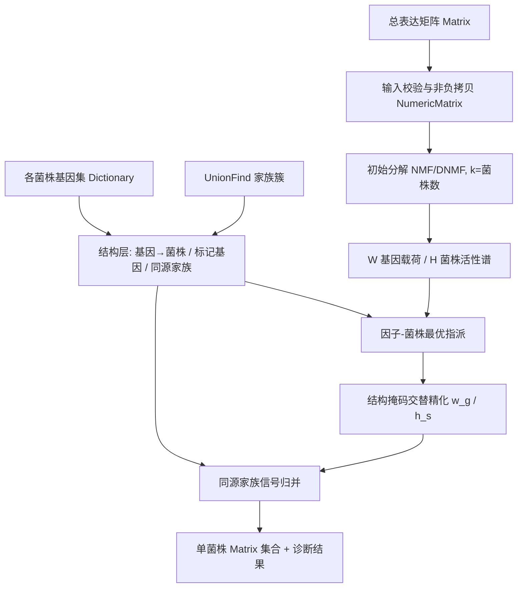

## 产品概述

面向"5 株菌合成菌群"的转录组定量结果，构建一套可复用的矩阵分解流程：输入一张以"5 个基因组全部基因并集"为行、样本为列的总 hits 表达矩阵，以及各菌株的基因集与跨菌株同源基因家族关系，输出 5 张各自独立的"单菌株基因表达矩阵"（行=该菌株自身基因，列=与原矩阵一致的样本）。

## 核心功能

- 总矩阵输入与校验：接受 `Matrix` 对象（`geneID` 行 + `sampleID` 列），校验非负性、行标签覆盖率、样本数是否满足分解条件。
- 结构信息整合：由 `Dictionary(Of String, String())`（基因组 ID → 基因 ID 列表）建立"基因 → 菌株"归属；由基因家族同源关系识别跨菌株同源基因簇，区分"菌株特有标记基因"与"同源歧义基因"。
- 菌株因子分解：把总矩阵分解为"菌株活性谱（菌株 × 样本）"与"基因载荷（基因 × 菌株因子）"，因子数默认等于菌株数。
- 因子与菌株的一对一匹配：以菌株特有标记基因的载荷为依据自动判定每个因子对应哪个菌株，并给出匹配得分。
- 单菌株矩阵重构：为每个菌株输出只含自身基因行、只含自身表达贡献的 `Matrix`；同源基因家族的共享信号归还给该家族的"本菌株拷贝"行，避免跨菌株重复计数。
- 结果返回与导出：主入口返回以基因组 ID 为键的 `Dictionary(Of String, Matrix)`（即 `Matrix` 对象集合），同时提供含诊断信息的结果对象与按菌株批量导出 CSV 的能力。
- 边界情况处理：样本数不足、某菌株无表达行、基因 ID 跨基因组重复、矩阵含负值或 NaN 时给出明确报错或降级路径与告警。

## 技术栈

- 语言/平台：VB.NET，`net10.0`（沿用 `HTS_matrix-netcore5.vbproj` 现有配置，无需改项目文件）。
- 复用组件：
- `Matrix` / `DataFrameRow`（`HTS_matrix\Matrix\Matrix.vb`）：数据模型、`ArrayPack`、`INumericMatrix` 实现、对象初始化器写法。
- `Document.SaveMatrix` / `WriteCsvHeader` / `WriteCsvRows`（`HTS_matrix\File\Document.vb`）：结果导出。
- `UnionFind`（`SMRUCC.genomics.ComponentModel.Annotation`）：`GetClusters()` 提供"全部并集基因 + 基因家族簇"；`AddElements` / `UnionRange` 构造家族。
- `NMF.Factorisation` / `DNMF.Factorisation`（`Microsoft.VisualBasic.Math.LinearAlgebra.Matrix` 命名空间）：非负矩阵分解核心迭代器。
- `NumericMatrix`：构造 `New NumericMatrix(matrix)`（内部调用 `ArrayPack`）、`Item(i,j)`、`RowDimension` / `ColumnDimension`。
- `DebugAudit`（`Core.vbproj`）：测试断言与报告导出（遵循用户规则）。

## 实现方案

### 总体策略

采用"**结构先验 + 非负分解 + 掩码精化**"三段式流程：先用 `DNMF`（默认，标签=每行基因所属菌株索引）或 `NMF` 求全局菌株活性因子；再用菌株特有标记基因完成"因子 → 菌株"最优指派；最后在"每行基因只能挂载到自身菌株因子"的结构掩码约束下做若干轮闭式交替非负最小二乘，得到可辨识、可解释且各菌株互不越界的重构矩阵。`UnionFind` 的家族簇用于标记基因判定、同源歧义识别与家族信号归并。

### 关键决策与理由

1. **分解方向**：总矩阵为 `m 基因 × n 样本`，直接送入 `NMF/DNMF` 得到 `W`（基因 × k 载荷）与 `H`（k × 样本活性谱）。k 取菌株数，与"物种去卷积"假设一致：同菌株基因共享样本活性形状，跨菌株差异由不同因子承载。
2. **默认使用 DNMF**：每个并集基因的唯一归属菌株天然构成合法标签数组（长度 = 行数），Fisher 类内/类间约束使同菌株基因在 `W` 上聚拢、不同菌株分离，显著提升指派稳定性；同时保留 `NMF` 纯无监督路径作为可选项。
3. **必须做因子-菌株指派**：NMF 类算法因子顺序任意，不能用"第 i 个因子 = 第 i 个菌株"。以"无跨菌株同源基因"的标记基因载荷均值构造 `k × s` 评分矩阵，`k ≤ 8` 时枚举全排列取最大总得分（确定性、无外部依赖），否则退化为贪心 + 交换改进。
4. **掩码精化而非仅靠 NMF 结果**：NMF 无约束解不保证"菌株 A 的基因不携带菌株 B 的信号"。在指派固定后执行掩码交替最小二乘（`w_g ← (A_g·h_s)/(h_s·h_s)`，`h_s ← Σ_{g∈s} w_g A_g / Σ w_g²`），每株独立更新、天然非负、闭式解、无超参，收敛快且可分菌株并行。这是本流程与"直接调用 NMF"的关键差异，也是结果可重复的保证。
5. **同源家族归并**：对含跨菌株成员的家族簇，把该簇在组分 `c_s` 上的重构总量写回菌株 s 自己的那条基因行。家族层面总质量严格守恒（Σ_s Σ_{g∈簇} = Σ_{g∈簇} Σ_s），既不丢信号也不跨株重复计数。
6. **不做相似度权重反卷积**：`UnionFind` 只提供家族成员关系（无 identity/相似度），缺少权重时构造混合矩阵属于伪精度；故采用"结构掩码 + 家族归并"规避，避免引入不可验证参数。

### 性能与复杂度

- `NumericMatrix` 为稠密 `Double()()`；一次性 `O(m·n)` 拷贝。`DNMF` 内部校验本身是 `O(m·n)`，故进入前不再重复全量扫描（仅利用 `ArrayPack` 做一次非负/有限性检查并同时完成拷贝）。
- 每轮分裂更新的计算量为 `O(m·n·k)`，k ≈ 5，`m ≈ 2–3 万`、`n` 为几十，单轮在毫秒级；`max_iterations` 默认 300（NMF 的 `tolerance` 与绝对平方误差比较，实际几乎必然跑满，故默认值需保守），精化轮默认 60 轮 + 相对变化 `1e-6` 提前收敛。
- 归并与重构按菌株并行（每株只写自己的行槽位，无共享归约，结果与线程调度无关）；注意 `Microsoft.VisualBasic.Parallel` 会遮蔽同名类型，必须全限定 `System.Threading.Tasks.Parallel` 并设置 `ParallelOptions.MaxDegreeOfParallelism`（`HVG.vb` 已有同类注释可参照）。
- 输出内存 ≈ 总矩阵规模（各菌株基因行数之和 = 总行数），无额外数量级开销。

### 边界与降级

- `sample_count < 菌株数` 时 `k ≤ min(rows, cols)` 不成立，无法分解：降级为"按基因集直接切分总矩阵行 + 同源家族信号按成员均分"，返回结果并 `warning` 说明未做分解。
- 某菌株在总矩阵中无任何基因行：返回空矩阵 + `warning`，不中断其余菌株。
- 基因 ID 跨基因组重复：`Strict=True` 抛 `ArgumentException` 并列出前 10 个冲突 ID；`Strict=False` 取首个归属并告警。
- 总矩阵含负值/NaN：抛 `ArgumentException`，提示先做 `log`/`MinMaxNorm` 等非负化处理（NMF/DNMF 数学上要求非负）。

## 架构设计



模块职责划分：

- **结构层**（`CommunityStructure` 内部类）：基因归属索引、家族簇标准化、标记基因集合、家族成员表。
- **分解层**：`NMF` / `DNMF` 适配 + 指派算法 + 掩码精化迭代。
- **重构层**：按菌株生成 `DataFrameRow()`，同源归并、可选零行补齐、可选列总量校正。
- **输出层**：`CommunityDecomposition` 结果对象、`SaveAll` CSV 导出。

## 目录结构

```
src/GCModeller/analysis/HTS_matrix/
├── Math/
│   └── Decomposition.vb                    # [MODIFY] 主实现：DecompositionOptions / CommunityDecomposition /
│                                           #   Decomposition（Decompose、DecomposeMatrices、SaveAll、
│                                           #   BuildCommunityStructure、AssignFactors、RefineMasked、MergeHomologs）
└── test/
    ├── DecompositionTest.vb                # [NEW] 合成菌群分解的 DebugAudit 回归测试
    └── Program.vb                          # [MODIFY] Main 中追加 DecompositionTest.Run()
```

## 关键代码结构

```
Public Enum DecompositionMethod
    DNMF = 0   ' 默认：标签=每行基因归属菌株
    NMF = 1    ' 纯无监督
End Enum

Public Class DecompositionOptions
    Public Property Method As DecompositionMethod = DecompositionMethod.DNMF
    Public Property MaxIterations As Integer = 300
    Public Property Tolerance As Double = 0.00001
    Public Property Epsilon As Double = 0.000001
    Public Property RandomSeed As Integer?
    Public Property LambdaWithin As Double = 0.1
    Public Property LambdaBetween As Double = 0.1
    Public Property RefineIterations As Integer = 60
    Public Property RefineTolerance As Double = 0.000001
    Public Property RedistributeHomologs As Boolean = True
    Public Property IncludeSilentGenes As Boolean = False
    Public Property RescaleToTotal As Boolean = False
    Public Property Strict As Boolean = True
    Public Property Tqdm As Boolean = False
    Public Property DegreeOfParallelism As Integer = 0
End Class

Public Class CommunityDecomposition
    Public Property strains As Dictionary(Of String, Matrix)      ' 主要输出：基因组ID -> 单菌株矩阵
    Public Property assign As Dictionary(Of String, Integer)      ' 菌株 -> 因子下标
    Public Property markers As Dictionary(Of String, Integer)     ' 菌株 -> 标记基因数量
    Public Property markerScore As Dictionary(Of String, Dictionary(Of String, Double))
    Public Property abundance As Matrix                           ' 行=菌株, 列=样本
    Public Property strainResidual As Dictionary(Of String, Double)
    Public Property unassignedGenes As String()
    Public Property cost As Double
End Class

Public Class Decomposition
    Public Shared Function Decompose(total As Matrix,
                                     genomes As Dictionary(Of String, String()),
                                     families As UnionFind,
                                     Optional opt As DecompositionOptions = Nothing) As CommunityDecomposition
    Public Shared Function DecomposeMatrices(total As Matrix,
                                             genomes As Dictionary(Of String, String()),
                                             families As UnionFind,
                                             Optional opt As DecompositionOptions = Nothing) As Dictionary(Of String, Matrix)
    Public Shared Function SaveAll(result As CommunityDecomposition, outDir As String) As String()
End Class
```

## 实现注意事项

- **命名冲突**：`NumericMatrix` / `NMF` / `DNMF` 位于 `Microsoft.VisualBasic.Math.LinearAlgebra.Matrix`；本文件 `Matrix` 属当前 RootNamespace，优先解析，但建议使用别名 `Imports NMFModel = ...NMF` 等以杜绝歧义与误读。
- **不修改公共契约**：只在空壳 `Decomposition.vb` 内新增类型与成员，不改动 `Matrix` / `Document` / `UnionFind` / NMF 既有代码，保证向后兼容。
- **日志**：复用项目既有 `warning` / `info` 扩展输出关键字信息（菌株数、基因数、家族数、标记基因数、指派结果、残差、被丢弃的未归属基因数量），不打印整行数据，避免日志膨胀。
- **资源**：不持有文件句柄；`SaveAll` 使用 `Using` 包装写流（`Document.SaveMatrix` 内部已处理）。
- **可复现性**：`RandomSeed` 透传给 DNMF；枚举指派与精化过程无随机性，同等输入输出逐位一致。