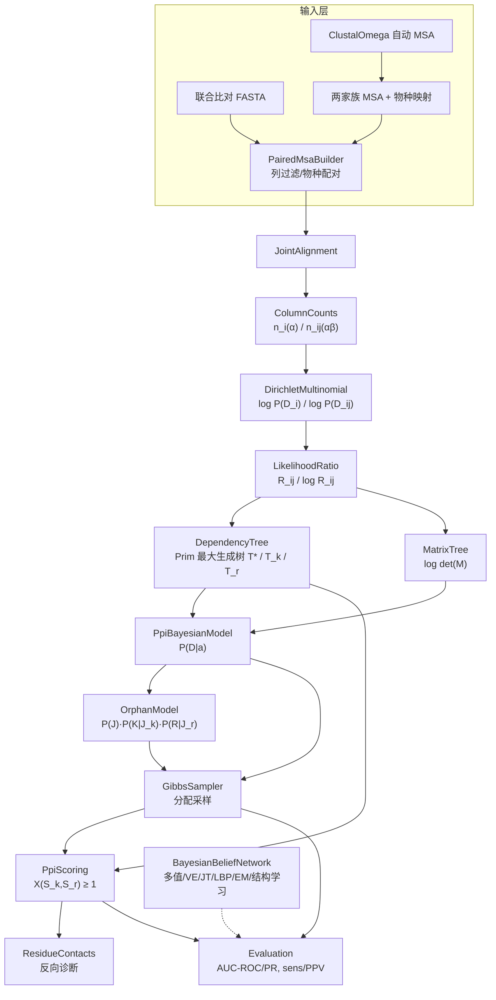

## 用户需求

按 Burger & van Nimwegen《Accurate prediction of protein–protein interactions from sequence alignments using a Bayesian method》(Mol Syst Biol 2008, 4:165, DOI 10.1038/msb4100203, PMC2267735) 与 `readme.md` 描述的方法，对 `G:\GCModeller\src\GCModeller\analysis\ProteinTools\ProteinTools.Interactions\PPI.vbproj` 项目的算法代码做**完全重构**，同时完善 `DataMining\Kernel\BayesianBeliefNetwork` 的贝叶斯网络内核。

## 产品概述

一个纯 .NET、不依赖 R 的蛋白质互作预测库：输入两个蛋白家族的多重序列比对，输出互作伙伴的概率/打分、残基接触位点解释与量化评估指标。原有「BLAST → Clustal 拼接序列 → R bnlearn `iamb`/`cpquery`」的黑箱流水线被替换为论文原方法：联合比对 → 列计数 → Dirichlet 多项边际似然 → 似然比 R_ij → 依赖树 T 与 Matrix-Tree 行列式 → 分配后验 P(a|D) → Gibbs 采样 → 静态打分 X ≥ 1 判互作。

## 核心功能

**输入层**

- 支持两种输入：① 已配对好的联合比对 FASTA（每行为同一基因组内 A 段 + B 段）；② 两个家族各自 MSA + 基因组/物种 ID 映射表，自动按物种配对、去冗余、过滤 gap 过多列。
- 两家族 MSA 缺失时，用项目内 Clustal Omega 复现自动生成。

**统计与建模层**

- 列频数、成对列频数统计；Γ 函数形式的 Dirichlet-多项边际似然（Jeffreys 先验 λ′ = 1/2，λ = 21λ′）。
- 似然比 R_ij = P(D_ij)/(P(D_i)P(D_j))，含有限样本校正；附带互信息 MI、APC 校正、NMI、序列熵。
- 依赖树构造（最大化 Σ log R_ij），支持 T*（全位置）、T_k、T_r 三棵树；对全部生成树求和的 Matrix-Tree 行列式边缘似然。

**推断与预测层**

- 分配后验 P(a|D) ∝ det(M)，含 max_T 近似开关。
- Gibbs 采样器：cognate 一对一分配采样 + orphan 至多一对多分配采样（含所属激酶类切换）。
- 静态打分 X(S_k,S_r) 与「X ≥ 1 判互作」规则，输出可解释的残基对贡献。
- 反向诊断：给定互作推断最可能接触的残基对。

**数据与评估层**

- SwissTCS 两组件系统数据获取/解析与全流程预测；iPfamPPI 注释与直系同源（interolog）转移。
- 系统发育置换检验（true/false 对照比对）。
- 评估：AUC-ROC、AUC-PR、灵敏度、PPV、校准曲线、消融对比。

**内核层（BayesianBeliefNetwork）**

- 任意多值节点的通用离散贝叶斯信念网络：正确的变量消除/junction tree 精确推断、loopy 置信传播近似推断、MLE + Dirichlet 平滑参数学习、BIC/MDL 结构学习（爬山/禁忌）、含隐变量的 EM、ancestral/Gibbs/似然加权采样。
- 修复现有「证据被覆盖」「只支持二元节点」「bucket 树不是 junction tree」「递归无记忆化」「硬编码 X 盘调试路径」等问题。

**交付形态**

- 独立 console 测试工程，用 DebugAudit 记录断言、耗时、变量快照，输出文本表格与 JSON 测试报告。

## 非功能要求

- 兼顾精度与性能：1000+ 列规模的联合比对可运行，采样迭代在可接受时间内完成；无外部数值库依赖，结果可用解析解/枚举对照验证。
- 可复现：随机种子可固定；测试全部为确定性数值对照。

## 技术栈选择

| 层面 | 选型 | 依据 |
| --- | --- | --- |
| 语言/运行时 | VB.NET，`net10.0` | 与 `PPI.vbproj` 现有 SDK 风格、TargetFramework 完全一致（本机 SDK 10.0.403） |
| MSA | `SequenceAlignment.vbproj` 的 `ClustalOmega.MultipleAlignmentOmega` + `MSAIO` | 已核实签名，等价于论文的 `hmmalign`；不自行实现比对 |
| 序列/FASTA IO | `biocore-netcore5` 的 `FASTA.FastaFile` | 现有 `DataPreparations.vb` 已在用 |
| 最优分支 | `DBNCode` 的 `OptimumBranching(scoresMatrix As Double()(), finalRoot As Integer, spanning As Boolean)` | 已通读；在 −log R_ij 上取最大权生成树即论文 T*，可作为 Prim 实现的对照参考 |
| 线性代数 | `Math.NET5` 的 `MatrixOps` / LU / Cholesky | `MatrixOps.Determinant` 已存在并有单测覆盖；但 log-det 需自带带主元 LU 以保证数值稳定 |
| 图结构 | `graph-netcore5`（NCC/MST 并查集） | 已引用，Kruskal 兜底对照 |
| 外部比对工具 | `localblast.NET5` 的 `BLASTPlus` | SwissTCS 流水线沿用（论文也用同源搜索构建家族） |
| 数据模型 | `Bio.InteractionModel` 的 `IInteraction` / `INetworkEdge` | `CrossTalks` 已实现，保持兼容 |
| 测试与报告 | `Core.vbproj` 的 `Microsoft.VisualBasic.ApplicationServices.Debugging.DebugAudit` | 用户规则指定 |
| 移除 | RDotNET / R `bnlearn`（`BnlearnModelling.vb`、`BnlearnInference.vb`） | 该文件是当前唯一 RDotNET 引用，且 vbproj 无该引用 → 项目当前无法编译，删除即修复 |


## 实现策略与关键决策

### 决策 1：以论文生成式模型为骨架，readme 特征层为可选增强

论文核心是「Dirichlet-多项 + 依赖树 + 行列式 + Gibbs」，与 readme 中「离散化 CPT + bnlearn 结构学习」是两条不同路线。方案以**论文生成式为默认路径**（无需训练集、可 ab initio、小样本友好），把 readme 的 MI_APC / DCA / 界面倾向性等作为**可选证据层**，仅在用户提供互作标签时接入 BBN 判别式分支。理由：论文路线可用解析解验证、无外部依赖、且与「移除 R」目标一致；readme 特征层保留扩展性但不下沉为必需路径。

### 决策 2：似然、行列式、打分全部走 log 空间

`P(D_i)`、`P(D_ij)`、`R_ij`、`det(M)`、`X(S_k,S_r)` 均以 log 形式实现，配 `LogSumExp`、`LogDet`、`LogGamma`（Lanczos 近似，自带实现，避免依赖不确定的外部数值库）。理由：21 个残基 × 数百列时 `Π Γ(·)` 会迅速溢出/下溢到 0 或 Inf；论文本身也指出多类并行时行列式数值不稳定。所有对外 API 返回 log 值 + 线性值双版本。

### 决策 3：采样用 T* 近似，行列式只用于最终判定与对照

单次交换伙伴只改变少数物种行的跨块计数，但 `det(M)` 是 O(L³)。若每次 Gibbs 移动都算行列式，L = 600 时约 2.16×10⁸ 次浮点运算/步，不可接受。方案：

- **采样移动的接受概率用 `max_T P(D|a,T)`（最大生成树，Prim O(L²)）**；
- `det(M)` 仅在最终打分、模型比较与测试对照中计算；
- 提供 `PpiModelOptions.UseMatrixTree` 开关，可切换到精确行列式（小规模数据/测试用）。

这与论文「并行多类时改用 T* 近似」的处理一致，且是显式可配置的取舍，而非静默降级。

### 决策 4：`BayesianBeliefNetwork` 保持公共类型名，内部重写推断与学习

全仓搜索确认该命名空间**仅被自身与 `DataMining\README.md` 消费**，无其他项目依赖 → 可安全重写内部实现。但 `NetworkLayout` XML 模型与 `NetworkLayout.TestData()`（Cloudy/Sprinkler/Rain/WetGrass）必须保持语义不变，因其是唯一现成的数值对照基准。`BElim` 类名保留（`BElim : Inherits BNInfer`），内部改为正确的变量消除。

### 决策 5：`SwissTCS` / `iPfamPPI` 公共面保持，流水线重写

`CrossTalks`、`TCSComponentTypes`、`SwissRegulon`、`DataPreparations` 被 `CLI_tools\ProteinInteraction\CLI\*.vb` 与 `Cytoscape\CLI_tool\CLI\TCS.vb` `Imports`。重写时保留命名空间与类型名，仅替换内部算法；`Matrix.vb`（绘图）与算法无关，原样保留。

## 性能分析

| 环节 | 复杂度 | 规模 | 缓解措施 |
| --- | --- | --- | --- |
| 列计数 | O(N·L)，N 序列数 | N~10³, L~600 | 单遍扫描，`Integer` 累加器，按列分块并行 |
| 成对联合计数 | O(L²·N)（稀疏） | 600² / 2 × 10³ ≈ 1.8×10⁸ | 用稀疏字典存 `(α,β)` 计数（每列非零符号通常 ≤ 6），跳过无共同物种的列对；`Parallel.For` 按 i 切分 |
| R_ij | O(L²· | Σ | ²)， | Σ | = 21 | 441 × 1.8×10⁵ ≈ 8×10⁷ | 稀疏化后实际仅遍历非零项；log Γ 用缓存表 |
| 最大生成树 | O(L²) Prim | 600² = 3.6×10⁵ | 稠密数组实现，无堆 |
| det(M) | O(L³) | 600³ | 默认关闭（决策 3），仅最终/测试启用；提供 `UseMatrixTree` 开关 |
| Gibbs 采样 | O(iters × 移动代价) | 默认 5×10⁴ 步/run × 5 run | 移动只重算受影响列对的计数增量，树分 O(L²) |


内存：联合比对 N×L 字符（`Char` 2 字节）≈ 1.2 MB；成对稀疏计数按需生成，不驻留全矩阵。

## 实现注意事项

1. **必须复用而非新建的模式**：`ClustalOmega.MultipleAlignmentOmega` 产生两家族 MSA；`AlignmentColumn.Trim` 的 gap 列过滤逻辑（≥75% gap 删列）迁入新的列过滤组件；`DipRecord` 的 CSV 解析沿用 `LoadCsv(Of T)`。
2. **`DebugAudit` 断言而非 `Throw`**：CPT 归一化、证据取值范围、树无环、计数非负等内部一致性检查用 `DebugAudit.Check`（DEBUG 期零开销）。公共 API 的入参校验（例如序列长度不一致、字母表非法、物种映射缺项）仍抛具体异常类型。
3. **删除 `#If DEBUG ... "x:\debug.txt"`**（`BNInfer.vb` 第 165/196 行），改为 `DebugAudit.Mark`。这是硬编码盘符，会在他机崩溃。
4. **修正 `Const EValue As Double = -10 ^ -10`**：VB 中 `^` 是幂运算且优先级高于一元负号，实际值 −1E-10；归一化容差应显式写为 `-1.0E-10` 并配 `DebugAudit.Check(pr >= -1.0E-10)`。
5. **保持向后兼容 `NetworkLayout`**：XML 元素名、`CPColumn.Data` 扁平数组语义、`Parents.ParentNodes` 按名引用，全部不改；仅新增可选属性（如 `Range` 语义扩展为任意 N）。
6. **`AlignmentColumn.ProteinAlphabetDictionary` 的 23 项与论文 21 项差异**：论文只含 20 氨基酸 + gap；现有字典含 `O`、`U` 两个非常规残基。新实现的 `ResidueAlphabet` 默认按论文 21 项，但提供 `IncludeNonStandard` 开关映射 O→K、U→C，保证旧输入数据可读。
7. **不触碰无关代码**：`SwissTCS\Matrix.vb`（`Generate(...) As Image` 绘图）、`WebParser.vb` 原样保留；`CLI_tools\ProteinInteraction\Protein.Interaction.vbproj` 引用旧路径 `ProteinTools.Interactions.vbproj` 属既有历史遗留，不在本次范围。
8. **移除无用项目引用**：删除 R 代码后，`PPI.vbproj` 对 `DynamicProgramming.NET5`、`dataframework-netcore5` 的引用需复核是否仍被使用（`IO.File`/`LoadCsv` 来自 csv 框架，保留），只在确认未使用后移除。

## 架构设计



## 目录结构

### 1. `DataMining\Kernel\BayesianBeliefNetwork\`（内核完善）

```
DataMining/Kernel/BayesianBeliefNetwork/
├── BeliefNetwork.vb                  [MODIFY] 多值节点支持：Range 任意 N（大于等于 2）；Parents 改为 List(Of BeliefNode)；CP_Table 保留 Double(,) 但明确 (parentConfig, value) 布局并补 stride 文档；Evidence 改为 Integer() 数组 + SetObserved/ClearEvidence/ObserveTable，修复 SetNodes 覆盖 conditions 的 bug（合并语义）；NetworkLayout 保持 XML 兼容并新增 JSON；TestData 保持 Cloudy/Sprinkler/Rain/WetGrass 不变；CreateNode 修正 EValue 为 -1.0E-10，新增环检测与 range 一致性 DebugAudit.Check。
├── BNInfer.vb                        [MODIFY] 保留 BNInfer 抽象基类与 BElim 类名；BElim 内部改为委托 VariableElimination；GetBelief(x, conditions) 语义改为「合并证据后求 P(x | conditions)」并显式文档化；删除 #If DEBUG 的 x:\debug.txt 写盘，改 DebugAudit.Mark。
├── VariableElimination.vb            [NEW] 正确的变量消除引擎：build moral graph、min-fill/min-degree 消除序启发式、factor 表（扁平 Double() + stride）、乘法/求和/归一化算子、(bucket, assignment) 记忆化、全程 log 空间 + LogSumExp。提供 Query(evidence, targets) 返回边缘后验。
├── JunctionTree.vb                   [NEW] moral graph → triangulation → clique 图 → 最大生成树 → 消息传递（collect/distribute）。作为 VE 的对照实现，用于验证 VE 正确性与多查询复用。
├── LoopyBeliefPropagation.vb         [NEW] 满 BP 近似推断：按节点集分组的因子乘积消息、阻尼系数、收敛判据（消息变化小于 tol）、最大迭代数；返回节点边缘后验。
├── ParameterLearning.vb              [NEW] 从观测数据学习 CPT：MLE 与 Dirichlet 平滑 θ_x|pa = (N(x,pa)+α)/(N(pa)+α|X|)，支持按节点配置不同 α；零计数配置下退回先验而非 0；接受 DataFrame/Integer()() 两种输入。
├── StructureLearning.vb              [NEW] hill-climbing 与 tabu search，评分 BIC/MDL（参考 DBNCode 的 LLScoringFunction/MDLScoringFunction 思路但不直接依赖其 DBN 配置结构）；支持 maxParents 约束、白名单/黑名单边、无环性检查；Chow-Liu 树学习（复用 OptimumBranching 语义）作为快速初始化。
├── ExpectationMaximization.vb        [NEW] 含隐变量的 EM：E 步调用 VariableElimination 得隐变量后验与期望充分统计量，M 步用 ParameterLearning 平滑 MLE；记录每轮对数似然用于单调性校验。
├── Sampling.vb                       [NEW] ancestral sampling、Gibbs sampling（按要求顺序采样每个未观测节点）、likelihood weighting（证据节点加权）；统一 Random 种子注入以保证可复现。
├── NumericLogSpace.vb                [NEW] LogSumExp、LogGamma（Lanczos）、乘积/归一化、带部分主元 LU 的 LogDet（对称正定 Laplacian 去掉一行一列），全部提供线性值包装。
└── NamespaceDoc.vb                   [MODIFY] 补充新命名空间与模块用途文档。
```

### 2. `ProteinTools.Interactions\Bayesian\`（PPI 算法核心，全新）

```
ProteinTools.Interactions/Bayesian/
├── Alignment/
│   ├── JointAlignment.vb             [NEW] 联合比对数据结构：Names/Genomes 行标签、A 段列数 LA、B 段列数 LB、原始字符矩阵；提供 Column(i)、CrossBlockPairs()、Subset(rows)、ToFasta()、FromFasta()（支持两种输入格式自动判别：单行拼接 or 分块标记）；校验所有行等长、字母表合法。
│   ├── PairedMsaBuilder.vb           [NEW] 输入模式 ② 的实现：读两家族 MSA（FastaFile 或 ClustalOmegaResult）+ 物种/基因组映射表（genomeId → (geneA, geneB)）→ 按 genomeId 配对成联合比对 → 去冗余（序列一致性阈值）→ 列过滤（gap 比例 ≥ 75% 删除，沿用原 Trim 语义）→ 输出 JointAlignment + 配对审计报告（成功配对数、缺失物种、被丢弃列数）。
│   └── ColumnCounts.vb               [NEW] 单列计数 n_i(α) 与成对计数 n_ij(αβ)；稀疏表示（Dictionary 或紧凑 (idx,count) 数组）与密集表示双模式；提供 IncrementalUpdate(rows, oldPair, newPair) 用于 Gibbs 增量化；提供 TotalCount、MarginalOf(i)、JointOf(i,j)。
├── Statistics/
│   ├── ResidueAlphabet.vb            [NEW] 论文 21 项字母表（20 AA + gap）及与旧 23 项字典（含 O/U）的映射；IncludeNonStandard 开关；Char 与索引双向转换；非法字符报错策略。
│   ├── DirichletMultinomial.vb       [NEW] log P(D_i)、log P(D_ij) 的 Γ 形式边际似然；先验 λ/λ′ 可配置，默认 Jeffreys（λ′ = 1/2，λ = 21λ′）；缓存 logGamma 查表；处理 n = 0、单残基、全 gap 边界。
│   ├── MutualInformation.vb          [NEW] MI、MI_APC（APC = MI(i,j) − MI(i,·)MI(·,j)/mean(MI)）、NMI、序列熵、熵加权 MI；提供与 log R_ij 的相关性诊断。
│   └── LikelihoodRatio.vb            [NEW] R_ij 与 log R_ij 计算，含并行化与稀疏跳过；提供 ComputeAll(counts) 与 ComputePair(counts, i, j)；输出可选的对数下溢保护。
├── Tree/
│   ├── DependencyTree.vb             [NEW] 在 −log R_ij 上求最大生成树（Prim 稠密 O(L²)）；T*（全位置）、T_k（仅 A 段）、T_r（仅 B 段）；TreeScore(tree) 返回 Σ log R_ij；与 OptimumBranching / 暴力枚举的对照入口。
│   └── MatrixTree.vb                 [NEW] 由 R_ij 构造 Laplacian M，去掉任一行列后求 log det(M)（Matrix-Tree 定理）；提供 LogDet 与 Det、约化行选择一致性检查、数值不稳定时的退化路径（返回 max_T 近似值 + 标记）。
├── Model/
│   ├── PpiModelOptions.vb            [NEW] 统一配置：字母表、先验 α/λ′、列过滤阈值、UseMatrixTree（默认 False）、UseMaxTreeApproximation、随机种子、并行度、log 空间开关。
│   ├── PpiBayesianModel.vb           [NEW] 组装层：由 JointAlignment 生成 counts/R_ij/树，提供 LogEvidence(a)（P(D|a) 的 det(M) 或 max_T 近似）、LogPosterior(a)、CloneForAssignment 以实现增量化。
│   ├── OrphanModel.vb                [NEW] P(D|a) = P(J)·P(K|J_k)·P(R|J_r) 分解；cognate 对冻结为 seeds；每基因组分配互作数 = min(orphanK, orphanR)；七个激酶类并行建模的编排（类列表可配置）。
│   ├── PpiScoring.vb                 [NEW] 静态打分 X(S_k, S_r) = Σ_(i,j)∈T* log[p^ij/(p^i·p^j)]；平滑相对频率 p^ij_αβ = (n+λ′)/(N+Σλ′)；判定规则 X ≥ 1；返回逐边贡献明细以支持可解释性输出。
│   ├── ResidueContacts.vb            [NEW] 反向诊断：给定互作，按 log R_ij 排序输出 top-K 残基对（含两侧位置、ML 氨基酸对、log R 值）；聚合到蛋白对级（top-K 和/均值 + logistic 转换）。
│   └── InterologModel.vb             [NEW] 直系同源转移：within-species 互作经 orthology 映射到目标基因组；用于 iPfamPPI 注释与低覆盖度兜底。
├── Inference/
│   ├── GibbsSampler.vb               [NEW] cognate 一对一分配采样与 orphan 分配采样（含 2 / 2×7 / 7×7 类切换）；按 P(g) ∝ r_g 抽基因组；随机取两个同类型蛋白在「当前分配」与「交换伙伴」间采样；增量更新计数与树分；统计配对频率 f(x,y)（并在输出中明确警示 f 不等价于后验）；5 次独立 run 取平均，种子可固定。
│   ├── PhylogeneticPermutation.vb    [NEW] 系统发育置换检验：orthology 判定（reciprocal best hit + 覆盖 > 80% + 一致性 ≥ 80%）、orthologous clique 过滤、按 overlap 降序贪心采纳、构造 true/false 双比对（false 在每个基因组内互换配对）、分别算 R_ij 并做分布对照（KS 统计量或分位数对照）。
│   └── InferenceResult.vb            [NEW] 采样结果容器：配对频率表、后验排序、top-K 残基对、收敛诊断（跨 run 方差）、模型元信息（列数、序列数、树分、使用的近似）。
└── Evaluation/
    ├── RocPrCurve.vb                 [NEW] AUC-ROC（梯形法）、AUC-PR（阶梯法，正负不平衡下主指标）、阈值扫描、灵敏度/PPV、校准分箱（预测概率 vs 观测频率）。
    ├── Benchmark.vb                  [NEW] 金标准评估编排：输入互作标签表 + 预测分数，输出全部指标；消融对比（仅 MI_APC / 仅 log R_ij / det(M) vs max_T / 含先验特征）。
    └── Metrics.vb                    [NEW] 基础度量：precision/recall/F1/accuracy/MCC/KL 散度；供测试工程直接复用。
```

### 3. `ProteinTools.Interactions\SwissTCS\`（流水线重写，保留公共面）

```
ProteinTools.Interactions/SwissTCS/
├── CrossTalks.vb                     [MODIFY] 保留 Public Class CrossTalks（IInteraction, INetworkEdge）、Trim/TrimedKinaseId/TrimedRegulatorId、Public Enum TCSComponentTypes 不变；新增 Score As Double、LogOdds、Source（cognate/sampled/ipfam）与残基对明细字段，供 CLI 展示。
├── SwissRegulon.vb                   [MODIFY] 保留 Public Module SwissRegulon 与全部 6 个公共方法签名（CLI 依赖）；内部 HTTP 解析改用统一的重试/超时/错误处理；移除与 R 相关参数。
├── DataPreparations.vb               [MODIFY] 全量重写 InferInteraction 流水线：①目标蛋白导出 → ②blastp 构建同源家族 → ③ClustalOmega 两家族 MSA → ④按基因组/物种 ID 配对构联合比对（取代原字符串拼接） → ⑤PpiBayesianModel + GibbsSampler 预测 → ⑥PpiScoring 打分与 X ≥ 1 判定 → ⑦输出互作表 + 诊断；构造函数移除 rBin 参数（保留重载并标注弃用以免 CLI 立即编译失败）；删除 DEBUG 下的 Take(5)/Take(10) 截断（改为可配置 MaxRecords）；复用 Trim 的 gap 列过滤语义迁至 PairedMsaBuilder。
├── WebParser.vb                      [MODIFY] 由空 Module 补全为 SwissTCS 页面/表格解析实现（被 SwissRegulon 使用）。
└── Matrix.vb                         [KEEP] 绘图辅助，与算法无关，保持原样。
```

### 4. `ProteinTools.Interactions\iPfamPPI\`（补全）

```
ProteinTools.Interactions/iPfamPPI/
├── iPfamPPI.vb                       [MODIFY] 保持 Namespace iPfamPPI / Public Module iPfamPPI；补全 iPfam 互作注释读取（iPfam 域-域互作表）、按结构域匹配到基因、经 InterologModel 迁移到目标基因组；输出 CrossTalks 集合以复用现有 CLI 展示路径。
└── iPfamRecord.vb                    [NEW] iPfam 数据行模型（domainA/domainB/score/evidence/pdbId）与 CSV/TSV 解析、去重、按 score 阈值过滤。
```

### 5. 删除与工程配置

```
ProteinTools.Interactions/Bayesian/BeliefNetwork.vb          [DELETE] 线性链式伪 BBN，被新 Model 层完全取代
ProteinTools.Interactions/Bayesian/SequenceAssembler.vb      [DELETE] 被 Alignment/PairedMsaBuilder + ColumnCounts 取代
ProteinTools.Interactions/Bayesian/BnlearnModelling.vb       [DELETE] R iamb/bn.fit，移除 R 依赖
ProteinTools.Interactions/Bayesian/BnlearnInference.vb       [DELETE] R cpquery，且为当前编译失败根因
ProteinTools.Interactions/PPI.vbproj                         [MODIFY] 复核并移除不再需要的 ProjectReference；其余保持不变（GenerateDocumentationFile / PackageTags / Description 更新为「论文方法复现 + 纯 .NET」）
ProteinTools.Interactions/test/test.vbproj                   [MODIFY] console 测试工程：引用 PPI.vbproj + Core.vbproj（相对路径 `..\..\..\..\..\runtime\sciBASIC#\Microsoft.VisualBasic.Core\src\Core.vbproj`，与现有写法一致）+ Math.NET5
```

### 6. `ProteinTools.Interactions\test\`（测试工程）

```
ProteinTools.Interactions/test/
├── Program.vb                        [MODIFY] 测试主入口：顺序执行各测试组，每组用 DebugAudit.Watch 计时、DebugAudit.Mark 记录参数，末尾 DebugAudit.Dump() 打印表格并 DebugAudit.SaveReport("report/test-report.json")；退出码 = (FailureCount 大于 0 ? 1 : 0)。
├── Tests/
│   ├── DirichletMultinomialTests.vb  [NEW] 边际似然与闭式 Γ 比值手算值对照（n=0、单残基、全 gap、21 符号满分布）；log/线性值一致性。
│   ├── LikelihoodRatioTests.vb       [NEW] 两列独立 → R ≈ 1；完全共变 → log R 单调增；大计数下 log R_ij 与直接算 MI 的线性相关；MI_APC/NMI 数值对照。
│   ├── MatrixTreeTests.vb            [NEW] L = 3、4 时枚举全部生成树求 Σ_T Π R_ij 与 det(M) 对照；去掉不同行列结果不变；log det 与 det 一致性。
│   ├── DependencyTreeTests.vb        [NEW] Prim 结果与暴力枚举最大生成树、与 DBNCode OptimumBranching 对照；T*/T_k/T_r 分段正确性。
│   ├── BeliefNetworkTests.vb         [NEW] 用 NetworkLayout.TestData() 校验 Cloudy-Rain-WetGrass 的经典条件概率（如 P(Rain=1 | WetGrass=1)）；Range = 3 手工网络对照；证据合并语义回归（防旧 bug）；VE 与 JunctionTree 结果交叉校验；LBP 在 polytree 上与 VE 一致。
│   ├── LearningTests.vb              [NEW] 参数学习与手工 MLE 对照、零计数配置不退化；EM 对数似然单调不减；结构学习在生成的样本上恢复已知边（precision/recall）。
│   ├── GibbsSamplerTests.vb          [NEW] 小分配空间（2 kinase × 2 regulator × 2 genome）上与精确枚举后验对照（频率误差阈值 + KL）；固定种子可复现；增量更新与全量重算一致性。
│   ├── ScoringTests.vb               [NEW] X(S_k,S_r) 与逐边求和手工实现对照；X ≥ 1 判定边界。
│   └── MetricsTests.vb               [NEW] AUC-ROC / AUC-PR / sensitivity / PPV 与手算小样本对照。
└── Data/
    ├── tcs_demo_A.fas / tcs_demo_B.fas  [NEW] 小型演示用两家族比对（可由 ClustalOmega 从内置短序列生成）
    └── genome_pair_map.csv              [NEW] genomeId,geneA,geneB 映射示例，覆盖「部分物种缺失」边界
```

## 关键代码结构

```
' 联合比对：行 = 基因组/物种，列 = A 段 LA 列 + B 段 LB 列
Public Class JointAlignment
    Public ReadOnly Property Names As String()          ' 行标签 = genomeId
    Public ReadOnly Property LengthA As Integer
    Public ReadOnly Property LengthB As Integer
    Public ReadOnly Property Length As Integer          ' LengthA + LengthB
    Public ReadOnly Property Alphabet As ResidueAlphabet
    Default Public ReadOnly Property Item(row As Integer, col As Integer) As Integer
End Class
```

```
' PPI 贝叶斯模型：核心打分入口，默认使用 max_T 近似
Public Class PpiBayesianModel
    Public Sub New(counts As ColumnCounts, Optional options As PpiModelOptions = Nothing)

    ''' <summary>log P(D | a)，a 由 counts 的当前行配对隐含决定</summary>
    Public Function LogEvidence() As Double

    ''' <summary>log P(a | D) = log P(D | a) + log P(a) - log Z</summary>
    Public Function LogPosterior() As Double

    Public Function LogR(i As Integer, j As Integer) As Double
    Public Function MaxTree() As DependencyTree
    Public Function LogDetLaplacian() As Double   ' 仅在 UseMatrixTree 时可用
End Class
```

```
' 变量消除：证据合并语义，修复旧 SetNodes 覆盖问题
Public Class VariableElimination
    Public Sub New(network As BeliefNetwork)
    ''' <summary>P(targets | evidence)，evidence 中 -1 表示未观测</summary>
    Public Function Query(evidence As Integer(), targets As Integer()) As Double()
    Public Function LogQuery(evidence As Integer(), targets As Integer()) As Double()
End Class
```

## Agent Extensions

### SubAgent

- **code-explorer**
- Purpose: 在删除旧类型（`BeliefNetwork`、`SequenceAssembler.AlignmentColumn`、`BnlearnModelling`、`BnlearnInference`）与修改 `BeliefNetwork.vb` / `BNInfer.vb` 公共签名之前，做一次 medium 深度的引用与影响面核查，确认 `CLI_tools\ProteinInteraction`、`Cytoscape\CLI_tool`、`DataMining` 内部及 `PPI.slnx` 中无遗漏的有效调用点。
- Expected outcome: 输出一份精确的调用点清单（文件路径 + 符号 + 行号），据此确认可安全删除，避免破坏编译。

### Skill

- **lsp-code-analysis**
- Purpose: 对 `BayesianBeliefNetwork` 与 `ProteinTools.Interactions` 的公共符号（`BElim`、`BeliefNetwork.SetNodes`、`NetworkLayout`、`CrossTalks`、`SwissRegulon` 的各方法）做语义级「查找引用」与「文件大纲」分析，确定必须保留的公共面与可以自由重写的内部面。
- Expected outcome: 一份符号级兼容性边界清单，明确重构中必须保持的签名集合。

- **pdf**
- Purpose: 复核 `msb4100203.pdf` 中关键公式的原始排版（式 1 至 10 的 Γ 形式边际似然、`det(M)` 表达式、逐边 `X(S_k,S_r)` 表达式），因为 Europe PMC 纯文本抓取时这些独立成行的公式未被渲染，需要与 PDF 原文对齐以避免符号错误。
- Expected outcome: 公式符号层面的确认结论（λ/λ′ 一致性约束、Laplacian 约化方式、打分式求和范围），用于校准 `DirichletMultinomial.vb`、`MatrixTree.vb`、`PpiScoring.vb` 的实现细节与测试预期值。