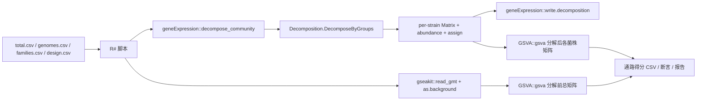

## 产品概述

把已完成的“合成菌群表达矩阵分解”流程从 VB.NET 类库导出为 R# 语言可直接调用的 API，并编写一个可执行的 R# 测试脚本：读取现有的 demo 合成转录组 CSV，完成矩阵分解，然后分别对“分解前的并集总矩阵”和“分解后的各菌株矩阵”做 KEGG 通路 GSVA 分析，产出通路级别的结果数据；脚本与全部结果文件落在 `test/omics/community/`。

## 核心功能

- **R# 分解 API**：在 `geneExpression` 包中新增分解入口，输入并集总表达矩阵 + 基因组基因表 + 同源家族表（可选样本分组），输出各菌株的表达矩阵、菌株活性谱、因子指派与残差等诊断信息。
- **输入格式兼容**：基因组/家族既可用 `list(菌株 = c(基因...))` 形式，也可直接用 `read.csv` 得到的 `dataframe`（列名 `strain`/`gene_id`、`family_id`/`gene_id`），避免在 R# 里做复杂的数据整形。
- **结果导出 API**：把每个菌株矩阵、活性谱与摘要表批量写成 CSV，返回文件路径列表。
- **通路打分辅助 API**：按“特征 × 样本子集”计算平均分值，供脚本做通路方向性断言。
- **R# 测试脚本**：加载 `total.csv`/`genomes.csv`/`families.csv`/`design.csv` → 按菌群分组分解 → 落盘校验形状 → `read_gmt` + `as.background` 构建 KEGG 背景 → 对分解前总矩阵和 4 个分解后菌株矩阵分别 `gsva` → 写出通路得分表 → 校验论文结论（YKB 中 K1 主导 `map00791`、Y1 主导 `map00010`、B1 主导 `map00380`；HKB 中 B1 主导 `map00791`、H1 主导 `map00920`）→ 生成 `[PASS]` 报告与 DebugAudit JSON 报告。
- **可复现运行**：按仓库 `SKILL.md` 的三步流程（编译 → 运行 → 校验产物时间戳）执行，并用脚本内断言而非退出码判定结果。

## 技术栈

- 语言/平台：VB.NET，`net10.0`（沿用 `phenotype_kit.vbproj` 现有配置）；R# 脚本解释执行。
- 复用组件：
- `SMRUCC.genomics.Analysis.HTS.DataFrame.Decomposition`（`Decompose` / `DecomposeByGroups` / `DecompositionOptions` / `CommunityDecomposition`），`Matrix`、`DataFrameRow`、`document.SaveMatrix`。
- `SMRUCC.genomics.ComponentModel.Annotation.UnionFind`（`AddElements` / `UnionRange`）。
- gseakit：`GSVA::gsva`、`background::read_gmt` / `background::as.background`（`Gmt` 实现 `IEnumerable(Of Cluster)`，`as.background` 通过 `pipeline.TryCreatePipeline(Of Cluster)` 接收）。
- devkit：`DebugAudit`（`reset/test/are_equal/check/mark/capture/save_report/failure_count`）。
- R# API 声明约定：`<ExportAPI("name")>` + `Public Function`，`'''` 文档注释含 `<example>`；返回 R# 复合对象用 `New list With { .slots = New Dictionary(Of String, Object) From {...} }`（与 `createVectorList` 一致）。

## 实现方案

### 总体策略

在 `geneExpression` 模块尾部（`End Module` 之前）追加三个导出 API 与若干私有转换函数，内部直接调用 `Decomposition`；输入适配层把 R# 的 `list` 或 `dataframe` 统一转换成 `Dictionary(Of String, String())`（基因组/家族）与 `String()`（样本分组），从而让脚本侧只做“读 CSV → 调 API → 写 CSV”，不承担数据整形逻辑。

### 关键决策与理由

1. **单一入口 + 分组参数**：`decompose_community` 内部判断 `groups` 是否有多个取值，有则走 `DecomposeByGroups`（demo 中 YKB/HKB 的功能程序不同，必须分组分解），否则走 `Decompose`；与 VB 侧已验证的行为保持一致。
2. **输入同时支持 list 与 dataframe**：`genomes.csv`/`families.csv` 有 5000+ 行，在 R# 里拼 `list` 成本高且易错；直接传 `read.csv` 结果最稳，同时保留 `list` 形式给交互式用法。
3. **不把 GSVA 逻辑塞进 API**：GSVA 与通路结论留在脚本层，API 只提供通用的 `feature_mean`（行均值），避免把论文专用断言固化进包接口。
4. **GMT 由数据生成器产出**：`gsva()` 的 `geneSet` 只接受 `Background` 或 `list`，而 `Gmt` 不是 `Background`，故脚本走 `read_gmt` → `as.background` → `gsva`；GMT 需要“通路 → gene_id”映射，放回 R 生成器里从 `annotation.csv` 一次性输出，避免在 R# 里做分组聚合。
5. **形状校验落盘读回**：R# 对 CLR `Matrix` 调 `nrow()/dim()` 只返回 1（SKILL.md 已明确），脚本改为 `write` 后用 `read.csv` + `nrow/ncol` 断言。

### 性能与可靠性

- 5224 基因 × 24 样本、4 个因子：DNMF 初始化 + 掩码精化 + 家族反解在秒级完成；`DecomposeByGroups` 按菌群切分为两个 12 样本子问题，进一步降低单次计算量。
- 所有 API 对空输入、缺失列、非法列名给出明确 `Message`/异常；负值时沿用 `Decompose` 已有的 `ArgumentException`。
- 不做无关重构，只追加代码；`geneExpression` 现有 60+ API 的签名与行为不变。

## 架构设计



## 目录结构

```
src/workbench/R#/phenotype_kit/
└── geneExpression.vb                # [MODIFY] 追加 3 个 ExportAPI + 私有转换函数（插在 End Module 之前）

src/GCModeller/analysis/HTS_matrix/test/R/
└── syncom_demo_data.R               # [MODIFY] 额外输出 pathways.gmt（通路 -> gene_id）

src/GCModeller/analysis/HTS_matrix/test/data/syncom/
└── pathways.gmt                     # [NEW] 由 R 生成器产出，供 GSVA 使用

test/omics/community/
├── decomposition_gsva_test.R        # [NEW] R# 测试脚本（唯一脚本入口）
├── decomposed/                      # [NEW] write.decomposition 输出：4 个菌株矩阵 + abundance.csv + summary.csv
├── gsva_pre_community.csv           # [NEW] 分解前总矩阵的通路 GSVA 得分（通路 × 样本）
├── gsva_post_<isolate>.csv          # [NEW] 分解后每个菌株的通路 GSVA 得分（4 个文件）
├── gsva_post_<isolate>_groups.csv   # [NEW] 按样本组汇总的通路得分（aggregate_samples）
├── test_report.txt                  # [NEW] [PASS]/[FAIL] 逐条记录
└── debug_audit_report.json          # [NEW] DebugAudit 结构化报告
```

## 关键代码结构

```
' geneExpression 模块新增（签名契约）
<ExportAPI("decompose_community")>
Public Function decomposeCommunity(expr As Matrix,
                                   genomes As Object,               ' list(strain -> genes) | dataframe(strain, gene_id)
                                   Optional families As Object = Nothing, ' list(family -> genes) | dataframe(family_id, gene_id)
                                   Optional groups As Object = Nothing,   ' list(group -> samples) | dataframe(sample, group)
                                   Optional method As String = "DNMF",
                                   Optional cross_map As Double = 0.25,
                                   Optional refine_iterations As Integer = 60,
                                   Optional max_iterations As Integer = 300,
                                   Optional seed As Integer = -1,
                                   Optional env As Environment = Nothing) As Object
' 返回 list: strains(list: strain -> Matrix), abundance(Matrix), assign(list), residual(list), method, unassigned

<ExportAPI("write.decomposition")>
Public Function writeDecomposition(<RListObjectArgument> result As list, dir As String, Optional env As Environment = Nothing) As String()

<ExportAPI("feature_mean")>
Public Function featureMean(expr As Matrix, featureId As String, <RRawVectorArgument> Optional samples As Object = Nothing) As Double
```

## 实现注意事项

- 私有辅助：`asGeneGroups(Object, keyField$, idField$, env)` 统一处理 list/dataframe，并校验键/值非空、去重。
- `families` 为 Nothing 或空时构造 `Nothing` 的 `UnionFind`（全部基因视为标记基因）；否则 `uf.AddElements(全部基因)` + 逐家族 `UnionRange`。
- `groups` 组数 < 2 时退化为整体分解；样本名缺失时给出警告并返回 `Message`。
- `write.decomposition` 用 `Directory.CreateDirectory` 建目录，逐菌株 `SaveMatrix`（文件名 `<strain>.csv`，学名含空格合法），并写 `summary.csv`（strain, genes, samples, method, factor, residual）。
- 脚本路径使用字面量绝对路径（R# 缺少 `file.path`/`paste0` 保障），4 个菌株显式展开、不用循环；`gsva()` 先只用默认参数（`kcdf=none`、`min_sz=1`、`normalize=TRUE`）。
- 编译与运行（本机路径）：`dotnet build "E:\codebuddy\GCModeller\src\GCModeller.slnx" -c Rsharp_app_release -p:Platform=x64`；`cd E:\codebuddy\GCModeller\src\R-sharp\App\net10.0` 后 `.\R#.exe "E:\codebuddy\GCModeller\test\omics\community\decomposition_gsva_test.R" --attach "E:\codebuddy\GCModeller" --debug=none`；执行前核对 `assembly\net10.0\phenotype_kit.dll` 时间戳已刷新。
- 结论以脚本 `[PASS]` 与 `DebugAudit::failure_count() == 0` 判定，退出码仅作辅助；`--debug` 会令 CLR 异常不被包装，故错误断言统一用 `check_throws`/`test` 而非 `tryCatch`。