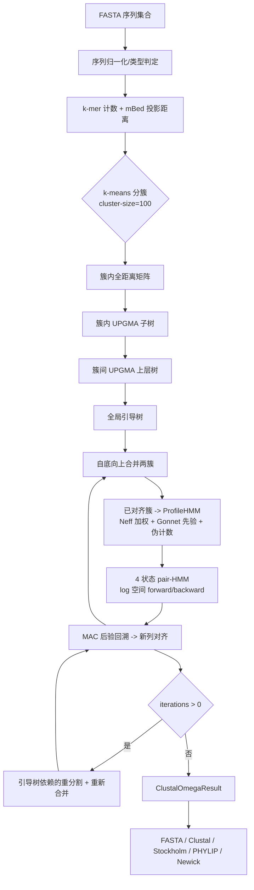

## Product Overview

在 `SequenceAlignment` 项目内新增一条完整的 Clustal Omega 风格多序列比对流水线，用纯托管代码（VB.NET）实现 mBed 距离估计、k-means 分簇、UPGMA 引导树、三态 profile HMM 构建、HMM–HMM（HHalign 同源）profile–profile 比对与后验概率最大准确度（MAC）回溯、可选迭代精炼，并以库 API 的形式对外提供。

输入为蛋白或核酸 FASTA 序列集合，输出为等长的多序列比对结果（行名 + 对齐后的行序列），同时携带引导树与距离矩阵，可导出为 FASTA、Clustal(.aln)、Stockholm、PHYLIP 格式以及 Newick 格式的引导树文本。

## Core Features

- **统一入口与参数对象**：`ClustalOmega.Align(seqs, options)` 一次性产出比对结果、引导树、距离矩阵与统计信息；参数覆盖序列类型、k-mer 长度、分簇上限、迭代次数、gap open/extend、MAC 内存上限、随机种子。
- **序列类型自适应**：蛋白走 Gonnet/BLOSUM 矩阵、默认 k-mer=2；核酸走 DNA 矩阵、默认 k-mer=5，并统一大写、`U→T`、去除对齐空白后的规范化。
- **可扩展的聚类与建树**：mBed 随机投影把两两距离从 O(N²) 降到 O(N·logN)；k-means 分簇（软上限默认 100 条）；簇内全距离矩阵建 UPGMA 子树、簇间再建上层树，拼接成全局引导树；保留"全距离矩阵"分支供小数据集使用。
- **HMM 比对引擎**：每个已对齐簇建成三态（match/insert/delete）profile HMM，含序列加权（Neff）、Gonnet 先验与伪计数；两条 profile 之间做对数空间 4 状态（MM/GD/DG/GG）动态规划，forward+backward 求后验后用最大准确度解码回溯出列对齐；gap open 6 bit、gap extend 1 bit 为默认值。
- **渐进合并与精炼**：按引导树自底向上合并，"once a gap, always a gap" 由 profile 结构自然满足；支持 `iterations` 轮迭代精炼（默认 0）。
- **多格式输出**：比对结果可写 FASTA、Clustal(.aln，含分块与保守标记行)、Stockholm、PHYLIP（sequential/interleaved），引导树可写 Newick。
- **结果可观测**：返回总列数、SP 得分、每条序列的编辑距离/到中心距离、每个阶段的耗时与簇规模统计，便于对照与调参。
- **健壮性**：空输入、单序列、全部序列相同的退化路径直接返回；非法字符、长度 0 序列、矩阵缺失项给出明确异常信息；同一输入在相同随机种子下结果完全可复现。

## 技术栈选择

- **语言与框架**：VB.NET，`net10.0`（`SequenceAlignment.vbproj` 现有 `TargetFrameworks`），SDK 风格项目，`Clustal/*.vb` 由通配自动编译。
- **复用现有 ProjectReference（无需新增）**：
- `core/Bio.Assembly/biocore-netcore5.vbproj`：`FastaSeq`（`Headers`/`SequenceData`/`Title`/`HaveGaps`/`Length`/`Save`）、`FastaFile`、`NucleicAcid`
- `runtime/sciBASIC#/Data_science/DataMining/DynamicProgramming/DynamicProgramming.NET5.vbproj`：`IScore(Of Char)` 约定、`KBandSearch` 的带状 DP/回溯写法参考
- `runtime/sciBASIC#/Data_science/Mathematica/Math/Math/Math.NET5.vbproj`：`NumericMatrix`（距离矩阵、后验矩阵可视化/统计）
- `runtime/sciBASIC#/Microsoft.VisualBasic.Core/src/Core.vbproj`：`VBDebugger`、`TqdmWrapper`、`DebugAudit`（测试报告）
- **不新增对 `HMM.NET5.vbproj` 的引用**（见下节结论），也不新增对 `hierarchical-clustering` 的引用（UPGMA 需确定性 tie-break 与簇内 profile 绑定，自实现更合适）。
- **预计无需修改 `SequenceAlignment.vbproj`**：Gonnet 矩阵以 VB 常量表内嵌（`Resources/Gonnet250.vb`），不引入 resx，从而避免在 `ItemGroup` 中新增白名单条目。

## 关于"能否复用 HMM.NET5.vbproj"的结论

**不能直接复用为 HHalign 引擎，不建议新增工程引用。** 依据均已核实：

1. **数据结构不匹配**：`HMM.vb` 的模型是 `states As String()` + `transMatrix As Double()()`（S×S 全转移）+ `emissionMatrix`（O×S）。profile HMM 是三态（M/I/D）稀疏链式转移，若映射为 `3M` 个状态的全矩阵，空间从 O(M) 膨胀到 O(M²)，10⁴ 条规模直接不可行。
2. **数值空间不匹配**：`Algorithm/HMMAlgorithm/Utils.vb` 中 `gamma = alpha*beta/forward`、`xi = alpha*trans*emiss*beta/forward` 是线性空间公式；HHalign 必须在对数空间用 `logsumexp` 累加，否则长序列（M>500）后验必下溢为 0。
3. **算法目标不匹配**：现有 `Forward/Backward/Viterbi/BaumWelch` 全部针对 **1D 观测链 `Chain`**；HHalign 需要的是两条 profile 在 `M1×M2` 网格上的 **2D pair-HMM**（MM/GD/DG/GG 四状态），语义上不是"一条符号链的隐状态解码"。
4. **性能不匹配**：`Alpha.alphas As List(Of List(Of Double))` 每步分配，且无滚动行/分块，无法支撑目标规模。

**可以借鉴的部分**（只借设计，不引用程序集）：`Models/Objects.vb` 的"状态对象/观测对象"建模习惯；`KBandSearch` 的哨兵值（`UNREACHABLE`）、窗口化滚动行、trace 缓冲上限检查、以及"实例非线程安全、每线程独立实例"的注释约定。因此 `Clustal/HMM` 下自建 `ProfileHMM` + `PairHMMAligner`，复用 `Math.NET5` 做矩阵运算即可。

## Implementation Approach

### 总体策略

按 clustalo 的三阶段流水线落成六个独立子系统（距离、聚类建树、profile 构建、pair-HMM 比对、渐进合并、格式化输出），由门面 `ClustalOmega` 串联，阶段之间只通过不可变数据结构（距离矩阵、`GuideTree`、`ProfileHMM`、对齐行数组）通信，从而每个阶段可单独测试、单独并行、单独替换。



### 关键技术与决策

1. **打分单位与矩阵**

- 采用 HHalign/HHsuite 同源的 **Gonnet 250 矩阵，单位为 1/3 bit**，换算系数 `S33 = 1/log2(10)/3` 量级的固定常数统一在一次查表中完成，使事件层只处理"bit"单位。
- 现有 `data/BLOSUM/GONNET.txt` 是**整数四舍五入的 PAM250**，与 clustalo 的浮点 Gonnet 不同，因此**不复用该文件作为默认矩阵**；它在 `ScoringMatrix.LoadFile` 中仍可作为"整数矩阵"被解析（兼容 `SmithWaterman/Matrix/BlosumParser.vb` 的宽表格式），但默认走内嵌常量表 `Resources/Gonnet250.vb`。
- 查表结构参考 `Diamond/AminoAcidScorer.vb` 的做法：`Char → Byte code`（256 项）+ `code×code → Double`（32×32 扁平数组），未登记字符落到 `X`/wildcard，避免最内层 DP 的二级间接寻址。

2. **mBed 距离**

- k-mer 编码参考 `Diamond/SeedEncoder.vb` 的"base-A 滚动累加"写法，但 mBed 需要精确 k-mer 计数，故改用 `k<=2` 时按小整数键直接开数组、`k>=5` 时用 `Dictionary(Of Long, Integer)` 的稀疏计数。
- 距离定义与 mBed 一致：对 seed 序列集合，用"共享 k-mer 比例"构造特征向量，距离 `d = 1 - shared/(|A|+|B|-shared)`；seed 数取 `min(N, max(2·⌈log2 N⌉, 16))`，抽样由 `options.Seed` 固定，保证可复现。
- 复杂度 O(N·|seeds|·L)；不做 N² 全表（仅 `options.FullDistanceMatrix=true` 时退化该分支）。

3. **k-means 分簇 + UPGMA**

- 在 mBed 特征空间做 k-means（`k = ⌈N/cluster-size⌉`，软上限 100，允许末簇溢出），初始化用确定性 k-means++（固定 RNG），迭代上限 10 或质心位移 < 1e-6 终止。
- 簇内：全距离矩阵 + UPGMA（`O(n²)` 最小堆 + 簇大小加权平均，tie-break 按"较小序列索引优先"，保证确定性），得到子树。
- 簇间：以每簇"离质心最近"的成员序列为代表做上层 UPGMA，再把子树挂到对应叶子上，拼成全局二叉树。
- `GuideTree` 节点同时承载叶子序列索引与内部节点合并顺序，供渐进阶段顺序消费。

4. **ProfileHMM**

- 由"已对齐的行集合"构建：`M` = 列数，match 状态发射概率 = 列频度 + Gonnet 先验加权 + 伪计数后归一化；`Neff` 按列熵计算并用于序列加权（避免高度相似序列主导）。
- 转移概率：`M→M / M→I / M→D / I→M / I→I / D→M / D→D`，插入/删除概率由 `gapOpen=6.0 bit`、`gapExtend=1.0 bit` 换算为对数概率并加伪计数（HHalign/HMMER 风格），保证每行转移和为 1。
- 只用 `Double()` 扁平数组，避免 `List(Of List(Of Double))`。

5. **pair-HMM 比对（HHalign 同源）**

- 状态集：`MM`（两列匹配）、`GD`（第一 profile 走 gap）、`DG`（第二 profile 走 gap）、`GG`（双 gap，仅出现在路径端点）；发射分数来自两侧 profile 的 match 发射概率乘积的对数，转移分数为各项对数概率 + gap 罚分。
- 两遍法：第 1 遍 forward 只保存两个滚动行（O(M2) 内存）求总配分 `Z`；第 2 遍 forward+backward 联合计算后验，写入 `Byte` 量化的后验矩阵供 MAC 回溯。
- **内存上限**：`options.MacRamMb` 默认 2048；若 `(M1+1)*(M2+1)*4` 的后验缓冲超限，则走"分块 checkpoint + 重算"策略（与 clustalo 的 `--MAC-RAM` 同思路），并在结果统计里记录实际分块数。
- MAC 回溯：沿 DP 图在每列取"后验和最大"的转移，得到列对齐；不做 Viterbi（Viterbi 作为 `options.Decode=Viterbi` 的可选分支）。
- 数值守卫：`log(0)` 统一以 `NEG_INF = -1e30` 表示，任何加法后仍为 `NEG_INF` 的格子不参与比较，避免 `KBandSearch` 注释里警示过的"哨兵参与算术导致方向反转"类错误。

6. **渐进合并与迭代精炼**

- 按树后序遍历合并；每次合并把两簇的行数组按新列映射重排（`Int32[]` 列映射，避免反复字符串拼接），最后一次性 `StringBuilder` 成形。
- `iterations`：0 = 关闭；>0 时用"引导树二分"（取根的两棵子树之外，按边切分重分组）重对齐 `iterations` 轮，每轮结束用 SP 得分判断是否接受（只接受不劣化的结果），与 clustalo 的默认策略保持同向。

7. **并行与确定性**

- `Parallel.For` 只用于"互相独立的两两任务"：mBed 距离计算、簇内全距离、同层的树合并分支。
- 所有 DP 工作缓冲、`Random` 实例、`StringBuilder` 均为**每线程私有**（沿用 `KBandSearch` 文档里"实例非线程安全，每个并行分支必须 new 一个"的教训），结果按索引写回数组以保证顺序稳定。

8. **输入输出**

- 归一化：蛋白 `ToUpperInvariant` + 非标准字母映射到 `X`；核酸 `ToUpperInvariant` + `U→T` + 非 ACGT 映射到 `N`。
- **注意**：`NucleicAcid.Canonical(seq)` 返回"序列与其反向互补中字典序较小者"，会改变序列朝向，**不可用于 MSA 输入归一化**（现有 `MSA/CenterStar.vb` 那样用会导致输出序列被反向互补）；本实现仅在 `options.StrandInvariantKmer=true` 时用于 k-mer 计数，且计数后仍以原始朝向输出。
- Writer 全部实现为 `Shared` 方法（`Write(result, path)` / `ToString(result)`），Stockholm 输出需可被现有 `MSA/TabularMSA/Reader.Parser` 回读。

9. **性能与复杂度**

- mBed：`O(N·|seeds|·L)`；k-means：`O(N·k·d·iters)`；簇内 UPGMA：`O(c²)`（c≤100，总 `O(N·c)`）。
- 渐进比对：`O(Σ M1·M2·4)`，对同源家族通常 `M1·M2 ≈ L²`；这是唯一的热点，靠 `Parallel.For` + 扁平数组 + `Byte` 后验量化控制。
- 内存：距离阶段 `O(N·|seeds|)`，比对阶段 `O(M1·M2)` 或受 `MacRamMb` 约束。

10. **风险与规避**

    - 与 clustalo 输出"逐列一致"不可强求（HHalign 内部还有 Neff 估计、伪计数细节、MAC 的 tie-break 差），验收标准定为"行等长/去 gap 可还原输入/SP 得分不劣于 CenterStar/结构合理"，而非逐字符相等。
    - Gonnet 常量表的数值精度直接决定远源序列的灵敏度，需在代码注释中标注来源（Gonnet, Cohen & Benner 1992，1/3 bit 单位）与换算公式，便于后续校正。

## Implementation Notes

- **改动边界**：只新增 `SequenceAlignment/Clustal/**` 与 `SequenceAlignment/test/ClustalOmegaDemo.vb`；**不修改** `MSA/`（含 `CenterStar.vb`、`ScoreMatrix.vb`、`MSAOutput.vb`）与 `SequenceAlignment.vbproj`。`MSAOutput` 通过继承复用（其 `PopulateAlignment` 已是 `Public Overridable`），不复制其逻辑。
- **日志**：阶段级进度用 `VBDebugger.EchoLine`（与 `CenterStar.FindStarIndex` 同风格）；**不要**在 `Parallel.For` 内做逐条进度条刷新（性能杀手），只在阶段边界打印"阶段名 + 规模 + 耗时"；不打印序列内容（体量与隐私）。
- **Debug 断言**：沿用 `CenterStar.ValidateAlignment` 的思路，用 `<Conditional("DEBUG")>` 校验"所有行等长 + 去 gap 可还原输入 + profile 每列发射概率和≈1 + 树叶子数=N"，Release 零开销。
- **兼容性**：`ClustalOmegaResult` 继承 `MSAOutput` 后，`cost`/`edits`/`names`/`MSA` 语义必须自洽（`cost` = SP 得分，`edits` = 每条序列与最近叶/参考的差异计数），避免下游误用。
- **可复现性**：所有随机性集中于 `options.Seed`，`Parallel` 分支内不得共享 `Random`。

## Key Code Structures

```
Namespace Clustal

    ''' <summary>Clustal Omega 流水线的参数对象。</summary>
    Public Class ClustalOmegaOptions
        Public Property SeqType As SequenceType          ' Auto / Protein / DNA
        Public Property KmerSize As Integer = 0          ' 0 = auto (蛋白 2 / 核酸 5)
        Public Property ClusterSize As Integer = 100     ' k-means 软上限
        Public Property FullDistanceMatrix As Boolean    ' 跳过 mBed，走全距离矩阵
        Public Property Iterations As Integer = 0        ' 迭代精炼轮数
        Public Property GapOpenBits As Double = 6.0
        Public Property GapExtendBits As Double = 1.0
        Public Property MacRamMb As Integer = 2048       ' MAC 后验缓冲上限
        Public Property Decode As DecodeMode = DecodeMode.MaximumAccuracy
        Public Property StrandInvariantKmer As Boolean
        Public Property Seed As Integer = 0              ' 0 = 固定默认种子，保证可复现
        Public Property Threads As Integer = 0           ' 0 = 自动
    End Class

    ''' <summary>三态 profile HMM，由已对齐的行集合构建。</summary>
    Public Class ProfileHMM
        Public ReadOnly Property Columns As Integer
        ''' <summary>M×A 的扁平发射对数概率（行优先）。</summary>
        Public ReadOnly Property EmitLog As Double()
        ''' <summary>7 类转移的扁平对数概率（M2M, M2I, M2D, I2M, I2I, D2M, D2D）。</summary>
        Public ReadOnly Property TransLog As Double()
        Public ReadOnly Property Neff As Double()

        Public Shared Function FromAlignment(rows As String(), alphabet As SequenceAlphabet,
                                             options As ClustalOmegaOptions) As ProfileHMM
    End Class

    ''' <summary>两条 profile 的 4 状态 pair-HMM 比对器。</summary>
    Public Class PairHMMAligner
        Sub New(options As ClustalOmegaOptions, alphabet As SequenceAlphabet)
        ''' <summary>返回列映射对：map1(i) / map2(j) 指向输出列，-1 表示 gap。</summary>
        Public Function Align(q As ProfileHMM, t As ProfileHMM) As (map1 As Integer(), map2 As Integer())
    End Class
End Namespace
```

## Directory Structure

```
g:/GCModeller/src/GCModeller/analysis/SequenceToolkit/SequenceAlignment/
├── SequenceAlignment.vbproj                    # [未改动] SDK 通配自动编译新增 .vb；Gonnet 用常量表避免新 resx
├── Clustal/
│   ├── readme.md                               # [MODIFY] 保留原有算法综述，追加"本实现模块映射/参数/验收标准"章节
│   ├── ClustalOmega.vb                          # [NEW] 门面：Align(seqs, options) 串联六阶段，含空/单序列/全相同退化分支与阶段耗时统计
│   ├── ClustalOmegaOptions.vb                   # [NEW] 参数对象（见 Key Code Structures），含参数校验与自动推导（k-mer、cluster-size、threads）
│   ├── ClustalOmegaResult.vb                    # [NEW] 继承 MSAOutput，附加 GuideTree、DistanceMatrix、SP 得分、簇规模、阶段耗时；提供 SaveAs(format, path)
│   ├── SequenceAlphabet.vb                      # [NEW] 蛋白/核酸字母表、大小写与 U→T 归一化、非法字符映射(X/N)、序列类型自动判定、k-mer 默认值
│   ├── Distance/
│   │   ├── KmerCounter.vb                       # [NEW] k-mer 编码与计数（k<=2 用数组、k>=5 用 Dictionary(Of Long,Integer)），参考 SeedEncoder 的滚动编码
│   │   └── MBedDistance.vb                      # [NEW] seed 序列抽样（确定性）、特征向量、距离矩阵（O(N·|seeds|)）、FullDistanceMatrix 分支
│   ├── Clustering/
│   │   ├── KMeansCluster.vb                     # [NEW] 确定性 k-means++ 初始化 + Lloyd 迭代 + 软上限 100 的簇划分，输出簇成员索引
│   │   ├── UPGMA.vb                             # [NEW] O(n²) 最小堆 + 簇大小加权平均 + 确定性 tie-break，输出二叉树与合并高度
│   │   └── GuideTree.vb                         # [NEW] 树节点（叶子=序列索引，内部=左右子节点+距离/高度），提供后序遍历、叶子计数、Newick 输出入口
│   ├── HMM/
│   │   ├── ScoringMatrix.vb                     # [NEW] 替换矩阵抽象：Char→Byte 编码 + code×code 扁平 Double 表（参考 AminoAcidScorer），支持内嵌 Gonnet250/BLOSUM62/DNA 与外部浮点矩阵文件解析
│   │   ├── ProfileHMM.vb                        # [NEW] 三态 profile 构建：列频度、Neff 加权、Gonnet 先验、伪计数、转移概率归一化（见 Key Code Structures）
│   │   └── PairHMMAligner.vb                    # [NEW] log 空间 4 状态 forward/backward、后验量化、MAC/Viterbi 回溯、MacRamMb 分块重算
│   ├── Progressive/
│   │   ├── ProgressiveAligner.vb                # [NEW] 按 GuideTree 后序自底向上合并；Int32 列映射重排；阶段内 Parallel.For（每线程私有缓冲）
│   │   ├── Refinement.vb                        # [NEW] iterations 迭代精炼：引导树依赖重分割 + 重对齐 + SP 接受准则
│   │   └── AlignmentStatistics.vb               # [NEW] SP 得分、列一致性、保守列标记（与 MSAOutput.Print 的 `*`/`-` 语义对齐）
│   ├── IO/
│   │   ├── FastaWriter.vb                       # [NEW] 复用 FastaFile/FastaSeq.Save，按 options 换行宽度输出
│   │   ├── ClustalWriter.vb                     # [NEW] Clustal(.aln)：首行 CLUSTAL 版本、60 列分块、行名补齐、conservation 标记行
│   │   ├── StockholmWriter.vb                    # [NEW] `# STOCKHOLM 1.0` + `#=GF/#=GS/#=GC seq_cons`，保证可被 MSA/TabularMSA/Reader 回读
│   │   ├── PhylipWriter.vb                       # [NEW] sequential 与 interleaved 两种；行名截断 10 字符并做唯一化
│   │   └── NewickWriter.vb                       # [NEW] GuideTree → Newick 字符串，含分支长度（UPGMA 高度）+ 分号结尾
│   └── Resources/
│       └── Gonnet250.vb                          # [NEW] Gonnet 1992 1/3-bit 浮点矩阵常量表 + S33 换算，注明来源与公式
└── test/
    ├── test.vbproj                               # [未改动] 已引用 SequenceAlignment.vbproj
    └── ClustalOmegaDemo.vb                        # [NEW] console 验证程序：DebugAudit.Check/AreEqual/Watch/Mark + SaveReport 生成测试报告；覆盖小样例不变量、mBed/UPGMA/簇规模断言、四种格式回读、10^3 规模性能冒烟
```

## Agent Extensions

### SubAgent

- **code-explorer**
- Purpose: 在实现前与实现中用 "medium/very thorough" 级别核对 `FastaSeq`/`FastaFile`/`NucleicAcid`/`Blosum`/`KBandSearch`/`DebugAudit` 的真实签名与调用点，并排查 `Clustal` 命名空间与现有 `DIAMOND`、`MSA` 名称是否冲突。
- Expected outcome: 产出一份已验证的 API 清单（类型全名、方法签名、返回类型），确保计划中的代码结构定义可直接编译，不出现虚构 API。

### Skill

- **lsp-code-analysis**
- Purpose: 通过语义导航完成定义跳转、引用查找与文件大纲提取，确认 `MSAOutput.PopulateAlignment` 的 `Overridable` 可继承、`DebugAudit` 各断言方法的可见性，以及新增 `ClustalOmegaResult` 继承后的所有派生成员调用点。
- Expected outcome: 得到准确的继承/引用关系与潜在命名冲突清单，保证"只新增、不改动 MSA"的改动边界成立。