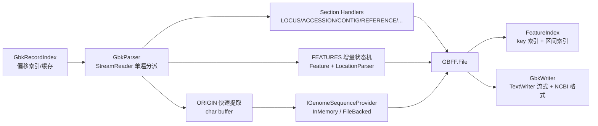

## 用户需求

优化 `g:/GCModeller/src/GCModeller/core/Bio.Assembly/biocore-netcore5.vbproj` 中 `Assembly/NCBI/Database/GenBank/GBK` 这一 NCBI GenBank (GBFF) 读写模块，使其从"只能处理细菌/真菌小基因组"升级为能处理 **人基因组级别大型 GBFF 文件**（测试样本 `G:\VirtualViewer\data\human.gbff` = 4.83 GB / 65,508,346 行 / 25 条染色体记录）。

### 阶段一：解析（读）优化

- **解析主干重写**：不再一次性 `ReadAllLines` 载入 6550 万行，改为单遍流式扫描；不再对每个字段做 Regex 全表匹配 + `Array.IndexOf` 二次扫描。
- **feature 索引与查询重构**：按 feature key 建立分组索引，按位置建立有序区间索引，`GetByLocation` 从线性扫描改为二分/区间查询；`Query` 去 LINQ 分配。
- **feature 基因组序列获取修正**：多外显子 `join(...)` 必须逐段拼接、`complement` 必须对拼接结果反向互补、坐标 1-based 闭区间（修掉 `right-left` 少 1 的 off-by-one），且不再做整条染色体字符串拷贝。
- **文本解析函数优化**：Location 解析去掉 2~3 个 Regex/次（约 300 万次调用），qualifier 解析、ORIGIN 提取、REFERENCE 分块全部改为 Span/索引直读。
- **补齐缺失的数据库解析**：`CONTIG`（human.gbff 每条记录都有，当前完全未解析）、`PRIMARY`、`SEGMENT`、`PROJECT`、`WGS`、`LOCUS` 的 topology/division/CON 状态、`REFERENCE REMARK`、`DBLINK` 全部 key、`COMMENT`，以及 Location 的 `order()`、单点、`123^124`、`<`/`>` partial、join 内每段独立 complement。

### 阶段二：大基因组能力（已确认取舍）

- **流式 + 可选低内存模式**：默认逐记录流式（单次仅保留一条记录，最大约 250 MB 序列，迭代产出后可回收）；另提供低内存模式——序列不常驻内存，记录中保存 ORIGIN 段的文件偏移与长度，取 feature 序列时按需回读。
- **按 accession 随机访问**：扫描一次生成 `LOCUS` 字节偏移表（可缓存到磁盘），之后 `File.LoadRecord(path, "NC_000001")` 只解析目标记录，秒级返回。

### 阶段三：写操作优化（在解析完成之后）

- 流式写出到 `TextWriter`，不再把整条 249 MB 序列拼成 `StringBuilder` + `LineTokens` + `String.Join` 三份拷贝。
- 按严格 NCBI 规范重写 `LOCUS`/`DEFINITION`/`SOURCE`/`REFERENCE`/qualifier 的换行与缩进规则（允许改变现有输出外观），并补齐 `CONTIG`/`PRIMARY`/`COMMENT`/`DBLINK` 的写出，使"解析后回写"语义保真。

### 约束与验收

- 保持向后兼容：`File.Load` / `File.LoadDatabase(path|Stream, suppressError)` / `File.Save` / `Origin.SequenceData|ToFasta` / `Features.AddGenes|GetByLocation|Add|Delete|SetSourceFeature` / `Feature.Location|SetValue|Query` / `Locus.AccessionID|Length|UpdateTime` / `Source.SpeciesName` 等现有调用点必须继续编译并通过。
- 以 `human.gbff` 真实跑通并量测：单条 chr1 记录（507 万行 / 249 Mb / 47,876 features）解析目标 < 15 s、内存增量 < 2 GB；全文件流式遍历 < 5 min；1 万个 CDS 序列提取 < 1 s；单条记录写出峰值内存 < 300 MB。
- 测试程序使用 `DebugAudit` 记录耗时与断言，输出 JSON 测试报告。

## 技术栈

- 语言/运行时：**VB.NET / .NET 10.0**（`biocore-netcore5.vbproj`，`TargetFrameworks=net10.0`，`RootNamespace=SMRUCC.genomics`，`AssemblyName=SMRUCC.genomics.Core`）。不引入新 NuGet 依赖。
- 复用现有基础设施：`Microsoft.VisualBasic.Core`（`Core.vbproj`，含 `DebugAudit`、`NamedValue`、`Strings`、日志扩展 `.debug/.warning`）、`SMRUCC.genomics.SequenceModel`（`FastaSeq`、`NucleicAcid`、`CutSequence`）、`SMRUCC.genomics.ComponentModel.Loci`（`NucleotideLocation`、`Location`、`Strands`）。
- I/O：`FileStream(..., FileOptions.SequentialScan)` + 1 MB 缓冲 + `StreamReader(Encoding.Latin1)`；写出用 `StreamWriter` + `ArrayPool(Of Char)`。仅 net10 目标，因此可删除 `#If NET48 Then ... BeginInvoke` 的异步分支。
- 测试：控制台工程 `Test/test.vbproj`（`OutputType=Exe`，`net10.0`）+ 新增 `Test/gbffLargeGenomeTest.vb`，报告用 `DebugAudit.Watch/Mark/Check/AreEqual/Snapshot/SaveReport`。

## 实现方案

### 总体策略

把"读一个字段"从"扫全表找行号"改为**单遍顺序状态机**：`StreamReader` 逐行读取，按行首 12 列以内的大写关键字分派到对应 section 缓冲区；`FEATURES` 段在读取过程中直接增量解析成 `Feature` 对象（不缓存 92 万行文本），`ORIGIN` 段在读取过程中逐行把字母字符拷入预分配 `char[]`（容量取自 `LOCUS` 的 length），读完一次 `new String(char[], 0, n)` 收口。整条记录结束后统一 `LinkEntry` 并 `yield`，随后对象即可被 GC 回收。

**关键决策与理由**

1. **不使用 `ReadAllLines`**：4.83 GB 文件产生 6550 万个 `string`（约 6 GB 常驻），且 `Internal_readBlock` 对每个字段做全表 Regex + `Array.IndexOf`，复杂度 O(n·m)。改为 O(bytes) 单遍扫描后，解析复杂度与文件大小线性，内存只与"最大单条记录"成正比。
2. **Location 自写零正则解析器**：现有实现每 feature 2 次 `Regex.Matches` + 1 次 `Regex.Split`，人基因组规模下约 150~300 万次；自写递归下降解析器（`complement(...)`/`join(...)`/`order(...)`/`a..b`/`<a..>b`/`a^b`/单点）为 O(len(location))≈O(40)，可快 1~2 个数量级，同时修复 join 内每段独立 complement 的语义。
3. **索引与主列表分离、惰性失效**：`FEATURES._innerList` 保留为唯一存储（兼容 `Extensions.vb:153`），索引（`Dictionary(Of String, Feature())` 按 key + 按 `Left` 排序的区间索引）惰性构建，`Add/Delete/AddGenes` 置脏标记后重建。区间查询用"按 Left 排序 + 前缀最大 Right 数组 + 二分"实现，单次查询 O(log n + k)，内存开销约 n×(8+4) 字节。
4. **序列提取零中间层**：`SequenceData.Substring(start, len)` 直接切片，多段按总长预分配 `char[]` 一次填充，`complement` 用 256 项查表 + 逆序单遍写入（替代现有 `ToUpper` + 8 遍 `StringBuilder.Replace`）。不再经过 `CutSequenceLinear`（含边界分支与 warning 日志）。
5. **低内存模式**：`File` 持有一个 `IGenomeSequenceProvider`；`InMemorySequenceProvider` 包字符串，`FileBackedSequenceProvider` 保存 `(path, originOffset, originLineCount)` 并在取值时按需回读该段。默认内存模式，`GbkReadOptions.LoadSequence=False` 时切换。
6. **记录偏移索引**：`GbkRecordIndex` 一次顺序扫描记录 `LOCUS` 行起始字节偏移 + `//` 结束偏移 + accession，`BinaryFormatter` 之外用轻量文本/JSON 缓存（`.gbff.idx`），命中缓存则直接 seek。缓存以"路径 + 文件大小 + 最后修改时间"为键校验。
7. **写出流式化**：`GbkWriter.Save(gb, TextWriter)` 为核心实现，`CreateDoc` 退化为"写入 `StringWriter`"以保持兼容；`ORIGIN` 按 60 碱基/行直接从字符串切片写出，位置号右对齐 9 列（支持 >99,999,999），中间不产生任何整串拷贝。
8. **兼容优先**：所有现有公共成员保留签名与语义（`JoinLocation`、`HasJoinLocation`、`Locations` setter 的 min/max 计算、`PairedValues`、`attributes`、`QueryDuplicated`、`SetValue`、`ToString` 等），新能力以新增类型/重载提供；`_innerList` 仍为 `Protected Friend List(Of Feature)`。

### 性能与可靠性

- 读：单遍 I/O + 每行 O(1) 分派，总复杂度 O(fileSize)；热点为 ORIGIN 字符拷贝（约 31 亿字符，托管 `char[]` 直拷，无 LINQ/无 StringBuilder 追加）。瓶颈是磁盘顺序读，SSD 上 4.83 GB 约 20~40 s；解析开销目标不超过 I/O 的 50%。
- 内存：峰值 = 最大单条记录（chr1：249 Mb 序列 ≈ 500 MB UTF-16 + 47,876 个 Feature 约 60~100 MB）。低内存模式下峰值可降到约 100 MB。
- 查询：`GetByLocation` O(log n + k)；`Query(key, value)` 先按 key 索引缩表，再做无分配的 `IndexOf(..., Ordinal)` 扫描。
- 健壮性：所有 section 解析容错（缺字段返回空对象而非 `Nothing` 抛 NRE）、长度不足的行不再 `Throw InvalidProgramException` 而是计数并跳过（阈值内告警，超阈值抛带上下文的 `GbkFormatException`）；`suppressError` 语义保留。
- 兼容性风险控制：以"先改读、后改写"分阶段落地，每阶段保证可编译；`Extensions.vb`/`ExportServices` 的改动限定在编译错误处，不做顺带重构。

### 架构



## 执行要点

- **不要让 `ORIGIN` 依赖列位置**：位置号 ≥ 9 位时序号从第 0 列开始（`100000021 aacaatgctg ...`），必须"跳过前导空白与数字后只拷字母字符"（`a-z A-Z`），这才是 human.gbff 的正确解法。
- **`FEATURES` 段的行分类**：第 6 列非空格 = 新 feature 起始；第 22 列（index 21）为 `/` = 新 qualifier；其余 = 续行（拼接到当前 qualifier，跨行的 `join(...)` location 同样按续行处理）。必须支持 location 跨多行。
- **不引入并行**：现有 `FeaturesListParser`/`ListFeatures` 的 `AsParallel` 在小集合上反而更慢，且与增量解析冲突，一律移除；上位机已有并行调用点保持可用。
- **日志**：沿用 `Call $"".debug/.warning` 与 `App.LogException`；仅在"跳过非法行/缺失 section"时按记录汇总输出一条警告（不逐行刷日志），不打印序列内容。
- **改动边界**：只改 `GBK/` 目录及因此编译失败的 `GenBank/Extensions.vb`（第 153 行 `_innerList`）、`GenBank/ExportServices/*`（`JoinLocations`/`CutSequenceLinear` 调用点）；不动 `TabularFormat`、`Metagenomics`、`SequenceModel` 的公开行为（如需快速 reverse-complement，在 GBK 内新增工具而不是改 `NucleicAcid.Complement`）。
- **测试数据开关**：测试程序通过命令行参数接收 gbff 路径，默认硬编码 `G:\VirtualViewer\data\human.gbff`；报告输出到 `Test/report/gbff-<timestamp>.json`。

## 目录结构

```
g:/GCModeller/src/GCModeller/core/Bio.Assembly/
├── Assembly/NCBI/Database/GenBank/
│   ├── GBK/
│   │   ├── GbkParser.vb                  # [MODIFY] 重写为单遍流式解析器。实现 Read(path)/Load/LoadDatabase(Stream) 的公共入口，内部按关键字分派 section；新增 Read(Stream, GbkReadOptions) 与 ReadRecord(path, offset, length)。删除 Regex/Array.IndexOf/ReadAllLines 路径；保留 bufferTrims/doLoadData 兼容签名（标记 Obsolete）以免内部调用点断裂。
│   │   ├── GbkReadOptions.vb             # [NEW] 读取选项：LoadSequence(默认 True)、LoadFeatures、BufferSize、Encoding、BuildRecordIndexCache、LazySequence(低内存模式)、KeepRawSections。提供 Default 共享实例。
│   │   ├── GbkRecordIndex.vb             # [NEW] 记录偏移索引。Scan(path) 顺序扫描 LOCUS/`//` 得到 (Accession, StartOffset, EndOffset, Length)；Save/Load 磁盘缓存（路径+Size+LastWriteTime 校验）；TryGetRecord(accession)。
│   │   ├── GbkFormat.vb                  # [NEW] GenBank 文本格式常量与工具：列宽（6/12/21/60/80）、LOCUS/DEFINITION/qualifier 换行与缩进规则、引号转义、位置号右对齐、`Enum LocusTopology/CON` 判定辅助。
│   │   ├── GbkExceptions.vb               # [NEW] GbkFormatException（带记载名/行号/上下文的格式异常），替代裸 InvalidProgramException。
│   │   ├── NucleotideSlice.vb            # [NEW] 快速序列操作：Slice(seq, left, right)（1-based 闭区间，边界钳制）、Concat(segments)、ReverseComplement(str)、ComplementInto(char[], src, dst)。查表实现，无 StringBuilder/LINQ。
│   │   ├── GenomeSequenceProvider.vb     # [NEW] IGenomeSequenceProvider 抽象 + InMemorySequenceProvider（包字符串）+ FileBackedSequenceProvider（持 path/offset，按需回读 ORIGIN 段）。
│   │   ├── File.vb                       # [MODIFY] 增加 Contig/Primary/Segment/Project 属性与 IsCON/Topology；Origin 改为经 IGenomeSequenceProvider 取值（SequenceData 属性保持兼容）；修正 Read(feature) 的 off-by-one 与多段语义；新增 LoadRecord(path, accession)/TryLoadRecord；LoadDatabase 改为委托 GbkParser 流式实现；Save 新增 TextWriter 重载；修复 IsValidGenbankFormat。
│   │   ├── GbkWriter.vb                  # [MODIFY]（阶段三）新核心 Save(gb, TextWriter, options)，CreateDoc 退化为写 StringWriter；所有 ToString 重载保留；ORIGIN 分块写出；qualifier 按 NCBI 规范换行/转义；LOCUS/DEFINITION/SOURCE/REFERENCE/CONTIG/COMMENT/DBLINK 严格格式化。
│   │   └── Keywords/
│   │       ├── KeyWord.vb                # [MODIFY] 新增 GBK_FIELD_KEY_CONTIG/PRIMARY/SEGMENT/PROJECT/WGS/ORIGIN 等常量；__trimHeadKey 改为 Substring(10) 直取，去除 Mid。
│   │       ├── ACCESSION.vb              # [MODIFY] LOCUS.InternalParser 改为 Span 解析：AccessionID/Length/Type(bp)/Molecular/topology(linear|circular|both)/DivisionCode/IsCON/UpdateTime；增加 Topology 属性；保持 6 参构造兼容（ChunkBuffer 越界时降级为 Nothing 而非崩）。
│   │       ├── CONTIG.vb                 # [NEW] CONTIG 解析：`join(gap(10000),NT_077402.3:1..197666,gap(50000),...)` → ContigSegment()（Accession/Start/End/GapLength/IsGap）+ 总长校验；ToString 按 80 列换行回写。
│   │       ├── PRIMARY.vb                # [NEW] PRIMARY 行解析（WGS master 记录：`Primary: ...` + 引用列表）。
│   │       ├── ORIGIN.vb                 # [MODIFY] 去掉 Widening CType(String()) 的 LINQ 实现，改由 GbkParser 直接构造；GetFeatureSegment 改用 NucleotideSlice.Slice（不经过 CutSequenceLinear）；新增 GetSequence(feature) 支持多段+反向互补；GCSkew 改单遍计数；ToFasta 保留。
│   │       ├── COMMENT.vb                # [MODIFY] 按记录拼接保留换行结构（去除首行 12 列缩进），ToString 回写时按 12 列缩进换行。
│   │       ├── DBLINK.vb                 # [MODIFY] 解析去除 Mid(13) 硬编码，改为取第一个 `:` 前缀键；Links 改为保序且允许重复 key；增加 GetLink(name)。
│   │       ├── REFERENCE.vb              # [MODIFY] 去掉 Array.IndexOf 的 O(n²) 分块，改为顺序分块；RefInfo 增加 Remark 字段；Dictionary.Add → TryAdd 语义（多 REMARK/重复子字段不再抛异常）。
│   │       ├── SOURCE/SOURCE.vb          # [MODIFY] ORGANISM lineage 解析容错（空行/超长行）；回写按 12 列缩进 80 列换行。
│   │       └── Features/
│   │           ├── FEATURES.vb           # [MODIFY] 保留 _innerList/source/Add/Delete/AddGenes/SetSourceFeature/LinkEntry；GetByLocation 改区间索引查询；Query/ListFeatures 去 LINQ 与 AsParallel；新增 Count、ByKey(key)、IntervalIndex（惰性+脏标记）。
│   │           ├── FeatureIndex.vb       # [NEW] FeatureKeyIndex（Dictionary(Of String, Feature())）+ FeatureIntervalIndex（按 Left 排序 + 前缀 MaxRight + 二分 overlap 查询）；支持增量失效重建。
│   │           ├── Feature.vb            # [MODIFY] SequenceData 改为 gb.Origin.GetSequence(Me)（多段+反向互补）；Query(key) 改无分配循环；保持 attrSet/PairedValues/attributes/SetValue/QueryDuplicated/ToString 兼容；ToString(qualifier) 仍可用。
│   │           ├── Location.vb           # [MODIFY] 增加 Order/IsPartial/PerSegmentComplement 等语义属性；ContiguousRegion 保持 min..max；JoinLocation 语义修正为"跨环状起点的尾段"；ToString 按 NCBI 规范重建（complement/join/order/partial）；Locations setter 仍计算 _left/_right。
│   │           ├── LocationParser.vb     # [NEW] 零正则递归下降解析器：解析 `complement(...)`/`join(...)`/`order(...)`/`a..b`/`<a`/`b>`/`a^b`/单点，返回 Location；同时保证 O(len) 与无异常抛出（非法输入降级为空 LocationSegment 并计数）。
│   │           ├── ParserHelper.vb       # [MODIFY] 删除 __formatString/readBlock 的"先摊平成字符串数组再分块"两步法，改为直接消费行的增量状态机（FeatureBuilder）；保留 FeaturesListParser 兼容入口（内部走新状态机）。
│   │           └── Qualifier.vb          # [MODIFY] FeatureQualifiers 补齐：regulatory_class、ncRNA_class、artificial_location、exception、old_locus_tag、mobile_element_type、rpt_unit_range、satellite 等；保持枚举名即 qualifier key 的约定。
│   ├── Extensions.vb                     # [MODIFY] 第 153 行 gb.Features._innerList 改为 gb.Features（IEnumerable）或新增 ListFeatures()；不改变 LocusMaps 行为。
│   └── ExportServices/
│       ├── GBFFFeatureDumps.vb           # [MODIFY] 第 228-229 行 locs.JoinLocations + CutSequenceLinear 改为 gb.Origin.GetSequence(mRNA)。
│       ├── gbExportService.vb            # [MODIFY] 仅在编译或语义受损处调整（Origin.SequenceData 兼容保留，预计零改动）。
│       └── gbEntry.vb                    # [MODIFY] 仅在编译错误处调整（ContiguousRegion/GCSkew 保留）。
└── Test/
    ├── test.vbproj                       # [MODIFY] StartupObject 改为 test.gbffLargeGenomeTest（或为其新增运行说明），保持 net10.0 与三处 ProjectReference。
    └── gbffLargeGenomeTest.vb            # [NEW] 控制台性能/正确性测试：模式 baseline|record|stream|feature|write|all；用 DebugAudit.Watch 计时、Mark 记录特征数/序列长度/内存、Check/AreEqual 断言、SaveReport 输出 JSON 报告；默认数据路径 G:\VirtualViewer\data\human.gbff。
```

## 关键代码结构

```
' GBK/GbkReadOptions.vb
Public Class GbkReadOptions
    Public Property Encoding As Encoding = Encoding.Latin1
    Public Property BufferSize As Integer = 1024 * 1024
    Public Property LoadSequence As Boolean = True      ' False: 低内存模式，序列按需回读
    Public Property LoadFeatures As Boolean = True
    Public Property BuildRecordIndexCache As Boolean = True
    Public Property MaxInvalidLineCount As Integer = 100 ' 超过此值抛 GbkFormatException

    Public Shared ReadOnly Default As New GbkReadOptions
End Class

' GBK/GenomeSequenceProvider.vb
Public Interface IGenomeSequenceProvider
    ''' <summary>1-based 闭区间切片；返回的字符串为新分配结果</summary>
    Function Slice(left As Long, right As Long) As String
    ''' <summary>按 feature 的多段 location 拼接并按需反向互补；0 表示无序列</summary>
    Function GetSequence(feature As Keywords.FEATURES.Feature) As String
    ReadOnly Property Length As Long
    ReadOnly Property IsAvailable As Boolean
End Interface

' GBK/Keywords/Features/FeatureIndex.vb
Public NotInheritable Class FeatureIntervalIndex
    ''' <summary>返回与 [left,right] 区间重叠的 feature；复杂度 O(log n + k)</summary>
    Public Function Overlap(left As Long, right As Long) As Feature()
    Public Sub Add(feature As Feature)
    Public Sub Rebuild(features As IEnumerable(Of Feature))
End Class
```

## 验证方式

1. `dotnet build biocore-netcore5.vbproj -c Debug` 零新增警告/错误；`Test/test.vbproj` 可编译。
2. `gbffLargeGenomeTest all`：先单条 `NC_000001`（断言 47,876 features、序列长度 248,956,422、`Features.source` 为 source、`Contig` 非空），再全文件流式遍历（断言 25 条记录、总碱基数与 `Locus.Length` 之和一致），再抽 10,000 个 CDS 提取序列（断言含多外显子的 CDS 长度 = 各段长度之和、反向互补基因首碱基与正向切片互补），最后写出并回读一条记录做语义比对。
3. 记录耗时/内存到 `DebugAudit`，`SaveReport("Test/report/gbff-<timestamp>.json")`，对照验收指标。

## Agent Extensions

### SubAgent

- **code-explorer**
- Purpose: 在每个阶段的实施前做定点侦查，避免改动遗漏（尤其是 `Feature`/`Location`/`FEATURES` 成员在 `ExportServices`、`workbench`、`interops` 等下游项目的调用点，以及 `_innerList` 唯一读取点 `GenBank/Extensions.vb:153`）。
- Expected outcome: 输出精确到"文件绝对路径:行号 + 调用形式"的改动清单，确保重构后全仓编译通过、无遗漏适配点。

### Skill

- **lsp-code-analysis**
- Purpose: 对 `GBFF.File`、`FEATURES`、`Feature`、`Location`、`ORIGIN` 等核心类型做定义/引用/实现级别的语义查询（Find References、Call Hierarchy、Type Hierarchy），确认成员改名或语义调整的真实影响面。
- Expected outcome: 形成"成员级"影响面报告（哪些符号可安全调整、哪些必须保留签名），并据此确定兼容层需要保留的成员清单。