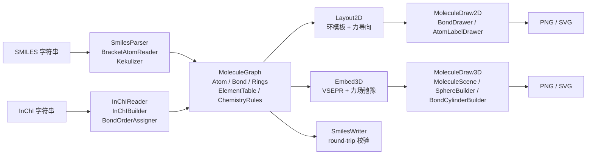

## 用户需求

在 `SMILES` 库中实现对 **SMILES** 与 **InChI** 两种分子结构式字符串的解析，统一转换为同一个分子图对象；再由分子图重建 2D 与 3D 坐标数据。随后在 `SMILESView` 库中基于这些坐标分别实现 2D 与 3D 分子结构绘图。最后在 `test` 项目中编写可运行的命令行示例与验证程序。

## 产品概览

一套"结构字符串 → 分子图 → 分子坐标 → 结构图像"的完整处理流程。输入为一行 SMILES 或 InChI 文本，输出为可保存的 2D 结构图（键线式/楔形式）与 3D 立体结构图（球棍模型或空间填充模型），并可导出的 PNG 位图与 SVG 矢量图；控制台程序一次运行即可验证解析、坐标与渲染全链路，并输出图像与验证报告。

## 核心功能

- **SMILES 解析**：支持分支、环闭合（含二位数字环号）、全部键符号、方括号原子（同位素、电荷、氢数、原子类别）、芳香小写原子、手性标记、多组分分子；完成芳香体系的双键还原与隐式氢补全。
- **InChI 解析**：支持标准 InChI 的分子式层、连接层、氢层、电荷层、质子层与立体层解析，并由价态与氢层信息还原键级。
- **统一分子图对象**：原子、化学键、芳香性、形式电荷、立体标记、显式/隐式氢、成环信息、连通分量、分子式与分子量等统一表示，两种格式解析结果完全一致可互换。
- **2D 坐标重建**：环系优先使用规则多边形布局，取代基按理想键角向外生长，再经等键长约束与重叠消解的迭代优化，输出平整、无交叉重叠的平面坐标。
- **3D 坐标重建**：依据原子杂化类型生成线性/平面三角/四面体理想几何，再经键长、键角、环平面性与非键排斥的力场弛豫得到三维坐标，并尽量符合手性标记。
- **2D 结构绘制**：单/双/三键与芳香键绘制、立体楔形与虚线键、元素配色原子标签（含电荷与氢数标注）、自适应缩放与留白、可选标题与注释。
- **3D 结构绘制**：原子球体（按元素配色与半径）与键圆柱（分色、分段）组合的球棍模型，以及按范德华半径的空间填充模型；带光照、透视投影与正确的前后遮挡排序。
- **输出与验证**：图像导出 PNG 与 SVG；命令行示例批量处理内置用例，校验原子数、键数、分子式、价态合法性与坐标质量，并生成文本与 JSON 格式的测试报告与图像文件。

## 技术栈

- 语言与运行时：VB.NET，`net10.0`（`SMILES` 库）/ `net10.0-windows`（`SMILESView`、`test`），与现有三个 `.vbproj` 保持一致。
- 3D 渲染：复用 `Microsoft.VisualBasic.Imaging.Drawing3D`（`Camera`、`Surface`、`PainterAlgorithm`、`Math3D`），不引入新的图形库。
- 2D 渲染：复用 `IGraphics` 抽象（`Graphics2D` GDI+ 光栅驱动 / `GraphicsSVG` 矢量驱动）。
- 化学基础数据：复用 `SMRUCC.genomics.ComponentModel.Chemical.PeriodicTable`（原子量/元素表）。
- 数学：复用 `Math.NET5`（线性代数）与 `Core` 中的 `PointF3D`。
- 测试报告：复用 `Microsoft.VisualBasic.Core` 的 `DebugAudit`。

三个 `.vbproj` 的 `ProjectReference` 与 `TargetFramework` **已完全满足需求，无需修改**；`SMILES.slnx` 已包含全部三个项目，也无需修改。

## 实现策略

### 分层与职责边界

`SMILES` 库（net10.0，**无 System.Drawing 依赖**）负责：分子图模型、两种格式解析、环感知、价态/杂化推断、2D/3D 坐标重建、坐标质量度量。`SMILESView` 库（net10.0-windows）只做"取坐标 → 生成图元 → 光栅化/矢量化"。测试项目只做编排与断言。这样坐标算法可独立测试、可被非 GUI 场景复用，渲染层不做任何化学推理。

### 统一分子图的核心决策

- 定义**自包含**的 `Atom` / `Bond` / `MoleculeGraph`，不引用 `analysis/MetabolicRouter` 中已有的 `Chem.Molecule`（避免把大型分析模块拖入依赖链）。但沿用其已被验证的命名与结构约定：平行数组式邻接、`a`/`b`/`order` 键三元组、惰性邻接缓存、`MorganRanks` 规范排序。
- `Atom` 实现 `Microsoft.VisualBasic.Imaging.PointF3D`（该接口定义在 `Core` 程序集，`SMILES.vbproj` 已引用）。好处是视图层可直接用 `Drawing3D.Models.Extensions.LoadVector3D(Of T As PointF3D)` 把原子集合一次性转成 `Point3D` 序列，零胶水代码。
- 键级用 `Double`（容忍 1.5 芳香键），同时保留 `IsAromatic` 布尔标记，使"芳香感知"与"Kekulé 键级"两个表达并存，避免反复互转。
- 元素颜色以 **hex 字符串** 保存在 `SMILES` 库（`ElementTable.CpkColorHex`），视图层再转 `Color`。这是 net10.0 无 System.Drawing 约束下的唯一干净做法。

### 解析策略

- **SMILES**：手写单遍状态机（显式位置索引，出错信息携带列号）。解析阶段只记录"待定键级 + 芳香标记"，解析结束后统一执行一次 **Kekulé 化**（对芳香子图做最大匹配的完美匹配搜索，为每个需要双键的芳香原子选出配对边），再补全隐式氢。这一顺序避免边解析边推断导致的回溯。
- **SMILES 写出**：实现确定性 DFS 写出器（Morgan 秩排序邻居、环闭合号登记），用于 demo 的 round-trip 自校验。环闭合数字的分配逻辑是解析器的镜像，实现时两侧对照编写可显著降低出错率。
- **InChI**：分为"层解析"（`InChIReader` → 纯数据 `InChIData`）与"图构建"（`InChIBuilder`）两步。连接层只给出拓扑，键级缺失，因此键级还原器（`BondOrderAssigner`）以"价态守恒 + 氢层计数 + 最小自由基"为目标，从小环优先的顺序做带剪枝的回溯赋值。`/q` 与 `/p` 层只给电荷总数而无原子归属，采用价态需求定位（四配位 N、一配位 O 等），无法定位时记入 `Warnings` 而非抛异常。
- 全部化学不确定性统一走 `MoleculeGraph.Warnings As List(Of String)` 收集：单条结构的化学"不完美"不应中断整批处理。

### 坐标重建策略

- **环感知**：自实现 SSSR（最小环基）——逐条键临时删除后求端点间最短路得到候选环，按原子集合去重并剔除超集，环数量上界为 `bonds − atoms + components`。复杂度 `O(E·(V+E))`， metabolites 尺度（≤200 原子）可忽略。
- **2D 布局**：① 环系用规则多边形模板（5/6 元环）；② 稠合/螺环沿共享键或共享原子拼接；③ 取代基按 BFS 向外生长，理想夹角 120°，冲突时尝试左右两个分支位置；④ 力导向精修（键长弹簧 + 1-3 原子对角度排斥 + 非键重叠消解，步长退火 ~200 轮）；⑤ 归一化键长、去重叠、居中。
- **3D 嵌入**：① 按键级与芳香性确定杂化（sp/ sp²/ sp³）；② 依理想几何做 BFS 生长（线性 180°、三角平面 120°、四面体 109.47°）；③ 力场弛豫：键长项 + 键角项 + 环平面性项 + 手性（标量三重积符号）约束 + 图距 ≥3 的非键软排斥（截断 3 Å），固定步长梯度下降 ~500 步并线性衰减步长；④ 输出以 Å 为单位、几何中心归零的坐标。
- **性能预算**：2D 每轮 `O(n²)`、3D 每轮 `O(n²)`。200 原子 × 500 步 ≈ 2×10⁷ 次标量运算，VB 数组直算约百毫秒级。热循环内一律使用原始 `Double()` 数组与预建邻接索引，禁用 LINQ/闭包分配；原子数 > 500 时自动降迭代数（并在 `Warnings` 记录降级）。

### 渲染策略

- **2D**：`MoleculeDraw2D.Draw(canvas As IGraphics)` 单入口，PNG 走 `New Size(w,h).CreateGDIDevice(Color.White)` + `Graphics2D.ImageResource.SaveAs(path)`；SVG 走 `New GraphicsSVG(size, dpi, dpi)` + `WriteSVG(g, path)` 扩展。双/三键按垂直法线偏移画平行线（偏移量 = 键宽 × 1.4），楔形键用填充三角形/折线实现，原子标签用"底衬填充 + 文本"保证可读性。
- **3D**：`MoleculeScene` 把分子编译为 `Surface()` 面片集合，`MoleculeDraw3D` 统一用 **`PainterAlgorithm.SurfacePainter(canvas As IGraphics, camera, surfaces, illumination:=True)`**（跨平台重载），一次完成旋转、投影、并行光照与按平均 Z 的画家算法排序。
- **两种模式**：`BallAndStick`（原子球半径取共价半径 × 0.35，键半径 ≈ 0.12 Å，可按原子分色为半键）与 `SpaceFilling`（球半径取范德华半径 × 1.0，不画键）。

## 关键实现要点（执行注意事项）

1. **`Camera.Screen` 必须先赋值**再调用 `Project`，否则投影按 0 尺寸计算、所有点塌陷到 `Offset`，表现为"空白图"。相机自动取景用点云包围球 + `FieldOfView`/`ViewDistance` 反算，不要把 `MaxPlainCameraView` 当成唯一手段（它对近平面点云可能给出退化法向）。
2. **画家算法按平均 Z 排序**：一根长键若作为单个四边形面片，会整片压在球体前面或后面而出现穿插。因此键圆柱必须沿轴向切成 8~12 段，每段独立 `Surface`。
3. **`Brush` 复用**：`Surface.brush` 与逐面光照产生的刷子若每次 `New SolidBrush`，数百原子即产生数万 GDI 句柄。按"元素 × 光照档位"做 `Dictionary` 缓存，用静态共享实例，进程结束时不再释放（进程级缓存，避免释放后仍被引用的崩溃）。
4. **球体模板缓存**：单位球（`nstacks=10, nslice=20`）顶点与面索引只生成一次，每个原子仅做缩放 + 平移，避免 `N × stacks × slices` 次三角函数调用。
5. **`DebugAudit.Check` 带 `<Conditional("DEBUG")>`**，Release 构建会被编译器整体消除。demo 中的断言一律用 `DebugAudit.Test(...)` / `AreEqual(...)`（两者 Release 下仍生效），`FailureCount` 决定进程退出码。
6. **`Copyright`/文档注释**：新文件沿用仓库风格——块式 `Namespace`、4 空格缩进、完整 `''' <summary>/<param>/<returns>` 注释、`GenerateDocumentationFile=True` 下不允许出现未注释的公开成员缺失警告（保持 `Imports` 最小化）。
7. **不改动无关代码**：仅删除两个 `Class1.vb` 占位符；三个 `.vbproj` 与 `.slnx` 保持原样；不触碰 `analysis/MetabolicRouter`、`RCSB-pdb` 等其它项目。
8. **图像输出目录**：demo 从 `AppContext.BaseDirectory` 向上定位 `test.vbproj`，输出到 `test/output/`（自动创建），报告写 `audit_report.txt` 与 `audit_report.json`，与 `engine/IO/BioCycCompiler/test/Program.vb` 的现有范式一致。

## 架构设计



数据流：`文本 → MoleculeGraph（含 Warnings） → Atom.X/Y/Z → Surface()/IGraphics 图元 → 位图或矢量文件`。坐标只存在于 `Atom` 上，两种绘制器都只读坐标，互不影响。

## 目录结构

```
SMILES/
├── SMILES/                                    # 分子图与解析库 (net10.0, 无 System.Drawing)
│   ├── SMILES.vbproj                          # [UNCHANGED] 现有引用已满足
│   ├── Class1.vb                              # [DELETE] 占位符
│   ├── MoleculeIO.vb                          # [NEW] 统一门面：Parse/ParseSmiles/ParseInChI/ParseFile/TryParse/WriteSmiles，自动识别格式
│   ├── Graph/
│   │   ├── Enums.vb                           # [NEW] AtomStereo/BondStereo/Hybridization/MoleculeFormat/Layout2DOptions/Embed3DOptions
│   │   ├── Atom.vb                            # [NEW] 原子模型，Implements PointF3D；Index/Element/Isotope/Charge/ExplicitH/IsAromatic/AtomClass/Stereo/X/Y/Z
│   │   ├── Bond.vb                            # [NEW] 键模型，Implements IndexEdge；a/b/order(Double)/IsAromatic/Stereo/IsRing
│   │   ├── MoleculeGraph.vb                   # [NEW] 统一分子图：Adjacency 惰性缓存、Neighbors、BondOrder、ImplicitH、TotalH、Hybridization、ValenceViolations、Components、Rings、MolecularFormula、MolecularWeight、MolKey、Warnings、Layout2D、Embed3D
│   │   ├── Rings.vb                           # [NEW] SSSR 最小环基、环系归并、IsRing 标记，供 2D 模板布局与 3D 平面性约束使用
│   │   ├── ElementTable.vb                    # [NEW] 共价半径、范德华半径、默认价态、CPK 颜色(hex)、默认键长、原子量(复用 PeriodicTable)
│   │   └── ChemistryRules.vb                  # [NEW] 价态/自由基判定、隐式氢补全、杂化推断、Kekulé 化入口
│   ├── SMILES/
│   │   ├── SmilesParser.vb                    # [NEW] 完整 SMILES 状态机：分支/环闭合(含 %nn)/键符号 -=#:$/\/方括号原子/芳香小写/@ 与 @@/. 多组分；错误携带列号
│   │   ├── BracketAtomReader.vb               # [NEW] 解析 [13CH3:2+]/[nH]/[O-] 等记号：同位素、元素、手性、H 数、电荷、原子类别
│   │   ├── Kekulizer.vb                       # [NEW] 芳香子图完美匹配赋值、芳香键标记、隐式氢补全
│   │   └── SmilesWriter.vb                    # [NEW] 确定性 DFS 写出（Morgan 秩排序、环闭合号、芳香小写），用于 round-trip 校验
│   ├── InChI/
│   │   ├── InChIData.vb                       # [NEW] 层数据模型：版本/分子式段/连接层/氢层/电荷/质子/立体层原始片段
│   │   ├── InChIReader.vb                     # [NEW] 层切分与 formula、c、h、q、p、b、t、m、s 解析，含多组分偏移量计算
│   │   ├── InChIBuilder.vb                    # [NEW] 由层数据构建 MoleculeGraph：原子编号映射、电荷/质子归属、氢补全、调用键级还原
│   │   └── BondOrderAssigner.vb               # [NEW] 基于价态守恒 + 氢层计数 + 最小自由基的键级回溯赋值（小环优先、带剪枝）
│   └── Coordinates/
│       ├── Geometry.vb                        # [NEW] 轻量 Vec3（dot/cross/normalize/rotate/angle）、质心与包围盒、单位球顶点生成
│       ├── Layout2D.vb                        # [NEW] 环模板 + BFS 生长 + 力导向精修 + 重叠消解 + 键长归一化
│       ├── Embed3D.vb                         # [NEW] 杂化推断驱动的 VSEPR 生长 + 力场弛豫（键长/键角/环平面性/手性/非键排斥）
│       └── CoordinateQuality.vb               # [NEW] 质量度量：平均键长与标准差、最小非键原子间距、共线/退化检查，返回结构化结果供断言
├── SMILESView/                                # 2D/3D 渲染库 (net10.0-windows)
│   ├── SMILESView.vbproj                      # [UNCHANGED]
│   ├── Class1.vb                              # [DELETE] 占位符
│   ├── StructureViewer.vb                     # [NEW] 一站式门面：文本 → 解析 → 布局 → 绘制 → SavePng/SaveSvg，供 demo 与外部调用
│   ├── Theme/
│   │   ├── ElementColors.vb                   # [NEW] CPK hex → System.Drawing.Color 转换表与缓存
│   │   └── ChemTheme.vb                       # [NEW] 背景色、字体、键宽、球半径比例、光照参数、标签底衬等主题参数
│   ├── Draw2D/
│   │   ├── MoleculeDraw2D.vb                  # [NEW] 主渲染器：自动缩放与留白、坐标翻转、键/标签/标题绘制、PNG 与 SVG 双出口
│   │   ├── BondDrawer.vb                      # [NEW] 单/双/三键平行偏移、芳香键虚线与内圈、楔形实心键、虚线键的几何生成
│   │   └── AtomLabelDrawer.vb                 # [NEW] 元素符号与电荷/氢下标排版、底衬填充、隐藏碳原子规则
│   └── Draw3D/
│       ├── SphereBuilder.vb                   # [NEW] 单位球模板缓存 → 缩放平移生成 Surface() 面片集合
│       ├── BondCylinderBuilder.vb             # [NEW] 两原子间圆柱（分段 8~12 段、按原子分色为半键），生成 Surface()
│       ├── MoleculeScene.vb                   # [NEW] 由 MoleculeGraph 编译场景：BallAndStick / SpaceFilling、相机自动取景、光照与背景
│       └── MoleculeDraw3D.vb                  # [NEW] 渲染入口：SurfacePainter(IGraphics, Camera, Surface())，PNG 与 SVG 双出口
└── test/                                      # 控制台 demo (net10.0-windows)
    ├── test.vbproj                            # [UNCHANGED]
    ├── Program.vb                             # [MODIFY] ImageDriver.Register + 遍历用例 + 断言 + 出图 + 报告 + 退出码
    ├── TestCases.vb                           # [NEW] 内置用例表（SMILES 与 InChI 对照、期望分子式/原子数/键数/芳香性/手性）
    ├── Report.vb                              # [NEW] 输出目录定位、DebugAudit.Dump/ToJson 落盘、控制台摘要
    └── output/                                # [GENERATED] *_2d.png / *_3d_ballstick.png / *_3d_spacefill.png / *.svg / audit_report.*
```

## 关键代码结构

```
Namespace SMRUCC.genomics.Molecule.SMILES

    Public Class Atom : Implements Microsoft.VisualBasic.Imaging.PointF3D
        Public Property Index As Integer
        Public Property Element As String
        Public Property Isotope As Integer          ' 0 = 天然丰度
        Public Property Charge As Integer
        Public Property ExplicitH As Integer        ' 方括号中显式写出的 H
        Public Property IsAromatic As Boolean
        Public Property AtomClass As Integer        ' SMILES :n 原子类别
        Public Property Stereo As AtomStereo
        Public Property X As Double Implements Microsoft.VisualBasic.Imaging.Layout2D.X
        Public Property Y As Double Implements Microsoft.VisualBasic.Imaging.Layout2D.Y
        Public Property Z As Double Implements Microsoft.VisualBasic.Imaging.PointF3D.Z
    End Class

    Public Class MoleculeGraph
        Public Property Atoms As List(Of Atom)
        Public Property Bonds As List(Of Bond)
        Public Property Format As MoleculeFormat
        Public Property SourceText As String
        Public ReadOnly Property Warnings As List(Of String)

        Public Function Neighbors(index As Integer) As List(Of (neighbor As Integer, order As Double))
        Public Function ImplicitH(index As Integer) As Integer
        Public Function Hybridization(index As Integer) As Hybridization
        Public Function ValenceViolations() As List(Of Integer)
        Public Function Rings() As List(Of Integer())
        Public Function MolecularFormula() As String
        Public Sub Layout2D(Optional options As Layout2DOptions = Nothing)
        Public Sub Embed3D(Optional options As Embed3DOptions = Nothing)
    End Class

End Namespace
```

```
Namespace SMILESView

    Public Enum RenderMode
        BallAndStick
        SpaceFilling
    End Enum

    ''' <summary> 文本 → 解析 → 坐标 → 图像的统一门面。 </summary>
    Public Class StructureViewer
        Public Sub New(graph As MoleculeGraph)

        Public Function Render2D(size As Size, Optional theme As ChemTheme = Nothing) As IGraphics
        Public Function Render3D(size As Size, mode As RenderMode, Optional camera As Camera = Nothing) As IGraphics

        Public Function SavePng2D(path As String, size As Size) As Boolean
        Public Function SaveSvg2D(path As String, size As Size) As Boolean
        Public Function SavePng3D(path As String, size As Size, mode As RenderMode) As Boolean
        Public Function SaveSvg3D(path As String, size As Size, mode As RenderMode) As Boolean
    End Class

End Namespace
```