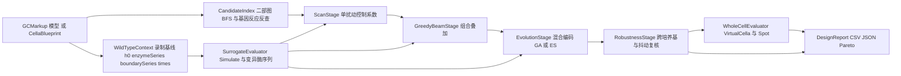

## 产品概述

在 `CellaOptimization.vbproj` 中实现一个可独立调用的代谢通路自动优化器类库，基于 Cella 虚拟细胞引擎，以「目标化合物产量相对野生型的提升倍数」为目标，自动搜索「基因敲除组合 + 酶 kcat 倍数组合」的最优突变设计，并输出可复现的设计清单、评估指标与实验报告。

## 核心功能

- **野生型基线**：加载 GCMarkup 模型或 `CellaBlueprint`，校验预训练 `MetabolicTemplate`，构建单细胞并录制基线轨迹（初始代谢物、逐反应酶水平、边界浓度、时间网格）与基线目标产量、生长指标。
- **候选空间构造**：由化学计量矩阵构建「代谢物—反应」二部图，以目标化合物为根做限定半径的广度优先搜索，自动区分「敲除候选（消耗目标或竞争前体）」与「kcat 上调候选（合成目标或供给前体）」；建立基因到反应的反向索引，支持必需基因与交换/转运反应黑名单，把搜索维度压到数十维。
- **两类突变**：虚拟敲除落到该基因催化的全部反应（酶水平置 0）；kcat 突变落到选定反应的酶水平乘子（`kcat_mut / kcat_wt`），支持多个突变叠加、上下界钳制与越界标记。
- **两级评估**：快层用纯代谢网络在野生型输入序列上回放并施加突变，批量筛选；慢层用完整虚拟细胞（六层因果链）在固定培养基与时间步下复核 Top 候选，两层都强制先复位到野生型再施加突变。
- **分层搜索**：单扰动全扫描得到通量控制系数排序；贪心/Beam 逐轮叠加并检验上位效应；在约简子空间上做混合编码（敲除位串 + 离散倍数向量）的遗传算法或进化策略精修；最后跨培养基、跨随机种子、kcat 抖动做稳健性复核与 Pareto 排序。
- **结果评估与报告**：产量在原始浓度空间计算并加平滑项，输出提升倍数、生长比、质量守恒残差、可行性、编辑数惩罚与综合评分；导出候选设计 CSV、最优设计 JSON（含配置、种子、模板来源、逐阶段诊断）与 Pareto 前沿。
- **可复现与可验证**：所有评估使用固定种子、固定时间网格、固定培养基与固定输入序列；同一设计重复评估结果一致；提供控制台端到端测试与审计报告。
- **约束与边界**：不修改 Cella 引擎；模板未训练时拒绝运行；kcat 倍数限制在训练分布附近，越界设计降权或剔除；不负责模型训练与数据预处理，只消费已训练模板或训练集。

## 技术栈选择

- 语言与运行时：VB.NET，`net10.0`，SDK 风格工程，与 `Cella.vbproj`、`CellaLoader.vbproj` 保持一致。
- 复用现有工程：`Cella`（`VirtualCella`、`CellaFactory`、`CellaBlueprint`、`MetabolicNetwork`、`MetabolicNetworkGraph`、`CellularState`、`StatePool`）、`Metaboliq`（`MetabolicLiquidNetwork`、`MetabolicTrajectory`、`MetabolicDataIO`）、`sciBASIC#` 的 Tensor/LNN/`Darwinism`、`Microsoft.VisualBasic.Core` 的 `DebugAudit`、`GCMarkupLanguage`、`Model.Core`、`BioCyc`。
- 不引入新 NuGet 包；不新增外部求解器依赖。
- 测试：独立控制台 Exe 工程 `test/CellaOptimization.Test.vbproj`，按项目规则使用 `G:\GCModeller\src\runtime\sciBASIC#\Microsoft.VisualBasic.Core\src\ApplicationServices\Debugger\DebugAudit.vb` 的 `Reset / Mark / Check / AreEqual / Watch / SaveReport` 生成测试报告。

## 实现方案

### 1. 突变表示

定义混合变量设计 `MutationSpec`：`KnockOuts` 为基因或反应 id 集合，`KcatScales` 为 `reactionId -> kcat_mut / kcat_wt` 的映射。`Id` 由排序后的敲除集与排序后的倍数表拼接成规范化字符串，用于缓存与去重；提供克隆、边界校验、编辑数统计与冲突检测。

### 2. 快层评估：把突变编码进输入序列

`MetabolicLiquidNetwork.Simulate` 内部会 `Liquid.ResetState()` 并重建初始状态，因此同一实例重复调用是可复现的；但 `Liquid` 的隐藏状态是实例私有的，`_enzymeLevel` 也是实例私有的。为避免「上一次评估残留的扰动状态」以及多线程争用，快层采用如下策略：

- 保持模板的 `_enzymeLevel` 始终为 1.0，永不调用 `SetEnzymeLevel`；
- 对每个候选复制野生型 `enzymeSeries`，按设计把对应反应的整列乘上倍数：敲除为 0，kcat 突变为 `kcat_mut / kcat_wt`；
- 调用 `Simulate(h0, mutatedEnzymeSeries, boundarySeries, times)`。

由于 `BuildInput` 执行 `u(j) = enzymes(j) * _enzymeLevel(j)`，而通量头执行 `v_j = u_j * sigma(z_j)`，把倍数放进 `enzymeSeries` 与放进 `_enzymeLevel` 在数学上等价，但前者无状态、可缓存、无需复位，从根上消除了状态泄漏。默认单实例串行评估；如需并行，按线程数创建独立 `MetabolicLiquidNetwork` 副本并共享常量张量，同时在配置中暴露内存上限，超过上限自动退回串行。

### 3. 慢层评估：完整虚拟细胞 + 直连格点

慢层不经过 `Environment`/`CellBatchRunner`，而是：

- `CellaFactory.BuildCell(blueprint)` 构建全新细胞；
- `New Spot With { .Medium = medium }`，通过 `CellaFactory.BindToSpot(cell, spot, Nothing)` 绑定并写入边界初值；
- 循环调用 `cell.Tick(dt)`，读取 `cell.State.Level(StatePool.Metabolite, id)`、`cell.metabolic.ProducedAmount(id)`、`cell.GrowthRatePerTick()`、`cell.Biomass`、`cell.IsAlive`。

这样做的原因有三点：一是避开 `MetabolicNetwork.TickBatch` 未乘 `_enzymeLevel` 导致的「批量管线下突变静默失效」缺陷；二是绕开生命周期、分裂、迁移与分化带来的随机性，保证同一设计可复现；三是评估代价只与单细胞相关，适合复核数十个候选而非数万个。每次评估前调用 `cell.metabolic.Model.ResetPerturbation()`，再按设计调用 `cell.metabolic.KnockOut(reaction)` 或 `SetEnzymeLevel(reaction, scale)`。

### 4. 候选空间剪枝

从 `MetabolicNetworkGraph.Stoichiometry`（`mAll × r`）恢复「反应—底物/产物」关系：正系数为产物、负系数为底物。以目标化合物为根，按共享反应做 BFS，得到每个代谢物与反应到目标的拓扑距离。

- 敲除候选：距离不超过 `SearchRadius`、且消耗目标或消耗目标前体的反应；排除目标自身的必需合成反应、交换/转运反应、`Exporters` 中登记的外排反应、无基因映射的自发反应。
- kcat 上调候选：距离不超过 `SearchRadius`、且生成目标或生成目标前体的反应，以及 ATP/NADH/NADPH 等辅因子再生反应。
- 基因到反应的反向索引由 `CellaBlueprint.ReactionGeneMap` 反转得到；一个基因可对应多条反应，敲除时必须全部置零。
- 必需基因优先由「单敲除后生长比低于阈值」自动推导，也允许用户在配置中显式给出黑名单。
- 用 `MaxCandidates`（默认 40）截断，截断前按拓扑距离与目标相关性排序。

### 5. 分层搜索

- **Stage A 单扰动扫描**：对每个候选分别评估敲除、`0.5` 倍、`2` 倍三种扰动，计算近似控制系数 `C = delta(ln Y) / delta(ln level)`；按 `|C|` 排序保留 `TopK`（默认 20）。
- **Stage B 贪心/Beam 叠加**：以空设计为起点，每轮对 Beam 中每个设计尝试加入一个候选编辑（敲除或配置中的离散步长 `{0.25, 0.5, 2, 4}`），满足 `MaxKnockouts`、`MaxKcatEdits` 与不重复约束后评估，保留前 `BeamWidth` 个；连续 `Patience` 轮无提升即停止。该阶段专门捕捉「先敲除竞争支路、再上调合成酶」这类上位效应。
- **Stage C 混合编码进化**：在 `TopK` 子空间上使用定长染色体，每个基因位取离散状态 `{野生型, 敲除}` 或 `{野生型, 0.25, 0.5, 2, 4}`；实现锦标赛选择、均匀交叉、逐位变异、精英保留与约束修复，种群规模与代数由配置控制。选择自写实现而非直接套用 `Darwinism.GAF.GeneticAlgorithm`，原因是后者的种群、替换策略、适应度池装配成本高，且其 `Chromosome` 契约要求实现多个与优化器无关的成员；若后续需要多目标 GA，可再适配。
- **Stage D 稳健性复核**：对 Pareto 前沿候选在多种培养基浓度、多个随机种子、kcat 倍数正负 10% 抖动下重跑慢层评估；只有全部条件下提升倍数大于 1 且生长达标的设计才进入最终推荐，并按「提升倍数、生长比、编辑数」做 Pareto 排序。

### 6. 目标函数

设目标化合物在原始浓度空间的时间序列为 `c(t)`，由 `MetabolicDataIO.InverseRow` 从归一化空间还原并加平滑项 `epsilon = 1e-6`。产量按配置取终点值、时间均值、曲线下面积或分泌累计量：

`Y = mean(c(t))`；`Fold = (Y_mut + epsilon) / (Y_WT + epsilon)`；

`Score = log2(Fold) - lambdaG * max(0, gMin - growth_mut / growth_WT) - lambdaM * ||S·v||_2 - lambdaE * editCount - lambdaOOD * oodFlag`

其中 `||S·v||_2` 由 `MetabolicNetworkGraph.SteadyStateViolation` 给出；快层无生物量时用平均绝对通量、质量守恒残差与数值失败计数做代理；慢层使用 `GrowthRatePerTick()` 与 `Biomass`。越界标记在 `kcat` 倍数超出配置上下界或模板训练范围时置位。

### 7. 关键决策与取舍

- **不改 `Cella.vbproj`**：保持引擎零回归；批量管线缺陷通过慢层不走批量路径规避，并在报告中记录一条可选修复建议。
- **快层把突变编入酶序列**：避免扰动状态泄漏与线程争用，代价是需要为每个候选复制 `T × r` 的酶矩阵；在 `T` 约 100、`r` 约 3000 时单候选约 2.4 MB，可接受。
- **慢层直连 `Spot`**：确定性优先，牺牲了空间扩散、分裂与生态位效应；这些属于后续扩展，不影响通路优化的主目标。
- **归一化空间还原**：倍数必须在原始浓度空间计算，否则 z-score 空间的比值没有生物学意义。
- **模板校验**：`blueprint.MetabolicTemplate` 为空或 `MetabolicLoss` 为空时直接抛出可解释异常，避免用随机权重优化出无意义结果。
- **FBA 预筛暂不接入**：仓库内 `FBA.Core` 的工程边界尚未确认，先以拓扑剪枝替代；待确认其 `.vbproj` 后再作为可选 Stage 0.5 接入。

### 8. 性能与可靠性

- 单次快层评估复杂度约为 `O(T * (m^2 + m*r))`，由 LNN 前向主导；单次慢层为 `O(T * 六个子网络)`。
- 通过拓扑剪枝把候选从数千条反应压到约 40 条，预算 `EvaluationBudget` 默认 5000 次快层评估。
- `EvaluationCache` 以规范化 `MutationSpec.Id` 为键做线程安全缓存；同一设计在扫描、Beam、进化阶段重复出现时直接命中。
- 约束修复在评估前完成，非法设计不进入评估；出现 NaN、Inf、ODE 失败计数增加或质量守恒残差超阈值的设计直接判为不可行。
- 默认串行评估；并行仅在显式配置且内存预算允许时启用，避免数百 MB 级权重张量被重复分配。
- 日志不逐候选打印，只按阶段汇总并写入 CSV；`DebugAudit` 仅用于测试工程，不进生产热路径。

## 架构设计

系统分为五层，单向依赖：

- **Design 层**：`MutationSpec`、`OptimizationConfig`、`EvaluationResult`，只含数据与校验，不依赖引擎。
- **Model 层**：`WildTypeContext` 负责构建蓝图/细胞并录制基线；`CandidateIndex` 负责拓扑剪枝与基因反应反查；`Mutator` 负责把设计翻译为引擎调用。
- **Evaluation 层**：`IEvaluator` 统一契约；`SurrogateEvaluator` 与 `WholeCellEvaluator` 两级实现；`TargetAccumulator` 负责目标读数与反归一化；`Fitness` 负责评分；`EvaluationCache` 负责去重。
- **Search 层**：`ScanStage`、`GreedyBeamStage`、`EvolutionStage`、`RobustnessStage` 各自只依赖 `IEvaluator`，由 `OptimizationDriver` 串联并维护预算。
- **Report 层**：`DesignReport` 输出 CSV/JSON、Pareto 前沿与阶段摘要。



数据流：模型 → 蓝图 → 基线轨迹与候选索引 → 快层扫描/Beam/进化 → 慢层复核 → 报告。设计对象在层间传递，评估器不持有搜索状态，搜索层不直接接触引擎 API。

## 目录结构

```
CellaOptimization/
├── CellaOptimization.vbproj              [MODIFY] 统一为引擎工程约定：增加 Platforms、AssemblyName、RootNamespace 改为 SMRUCC.genomics.GCModeller.ModellingEngine.Optimization；增加 Compile Remove test；保留现有 Cella/Metaboliq/MachineLearning/Core 等引用。
├── Class1.vb                             [DELETE] 删除占位空类。
├── Design/
│   ├── MutationSpec.vb                   [NEW] 突变设计：敲除集合、kcat 倍数表、规范化 Id、克隆、约束校验、编辑数统计、冲突检测。
│   ├── OptimizationConfig.vb             [NEW] 目标化合物与目标池、产量指标、时间网格与步长、敲除/kcat 上限、倍数档位与上下界、剪枝半径、候选上限、Beam 宽度、种群与代数、评估预算、随机种子、培养基、惩罚权重、并行与内存预算。
│   └── EvaluationResult.vb               [NEW] 产量、野生型产量、提升倍数、生长比、质量守恒残差、可行性、越界标记、综合评分、耗时、诊断信息。
├── Model/
│   ├── CandidateIndex.vb                 [NEW] 由 CellaBlueprint 与 MetabolicNetworkGraph 构建：基因到反应反向索引、反应到基因正向索引、底物/产物邻接、目标 BFS 距离、敲除候选与 kcat 候选分类、必需基因与黑名单过滤、候选截断与稳定排序。
│   ├── WildTypeContext.vb                [NEW] 加载模型或接受蓝图；校验 MetabolicTemplate 已训练；构建单细胞与 Spot；按固定时间网格录制 h0、enzymeSeries、boundarySeries、times、目标基线、生长基线；提供 CreatePristineModel 供快层复用。
│   └── Mutator.vb                        [NEW] 把 MutationSpec 翻译为引擎调用：快层生成变异 enzymeSeries；慢层先 ResetPerturbation 再 KnockOut/SetEnzymeLevel；倍数钳制、越界标记、基因到反应展开、应用结果回显。
├── Evaluation/
│   ├── IEvaluator.vb                     [NEW] 统一评估契约：Name 与 Evaluate(spec)；可选 Reset 与 Dispose。
│   ├── TargetAccumulator.vb              [NEW] 支持胞内、边界、分泌三种目标池；按时刻采样、积分与统计；调用 MetabolicDataIO.InverseRow 反归一化；处理 NaN/负值/零基线；输出终点值、均值、AUC、累计分泌量。
│   ├── SurrogateEvaluator.vb             [NEW] 基于 MetabolicLiquidNetwork.Simulate 的快层实现；复制并变异酶序列；复用固定 h0/boundary/times；异常与数值失败捕获；结果写缓存。
│   ├── WholeCellEvaluator.vb             [NEW] 基于 VirtualCella 与 Spot 的慢层实现；每候选新建细胞与格点；逐 Tick 读取目标、生长、存活；评估前复位扰动；可选多次重复取均值。
│   ├── Fitness.vb                        [NEW] 实现评分公式：log2 倍数、生长惩罚、质量守恒惩罚、编辑数惩罚、越界惩罚；提供不可行判定与分数归一化。
│   └── EvaluationCache.vb                [NEW] 线程安全的 spec.Id 到 EvaluationResult 缓存；命中率统计；可选容量上限与淘汰。
├── Search/
│   ├── ScanStage.vb                      [NEW] 单扰动全扫描：敲除、0.5 倍、2 倍；计算近似控制系数；输出排序表与 TopK 候选。
│   ├── GreedyBeamStage.vb                [NEW] Beam 搜索：逐轮叠加单编辑、约束检查、去重、精英保留、Patience 早停。
│   ├── EvolutionStage.vb                 [NEW] 混合编码进化：定长离散染色体、锦标赛选择、均匀交叉、逐位变异、精英保留、约束修复、预算耗尽停止。
│   ├── RobustnessStage.vb                [NEW] 多培养基、多随机种子、kcat 抖动复核；Pareto 非支配排序；输出推荐设计集合。
│   └── OptimizationDriver.vb             [NEW] 串联五个阶段；持有配置、上下文、索引、评估器与缓存；维护评估预算与阶段日志；返回最优设计与全部结果。
├── Report/
│   └── DesignReport.vb                   [NEW] 导出 candidates.csv、best_design.json、pareto.csv、stage_summary.md；记录配置快照、种子、模板来源、每阶段耗时与命中率；提供读取与断言辅助方法供测试使用。
└── test/
    ├── CellaOptimization.Test.vbproj     [NEW] Exe，net10.0，引用 CellaOptimization、Cella、Metaboliq、GCMarkupLanguage、Core；加入 Cella.slnx。
    ├── Program.vb                        [NEW] 端到端测试入口：DebugAudit.Reset 后依次验证工程装配、蓝图与模板校验、候选索引、突变正确性、快层确定性、慢层一致性、搜索约束、报告读写；最后 SaveReport。
    └── DemoNetwork.vb                    [NEW] 构造 8 至 12 个代谢物、10 至 15 条反应的小型合成网络（含目标产物、竞争支路、辅因子再生），用于在无外部模型时跑通算法与断言数值关系。
```

另需修改 `g:/GCModeller/src/GCModeller/engine/Cella.slnx`：新增 `CellaOptimization/CellaOptimization.vbproj` 与 `CellaOptimization/test/CellaOptimization.Test.vbproj` 两个节点，平台映射为 x64。

## 关键代码结构

```
Public Class MutationSpec
    Public Property KnockOuts As String()
    Public Property KcatScales As Dictionary(Of String, Double)

    Public ReadOnly Property Id As String
    Public ReadOnly Property EditCount As Integer

    Public Function Clone() As MutationSpec
    Public Function CanonicalKey() As String
    Public Function Validate(config As OptimizationConfig) As Boolean
End Class
```

```
Public Interface IEvaluator
    ReadOnly Property Name As String
    Function Evaluate(spec As MutationSpec) As EvaluationResult
End Interface

Public Class EvaluationResult
    Public Property Yield As Double
    Public Property WildTypeYield As Double
    Public Property FoldChange As Double
    Public Property GrowthRatio As Double
    Public Property MassResidual As Double
    Public Property Viable As Boolean
    Public Property OutOfDistribution As Boolean
    Public Property Score As Double
    Public Property ElapsedMilliseconds As Double
    Public Property AppliedKnockOuts As String()
End Class
```

```
Public Class OptimizationConfig
    Public Property TargetCompound As String
    Public Property TargetPool As StatePool = StatePool.Metabolite
    Public Property Metric As TargetMetric = TargetMetric.Mean

    Public Property TotalTime As Double = 100.0
    Public Property TimeStep As Double = 1.0
    Public Property Resolution As Integer = 100

    Public Property MaxKnockouts As Integer = 3
    Public Property MaxKcatEdits As Integer = 3
    Public Property KcatLevels As Double() = {0.25, 0.5, 2.0, 4.0}
    Public Property KcatMin As Double = 0.1
    Public Property KcatMax As Double = 4.0

    Public Property SearchRadius As Integer = 2
    Public Property MaxCandidates As Integer = 40
    Public Property TopK As Integer = 20
    Public Property BeamWidth As Integer = 8
    Public Property Patience As Integer = 3

    Public Property PopulationSize As Integer = 32
    Public Property Generations As Integer = 30
    Public Property EvaluationBudget As Integer = 5000
    Public Property Seed As Integer = 2024
End Class
```

## 验收标准

- 同一设计连续两次快层评估的产量差小于 `1e-9`；同一慢层配置重复运行结果一致。
- 敲除反应后该反应通量绝对值小于 `1e-9`；单反应线性测试中 2 倍 kcat 的通量比落在 `2 ± 5%`。
- 候选索引中每个基因的反向反应集合非空时，敲除该基因会置零其全部反应。
- 搜索产出的最优设计满足 `MaxKnockouts` 与 `MaxKcatEdits`；在合成网络上至少找到一个提升倍数大于 1 的可行设计。
- `DesignReport` 生成的 CSV 与 JSON 可被重新读取且字段完整。
- 测试工程 `DebugAudit.SaveReport` 输出报告且断言失败数为 0。

## Agent Extensions

### Skill

- **lsp-code-analysis**
- Purpose: 在接入引擎前用语义分析核对 `MetabolicNetwork.KnockOut`、`SetEnzymeLevel`、`MetabolicLiquidNetwork.BuildInput`、`Simulate`、`CellaFactory.BuildCell`、`BindToSpot`、`CellularState.Level` 等符号的真实签名与调用点，避免计划与实现漂移。
- Expected outcome: 输出一份已核对的引擎 API 清单（含所在文件与重载），作为 `WildTypeContext`、`Mutator`、两级评估器的实现依据；发现签名不一致时在编码前调整设计。