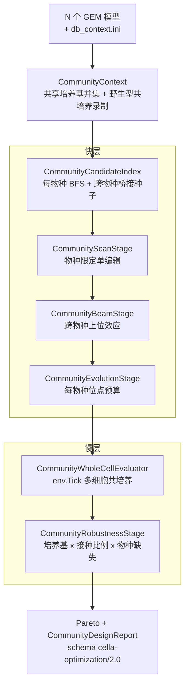
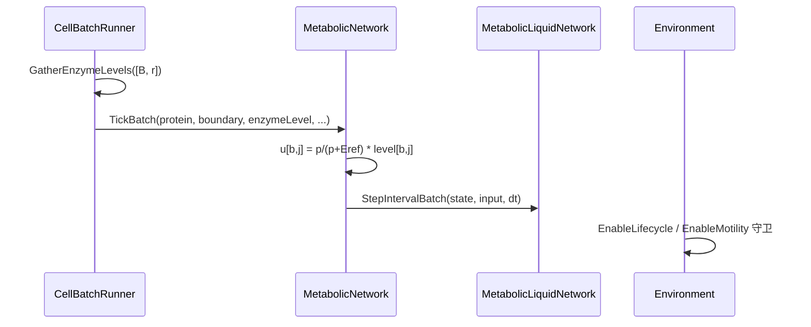

## 用户需求

让现有的代谢网络自动优化引擎 **同时兼容两种场景**：

1. 单菌发酵的代谢网络自动优化（已有能力，必须保持行为不变）；
2. 合成菌群多菌混合发酵的代谢网络自动优化（新增能力）。

## 产品概述

引擎从「一个物种、一个细胞、一个目标池」扩展为「N 个物种共用一个培养基、多个细胞、多个群落级目标」的搜索流程，同时不破坏现有单菌流程与测试基线。

## 核心功能

### 1. 单菌路径零回归

- 现有 `WildTypeContext` / `SurrogateEvaluator` / `WholeCellEvaluator` / 五阶段搜索 / 报告全部保持原语义；
- 现有 `CellaOptimization.Test`（`ecoli_virtualcell.xml`）作为回归基线，必须全绿。

### 2. 群落优化上下文

- 一次加载 2~6 个物种模型（以 Acetoin 五菌为例）与一份上下文映射（`db_context.ini`）；
- 自动生成**共享培养基**（各物种边界代谢物并集，按上下文映射的培养基配方与被动通透配置初始化）；
- 在同一格点上共同培养各物种的种子细胞，录制野生型共培养轨迹：共享培养基时间序列、每物种的酶序列与生长曲线、交叉喂养边；
- 每个物种独立享有编辑预算（敲除上限、kcat 上限）。

### 3. 物种维度的编辑方案

- 一个候选方案 = 若干「物种 + 基因敲除」与「物种 + 反应 kcat 倍数」的集合；
- 方案 ID 含物种前缀，保证不同物种的同名基因 / 同 ID 反应不会互相串扰（缓存、去重、报告均按物种隔离）。

### 4. 群落级目标与约束

- 目标化合物位于**共享培养基**（如 Acetoin），支持终点 / 均值 / AUC / 累计净产量四种指标；
- 评分同时考虑：群落总滴度提升倍数、每个物种的生长比不得低于下限、任一物种丰度低于阈值即判失败（共存约束）、编辑数量惩罚；
- 输出每物种的贡献占比与交叉喂养通量。

### 5. 两级评估（快层 + 慢层）

- 快层（代理）三档可切换：开环近似、定点闭环（默认迭代 3 次，能反映「改 A 影响 B」的交叉喂养耦合）、跳过快层；
- 慢层（全细胞复核）在共享培养基上同时推进所有物种的细胞，直接读取培养基中的目标浓度与各物种丰度；
- 批量管线与逐细胞管线结果必须一致。

### 6. 群落稳健性

- 在培养基浓度缩放、**接种比例抖动**、**物种缺失**三类扰动下重跑 Top 候选；
- 只有全部条件下仍提升且各物种存活的设计才进入推荐集合，并按非支配排序给出前沿。

### 7. 报告与验收

- 报告升级为带物种维度的新 schema，包含：候选编辑（按物种）、群落指标、每物种丰度与贡献、交叉喂养边、阶段诊断；
- 用 Acetoin 五菌模型跑端到端验收，测试报告由统一审计模块生成。

## 技术栈

沿用现有技术栈，不引入新依赖：

- 语言 / 框架：VB.NET，`net10.0`
- 引擎项目：`Cella.vbproj`（`RootNamespace = SMRUCC.genomics.GCModeller.ModellingEngine.vCella`）
- 优化项目：`CellaOptimization.vbproj`（`RootNamespace = ...Optimization`），已引用 `Cella`、`CellaLoader`、`Dynamics`、`Metaboliq`
- 数值：`Microsoft.VisualBasic.MachineLearning.TensorFlow.Tensor` + `Metaboliq.MetabolicLiquidNetwork`（LTC）
- 测试：`CellaOptimization.Test` 控制台程序 + `DebugAudit`

## 实施策略

**总原则：并列新增，单菌零改动。** 单菌链路（`WildTypeContext` → `SurrogateEvaluator` / `WholeCellEvaluator` → 五阶段）一行不动；群落链路以 `Community*` 前缀并列实现，共享底层以 `Friend` 可见性导出的算子（交叉、变异、锦标赛、培养基缩放）。

三条关键决策及其理由：

1. **酶水平（基因型）的单一真相源放在 `MetabolicLiquidNetwork._enzymeLevel`**，只新增只读属性与批量写入方法。原因：现有 `MetabolicNetwork.KnockOut / SetEnzymeLevel` 全部委托给模型，若在 `MetabolicNetwork` 里再存一份影子副本，任何绕过封装直接调用 `Model.SetEnzymeLevel` 的代码（`WildTypeContext`、`DemoMatrix` 自检、外部脚本）都会让两份状态失同步。这是跨项目的**最小必要改动**（`sub-system/Metaboliq`），仅新增成员，不改既有语义。

2. **批量相按行加乘扰动系数**。`CellBatchRunner` 为每物种分组各持一个 `[capacity, reactionCount]` 的酶水平缓冲，`gather.metabolic` 阶段随蛋白水平一并收集，`TickBatch` 在组装 `u` 时逐行相乘。新增的是**重载**（保留旧签名），旧调用方零改动。

3. **群落快层用定点迭代闭合培养基**，不引入新的物理模型。`MetabolicNetworkGraph` 已把转运反应当作普通反应纳入化学计量矩阵，因此某物种对某边界代谢物的净交换率就是 `Σ_j S(row, j)·v_j`（与 `TargetAccumulator.CumulativeProduction` 同一套数学）。迭代式：
`M_k(t) = M_0(t) + Σ_{τ≤t} dt·Σ_i net_i(τ)`，直到 `max|M_k − M_{k−1}| < tol` 或达到 `SurrogateIterations`；不收敛时降级为开环并把降级原因写进 `StageSummary.Message`。

性能与预算：

- 快层成本 ≈ `单物种成本 × 物种数 × 迭代次数`；默认 `Iterations=3`，`tol=1e-3`。
- 慢层成本 ≈ `单物种成本 × 物种数 × 细胞数`；`EvaluationBudget` 在群落模式下语义改为**细胞步预算**（`evaluations × species × cells`），否则预算会被物种数稀释。
- 物种间快层评估可并行：每物种用 `WildTypeContext.CreateTemplateClone()`（已存在、未被使用的工厂方法）持独立 `_enzymeLevel` 与隐藏状态，替代单一 `SyncLock`。

## 架构设计



数据流：
`CommunityConfig` → `CommunityContext.FromModels`（录制 WT）→ `CommunityCandidateIndex` → 快层（`CommunitySurrogateEvaluator`，三档）→ 慢层（`CommunityWholeCellEvaluator`）→ `CommunityDesignReport`。

### 引擎侧（Cella.vbproj）改动要点



### 目录结构

```
engine/
├── sub-system/Metaboliq/
│   └── MetabolicLiquidNetwork.vb                      # [MODIFY] 新增 EnzymeLevels 只读属性、ApplyEnzymeLevels 批量写入（唯一真相源）
├── Cella/
│   ├── Networks/MetabolicNetwork.vb                   # [MODIFY] 新增 EnzymeLevels/ApplyEnzymeLevels 转发；TickBatch 新增带 enzymeLevel 参数的重载（旧签名保留）
│   ├── Environment/CellBatchRunner.vb                 # [MODIFY] BatchState 新增 _enzymeLevel 缓冲；EnsureCapacity 分配；gather.metabolic 阶段收集；调用新 TickBatch 重载
│   ├── Environment/Environment.vb                     # [MODIFY] 新增 EnableLifecycle/EnableMotility 开关（默认 True），守卫 CellLifecycle.Run 与 FlagellarMotor.Swim
│   ├── Factory/CellaFactory.vb                        # [MODIFY] BuildDaughter 继承亲代酶水平；新增 SeedCommunity 辅助（按物种指定格点与细胞数）
│   └── State/CellaBlueprint.vb                        # [MODIFY] SpeciesName 补文档语义（必须唯一）；新增 Clone()（仅复制可独立修改的字段，共享几何/模板引用）
├── CellaLoader/
│   └── Bootstrapping.vb                               # [MODIFY] BlueprintFromModel 新增可选 speciesId/displayName 参数并写入蓝图
├── vCella/
│   └── Simulation.vb                                  # [MODIFY] 传入去重后的 speciesId（复用现有 #n 去重逻辑）；其余调用点因可选参数无需改动
└── CellaOptimization/
    ├── Design/
    │   ├── OptimizationConfig.vb                      # [MODIFY] TargetPool 新增 SharedMedium 成员（既有分支走 Case Else，零回归）
    │   ├── CommunityConfig.vb                         # [NEW] SpeciesConfig、CommunitySurrogateMode、CommunityConfig : Inherits OptimizationConfig（含 ValidateCommunity/Clone）
    │   ├── CommunityMutationSpec.vb                   # [NEW] SpeciesEdit（物种 + 敲除 + kcat）、CommunityMutationSpec（含物种前缀的规范化 Id、WithKnockOut/WithKcat/ForSpecies/Clone）
    │   └── CommunityEvaluationResult.vb               # [NEW] CommunityEvaluationResult : Inherits EvaluationResult，附 SpeciesObservation、CommunityStatistics（丰度/贡献/交叉喂养）
    ├── Model/
    │   ├── CommunityContext.vb                        # [NEW] SpeciesContext + CommunityContext：共享培养基并集、WT 共培养录制、共享培养基轨迹、CreateEnvironment、ReadCommunityTarget
    │   ├── CommunityCandidateIndex.vb                 # [NEW] 每物种候选 + 跨物种桥接种子 + 转运候选分类
    │   ├── CandidateIndex.vb                          # [MODIFY] 新增可选 searchSeeds As String() 与 includeTransporters As Boolean（默认行为不变）
    │   └── CommunityMutator.vb                        # [NEW] 按物种解析反应缩放、构建每物种酶序列、把讲划应用到 N 个细胞
    ├── Evaluation/
    │   ├── ICommunityEvaluator.vb                     # [NEW] 群落评估器契约（Evaluate(spec) / Evaluate(spec, medium, inoculum)）
    │   ├── CommunityTargetAccumulator.vb              # [NEW] 共享培养基 titer、每物种贡献、交叉喂养累计
    │   ├── CommunityFitness.vb                        # [NEW] CommunityFitnessOptions + Apply（群落 fold、逐物种生长地板、共存硬约束、编辑惩罚）
    │   ├── CommunityEvaluationService.vb              # [NEW] 缓存（按物种化 Id + 培养基/接种哈希）、细胞步预算、统一评分
    │   ├── CommunitySurrogateEvaluator.vb             # [NEW] 三档：OpenLoop / FixedPoint（迭代闭合共享培养基）/ None
    │   └── CommunityWholeCellEvaluator.vb             # [NEW] env.Tick 多细胞共培养、确定性开关、读共享培养基与物种丰度
    ├── Search/
    │   ├── EvolutionStage.vb                          # [MODIFY] Crossover/Mutate/Tournament/RandomChromosome 由 Private 改 Friend（纯可见性，便于群落版复用）
    │   ├── RobustnessStage.vb                         # [MODIFY] ScaleMedium 改 Friend（复用）
    │   ├── CommunityScanStage.vb                      # [NEW] 物种限定单编辑扫描（KO / kcat / 转运）
    │   ├── CommunityBeamStage.vb                      # [NEW] Beam 组合叠加（跨物种上位效应，CanApply 带物种校验）
    │   ├── CommunityEvolutionStage.vb                 # [NEW] 混合编码 GA（位点带 SpeciesId，按物种修复编辑上限）
    │   ├── CommunityRobustnessStage.vb                # [NEW] 培养基 x 接种比例 x 物种缺失 + Pareto
    │   └── CommunityOptimizationDriver.vb             # [NEW] 群落五阶段串联 + CommunityRunResult
    ├── Report/
    │   └── CommunityDesignReport.vb                   # [NEW] schema cella-optimization/2.0：community.csv / candidates.csv（species 列）/ crossfeeding.csv / best_design.json / stage_summary.md
    └── test/
        ├── Program.vb                                 # [MODIFY] 新增 --mode single|community 与 --models/--context-map/--medium-csv 参数；single 分支保持原逻辑
        ├── CommunityDemo.vb                           # [NEW] 合成三物种交叉喂养网络自检（SpeciesName 归因、批量/逐细胞一致性、闭环 vs 开环差异）
        └── CommunityRun.vb                            # [NEW] 群落端到端运行（Acetoin 五菌）与 DebugAudit 报告
```

### 关键代码结构

```
' Design/CommunityConfig.vb
Public Class SpeciesConfig
    Public Property SpeciesId As String            ' 必须唯一，用于归因 / 缓存键 / 报告列
    Public Property Blueprint As CellaBlueprint
    Public Property InoculumCells As Integer = 1
    Public Property MaxKnockouts As Integer        ' 每物种独立预算
    Public Property MaxKcatEdits As Integer
End Class

Public Enum CommunitySurrogateMode
    OpenLoop      ' 边界固定为 WT 共享培养基轨迹
    FixedPoint    ' 迭代闭合共享培养基（默认）
    None          ' 跳过快层，只跑慢层
End Enum

Public Class CommunityConfig : Inherits OptimizationConfig
    Public Property Species As SpeciesConfig()
    Public Property SharedMedium As Dictionary(Of String, Double)
    Public Property MediumCsv As String
    Public Property ContextMapIni As String
    Public Property SurrogateMode As CommunitySurrogateMode = CommunitySurrogateMode.FixedPoint
    Public Property SurrogateIterations As Integer = 3
    Public Property SurrogateTolerance As Double = 0.001
    Public Property MinSpeciesAbundance As Double = 0.05
    Public Property LambdaSpeciesGrowth As Dictionary(Of String, Double)
    Public Property Deterministic As Boolean = True   ' 关闭生命循环/运动/并行
End Class

' Design/CommunityMutationSpec.vb
Public Class SpeciesEdit
    Public Property SpeciesId As String
    Public Property KnockOutGenes As String()
    Public Property KcatScales As Dictionary(Of String, Double)
End Class

Public Class CommunityMutationSpec
    Public Property Edits As Dictionary(Of String, SpeciesEdit)   ' key = speciesId
    Public ReadOnly Property Id As String                          ' "S1:KO:a,b;KC:r=2|S2:KO:c"
    Public Function WithKnockOut(speciesId As String, gene As String) As CommunityMutationSpec
    Public Function WithKcat(speciesId As String, reactionId As String, scale As Double) As CommunityMutationSpec
End Class

' Model/CommunityContext.vb
Public Class CommunityContext
    Public ReadOnly Property Species As SpeciesContext()
    Public ReadOnly Property Times As Double()
    Public ReadOnly Property SharedMedium As Dictionary(Of String, Double)
    Public ReadOnly Property MediumSeries As Tensor          ' [T+1, nUnion]
    Public ReadOnly Property TargetId As String
    Public Shared Function FromModels(models As VirtualCell(), define As Definition, config As CommunityConfig) As CommunityContext
    Public Function CreateEnvironment(medium As Dictionary(Of String, Double)) As Environment
    Public Function ReadCommunityTarget(env As Environment) As Double
    Public Function ReadSpeciesAbundance(env As Environment) As Dictionary(Of String, Double)
End Class
```

### 实现要点

**性能**

- `TickBatch` 新增的乘法为 `O(B·r)`，相对 RK4 积分（每细胞每步上万次乘加）可忽略。
- 快层的物种间并行用 `CreateTemplateClone()`；不要克隆蓝图（`MetabolicGraph` 已缓存，克隆会触发数 MB 的重建）。
- `CommunityCandidateIndex` 必须缓存每物种 BFS 结果，禁止在 `Classify` 内重复构造 `metaboliteReactions/reactionMetabolites` 索引（现有 `ComputeReactionDistances` 已是每构造一次，群落版会调用 N 次，需按物种缓存一次）。
- 定点迭代的每轮都是整条轨迹的 `Simulate`，不要在迭代内重算 WT 基线；`M_0` 只取一次。

**日志**

- 复用现有 `Console` + `VBDebugger.Mute`，不新增逐候选日志；阶段级摘要走 `StageSummary.Message`。
- 定点迭代不收敛、某物种在 WT 中已死亡、培养基成分为空、`SpeciesName` 重复等异常必须显式抛出或写入 `StageSummary`，禁止静默降级。
- 验收报告统一走 `DebugAudit`（`Reset/Check/AreEqual/Mark/SaveReport`）。

**爆炸半径控制**

- `TickBatch` 保留旧签名重载；`BlueprintFromModel` 用可选参数；`Environment` 新开关默认 `True`；`TargetPool` 新增枚举值由既有 `Case Else` 兜底；`DesignReport` 完全不动。
- 单菌 `WildTypeContext.FromModel` **不传** `speciesId`，因此 `Blueprint.SpeciesName` 仍为 `Nothing`、`cell.Id` 前缀仍是 `cell_`，确保单菌逐位不变。
- `CellaThreading.SetThreads` 是全局静态状态：群落确定性模式必须「进入时保存 → 设为 1 → 退出还原」，并在 `Dispose` 中兜底还原，避免污染宿主进程。
- `vCella/Simulation` 传入 `speciesId` 属于**行为变更**（物种列与 cell id 改变），需在提交说明中标注。

**数值安全**

- 复用 `WildTypeContext.Safe`、`CellularState.Sanitize`、`GraphSanitizer`；共享培养基更新后钳制非负并过滤 NaN/Inf。
- 定点迭代的收敛判据用相对误差（`|ΔM| / max(1, |M|)`），避免低浓度成分导致无法收敛。

## 风险与应对

| 风险 | 应对 |
| --- | --- |
| 批量相扰动传播改动引入数值漂移 | 保留旧重载；`CommunityDemo` 断言「批量 = 逐细胞」逐元素相等（容差 1e-9） |
| 单菌回归被意外破坏 | 单菌路径不传新参数；先跑 `CellaOptimization.Test` 建立基线再改 |
| 五菌 GEM 模型过大导致慢层不可用 | 慢层仅复核 TopN（默认 2），并支持 `--budget` 与 `Steps` 缩放；快层用 `None` 档兜底 |
| 定点迭代发散 | 迭代上限 + 相对误差判据 + 自动降级为 OpenLoop 并记录 |
| 物种名冲突 | `CommunityContext` 构造期强制唯一性校验，冲突即抛异常 |


## Agent Extensions

### SubAgent

- **code-explorer**
- Purpose: 在修改 `TickBatch`、`BlueprintFromModel`、`Environment.Tick` 等签名后，穷举定位所有调用点与间接引用，确保“同步修所有调用方”无遗漏。
- Expected outcome: 输出完整的调用点清单（文件 + 行号 + 调用形式），用于逐项核对与修改，避免编译期漏改或运行期语义漂移。