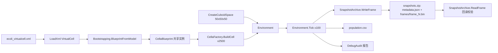

# Cella 多细胞模拟测试程序（2500 细胞 / 50³ / 100 步 / 快照 zip 归档）

## 产品概述

在 `CellaLoader\test\Program.vb` 中实现一个端到端控制台测试流程：加载由 BioCyc 数据库编译生成的大肠杆菌虚拟细胞模型，构建多细胞模拟环境，播种 2500 个细菌细胞到 50×50×50 的立方体空间，推进 100 个时间步，并通过 `Cella\Snapshots` 快照系统把每一帧的完整细胞状态**以二进制序列化方式写入单个 zip 压缩包**（顶层 `metadata.json` + `frames/` 下的逐帧二进制文件），同时生成测试报告。

## 核心功能

- **模型加载**：从 `BioCycCompiler\test\output\ecoli_virtualcell.xml` 读取 GCMarkup_3.0 虚拟细胞模型，校验基因组、代谢网络、区室、调控网络有效性。
- **模拟环境构建**：创建 50×50×50（125000 格点）立方体空间，培养基（葡萄糖/氧气），时间步长 1.0。
- **细胞播种**：由模型构建单份共享蓝图，随机选取格点播种 2500 个细胞，正确初始化边界浓度、谱系登记与格点归属。
- **模拟推进**：逐步 `Tick` 推进 100 步，实时输出步数、存活数、占用格点、耗时与 ETA。
- **快照导出（二进制 zip 归档，新增核心）**：所有帧写入一个 zip 包，减少磁盘占用与 IO 等待；顶层 `metadata.json` 为元数据，`frames/frame_N.bin` 为逐帧二进制快照（含 RNA/蛋白/代谢物字典、位置、生物量、代数、存活状态、格点培养基与 pH/温度）。
- **快照读取**：提供与写入对称的反序列化 API（读取 metadata、按帧号读取帧），保证归档自描述、可校验。
- **统计与报告**：`population.csv`（时间 × 总数/存活/物种分布/平均生物量/占用格点）；DebugAudit 记录断言与阶段标记，生成 `audit_report.txt`/`.json`。
- **可配置运行**：默认 2500 细胞 / 50³ / 100 步；支持 `--cells`、`--steps`、`--size`、`--model`、`--out`、`--seed`、`--compress`、`--no-state`、`--gc`、`--json`（额外输出 JSON 帧，调试用）覆盖。
- **健壮性**：启动前磁盘空间预检；写帧失败保留已完成帧并记录审计事件；流式写入，禁止整帧驻留内存。

## 技术栈

- VB.NET / `net10.0`，沿用现有 `Cella.vbproj`、`CellaLoader\test\test.vbproj`，不新增 NuGet 依赖。
- 模拟引擎：`SMRUCC.genomics.GCModeller.ModellingEngine.vCella`（`Environment`、`SpaceInitializer`、`CellaFactory`、`VirtualCella`）。
- 序列化：zip 用 `System.IO.Compression.ZipArchive`；帧内二进制用 `BinaryWriter`/`BinaryReader`（7-bit 长度前缀 UTF-8 字符串 + little-endian 数值）；元数据用 `System.Text.Json.Utf8JsonWriter`。小表用 `Snapshot.Report.Report.SaveTable`。
- 测试记录：`DebugAudit`（`Mark`/`Capture`/`Check`/`AreEqual`/`SaveReport`/`ToJson`）。

## 实现方案

链路：「XML 模型 → 共享蓝图 → 空间环境 → 播种 → 逐步推进 → 逐帧二进制写入 zip → 元数据收尾 → 统计与审计」。

1. **补快照落盘能力（JSON）**：新增 `Cella\Snapshots\SnapshotWriter.vb`，实现 `Metadata.vb:66-89` 描述的 `metadata.json` / `frame_xxx.json` 布局（调试与兼容通道），流式写出，不物化整帧。
2. **新增二进制 zip 归档（本次新增需求）**：在 `Cella\Snapshots` 中新增 `SnapshotArchive.vb`，把全部帧写入单个 zip：

- 归档结构：`metadata.json`（顶层，JSON 文本，字段与 `Snapshot.Metadata` 完全一致）+ `frames/frame_1.bin … frames/frame_100.bin`。
- 帧二进制布局（版本化、自描述）：

```
magic        8 bytes  "GCMKFRM1"
version      Int32
time         Double
spotCount    Int32
[spot]*
x,y,z                 Int32 x3
ph, temperature       Double x2
externalsCount Int32 + [key:String, value:Double]*
cellCount     Int32
[cell]*
cell_id, parent_id, taxonomy, species   String (7-bit length prefix + UTF-8)
generation Int32, biomass Double, age Double, is_alive Boolean
若 includeState:
rnaCount Int32 + [name:String, value:Double]*
proteinCount Int32 + [name:String, value:Double]*
metaboliteCount Int32 + [name:String, value:Double]*
```

- `includeState=False` 时不写三个字典段（`--no-state`），归档体积可降至 MB 级。
- 只写 `spot.cells.Count > 0` 的占用格点；`Utf8JsonWriter` 写元数据，`BinaryWriter` 写帧，二者共用 `ZipArchive` 的 `CreateEntry(..., CompressionLevel.SmallestSize)`，压缩由 zip 层完成。
- 提供对称读取 API：`ReadMetadata()`、`ReadFrame(index)`、`EnumerateFrames()`，用于回读校验与下游分析。
- `Dispose`/`Close` 时先写 `metadata.json` 再释放 zip（元数据中的 `time_frames` 完整）；异常时保证已 flush 的条目可读。

3. **复用既有装配逻辑**：`CellaLoader.Bootstrapping.BlueprintFromModel(model)` 一次构建蓝图；2500 次 `CellaFactory.BuildCell(blueprint, model.taxonomy)` 共享蓝图；`CellaFactory.BindToSpot` 处理边界浓度与谱系。
4. **播种策略**：`SeedCells` 会遍历全部格点（125000），改用 `SeedMixedCulture` 式随机抽样循环播种 2500 个。
5. **推进与采样**：`Environment.Tick(env.TimeStep)`（内部已接 `CellBatchRunner`）；每步 `archive.WriteFrame(env, step, env.CurrentTime)`。
6. **元数据构建**：`shape` 按 `(x*HEIGHT+y)*DEPTH+z` 填 cuboid 全 true；`cells` 由模型基因与 EC 号构建 `CellMetadata`；`pathways` 由 `model.metabolismStructure.maps` 展开。

## 实现要点

- **体积与磁盘**：完整状态单帧约 400–450MB，100 帧 JSON 约 40–45GB；zip（Deflate，浮点文本/二进制混合）预计压缩到 **6–10GB**，且单文件顺序写显著减少小文件 IO 等待。`--no-state` 时归档约数十 MB。
- **IO 性能**：zip 条目顺序写入，`FileStream` 缓冲 1–4MB；不 seek 回填；每帧写完 `entry.Close()` 触发压缩块落盘。
- **内存**：逐格点/逐细胞写，单细胞字典用后即弃；`GetAllSpots()` 结果在循环外缓存一次；`--gc` 每 10 步回收一次。
- **可观测性**：每步输出 `step/total`、存活数、占用格点、本帧压缩后字节、归档累计大小、耗时、ETA；结束输出 zip 路径与总大小、压缩比。
- **健壮性**：启动前按 `cells × steps × 单细胞估算 / 压缩比` 预检磁盘；`IOException`/`OutOfMemoryException` 捕获后写审计并返回非零。
- **爆炸半径**：仅新增 `SnapshotWriter.vb`、`SnapshotArchive.vb` 与改写 `Program.vb`；不修改 `Environment`/`CellaFactory`/`VirtualCella` 及既有 DTO 字段语义。

## 架构设计



## 目录结构

```
engine/
├── Cella/
│   └── Snapshots/
│       ├── SnapshotWriter.vb            # [NEW] JSON 帧落盘（调试/兼容通道）
│       │                                #   New(outputDir, Optional includeState:=True, Optional compress:=False)
│       │                                #   WriteMetadata(meta) / WriteFrame(env, index, time) → Long
│       │                                #   Shared Capture(env, time, includeState) As TimeFrameSnapshot
│       │                                #   Shared BuildMetadata(env, blueprint, times, w, h, d, model) As Metadata
│       └── SnapshotArchive.vb           # [NEW] 二进制 zip 归档（本次新增需求）
│                                        #   New(zipPath, Optional includeState:=True, Optional level:=SmallestSize)
│                                        #   WriteMetadata(meta As Metadata)
│                                        #   WriteFrame(env, frameIndex, time) As Long   ' 返回该帧压缩后字节
│                                        #   ReadMetadata() As Metadata
│                                        #   ReadFrame(frameIndex) As TimeFrameSnapshot
│                                        #   EntryNames / FrameCount / BytesWritten / Close()
└── CellaLoader/
    └── test/
        ├── Program.vb                   # [MODIFY] 替换 Hello World
        └── output/
            └── snapshots/
                ├── ecoli_simulation.zip # [NEW] 主产物：metadata.json + frames/frame_1..100.bin
                ├── population.csv
                ├── audit_report.txt / .json
                ├── frames/              # 仅 --json 时生成（调试用）
                └── .gitignore
```

## 关键代码结构

```
' engine\Cella\Snapshots\SnapshotArchive.vb
' 命名空间 SMRUCC.genomics.GCModeller.ModellingEngine.vCella.Snapshot
Public Class SnapshotArchive : Implements IDisposable
    Sub New(zipPath As String, Optional includeState As Boolean = True,
            Optional level As CompressionLevel = CompressionLevel.SmallestSize)

    Public ReadOnly Property ArchivePath As String
    Public ReadOnly Property IncludeState As Boolean
    Public ReadOnly Property FrameCount As Integer
    Public ReadOnly Property BytesWritten As Long

    Public Sub WriteMetadata(meta As Metadata)
    Public Function WriteFrame(env As Environment, frameIndex As Integer, time As Double) As Long

    Public Function ReadMetadata() As Metadata
    Public Function ReadFrame(frameIndex As Integer) As TimeFrameSnapshot

    Public Function FrameEntryName(frameIndex As Integer) As String   ' "frames/frame_{n}.bin"
    Public Sub Close()
    Public Sub Dispose() Implements IDisposable.Dispose
End Class

' 二进制帧的读写由两个 Shared 方法承载，便于单测与复用：
Public Shared Sub WriteFrameBinary(stream As Stream, snap As TimeFrameSnapshot, includeState As Boolean)
Public Shared Function ReadFrameBinary(stream As Stream) As TimeFrameSnapshot
```

## 待办事项

1. 新增 `SnapshotWriter.vb`（JSON 帧落盘 + Capture + BuildMetadata）
2. 新增 `SnapshotArchive.vb`（二进制帧编解码 + zip 归档 + 回读 API）
3. 改写 `CellaLoader\test\Program.vb`（CLI、加载、播种、Tick×100、写归档、population.csv、DebugAudit）
4. 冒烟运行 `--cells 100 --steps 5` 并修复链路问题（校验帧数/元数据/回读/审计）
5. 全量运行 2500/50³/100 并核对产物（zip 大小、压缩比、帧完整性）

## 风险

- **体积**：完整状态 100 帧即使压缩也可能 6–10GB；提供 `--no-state`/`--compress`/`--cells` 降级。
- **时长**：2500 细胞 × 100 步含 6 个子网络，可能数小时；先冒烟验证。
- **内存**：流式写入 + 共享蓝图；必要时降低 `--cells`。
- **兼容性**：`Bootstrapping` 依赖 `regulations.operonId`、`reactions.enzymatic/none_enzymatic`、`enzyme.catalysis`，上一轮改造已保证非空。