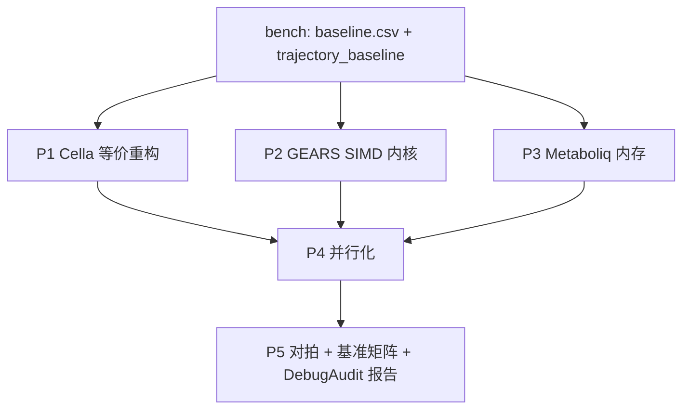

## 产品概述

针对 `GCModeller\engine\Cella\Cella.vbproj` 及其依赖栈（`sub-system\GEARS`、`sub-system\Metaboliq`、sciBASIC Tensor 计算内核）建立性能与内存优化方案，使 2500 细胞 × 100 步的虚拟细胞空间模拟从当前约 380 小时降至数小时，常驻内存减半。

## 现状实测

- 播种：约 2.2 s/细胞（`CellaFactory.BuildCell`，含 6 个子网络与 LNN 权重复制）
- 推进：10 细胞 ≈ 88 s/步，50 细胞 ≈ 278 s/步（约 5.6–8.8 s/细胞/步）
- 外推 2500×100 ≈ 380 小时；完整状态快照单帧约 400MB
- 关闭诊断日志后无明显改善，日志不是主因

## 核心问题（已定位）

- **GEARS 批量图卷积为纯标量三循环**，且按 capacity（64/512）补零计算，实际算力仅约 10 MFLOP/s，padding 放大 8–64 倍
- **每次前向重建节点特征矩阵**（6764×34，单细胞约 14MB 临时张量；批量每步重写约 942MB）
- **每细胞复制约 0.9–1.5MB LNN 参数**（2500 细胞即 2–4GB）
- **周转系统对一维线性 ODE 调用 CVODE**，每细胞每步两次状态拷贝
- **扩散相每步 S 次分配与字符串哈希**；`GetAllCells().ToArray()` 每步 6 次以上
- **零并行**；批量只覆盖 GRN 与代谢两相
- GRN niche 增益为 `O(B·G·|L|)` 嵌套扫描；`CellularState.Sanitize` 每步全池重扫

## 核心功能

- 可复现的基准与剖析体系（相级耗时、分配量、工作集、轨迹基线）
- 等价重构型优化（闭式解、缓冲复用、CSR、扁平缓存），结果可对拍
- 内核级优化（SIMD GEMM + 稀疏散射、常量特征预计算、float32 路径）
- 内存优化（参数模板共享、工作区池化、生命周期清理）
- 多线程并行（按细胞/按格点分片）
- 优化前后基准矩阵与验证报告（DebugAudit）

## 技术栈

- VB.NET / `net10.0`，沿用 `Cella.vbproj`、`GEARS.vbproj`、`Metaboliq.vbproj`、`TensorFlow.vbproj`，不新增第三方依赖
- 数值内核：现有 `SIMDTensor` / `SIMDTensorF` / `MixedPrecisionOps`
- 剖析：`PhaseProfiler`（`Environment\PhaseProfiler.vb:22`，`Report()` 于 :99-129）、`CellBatchRunner.Profile`、`GC.GetTotalAllocatedBytes`、`Process.WorkingSet64`
- 测试报告：`DebugAudit`（`Mark`/`Capture`/`Check`/`AreEqual`/`SaveReport`）

## 实现方案

**总策略：先量化、再等价重构、最后内核与并行。** 每一阶段可独立验收，且保留 double 回退路径。

### P0 基准与剖析（必须先做）

新增 `engine\CellaLoader\bench\`（console，引用 `Cella`、`CellaLoader`、`GCMarkupXML`）：

- CLI：`--model --cells --steps --size --seed --precision`
- 每步记录：`env.Profile.Report()`、`env.CellBatch.Profile.Report()`、`GC.GetTotalAllocatedBytes` 增量、`GC.GetTotalMemory(true)`、`Process.WorkingSet64`
- 扫描 cells ∈ {1, 8, 16, 64, 128, 256, 512} × steps=3，输出 `baseline.csv`（ms/step、ms/cell/step、alloc/cell/step、peak MB、phase 占比）
- 轨迹基线：固定 8 细胞 × 5 步，按细胞导出 `mRNA/Protein/Metabolite` 的位模式哈希到 `trajectory_baseline.bin`
- 关键目的：区分「固定 padding 成本」与「真实线性成本」，避免用 10 细胞数据外推造成误判

### P1 Cella 引擎等价重构（低风险）

1. `Networks\TurnoverSystem.vb:103-161`：RHS 为 `y' = P − k·y`，改为闭式解
`y(t+dt) = y0·e^(−k·dt) + (P/k)(1 − e^(−k·dt))`，消耗量 `P·dt − (y1 − y0)`；
删除 `Advance/CurrentState/ResetState` 调用与两次数组拷贝（同时修正原 `k·y0·dt` 的一阶近似）
2. `Environment\Environment.vb:342-361`：缓存扁平 `Spot[]` / `VirtualCella[]`，生命周期事件（分裂/死亡/迁移）增量维护或置脏，替换 6+ 次/步 `ToArray()`
3. `Environment.vb:423-455,499-555`：预分配 `delta`/`mass` 缓冲与 `molecule id → 列索引`、`spot → 行` 映射；`Spot.Medium`（`Spot.vb:17`）统一为 `OrdinalIgnoreCase`（修正与 `Diffuse` 比较器不一致导致的静默读 0）；`GetNeighbors`（:382-400）预计算邻居索引
4. `Networks\GeneRegulatoryNetwork.vb:513-544`：niche 增益按 `dst` 建 CSR 分桶，`O(B·G·|L|) → O(B·(G+|L|))`
5. `State\CellularState.vb:289-321`：`Sanitize` 去掉每步字面量数组；仅在子网络报告异常时扫描对应池
6. `Environment\CellBatchRunner.vb`：修正 `BatchedCellSteps`/`BatchLaunches` 双增（:255-256、:297-298）；缓冲尺寸改为实际 count（1.25x 增长，padding ≤8）；`MeasureSizes`（:391）结果缓存

### P2 GEARS 内核（最大收益）

1. 新增 SIMD/GEMM 版 `GraphLayerBatch`（覆盖 `Compute\TensorComputeBase.vb:631-712` 的标量实现，保留旧实现作回退）：

- `H = X · [Wself | Wrel]`（34→64 一次 GEMM，权重预转置为行主序连续）
- `S = scatter_add(edges, H[:,32:])`（`O(|E|·d)`，顺序访存）
- `Y = act(H[:,0:32] + S + bias)`

2. 特征矩阵常量预计算（`Model\GEARSModel.vb:183-237`、`Model\GearsBatchWorkspace.vb:60`）：16 维基因身份嵌入为图级常量，预计算 `E_pre`；每步仅组 2 个动态列，`z_pert` 用 rank-1 更新；工作区跨步复用，消除每步约 942MB 写
3. 共享模型：确保 `blueprint.Gears` 只构建一次（`GeneRegulatoryNetwork.vb:87`）；默认 `CoexpressionTopK=0`（`GEARSConfig.vb:106`），开启时把 Pearson 结果缓存进蓝图（`Graph\GeneRegulatoryGraph.vb:344-366`）
4. 精度开关 `CELLA_GEARS_PRECISION=float32|double`，float32 走 `TensorF`/`SIMDTensorF`；`GEARSConfig` 的 `HiddenDim/NumLayers` 可配（默认 32/2 不变）

### P3 Metaboliq 与内存

1. 参数模板共享（`Networks\MetabolicNetwork.vb:178-218`）：每蓝图一份不可变 LNN 参数，细胞只持状态；训练走 copy-on-write，消除 0.9–1.5MB/细胞
2. Tensor 工作区池化（`MetabolicNetwork.vb:256,296-298,486-492`；`Metaboliq\MetabolicLiquidNetwork.vb:205-224,283-300`），按 batch 尺寸复用
3. `EffectiveTau` 脏标记缓存（`LiquidCell.vb:442-461,553`）；FluxHead/σ 标量循环向量化（:289-297、:327-346）
4. RK4 子步 workspace 复用；`MaxSubStep >= dt` 时跳过子步循环；`Training=False` 时禁止 `StepRecord` 登记（:630-655、:774-781）

### P4 并行

- `CellBatchRunner` 按 chunk `Parallel.For`（signaling/translation/transport/turnover/finish 逐细胞相）
- 扩散按 x 层并行（写目标为相邻格点，按层分片避免冲突）
- 随机数按 chunk 派生种子；`PhaseProfiler` 并行时改 `Interlocked` 或关闭；日志在并行区外汇总

### P5 验收

- 对拍：P1 逐位/1e-9 容差；P2/P3（float32）1e-6 容差，记录最大相对误差
- 基准矩阵：优化前后 × cells{64,256,1024,2500} × steps{3,10}
- 目标：≥10x 加速、每细胞常驻 <1MB、2500×100 < 4 小时

## 性能与复杂度要点

- `GraphLayerBatch` 由 `rows·outF·inF·(1+deg)` 降为 `rows·inF·2·outF + |E|·outF`，实测应降一个数量级
- 特征矩阵写量由 `capacity·n·34·8B`（942MB/步）降为常量项 + 每步 `2·n·8B`
- 内存：每细胞常量项由 ~1.5MB 降到 ~50–80KB（状态数组）
- 并行预期：8 核约 5–7x（逐细胞相占约 40%）

## 实施要点

- 修改 `TensorComputeBase` 属跨项目变更：新增方法/分支，旧路径保留，并运行 `_mixedprecision` 既有测试
- `GearsBatchWorkspace` 以 `rows=capacity` 为前提，调整 padding 时须同步 mask 与 scatter
- 参数共享引入别名风险：模板不可变 + 显式状态划分 + 独立性单测
- 每阶段结束运行 `dotnet build` 与基准，性能回退即回滚该阶段开关
- 提供环境变量开关以便生产环境逐项启用：`CELLA_GEARS_KERNEL=v2|v1`、`CELLA_PRECISION`、`CELLA_PARALLEL=0|1`

## 架构设计



## 目录结构

```
engine/
├── CellaLoader/bench/
│   ├── bench.vbproj                       # [NEW] 基准工程(net10.0, 引用 Cella/CellaLoader/GCMarkupXML)
│   └── Program.vb                         # [NEW] 扫描 cells×steps、相位剖析、分配/工作集采样、轨迹基线
├── Cella/
│   ├── Networks/TurnoverSystem.vb         # [MODIFY] 一维 ODE 闭式解，移除 CVODE 调用与状态拷贝
│   ├── Networks/GeneRegulatoryNetwork.vb  # [MODIFY] niche 增益 CSR 分桶；共享 GEARS 校验
│   ├── Networks/MetabolicNetwork.vb       # [MODIFY] 参数模板共享、Tensor 缓冲池化、批量写回复用
│   ├── Networks/ODE/OdeSubNetwork.vb      # [MODIFY] 保留供其它子系统；新增单变量解析路径
│   ├── Environment/Environment.vb         # [MODIFY] 扁平 Spot/Cell 缓存、Diffuse 缓冲与索引、邻居预计算、x 层并行
│   ├── Environment/CellBatchRunner.vb     # [MODIFY] 计数修正、按实际 count 分配、padding≤8、并行分片
│   ├── Environment/Spot.vb                # [MODIFY] Medium 比较器统一为 OrdinalIgnoreCase
│   ├── Environment/PhaseProfiler.vb       # [MODIFY] 并行安全累加、CSV 导出重载
│   └── State/CellularState.vb             # [MODIFY] Sanitize 降频与去分配
├── sub-system/GEARS/
│   ├── Model/GEARSModel.vb                # [MODIFY] 特征常量预计算、临时张量复用、批量路径复用工作区
│   ├── Model/GearsBatchWorkspace.vb       # [MODIFY] 精确 rows、缓冲池、float32 支持
│   ├── Layers/GEARSConvLayer.vb           # [MODIFY] 走新内核接口，合并 Wself/Wrel
│   ├── Layers/MatOps.vb                   # [MODIFY] 标量 AXPY 改为后端 GEMM 调用
│   └── Graph/GeneRegulatoryGraph.vb       # [MODIFY] Pearson 共表达结果缓存、CSR 复用
├── sub-system/Metaboliq/
│   └── MetabolicLiquidNetwork.vb          # [MODIFY] 参数/状态分离、工作区复用、向量化、StepRecord 关闭
└── (sciBASIC) MachineLearning/TensorFlow/
    ├── Compute/TensorComputeBase.vb        # [MODIFY] 新增 GraphLayerBatchV2(GEMM+scatter)，旧实现保留
    ├── Compute/SIMDTensor.vb               # [MODIFY] 实现 V2 内核(double)
    ├── Compute/SIMDTensorF.vb              # [MODIFY] 实现 V2 内核(float32)
    └── Compute/MixedPrecisionOps.vb        # [MODIFY] 精度切换与诊断计数
```

## 关键代码结构

```
' Cella\Networks\TurnoverSystem.vb —— 闭式解（替代一维 CVODE）
Protected Overrides Sub Tick(dt As Double)
    ' dy/dt = P - k*y  =>  y1 = y0*exp(-k*dt) + (P/k)*(1-exp(-k*dt))
    Dim k As Double = recycleUseRate
    Dim y0 As Double = cell.State.RecyclePool
    Dim y1 As Double
    If k <= 1.0E-12 Then
        y1 = y0 + productionRate * dt
    Else
        Dim decay As Double = Math.Exp(-k * dt)
        y1 = y0 * decay + productionRate / k * (1.0 - decay)
    End If
    cell.State.RecyclePool = Math.Max(0.0, y1)
    Dim consumed As Double = productionRate * dt - (y1 - y0)
End Sub
```

```
' sciBASIC\...\Compute\TensorComputeBase.vb —— 新增两段式批量图卷积
Public Overridable Function GraphLayerBatchV2(
        x As Tensor, wSelf As Tensor, wRel As Tensor, bias As Tensor,
        edges As SparseCsr, output As Tensor[,], activation As Integer) As Boolean
    ' 1) H = X · [Wself | Wrel]        ' 一次 GEMM，权重已转置为行主序
    ' 2) S = scatter_add(edges, H[:, outF:])   ' O(|E|*outF) 顺序访存
    ' 3) Y = act(H[:, 0:outF] + S + bias)
End Function

' 精度与内核开关（读取一次并缓存）
Public Shared ReadOnly Property KernelMode As String   ' CELLA_GEARS_KERNEL = v2 | v1
Public Shared ReadOnly Property Precision As String    ' CELLA_GEARS_PRECISION = float32 | double
```

## Agent Extensions

### SubAgent

- **code-explorer**
- Purpose: 在改动 `GraphLayerBatch`、`GearsBatchWorkspace`、`CellBatchRunner` 之前，精确核对 `rows=capacity` 假设、mask/scatter 的索引约定、以及 `Tensor`/`TensorF` 的存储布局（行主序/跨步），避免重写内核时引入越界或结果错位
- Expected outcome: 输出精确到文件与行号的索引约定清单与调用点清单，作为内核改写与并行化的实现依据

### Skill

- **lsp-code-analysis**
- Purpose: 在大规模重构中对 `GraphLayerBatch`、`CopyWeights`、`TickBatch`、`Diffuse` 等符号做「查找引用/调用层级/影响面」分析，确保所有调用点同步调整
- Expected outcome: 得到每个被改符号的完整引用清单与受影响项目列表，避免遗漏调用点导致运行时回归