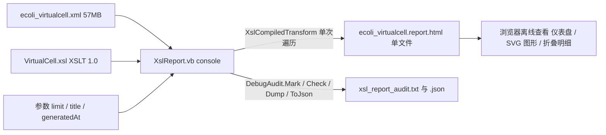

## User Requirements

- 为 `VirtualCell.vb` 所描述的虚拟细胞模型 XML 编写 XSL 样式表，以 `IO/BioCycCompiler/test/output/ecoli_virtualcell.xml` 结果模型为内容依据，实现模型文件可视化。
- 交付方式：XSL 样式表 + 一个 console 离线转换程序，把体积很大的模型 XML 转成独立、可离线打开的单文件 HTML 报告，避免浏览器直接加载原始 XML；不改动模型写出逻辑，也不向生成的 XML 注入样式表引用。
- 可视化内容三类全要：模型概览仪表盘、可折叠的分区明细表格、图形化视图。
- 大文件策略：每个分区限量展示前 N 条，并明确标注该分区总数，保证页面流畅。

## Product Overview

一份由虚拟细胞模型离线生成的单文件可视化报告。顶部呈现模型身份与生成信息，中部以统计卡片和图形化视图概括基因组、调控网络与代谢网络，下部按分区提供可折叠、可搜索的明细表格；整体为深色生物信息学仪表盘风格，带平滑悬停与折叠动效，宽屏多列、窄屏单列自适应。

## Core Features

- 概览仪表盘：物种与分类、数据源与 schema 版本、编译时间、基因组规模与 GC 含量、调控/蛋白/化合物/反应/酶/通路/文献/分类术语数量卡片、区室表与生理参数。
- 图形化视图：基因组基因轨道（按复制子长度与基因坐标绘制）、各分区计数统计图、底物—反应—产物及通路关系图。
- 分区明细：基因与转录单元、调控、蛋白、化合物、反应、酶、通路、文献证据、分类术语等分区表格，默认折叠、支持关键词过滤，限量显示并给出总数提示。
- 离线转换：命令行指定模型 XML、样式表、输出路径与限量参数，生成自包含报告；转换过程记录断言、耗时与输出大小并生成测试报告。
- 导航与说明：顶部锚点导航、底部信息栏标注数据来源、schema 版本、生成时间与限量说明。

## Tech Stack Selection

- **样式表**：XSLT 1.0（`.xsl`），兼容 `System.Xml.Xsl.XslCompiledTransform` 与浏览器内置 XSLT；不使用 `xsl:for-each-group` 等 2.0 特性。
- **报告前端**：静态 HTML5 + 内联 CSS3 + 原生 JavaScript + 内联 SVG，无外部依赖、无 CDN、无组件库（样式由 XSLT 直接生成，无法引入 React/Vue 组件体系）。
- **离线转换程序**：复用现有 `IO/BioCycCompiler/test` 的 net10.0 VB.NET console 项目（`test.vbproj`），使用 `XslCompiledTransform` 流式转换。
- **测试报告**：按用户规则使用同仓库的 `G:/GCModeller/src/runtime/sciBASIC#/Microsoft.VisualBasic.Core/src/ApplicationServices/Debugger/DebugAudit.vb`，沿用 `Program.vb` 已验证的 `Mark / Check / Dump / ToJson / FailureCount` 调用方式。

## Implementation Approach

**策略**：把「结构展示」全部放在一份 XSLT 1.0 样式表里，由模板按根元素层级分区渲染；一个轻量 console 程序负责编译样式表、以 `XsltArgumentList` 注入限量/标题/生成时间参数、用 `XmlReader` 读入模型、用 `FileStream` 写出单文件 HTML，并用 DebugAudit 记录断言与报告。这样可视化内容与转换逻辑解耦，样式表既能被 .NET 使用，也能被支持 XSLT 的浏览器直接使用；同时完全不触碰模型类与序列化代码。

**关键决策与权衡**：

1. **不改模型写出代码**：用户明确选择离线转换，故不修改 `CompilerServices/ModelBase/Model.vb`、不启用未接线的 `XmlDataModel.Stylesheet`，避免改变所有模型 XML 的产出格式（blast radius 最小）。
2. **复用现有 test 项目而非新建工程**：新增一个模块并在 `Main` 开头加参数分发即可获得 DebugAudit 引用、构建配置与执行入口；新增独立项目会牵动解决方案文件且带来额外引用，收益不足。原有编译演示流程保持不变。
3. **输出方法选 `method="xml"` + `omit-xml-declaration="yes"`**：HTML 输出模式会破坏 SVG 大小写敏感属性（如 `viewBox`、`preserveAspectRatio`）；用 XML 模式并手写 doctype 可保证内联 SVG 正确，代价是 HTML 中的布尔属性需写成完整形式。输出到 `FileStream` 而非 `XmlWriter`，使 `disable-output-escaping` 生效。
4. **限量渲染 + 总数**：每个分区用 `position()` 不超过 `limit` 截断（默认 50），总数用 `count()` 给出；折叠用原生 `details/summary`，过滤用内联 JS 对已渲染的少量行做 `textContent` 匹配，避免生成数万行 DOM。
5. **图形化采用确定性布局**：基因轨道按 `replicon/@length` 线性映射坐标；统计图用 SVG 横向条；代谢网络用「底物—反应—产物」三列二分图，而非力导向算法——在 XSLT 1.0 无随机数与复杂数学能力的前提下，确定性布局可复现、无额外 JS 库、渲染开销低。
6. **富文本安全**：模型文本含 HTML 转义片段与实体（`vcellkit:comment`、`note`、`medium`、化合物名称、同义名）。普通字段一律以纯文本输出并截断超长内容；仅对可信的注释/说明字段使用 DOE 渲染斜体等排版。理由：XSLT 1.0 无正则与 HTML 清洗能力，全量 DOE 存在脚本注入风险，全量纯文本又损失可读性，按字段区分是 KISS 与安全的折中。

**性能与可靠性**：输入约 57MB / 58 万行，`XslCompiledTransform` 内部构造 `XPathDocument`，时间与空间均为 O(N)，峰值内存约数百 MB，属可接受的一次性离线作业。瓶颈在三处并已缓解：① 避免 `//` 全文档后代轴，全部 XPath 从根按层级定位；② 分组统计（调控 family、反应 pathway、化合物 classId、文献年份）用 `xsl:key` + Muenchian 分组，避免逐节点重复全表扫描；③ 转换直接写 `FileStream`，不先拼大字符串，避免双倍内存。`XmlReaderSettings` 设 `IgnoreWhitespace=True`、`IgnoreComments=True`、`DtdProcessing=Prohibit`，既减少节点数又防 XXE。输出 HTML 控制在数 MB 内，浏览器打开流畅。

## Implementation Notes

- **命名空间是首要正确性风险**：根元素默认命名空间为 `https://bioCAD.gcmodeller.org/XML/schema_revision/GCMarkup_3.0`，XSLT 1.0 必须用前缀（建议 `gcm`）绑定后匹配；另需绑定 `vcellkit`（`https://bioCAD.gcmodeller.org/vcellkit/`）与 `gcmod`（`https://gcmodeller.org`）。未加前缀的元素名一律匹配不到节点。
- **已核实的分区选择器**（来自样例 XML 与模型类，按此编写模板）：`gcm:genome/gcm:replicon`（内含 `operons/TranscriptUnit/genes`）、`regulations/transcription`、`proteins/protein`、`regulons/regulon`、`bindingSites/bindingSite`、`promoters/promoter`、`terminators/terminator`、`proteinFeatures/proteinFeature`；`gcm:metabolome` 下 `compounds/compound`、`reactions`（属性 `size`，子容器 `enzymatic`、`none_enzymatic`、`transportation`，条目为 `reaction`）、`enzymes/enzyme`（`catalysis`）、`pathwayMaps/FunctionalCategory/pathway`（`reactions/string`、`note`）；顶层 `compartments/compartment`、`physiology`、`evidence/publication`、`classTerms/classTerm`。`compound` 名称为混合内容文本节点，取 `text()[1]` 而非 `value-of` 整个元素。
- **日志/审计**：只记录断言、文件路径、耗时、输出字节数与关键 HTML 标记是否出现；不把 57MB 内容、SMILES 长串或原始文本写入日志。复用已有 `DebugAudit` 方法，审计报告写入独立文件名，避免覆盖现有 `audit_report.txt` / `audit_report.json`。
- **Blast radius 控制**：新增 2 个源文件、修改 2 个现有文件；不改 `VirtualCell.vb`、模型类、`Model.vb`、`XmlExtensions.vb`、`.gitignore` 与样例 XML；`Program.Main` 仅增加 `--report` 早退分支，原数据库编译演示路径逐字保留。
- **样式表分发**：XSL 放在版本库内的 `IO/GCMarkupLanguage/v2/Xml/`（与 `VirtualCell.vb` 同级），并在 `test.vbproj` 以 `None Include` + `CopyToOutputDirectory=PreserveNewest` 复制到输出目录；程序默认从 `AppContext.BaseDirectory` 定位，也支持 `--xsl` 覆盖，便于把 XSL 与 exe 一起分发。

## Architecture Design

数据流为单向转换链，组件关系简单，不改现有模型编译链：



分层：`VirtualCell.xsl` 为展示层（模板 + 内联 CSS/JS/SVG）；`XslReport.vb` 为转换与校验层（参数解析、安全 XmlReader、XSLT 编译、流式输出、DebugAudit 断言）；`Program.vb` 仅为入口分发层。HTML 报告是完全自交付的静态产物，不依赖运行时。

## Directory Structure

本次改动集中在 XSL 样式表与现有 console 测试项目，其余产物落到已被忽略的 `output/` 目录。

```
engine/
└── IO/
    ├── GCMarkupLanguage/v2/Xml/
    │   └── VirtualCell.xsl                 # [NEW] 核心交付物。XSLT 1.0 样式表：绑定 gcm / vcellkit / gcmod 三个命名空间；声明 limit、title、generatedAt 参数；xsl:output 采用 xml 方法并省略声明；包含内联 CSS、JS、SVG 与全部命名模板。按顶层段落拆分模板：概览仪表盘、图形化视图、各分区限量表格、折叠与过滤脚本。文件头注释写明用法、命名空间来源与限量默认值。
    └── BioCycCompiler/test/
        ├── XslReport.vb                    # [NEW] 离线转换模块。解析 --report 参数（model、xsl、out、limit、audit）；以禁用 DTD 且忽略空白/注释的 XmlReader 打开输入；XslCompiledTransform.Load 编译样式表，XsltArgumentList 注入参数，Transform 直接写 FileStream；用 DebugAudit.Mark/Check 断言输入与样式表存在、编译成功、输出非空且含关键标记，最后 Dump/ToJson 生成审计报告并按 FailureCount 返回退出码。
        ├── Program.vb                      # [MODIFY] 仅修改 Shared Function Main 开头：当首个参数为 --report 时调用 XslReport.Run 并直接返回其退出码；保留原有数据库编译、校验与 generateReport 全流程及默认参数行为不变。
        ├── test.vbproj                     # [MODIFY] 新增一条 None Include，把 ../../GCMarkupLanguage/v2/Xml/VirtualCell.xsl 以 Link=VirtualCell.xsl 复制到输出目录（PreserveNewest）；不改动现有 ProjectReference 与 TargetFramework。
        └── output/                         # 已被 .gitignore 忽略，仅作为运行产物目录
            ├── ecoli_virtualcell.report.html   # [NEW] 转换生成的单文件可视化报告（自包含 CSS/JS/SVG），预计数 MB。
            ├── xsl_report_audit.txt            # [NEW] DebugAudit.Dump(includeRecords:=True) 输出的转换测试报告。
            └── xsl_report_audit.json           # [NEW] DebugAudit.ToJson(indent:=True) 输出的结构化断言记录。
```

## 关键接口契约（文字描述，不引入新抽象）

- 命令行：`test.exe --report 模型.xml [--xsl VirtualCell.xsl] [--out 报告.html] [--limit 50] [--audit 输出目录]`；省略参数时分别取当前目录、程序目录下的 XSL、输入文件同目录同名 `.report.html`、默认限量 50、输入文件所在目录。
- XSLT 参数：仅 `limit`（明细限量）、`reportTitle`、`generatedAt` 由转换程序注入，其余全部由 XML 计算，保证样式表可独立使用。
- 模块入口：`XslReport.Run(args)` 返回 Integer 退出码，供 `Program.Main` 的 `--report` 分支调用；不在模块内调用 `Environment.Exit`，保持可测试性。

## 设计风格

深色生物信息学仪表盘：以深蓝黑为底，青绿到蓝紫的渐变作为数据与交互主色，卡片使用半透明玻璃面板与细边框，标题用大字号高对比排版。整体氛围专业、冷静、带科研数据感；卡片与图形加轻微光晕、悬停上浮与渐显动效，避免朴素表格堆砌。全部样式与脚本内联，离线打开即可完整呈现。

## 页面规划（单页报告，五个功能块）

1. **顶部导航与标题栏**：左侧模型学名与数据源徽标，右侧锚点导航（概览/图形/明细/关于）与生成时间；半透明吸顶，滚动时保留。
2. **模型概览仪表盘**：一行统计卡片展示基因组大小、GC 含量、基因、调控、蛋白、化合物、反应、酶、通路、文献、分类术语总数；下方两列排布分类信息与区室/生理参数卡片，数字采用强调色与计数动效。
3. **图形化视图区**：基因组基因轨道 SVG（按复制子长度线性映射，正反向链分轨着色）、分区计数横向条形图、限量反应的底物—反应—产物二分网络图与通路类别树；图形带坐标标签与图例，hover 高亮。
4. **分区明细区**：各分区以可折叠面板组织，面板头显示名称与「已显示 N 条 / 共 M 条」，表格含搜索框，输入即过滤行；长文本截断并悬停展开，化合物名称、SMILES、文献标题等分列呈现。
5. **底部信息栏**：数据源、schema 版本、模型 GUID、生成时间与限量说明，附返回顶部链接。

## 交互与响应式

折叠用原生 details/summary，搜索用轻量内联脚本仅遍历已渲染的少量行；宽屏采用多列栅格与侧边锚点，窄屏自动堆叠为单列并压缩表格列数；表格容器横向滚动，SVG 采用 viewBox 自适应缩放。所有动效为 CSS 过渡，无外部字体与脚本请求。

## Agent Extensions

### SubAgent

- **code-explorer**
- Purpose: 实施前对 57MB 样例 XML 与 `v2/Xml/Genomics`、`Metabolism` 模型类做一次 medium 级复核，确认各分区容器/条目元素的准确名称、属性与命名空间，避免 XSLT 选择器写错。
- Expected outcome: 产出可直接用于编写模板的选择器清单（含 `regulations/transcription`、`reactions/enzymatic/reaction`、`pathwayMaps/FunctionalCategory/pathway` 等）及命名空间前缀对照，并指出模型类中与实际 XML 不一致之处。

### Skill

- **playwright-cli**
- Purpose: 在转换程序生成 HTML 后，以浏览器打开本地报告，检查概览卡片、SVG 图形、折叠面板与搜索过滤是否正常渲染与交互，并截图留证。
- Expected outcome: 得到页面渲染截图与交互检查结论；若浏览器环境不可用，则以 DebugAudit 中对 HTML 关键标记与限量行数的结构断言作为兜底验证。