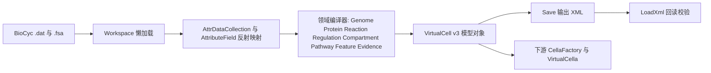

## 用户需求

1. 审查 `engine\IO\GCMarkupLanguage\v2\Xml` 中虚拟细胞模型的 XML 数据结构，判断其科学完整性，指出缺失的细胞建模要素，并给出模型改造方案。
2. 完善 `BioCycCompiler`，使 `F:\ecoli\29.0` 的 BioCyc 数据库可完整编译为 VirtualCell 模型文件；为此同步改造底层 BioCyc 读取项目与 GCMarkupLanguage v2 模型项目。
3. 在 `test` 项目中编写 console demo，用真实数据完成转换，并使用 DebugAudit 生成测试报告。

已确认的约束：

- 数据范围为“核心 11 类 dat 字段补全 + 新增 transporters、promoters、terminators、regulons、dnabindsites、protein-features、各类 links、classes”等；`pubs.dat` 只建立引用索引，不写入全文。
- 不存储 DNA/蛋白原始序列，仅保留氨基酸与碱基组成向量。
- 允许破坏性 schema 改造，无需兼容旧 GCMarkup_2.0 文件；但不得破坏独立的 v1 命名空间及 GCTabular 的既有依赖。
- 测试产物统一输出到 `engine\IO\BioCycCompiler\test\output\`。

## 产品概述

改造后形成三层数据管线：BioCyc `.dat` 解析层、VirtualCell XML 模型层、编译器映射层。模型从“仅能表达基因列表与反应方程”的简化结构，升级为可完整表达细胞区室、基因组结构（染色体与质粒、操纵子、RNA）、调控网络（转录因子、结合位点、调控组、启动子与终止子）、代谢网络（化合物理化属性、酶与动力学、反应热力学与方向、通路层次、跨膜转运）、以及文献证据与表型特征的虚拟细胞模型，并由真实大肠杆菌数据端到端验证。

## 核心功能

- **模型结构审查与补全**：新增区室定义与细胞生理参数；化合物补充电荷、分子量、InChI/SMILES、同义词与分类归属；反应补充方向标志、自发性、ΔG、平衡常数、原子映射、所属通路与催化酶；酶补充亚基组成、辅因子、定位与结构化动力学参数；蛋白补充分子量、等电点、多定位、GO、结构域与复合物；基因补充名称、同义词、交叉引用、GO、着丝粒位置；基因组补充 GC 含量与复制子拓扑；调控补充结合位点序列与坐标、机制、抑制常数、辅助蛋白；通路补充上下级层次与交叉引用；转运反应重建为结构化对象；新增证据/文献索引与 BioCyc 分类层次。
- **读取层补全**：修复标量属性只取首值、跨行续行丢空格、`#` 注释行未跳过、`//` 转义未处理、非 UTF-8 编码乱码、重复 UNIQUE-ID 丢弃等问题；新增 13 类 dat 模型与懒加载索引。
- **编译器全量映射**：支持多复制子拆分（染色体与质粒）、完整反应参数映射、酶动力学公式纠正、转运与调控网络生成、CCO 区室映射、文献与表型写入。
- **测试与报告**：对 ecoli 29.0 执行编译、XML 保存与回读往返校验，输出 DebugAudit 报告与统计摘要。

## 技术栈

- 语言与运行时：VB.NET，沿用现有 `BioCycCompiler.vbproj`、`GCMarkupXML.NET5.vbproj`、`BioCyc.vbproj` 目标框架与项目引用，不引入第三方依赖；测试项目保持 `net10.0`。
- 序列化：`System.Xml.Serialization` 配合 sciBASIC 的 `XmlExtensions.GetXml` 与 `Microsoft.VisualBasic.LoadXml(Of T)`。
- 数据解析：沿用现有反射驱动的 `AttributeField` 映射体系（`models\BioCyc\Models\Reflection\`），新类型仅需 `Xref` 特性加属性标注即可接入。
- 测试框架：`Microsoft.VisualBasic.ApplicationServices.Debugging.DebugAudit`（来自 `Core.vbproj`）。

## 实现方案

整体策略是“先补数据源、再立模型、最后重建映射”。

1. **schema 集中升级**：将 `VirtualCell.GCMarkupLanguage` 常量改为 `GCMarkup_3.0`。现有 `XmlRoot` 与 `XmlType` 均引用该常量，命名空间可随之统一切换；新增/重构成员全部使用显式 `XmlElement`、`XmlArray`、`XmlAttribute` 标注，避免与既有 `XmlText` 成员冲突（`Compound.name`、`CompoundFactor.compound`、`KineticsParameter.value` 已占用 XmlText）。
2. **读取层保持反射驱动**：新增 `.dat` 类型只增加模型类与 `Workspace` 的 `Lazy` 属性；所有可选文件走 `TryLoad` 分支，文件缺失时返回空集合并打印警告，不中断编译。复合值（GO-TERMS、MOLECULAR-WEIGHT 带 `^CITATIONS` 注解）在 `Factory.vb` 中新增 `ParseXxx(ValueString)` 风格的解析器。
3. **编译层按数据域拆分**：每个 dat 域对应一个编译器，`v2Compiler` 只负责编排与交叉链接（补齐动力学参数引用的化合物、把 EC 号回填到反应、把调控位点回填到操纵子），避免单个巨型方法。
4. **索引与复杂度**：各编译器构造时一次性建立 `Dictionary`/`ToLookup` 索引（基因、蛋白、酶反应、反应、通路、调控对象、结合位点），全局 O(n)；禁止在循环内做线性 `Contains` 查找。
5. **文献处理**：`pubs.dat` 仅构建 `citationId` 到 `title` 的索引表写入模型，不写正文，控制文件体积。
6. **去技术债**：不对 v1 命名空间与 `IO\GCTabular` 做任何改动；`BioCycCompiler` 对外暴露的构造与编译入口保持不变，改动集中在内部实现与模型层。

### 必须修复的既有缺陷（已定位）

- `Models\Reflection\ObjectWriter.vb` 对标量类型只取 `val(Scan0)`，导致 `enzrxns.reaction`、`protligandcplxes.components` 被截断。
- `Reader\FeatureElement.vb` 的续行拼接不插入空格、未处理 `//` 转义、未跳过 `#` 注释行。
- `Reader\AttrDataCollection.vb` 使用默认编码读取、重复 UNIQUE-ID 直接丢弃。
- `Metabolism\Reaction.vb` 的 `CheckReversible` 判定条件错误（现要求前后界均大于零），导致配合硬编码边界时全部反应被判为可逆。
- `ReactionNetworkCompiler.vb` 动力学公式误用 `Kcat.Km`；EC 号分组键为对象而非字符串；边界硬编码为 5 与 5；`KO` 恒空；`transportation` 从不填充。
- `GenomeCompiler.vb` 只生成单个复制子且 `isPlasmid` 恒为 False，丢失质粒。
- `RegulationCompiler.vb` 已算出结合位点索引却未写入，`operonId` 恒空，导致下游 `CellaFactory` 丢弃全部调控边。

### 性能与可靠性

- 规模基准：E. coli 29.0 约 4500 基因、4400 蛋白、3000 反应、3000 化合物，`pubs.dat` 15MB、`protein-features.dat` 13.7MB；不含序列时预期模型 XML 约 20 到 40MB。
- 内存：`ModelBaseType.Save` 采用整串序列化后写出，30MB 级模型峰值内存约为文件体积 2 到 3 倍，可接受；大集合字段使用 `XmlIgnore` 的运行时索引（如 `MetabolismStructure` 现有的 `m_refs`）避免被序列化。
- 容错：可选 dat 与 fsa 缺失时降级为空白组成向量，并在编译摘要中累计缺失计数，供测试断言缺失率上限。
- 编码：以容错的 `UTF8Encoding(False, False)` 读取，避免个别非 UTF-8 字节导致解析偏移或异常。

## 架构设计



## 目录结构

### BioCyc 读取项目（`g:\GCModeller\src\GCModeller\models\BioCyc\`）

```
BioCyc/
├── Workspace.vb                          # [MODIFY] 注册 pubs/classes/promoters/terminators/regulons/dnabindsites/protein-features/各类 links/transporters 的 Lazy 属性；新增 TryLoad，缺失文件返回空集合且不抛异常；新增基因/蛋白/反应/化合物按 ID 的索引缓存
├── Reader/
│   ├── AttrDataCollection.vb             # [MODIFY] 改为容错 UTF8 读取；重复 UNIQUE-ID 改为合并属性（数组并集、标量取首个非空）而非丢弃；保留原始 FeatureElement 供调试
│   ├── FeatureElement.vb                 # [MODIFY] 续行拼接插入空格；实现 // 转义；跳过以 # 开头的注释行；多行自由文本按原意还原
│   └── AttrValDatFile.vb                 # [MODIFY] 条目分隔与注释规则与新 FeatureElement 行为对齐，避免回归
├── Models/
│   ├── Model.vb                          # [MODIFY] 上提通用 DBLINKS 解析与 attributes 访问器，供子类复用，避免各文件重复实现
│   ├── Reflection/
│   │   ├── ObjectWriter.vb               # [MODIFY] 修复标量多值截断：多值且目标为标量时取首值并记录警告，目标为数组时完整写入
│   │   ├── Factory.vb                    # [MODIFY] 新增 GO-TERMS、MOLECULAR-WEIGHT 系列、ASSOCIATED-BINDING-SITE、COMPONENT-COEFFICIENTS 等复合值解析器
│   │   └── ElementFactory.vb             # [MODIFY] 注册上述新增复合类型的解析入口
│   └── Files/
│       ├── compounds.vb                  # [MODIFY] 补 GO-TERMS、ACCESSION-1/ABBREV-NAME、PI/PKA/LOGP、COMPONENTS/COMPONENT-COEFFICIENTS、REGULATED-BY、GROUP-*、TAUTOMERS、SYMMETRY、LOCATIONS、MOLECULAR-WEIGHT-KD/EXP/SEQ、UNMODIFIED/MODIFIED-FORM
│       ├── reactions.vb                  # [MODIFY] 补 EQUILIBRIUM-CONSTANT、STD-REDUCTION-POTENTIAL、PREDECESSORS/PRIMARIES、REGULATED-BY、REQUIREMENTS、ENZYMES-NOT-USED、DBLINKS、DATA-SOURCE、DOCUMENTATION
│       ├── pathways.vb                   # [MODIFY] 补 DBLINKS、DATA-SOURCE、DOCUMENTATION、PATHOLOGIC-* 与通路交叉引用
│       ├── genes.vb                      # [MODIFY] 补 CENTISOME-POSITION、CHARACTERIZATION、COMPONENT-OF、IN-GROUP、LAST-UPDATE；保留 accession 与 db_xrefs
│       ├── proteins.vb                   # [MODIFY] 补 MOLECULAR-WEIGHT 系列、GO-TERMS、REGULATES/REGULATED-BY、FEATURES、CATALYZES、ACTIVE-SITES、PI、CODING-SEGMENTS、RECOGNIZED-PROMOTERS
│       ├── enzrxns.vb                    # [MODIFY] 补 ENZRXN-IN-PATHWAY、ALTERNATIVE-COFACTORS、BASIS-FOR-ASSIGNMENT、REQUIRED-PROTEIN-COMPLEX、COFACTOR-BINDING-COMMENT、DBLINKS；reaction 明确为数组
│       ├── regulation.vb                 # [MODIFY] 补 ASSOCIATED-BINDING-SITE、ACCESSORY-PROTEINS、MECHANISM、KI、GROWTH-CONDITIONS、ANTITERMINATOR-*、PAUSE-*
│       ├── rnas.vb                       # [MODIFY] 补 COMPONENTS、COMPONENT-OF、END-POSITION、DBLINKS、gene 多值支持
│       ├── transunits.vb                 # [MODIFY] 补 LEFT/RIGHT-END-POSITION、TRANSCRIPTION-DIRECTION、REGULATED-BY、COMPONENT-OF、UNMAPPED-COMPONENT-OF、DBLINKS
│       ├── protligandcplxes.vb           # [MODIFY] components 改为数组，补 COMPONENT-COEFFICIENTS、DBLINKS
│       ├── species.vb                    # [MODIFY] 补 BIOMASS-TEMPLATES、CONTACT-EMAIL、DATA-SOURCE、DBLINKS、DOCUMENTATION、SEQUENCE-SOURCE、UPDATE-STATS
│       ├── pubs.vb                       # [NEW] 文献索引模型：仅 uniqueId、title、citation 行、年份与 PubMed/DOI 交叉引用，不保留正文
│       ├── classes.vb                    # [NEW] BioCyc 类层次模型：uniqueId、commonName、parent、instanceType，用于 GO/分类归属
│       ├── promoters.vb                  # [NEW] 启动子：uniqueId、gene、位置区间、方向、sigma 因子、序列特征、DBLINKS
│       ├── terminators.vb                # [NEW] 终止子：uniqueId、gene、位置区间、方向、类型、效率
│       ├── regulons.vb                   # [NEW] 调控组：uniqueId、regulator、regulatedEntities、commonName、comment
│       ├── dnabindsites.vb               # [NEW] 结合位点：uniqueId、gene、位置区间、方向、序列、score、bindingSiteType
│       ├── protein_features.vb           # [NEW] 蛋白结构域与位点：uniqueId、protein、featureType、区间、注释、证据
│       ├── compound_links.vb             # [NEW] 化合物同义与交叉引用链接
│       ├── gene_links.vb                 # [NEW] 基因同义与交叉引用链接
│       ├── pathway_links.vb              # [NEW] 通路同义与交叉引用链接
│       ├── protein_links.vb              # [NEW] 蛋白同义与交叉引用链接
│       ├── reaction_links.vb             # [NEW] 反应同义与交叉引用链接
│       └── transporters.vb               # [NEW] 转运子定义：底物、产物、膜定位、能量耦合类型、所属反应
```

### 虚拟细胞模型项目（`g:\GCModeller\src\GCModeller\engine\IO\GCMarkupLanguage\`）

```
GCMarkupLanguage/
├── v2/ModelExtensions.vb                 # [MODIFY] 适配新 schema 字段，保持 CreateModel 签名与行为，新增区室与热力学参数的可选传递
└── v2/Xml/
    ├── VirtualCell.vb                    # [MODIFY] 命名空间常量升级为 GCMarkup_3.0；新增 compartments、physiology、evidence、dataSource、schemaVersion；补 traits 装配；Summary 输出新增统计项
    ├── Compartment.vb                    # [NEW] 区室定义与细胞生理参数：id、kind 枚举、name、volume、pH、ionicStrength、membraneType；另含 Physiology（温度、倍增时间、培养基、氧利用）
    ├── Evidence.vb                       # [NEW] 证据与文献索引：citationId、title、pubmed、doi、evidenceType
    ├── ClassTerm.vb                      # [NEW] 分类层次节点：id、name、parent、instanceType，供 compounds/proteins/pathways 归属
    ├── Traits.vb                         # [MODIFY] 除 phenotype 外新增 growthRate、medium、oxygenRequirement 及来源引用
    ├── Genomics/
    │   ├── Genome.vb                     # [MODIFY] 新增 gcContent、genomeSize、plasmidCount、getReplicon(name)、按名字索引的运行时缓存（XmlIgnore）
    │   ├── replicon.vb                   # [MODIFY] 新增 topology、gcContent、length、accession、plasmidCopyNumber，并保证 isPlasmid 正确表达
    │   ├── gene.vb                       # [MODIFY] 新增 name、synonyms、accession、dbLinks、goTerms、centisomePosition、componentOf、characterization；保持组成向量不变
    │   ├── protein.vb                    # [MODIFY] 新增 molecularWeight、pi、locations 数组、goTerms、complexId、domains、activeSites、catalyzes
    │   ├── transcription.vb              # [MODIFY] 新增 bindingSite 对象、mechanism、ki、accessoryProteins、regulonId、evidence 引用；operonId 必须可写并实际填充
    │   ├── TranscriptUnit.vb             # [MODIFY] 新增 direction、left/right、regulatedBy、evidence
    │   ├── RNA.vb                        # [MODIFY] 新增 components、componentOf、endPosition、dbLinks
    │   ├── Regulon.vb                    # [NEW] 调控组：id、regulator、members、note
    │   ├── BindingSite.vb                # [NEW] DNA 结合位点：id、gene、left、right、strand、sequence、score、siteType
    │   ├── Promoter.vb                   # [NEW] 启动子：id、gene、区间、strand、sigmaFactor、特征序列
    │   ├── Terminator.vb                 # [NEW] 终止子：id、gene、区间、strand、type、efficiency
    │   └── ProteinFeature.vb             # [NEW] 蛋白结构域/位点：id、protein、featureType、left、right、note、evidence
    └── Metabolism/
        ├── MetabolismStructure.vb        # [MODIFY] 新增 transporters、compoundClasses、pathwayIndex 运行时索引（XmlIgnore）；保留现有 compounds/enzymes/maps
        ├── Compound.vb                   # [MODIFY] 新增 charge、mass、monoisotopicMass、inchi、inchiKey、synonyms、gibbs0、classId、componentOf、locations；BuildModel 使用真实分子量
        ├── Reaction.vb                   # [MODIFY] 新增 direction 枚举、spontaneous、deltaG、deltaGError、equilibriumConstant、stdReductionPotential、atomMappings、pathways、enzymes 列表、evidence；修复 CheckReversible 判定
        ├── Enzyme.vb                     # [MODIFY] 新增 subunits、cofactors、localization、kcat、km、vmax、kcatKm 结构化字段；Catalysis 保留公式但改为引用结构化参数
        ├── Pathway.vb                    # [MODIFY] 新增 superPathways、subPathways、pathwayLinks、enzymesNotUsed、dbLinks、classId
        └── Transportation.vb             # [MODIFY] 重构为结构化对象：id、name、membrane、substrates、products、enzyme、couplingType、reactionId
```

### 编译器项目（`g:\GCModeller\src\GCModeller\engine\IO\BioCycCompiler\`）

```
BioCycCompiler/
├── v2Compiler.vb                         # [MODIFY] 编排全部子编译器；补 taxonomy 与 properties（publications 来自 pubs 索引、DBLinks、URLs）、compartments、physiology、evidence、classes；统一交叉链接与缺失统计
├── GenomeCompiler.vb                     # [MODIFY] 按 species.Genome 与基因坐标拆分染色体与质粒，正确设置 isPlasmid/topology/gcContent；补 gene 的 name/synonyms/dbLinks/GO/centisome；保持组成向量计算
├── ProteinCompiler.vb                    # [MODIFY] 补 cellular_location 多值、molecularWeight、pi、goTerms、complexId、domains；修正 ligand/peptide_chains 语义
├── ReactionNetworkCompiler.vb            # [MODIFY] 补 formula/smiles/charge/mass；写入 gibbs、direction、spontaneous、equilibriumConstant、atomMappings、pathways；修正 EC 号选取与动力学公式；边界改为可配置默认值
├── RegulationCompiler.vb                 # [MODIFY] 回填 operonId、bindingSite、mechanism、ki、accessoryProteins、regulonId、biological_process、effector；使用已算出的 site_index
├── CompartmentCompiler.vb                # [NEW] 由 CCO-* 标识与 species 信息推导区室表，建立名称到 id 的映射并替换 MapInternal 的硬编码分支
├── PathwayCompiler.vb                    # [NEW] 由 pathways.dat 建立功能分类、上下级层次、通路交叉引用与酶缺失列表
├── TransportationCompiler.vb             # [NEW] 从 transporters 与跨膜反应生成结构化 Transportation 集合并挂到 ReactionGroup
├── FeatureCompiler.vb                    # [NEW] 汇总 promoters、terminators、dnabindsites、protein-features 到基因组与蛋白结构
├── EvidenceCompiler.vb                   # [NEW] 构建 pubs 引用索引，写入 Evidence 表并回链到基因、蛋白、反应、通路
├── ClassCompiler.vb                      # [NEW] 由 classes.dat 构建分类层次并回填 classId
└── test/
    ├── Program.vb                        # [MODIFY] 实现 Main：打开 F:\ecoli\29.0，执行编译、保存、回读，使用 DebugAudit 断言并输出报告
    └── output/                           # [NEW] 产物目录：ecoli_virtualcell.xml、audit_report.txt、audit_report.json、summary.txt
```

### 下游适配（仅三处，保持 v1 不受影响）

```
engine/
├── Cella/Factory/CellaFactory.vb         # [MODIFY] BlueprintFromModel 适配区室表与方向枚举，去掉 is_reversible 硬编码；调控边不再因 operonId 为空而跳过
├── Cella/VirtualCella.vb                 # [MODIFY] FromModel 适配新字段，保持公共签名不变
└── IO/GCMarkupLanguage/v2/ModelExtensions.vb  # [MODIFY] CreateModel 适配新 schema，兼容空集合
```

## 实施要点

- 序列化约束：新增集合成员一律显式标注元素名；同一类中只能存在一个 `XmlText` 成员；枚举以字符串序列化，避免数值化影响可读性。
- 顺序依赖：必须先改模型与读取层，再改编译器；`BioCycCompiler` 的编译入口签名保持不变，避免影响其他调用方。
- 大文件策略：`classes.dat`、`protein-features.dat` 采用流式逐条解析后建立精简索引，不保留原始行；`pubs.dat` 只取 id 与 title。
- 断言覆盖：物种名与 taxid、复制子数量与质粒存在性、基因数、反应数与酶促/非酶促划分、化合物公式非空比例、EC 号非空比例、调控 operonId 非空比例、转运非空、XML 回读后计数一致。
- 回归防护：每次修改后运行 `dotnet build` 校验三个项目与测试项目；对 v1 命名空间不做任何编辑。

## Agent Extensions

### SubAgent

- **code-explorer**
- Purpose: 在改动 v2 模型与编译器前，定位 `CellaFactory`、`VirtualCella`、`ModelExtensions` 以及 `IO\GCTabular` 中对 v2 字段的全部引用点，确认破坏性改造的波及范围。
- Expected outcome: 输出精确到文件与行号的调用点清单与受影响字段列表，作为适配任务与回归校验的依据。