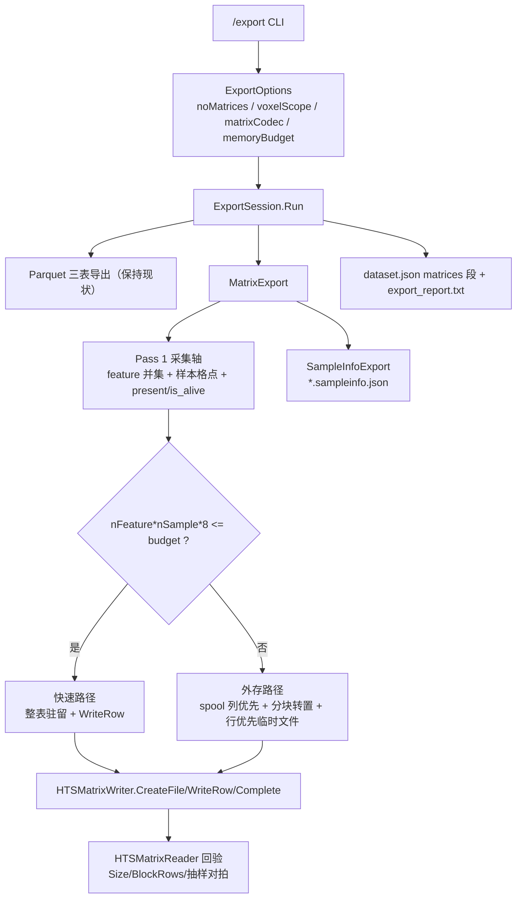

## 产品概述

扩展 vCella 的 `/export` 命令：在现有 cells / medium / molecules 三张 Parquet 表之外，用 HTS_matrix 的流式写入器额外产出两个「行=分子、列=样本」的二进制表达矩阵，并为每个矩阵生成与 ExperimentDesigner `SampleInfo` 模板一致的样本元数据。

## 核心功能

- **胞内矩阵**：行 = 细胞内分子（`CellSnapshot.metabolite` 的跨帧/跨物种并集），列 = 细胞 × 时间点；细胞并集策略，某细胞在某帧不存在则该列全 0。
- **环境矩阵**：行 = 体素内分子（`SpotSnapshot.externals` 并集），列 = 体素 × 时间点；默认 `occupied`（归档中出现过的体素），可切 `all`（按 `metadata.shape` 枚举全空间，空体素补 0）。
- **样本元数据**：每个矩阵配套 `*.sampleinfo.json`，字段与 `SampleInfo` 模板一致（`ID`/`sample_name`/`sample_info`/`batch`/`injectionOrder`/`metadata`/`color`/`shape`），且 `ID` 与矩阵列标签逐字一致；`metadata` 必含可解析为数值的 `time`。
- **流式写入**：超大型矩阵不整表驻留内存，必要时走「列优先暂存 + 分块转置」外存路径；小矩阵走整表驻留快速路径。
- **参数化**：`--no-matrices` 只关矩阵；`--voxel-scope=occupied|all`；`--matrix-codec=gzip|zlib|none`（默认 gzip）；`--matrix-memory-budget=&lt;MB&gt;`；`--no-molecules` 同时跳过矩阵（已确认）。
- **不回归**：既有三张 Parquet 的行数/列序/源归档 SHA256 不变校验全部保留。
- **可追溯**：`dataset.json` 增加 `matrices` 段，`export_report.txt` 记录每个矩阵的形状、样本数、字节数、codec、压缩块行数、写入模式与耗时。

## 技术栈

沿用现有工程，不引入新依赖：VB.NET / `net10.0`。矩阵写入复用 `G:\GCModeller\src\GCModeller\analysis\HTS_matrix\File\BinaryData\HTSMatrixWriter.vb`（`CreateFile` / `WriteRow` / `Complete`，块缓冲 4 MB、codec 支持 none/gzip/zlib、写临时文件后原子替换），读回复验复用同目录 `HTSMatrixReader`（`SampleIDs` / `FeatureIDs` / `Size` / `GetRow` / `GetSample` / `FileHeader`）。样本元数据复用 `G:\GCModeller\src\workbench\modules\ExperimentDesigner\Templates\SampleInfo.vb`。`vCella.vbproj` 已引用 `HTS_matrix`（第 64 行）与 `designer-netcore5`（第 63 行），**无需新增工程引用，也无需改动 HTS_matrix 工程**。

## 实施要点（基于已核实的代码事实）

### 1. 数据源与轴定义

- 帧模型：`TimeFrameSnapshot.time`、`environment As SpotSnapshot()`、`cells` 计数；`SpotSnapshot.{x,y,z, externals, cells, ph, temperature}`；`CellSnapshot.{cell_id, parent_id, taxonomy, species, generation, biomass, age, x,y,z, is_alive, rna, protein, metabolite}`。
- **归档只保存「有细胞」的体素**（`SnapshotWriter.Capture` 跳过空 spot），因此 `occupied` 直接用帧里出现的 `(x,y,z)`；`all` 必须按 `Metadata.shape` 枚举，索引公式为 `(x * height + y) * depth + z`，并断言 `shape.Length = width*height*depth`。
- 胞内与环境两个矩阵的 feature 集合**分别**求并集（胞内代谢物与胞外外源物质集合不同），不可混用。
- 样本格点固定为 `nSamples = frameCount × nEntities`（细胞矩阵 `nEntities = 细胞并集`，环境矩阵 `nEntities = 体素集合`），保证「某实体在某帧缺失」时列仍然对齐、填 0。

### 2. 转置问题与双路径（本轮核心）

`HTSMatrixWriter` 只能按行（分子）顺序写，而归档按帧（样本）组织，必须转置；目标规模可达 `nFeature × nSample × 8` 字节，不能整表驻留。据此：

- **快速路径**：`nFeature × nSample × 8 ≤ budget` 时，用一维 `Double(nFeature*nSample - 1)` 承接整表（避免二维数组在 LOH 上的碎片），逐行 `WriteRow`。
- **外存路径**：

1. Pass 1 解码全部帧，只收集 feature 并集与样本轴（含 `present` / `is_alive` 标记），不保留数值；
2. Pass 2 再解码一次，按样本顺序把长度 `nFeature` 的向量（缺失补 0）**列优先**追加写入 spool 临时文件（偏移 = `sample * nFeature * 8`）；
3. Pass 3 分块转置 spool → 行优先临时文件：取 `R` 个特征 × `B` 个样本的 tile，读端每列一次 `Seek(sample*nFeature*8 + featureStart*8)` 读 `R*8` 连续字节，写端按行写 `offset = (featureIndex*nSample + sampleStart)*8`、长 `B*8`；
4. Pass 4 顺序读行优先临时文件，逐行交给 `WriteRow`。

- 两个矩阵共享 Pass 1/Pass 2（同一次帧循环里同时写两个 spool），因此**总解码次数固定为 2**，与矩阵个数无关。
- `WriteRow` 的 `StrictFeatureOrder=True` 要求行序与 `featureIDs` 完全一致，转置阶段必须沿用同一顺序（不要重新排序）。

### 3. 样本 ID 与 SampleInfo

- `SampleInfo.ID` 要求符合 VB 标识符语法，且必须与矩阵列标签逐字一致（`ReadGeneExpressionMatrix` 用 `sampleSet(id)` 查找）。采用 `c{序号:D6}_f{帧号:D6}` 与 `v{x}_{y}_{z}_f{帧号}`，原始 `cell_id` / 坐标放进 `metadata`。
- `metadata` 必含 `time`（下游按该键解析时间轴）、`frame`、`present`；细胞样本再加 `is_alive`、`species`、`taxonomy`、`x/y/z`、`biomass`、`generation`；环境样本再加 `x/y/z`、`ph`、`temperature`。
- sidecar 用 JSON 数组（`Microsoft.VisualBasic.Serialization.JSON` 的 `GetJson(indent:=True)`），文件与矩阵同目录同名 + `.sampleinfo.json`；另写一个 `*.matrix.json` 描述形状/codec/scope/写入模式，便于离线消费。

### 4. 可观测性（不改既有签名）

压缩块行数无需改 HTS_matrix：`BinaryMatrixHeader.BlockRows` 是 Public，写到文件头里，`HTSMatrixReader.FileHeader.BlockRows` 可直接读回。因此导出后读回一次即可记录实际 `blockRows` 与 `Nblocks`。
需要注意的退化：`chunkRows = min(512, max(1, 4MB / (nSample*8)))`，当样本数极大时会被压到 1（一行一压缩块），写入显著变慢——此时在报告里给出明确提示，并建议 `--matrix-codec=none`。

### 5. 磁盘与失败处理

- 外存路径临时空间约为矩阵大小的 2 倍（spool + 行优先），开始前用 `DriveInfo.AvailableFreeSpace` 预检，不足则直接返回错误码（不写到一半失败）。
- 临时目录放在输出目录下的 `.matrixtmp-<8hex>`，`Finally` 中无条件清理；`HTSMatrixWriter` 自身在未 `Complete` 时已会删除半成品。
- 矩阵导出必须在 Parquet 三表与 SHA256 校验成功之后进行，或与之完全隔离；源 zip 只读，前后 SHA256 比对保持原样。

## 架构设计



## 目录结构

```
GCModeller/src/GCModeller/engine/vCella/
├── Program.vb                      # [MODIFY] /export 新增 --no-matrices / --voxel-scope /
│                                   #   --matrix-codec / --matrix-memory-budget；参数透传到 ExportOptions；
│                                   #   Usage、&lt;param&gt; 文档、签名三者保持一致
└── src/
    ├── ParquetExport.vb            # [MODIFY] ExportOptions 增加矩阵字段；Run() 在 Parquet 之后调用
    │                               #   MatrixExport；DatasetDescriptor 增加 matrices 段；
    │                               #   export_report.txt 记录每个矩阵的形状/样本数/codec/blockRows/
    │                               #   写入模式/耗时/临时目录清理结果；保持 --no-molecules 语义联动
    ├── MatrixExport.vb             # [NEW] 矩阵导出核心：帧循环复用、双轴采集、快速路径与外存路径、
    │                               #   样本 ID 生成、tile 转置、磁盘预检、HTSMatrixReader 回验
    └── SampleInfoExport.vb         # [NEW] SampleInfo 构造（cell / voxel 两套）+ ID 合法性校验 +
                                    #   JSON sidecar 与 *.matrix.json 清单写出

G:\fermenter\data\
├── simulate\run.cmd / run.sh       # [MODIFY] 结果清单追加 *.bin 与 *.sampleinfo.json 的枚举输出
└── README.md                       # [MODIFY] demo 03 段落补充两个矩阵的轴含义、SampleInfo 字段、
                                    #   读取示例（HTSMatrixReader；说明 Parquet 读取方式不适用）
```

## 关键数据结构

矩阵清单（写入 `dataset.json` 的 `matrices` 段，向后兼容的新增属性）：

```
Public Class DatasetMatrix
    Public Property name As String           ' "cell" / "environment"
    Public Property file As String           ' cell_matrix.bin
    Public Property sampleinfo As String     ' cell_matrix.sampleinfo.json
    Public Property nfeatures As Integer     ' 行数（分子）
    Public Property nsamples As Integer      ' 列数（实体 × 帧）
    Public Property features As Integer      ' 与 nfeatures 相同，显式给出便于消费方校验
    Public Property codec As String          ' gzip / zlib / none
    Public Property block_rows As Integer    ' 从 HTSMatrixReader.FileHeader.BlockRows 读回
    Public Property blocks As Integer
    Public Property write_mode As String     ' memory / spool
    Public Property voxel_scope As String    ' occupied / all / -（仅环境矩阵）
    Public Property bytes As Long
    Public Property elapsed_ms As Double
End Class
```

SampleInfo 键名约定（与 `DataFrame.ReadGeneExpressionMatrix(time_label:="time")` 对齐）：

| 矩阵 | `sample_info` | `metadata` 必含 | `metadata` 可选 |
| --- | --- | --- | --- |
| cell | species | `time`、`frame`、`present`、`is_alive` | `cell_id`、`taxonomy`、`x/y/z`、`biomass`、`generation` |
| environment | `voxel` | `time`、`frame`、`present`、`x/y/z` | `ph`、`temperature` |


## 性能与可靠性

- 解码次数固定 2 次（与矩阵数量无关）；快速路径额外 1 次行写出，外存路径额外 1 次 spool 写 + 1 次 tile 转写 + 1 次顺序读。
- 内存上界：快速路径 ≤ `--matrix-memory-budget`；外存路径 = tile（`R×B×8`，默认约 8–32 MB）+ 单个样本向量 + 固定 1 MB 流缓冲。
- 时间复杂度：解码 `O(frames × 分子数)`；转置 `O(nFeature × nSample)` 次双精度拷贝，读写均为连续块（读 `R*8` 字节、写 `B*8` 字节），不做逐元素随机 IO。
- gzip 默认开启；当 `blockRows` 被压到 1 时在报告里给出退化提示与 `--matrix-codec=none` 建议。
- 失败语义：任何矩阵写出失败都不删除已成功的 Parquet 表；返回码沿用现有约定（2 参数、3 归档读取、4 写出/自检失败）。

## 验证方案（用 G:\fermenter\data\simulate 实测）

1. 四工程编译 0 error；`bin\vCella.exe --help /export` 显示 4 个新参数。
2. 对 `simulate\result\community_snapshot.zip` 重新导出：Parquet 三表行数/列序不变（`cells` 30×15、`medium` 224×9、`molecules` 290,230 行）；新增两组矩阵与 sidecar。
3. 读回校验：`HTSMatrixReader.Size` 与 sidecar 数量一致；`SampleIDs` 顺序与 JSON 的 `ID` 顺序逐字一致；`FileHeader.BlockRows` 与报告中记录一致；抽取首帧/末帧若干 `(分子, 样本)` 与源帧 `CellSnapshot.metabolite` / `SpotSnapshot.externals` 对拍。
4. 逻辑预期：3 物种 × 10 帧、每帧 3 细胞 → 细胞样本 30；空间 1×1×1 → 环境样本 10；若出现分裂，并集应产生更多列且缺失列全 0。
5. **强制外存路径**：`--matrix-memory-budget=1 --matrix-codec=none` 与默认快速路径各导一次，逐元素比对（或字节比对）结果一致。
6. 开关语义：`--no-matrices` 只跳矩阵；`--no-molecules` 同时跳 molecules 表与矩阵；`export_report.txt` 有对应记录。

### SubAgent

- **code-explorer**
- Purpose: 在动 `ParquetExport.vb` 与新增 `MatrixExport.vb` 之前，确认 `ExportSession` 内部帧循环的可复用边界（`readFrames` / `appendFrame` 的调用与状态）、`HTSMatrixReader` 的公开读回 API（`GetRow` / `GetSample` / `FileHeader`），以及 `SampleInfo`/`SampleGroup` 的 JSON 序列化是否有既有封装。
- Expected outcome: 一份可直接照抄的集成要点清单（可复用方法签名 + 行号 + 需要注意的共享状态），避免在 1000 行的导出会话里重复实现帧解码或破坏 SHA256 校验流程。