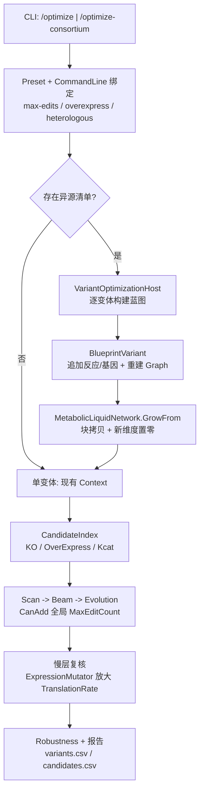

## 用户需求

在现有 vCella 优化器（`/optimize` 单菌、`/optimize-consortium` 合成菌群）之上完成四件事：

1. **落实诊断补丁**：打上上一轮评估结论中给出的修复（快层酶水平被 `TryGetValue` 清零的致命缺陷），并同步修掉直接压制编辑胜出的计罚问题。
2. **新增基因过表达搜索**：把"表达量乘以大于 1 的倍数"作为可搜索的自动优化方案；实现语义为**真实表达量（转录-翻译链）**——慢层提高该基因的翻译速率/蛋白水平，让酶输入 `u = e · _enzymeLevel` 自然生效；快层仍用酶列乘子近似。
3. **支持引入新基因/新反应**：走**网络变体路线**——每个"新增反应集"作为一个蓝图变体，重建 `MetabolicGraph` 与 `MetabolicLiquidNetwork` 模板（旧权重复制、新维度初始化），再在变体上真实参与打分，继续做敲除/过表达/kcat 搜索。候选来源为**用户提供的 JSON/CSV 反应清单**。
4. **新增"优化项目数"控制参数**：以基因节点为粒度、**全局合计**计数（KO / 过表达 / 新增基因 各计 1，kcat 编辑也计 1）；设 1 只搜单点方案，设 2 搜两点组合，设 3 搜三点组合，以此类推。

## 产品概述

单菌与合成菌群两条优化链路保持现有五阶段结构（扫描 → Beam → 进化 → 慢层复核 → 稳健性），在**编辑类型**、**候选空间**、**约束体系**、**评估层**四个维度扩展；命令行与 JSON 预设可完整描述"允许哪些编辑类型、最多几项编辑、过表达档位、异源反应清单"，报告可追溯到每个变体与每个基因节点。

## 核心功能

- 修复后，群落/单菌快层不再把未编辑反应清零；一个真实提升 40% 的 kcat 方案能拿到正分并被推荐。
- 过表达候选与敲除、kcat 并列参与扫描/Beam/进化；慢层以放大后的翻译速率持续表达，报告标注"表达量 ×N"。
- 提供异源反应清单（JSON/CSV），优化器按变体逐个插入反应与基因、重建拓扑与模板，输出变体排名表；新反应默认静默（酶水平 0），只有被优化器"开启"才生效，保证与基线可比。
- `--max-edits=N` 精确约束组合复杂度：1/2/3… 对应单点/两点/三点组合搜索；与既有逐类预算（MaxKnockouts/MaxKcatEdits）取交集。
- 所有新增能力都写入 `best_design.json`、`candidates.csv`、`stage_summary.md`、`config.json` 与 DebugAudit 测试报告。

## 技术栈选择

沿用现有栈，不引入新框架：

- 语言/运行时：VB.NET，`net10.0`（`vCella.vbproj`、`Cella.vbproj`、`CellaOptimization.vbproj`）
- 数值与优化：既有 `Metaboliq`（LTC/CfC 液态网络）+ `Cella`（虚拟细胞/环境/批量相）
- 配置与序列化：`System.Text.Json`（现有 `OptimizationPreset` 模式）
- 测试：`CellaOptimization/test` 控制台程序 + `Microsoft.VisualBasic.ApplicationServices.Debugging.DebugAudit`
- 构建：`Release|x64`，输出到 `engine/App/net10.0/`

## 实现方案

### 1) 缺陷修复（第 1 项，先做，其余功能都依赖它）

- `Mutator.MutatedEnzymeSeries`、`CommunityMutator.MutatedEnzymeSeries` 改为"键缺失保持 1.0"：
`Dim scale As Double = 1.0` → `Dim v As Double` + `If table.TryGetValue(id, v) Then scale = v`。
- 计罚口径修正：新增 `EvaluationResult.SpecEditCount`（由评估器写入 `spec.EditCount`，即"基因/反应编辑项数"），`Fitness.Apply` 与 `CommunityFitness.Apply` 的编辑罚项改用它；`AppliedKnockOutReactions` 仅用于报告与诊断。这是让"一个基因敲除"不再被罚 20 次的关键。
- 顺带消除一个数量级的内存/时间浪费：`MetabolicNetwork.Sub New` 里 `New MetabolicLiquidNetwork(...)` 改为仅当需要自建模板时才完整初始化，否则 `lightweight:=True`（它立即会被 `ShareWeights` 换成共享常量）。当前每个细胞白白分配约 (m+nIn)×r 的 `FluxWeight` 与同尺寸梯度。
- 样例预设同步修正（`G:\fermenter\data\consortium\preset.json` 仅作为回归输入，不改仓库内文件；在报告中给出建议值）。

### 2) 优化项目数（第 4 项）

- `OptimizationConfig.MaxEditCount As Integer = 0`（0 = 不限，沿用逐类预算）。
- `MutationSpec`：`EditCount` 改为"敲除基因数 + 过表达基因数 + kcat 反应数"，`CanAdd` 增加全局判据 `EditCount < MaxEditCount`，`Validate` 增加越界异常。
- `CommunityMutationSpec`：同上，但为**跨物种全局合计**（`Edits.Values.Sum(EditCount)`）。
- 搜索阶段配合：
- Beam：`CanApply` 已走 `spec.CanAdd`，天然生效；每轮最多叠加 `MaxEditCount` 轮（`MaxRounds` 至少取 `MaxEditCount`）。
- 进化：`Decode` 末尾增加**全局裁剪**（随机丢弃直到 `EditCount ≤ MaxEditCount`）；`RandomChromosome` 改为"随机选 K=1..MaxEditCount 个位点激活"，使组合搜索真正覆盖两点/三点。
- CLI：`--max-edits=N`；预设字段 `MaxEditCount`；两个命令的 Usage 与报告配置快照同步。

### 3) 基因过表达（第 2 项）

- 契约：`CandidateKind.OverExpress`；`MutationSpec.OverExpressions As Dictionary(Of String, Double)`（基因 → 倍数，必须大于 1）；`SpeciesEdit.OverExpressionGenes` 同构；规范化片段 `OE:gene=2`。
- 候选生成：在 `CandidateIndex.Classify` 已有的 gene→reactions 索引上，对进入候选空间的基因产出 `OverExpressCandidates`（复用同一批基因与距离/优先级，避免二次 BFS）。
- 快层：过表达与 kcat 共用"酶列乘子"通道（`ResolveReactionScales` 中把该基因的全部反应乘以倍数），修复 TryGetValue 后即为正确语义。
- 慢层（真实表达量，用户选定）：
- 新增 `Model/ExpressionMutator.vb`：`BlueprintWithExpression(base, overExpressions)` → `base.Clone()`（浅拷贝、共享 graph/template/expression）后把 `TranslationRate(gene) *= factor`（下限保护、上限由 `OverExpressMax` 约束）。
- `WholeCellEvaluator` / `CommunityWholeCellEvaluator` 改为"按候选蓝图建细胞/建群落"：`WildTypeContext.CreateCell(medium, blueprintOverride)`、`CommunityContext.CreateSeededEnvironment(medium, inoculum, blueprintOverrides)`。
- 效果：`CellaFactory.BuildCell` 的初始蛋白与 `TranslationSystem` 的每 tick 解析推进都按放大后的速率计算，表达量变化是持续且可复现的；同时 `Mutator.ApplyToCell` 仍负责 KO/kcat。
- 参数：`--overexpress-levels='2,4,8'`、`--max-overexpressions=N`、`--overexpress-max=<倍>数上限`；`--edit-kinds=ko,oe,kcat` 用于关闭某类编辑（便于对照实验）。

### 4) 异源新基因/新反应（第 3 项，网络变体路线）

- 输入契约（新文件 `Design/HeterologousReaction.vb`）：JSON 数组（或 CSV `id,gene,left,right,reversible,spontaneous,expression`），字段 `id`、`name`、`gene`、`left/right = [{id, coefficient}]`、`reversible`、`spontaneous`、`expression`（初始酶水平，默认 0）、可选 `species`（群落里指定归属，缺省按化合物交集自动推断）。
- 变体构建（新文件 `Model/BlueprintVariant.vb`）：

1. `bp = base.Clone()`；追加 `MetabolicReaction`（用现有拷贝构造/公开 setter）；
2. 追加基因：重建 `Expression`（新 `GeneExpressionData`，Matrix 多一行，行名=gene，值取清单里的 expression），**不改原矩阵**；
3. `ReactionGeneMap(reaction.id) = gene`，`TranslationRate(gene)` 基线置 0（新反应默认静默）；
4. `bp.MetabolicGraph = Nothing`（触发 `GetMetabolicGraph` 重建）；
5. `bp.MetabolicTemplate = MetabolicLiquidNetwork.GrowFrom(base.MetabolicTemplate, newGraph)`。

- 模板维度扩展（改 `Metaboliq/MetabolicLiquidNetwork.vb`）：新增 `GrowFrom(template, graph)`：
- 以 `lightweight:=True` 构造新实例（跳过随机初始化与梯度张量）；
- `FluxWeight` 由 (m_old+nIn_old)×r_old 扩为 (m_new+nIn_new)×r_new，**块拷贝旧值到左上角**，新增行/列填 0；
- `Liquid` 参数（`WeightRecurrent`/`WeightInput`/`Bias`/`Tau`/门控参数）按重叠块拷贝，新维度填 0；
- 结果：新反应通量恒为 0、新输入通道恒为 0 → **变体基线与原基线数值一致**，只有优化器"开启"新反应（过表达/kcat，或把静默基因抬高）才产生差异。这是保证"变体公平可比"的关键设计。
- 约束（v1 明确限定并及时报错）：异源反应的底物/产物必须已在模型中存在，或不引入新的边界代谢物（`ExplicitBoundary` 不变），以免 `nB` 变化引发额外的槽映射风险；违反者在报告 `variants.csv` 里标 `rejected`。
- 外层搜索（新文件 `Search/VariantOptimizationHost.vb`）：`基线变体 + 每个清单项（或清单组）` → 逐变体构建蓝图 → 构建 Context → 复用 `OptimizationDriver`/`CommunityOptimizationDriver` 内层搜索 → 汇总 `VariantResult`（fold、score、enabled reactions、elapsed）→ 取全局最优。
- 成本控制：构图约 50~60 s/物种、模板约 (m+nIn)×r 双精度；`--heterologous-max-variants`（默认 2）限制变体数，报告与 `stage_summary.md` 明确打印每个变体的构图/模板耗时与内存峰值；单变体内层沿用现有预算，避免总量爆炸。

### 性能与可靠性

- 快层每次评估约 10~12 s（三物种、Steps=1），变体数 N 会让总时间近似线性放大 → 用 `MaxVariants` + `EvaluationBudget` 双闸门，并提供"冒烟档"（Steps=1、budget 小）用于验证链路。
- 模板 `GrowFrom` 的复杂度 O(m·r) 内存拷贝一次，避免重复 Xavier 初始化；`lightweight` 复用可把每细胞数 GB 的瞬时分配降为零。
- 所有新增字段都进 `CopyTo`/`Clone`，防止群落配置漏拷贝（现有 `CopyTo` 注释已强调该风险）。
- 数值安全：过表达倍率、kcat 倍率统一走 `KcatMin/KcatMax` 与新增 `OverExpressMax` 钳制；NaN/Inf 一律回落到 1.0 并记入 `OutOfDistribution`。
- 向后兼容：`MaxEditCount=0`、无 `--overexpress-levels`、无 `--heterologous` 时，行为与现状逐步一致（除已修复的缺陷）；旧 JSON 预设可直接反序列化。

## 架构设计



## 目录结构

```
engine/
├── CellaOptimization/
│   ├── Design/
│   │   ├── OptimizationConfig.vb        # [MODIFY] CandidateKind 增加 OverExpress；新增 MaxEditCount / OverExpressLevels / MaxOverExpressions / OverExpressMax / HeterologousPath / HeterologousMaxVariants / EditKinds；CopyTo 同步
│   │   ├── CommunityConfig.vb           # [MODIFY] CloneCommunity 同步新字段；新增 IsKindEnabled/全局项目数查询
│   │   ├── MutationSpec.vb              # [MODIFY] OverExpressions 表、EditCount/CanAdd/Validate/CanonicalKey/Clone/ToString 支持 OE 与全局上限
│   │   ├── CommunityMutationSpec.vb     # [MODIFY] SpeciesEdit 增加 OverExpressionGenes；CanonicalFragment 增加 OE 段；CommunityMutationSpec.CanAdd 改为全局合计；ToSpecs/FromSpecs 携带 OE
│   │   ├── EvaluationResult.vb          # [MODIFY] 新增 SpecEditCount（编辑项数），供罚项使用
│   │   └── HeterologousReaction.vb      # [NEW] 异源反应 DTO + JSON/CSV 加载器 + species 归属推断 + 校验（代谢物必须已存在、不新增边界）
│   ├── Model/
│   │   ├── Mutator.vb                   # [MODIFY] 修复 TryGetValue 清零；ResolveReactionScales 支持 OE；ApplyToCell 增加过表达分支
│   │   ├── CommunityMutator.vb          # [MODIFY] 同上（逐物种）
│   │   ├── CandidateIndex.vb            # [MODIFY] 生成 OverExpressCandidates；异源静默基因候选
│   │   ├── CommunityCandidateIndex.vb   # [MODIFY] 逐物种 OverExpress 候选 + 展平视图
│   │   ├── ExpressionMutator.vb         # [NEW] 按方案克隆蓝图并放大 TranslationRate（真实过表达）
│   │   ├── BlueprintVariant.vb          # [NEW] 变体构建：追加反应、扩展表达矩阵、更新 ReactionGeneMap、清空图缓存、模板 GrowFrom
│   │   └── WildTypeContext.vb           # [MODIFY] CreateCell 增加 blueprintOverride 重载
│   ├── Evaluation/
│   │   ├── Fitness.vb                   # [MODIFY] 编辑罚项改用 SpecEditCount
│   │   ├── CommunityFitness.vb          # [MODIFY] 同上
│   │   ├── SurrogateEvaluator.vb        # [MODIFY] 通过修复后的 Mutator 生效；记录 OE 实际倍率
│   │   ├── CommunitySurrogateEvaluator.vb # [MODIFY] 同上；快层 abundance/growth 代理量 NaN 显式标记
│   │   ├── WholeCellEvaluator.vb        # [MODIFY] 用表达量蓝图建细胞（真实过表达）
│   │   └── CommunityWholeCellEvaluator.vb # [MODIFY] 用逐物种表达量蓝图播种
│   ├── Search/
│   │   ├── ScanStage.vb                 # [MODIFY] OE 候选扫描（多档位）
│   │   ├── GreedyBeamStage.vb           # [MODIFY] BeamEdit 支持 OE；轮数与 MaxEditCount 对齐
│   │   ├── EvolutionStage.vb            # [MODIFY] OE 位点；随机染色体按 MaxEditCount 选 K 个位点；Decode 全局裁剪
│   │   ├── CommunityScanStage.vb        # [MODIFY] 同上（逐物种）
│   │   ├── CommunityBeamStage.vb        # [MODIFY] 同上
│   │   ├── CommunityEvolutionStage.vb   # [MODIFY] 同上（跨物种全局裁剪）
│   │   ├── OptimizationDriver.vb        # [MODIFY] 暴露可复用的内层 Run（供变体宿主调用）
│   │   ├── CommunityOptimizationDriver.vb # [MODIFY] 同上；修复跨层分数比较（仅在同层内比较）
│   │   └── VariantOptimizationHost.vb   # [NEW] 变体外层循环：构建变体 → 内层搜索 → 汇总排名
│   ├── Report/
│   │   ├── DesignReport.vb              # [MODIFY] candidates 增加 kind/oe_scales/spec_edits；新增 variants 表
│   │   └── CommunityDesignReport.vb     # [MODIFY] 同上（含逐物种 OE 列）
│   └── test/
│       ├── Program.vb                   # [MODIFY] 新增断言：MaxEditCount 生效、OE 产生编辑、变体排名与静默基线一致；DebugAudit 出报告
│       └── DemoNetwork.vb               # [MODIFY] 小网络上的 OE/变体数值自检（秒级回归）
├── Cella/
│   └── Networks/MetabolicNetwork.vb     # [MODIFY] 构造模板时按需 lightweight，避免每细胞数 GB 无效分配
├── sub-system/Metaboliq/
│   └── MetabolicLiquidNetwork.vb        # [MODIFY] 新增 GrowFrom(template, graph)：FluxWeight/Liquid 参数块拷贝 + 新维度置零
└── vCella/
    ├── Program.vb                       # [MODIFY] 两个命令新增参数与 Usage（max-edits / overexpress-* / heterologous-*）
    └── src/Optimization/
        ├── OptimizationPreset.vb        # [MODIFY] 新字段 + 异源清单相对路径解析
        ├── OptimizationCommandLine.vb   # [MODIFY] ApplySingle/ApplyConsortium 绑定新开关
        ├── SingleStrainOptimization.vb  # [MODIFY] BuildConfig 透传新字段；有异源清单时走变体宿主
        └── ConsortiumOptimization.vb    # [MODIFY] 同上 + BuildSpecies 传递逐物种 OE/项目数配置
```

## 关键代码结构

```
' [NEW] CellaOptimization/Design/HeterologousReaction.vb
Public Class HeterologousReaction
    Public Property id As String
    Public Property name As String
    ''' <summary>新基因 id（写入 Expression/ReactionGeneMap/TranslationRate）</summary>
    Public Property gene As String
    Public Property left As CompoundTerm()     ' id + coefficient
    Public Property right As CompoundTerm()
    Public Property reversible As Boolean
    Public Property spontaneous As Boolean
    ''' <summary>初始酶水平；0 = 静默，只能被优化器开启</summary>
    Public Property expression As Double
    ''' <summary>群落模式下的归属物种；Nothing 时按化合物交集推断</summary>
    Public Property species As String

    Public Shared Function Load(path As String) As HeterologousReaction()
End Class
```

```
' [MODIFY] CellaOptimization/Design/MutationSpec.vb（新增成员，保持既有成员语义不变）
Public Property OverExpressions As Dictionary(Of String, Double)   ' gene → 表达倍数（大于 1）
Public ReadOnly Property EditCount As Integer                       ' KO 基因数 + OE 基因数 + kcat 反应数
Public Function CanAdd(kind As CandidateKind, config As OptimizationConfig) As Boolean
    ' 逐类预算 + 全局 MaxEditCount 双重判据
End Function
```

```
' [MODIFY] sub-system/Metaboliq/MetabolicLiquidNetwork.vb
''' <summary>
''' 按新拓扑扩展模板：旧权重块拷贝到左上角，新反应列与新输入通道置 0，
''' 使变体基线与原基线数值一致（新反应必须被"开启"才产生通量）。
''' </summary>
Public Shared Function GrowFrom(template As MetabolicLiquidNetwork,
                                graph As MetabolicNetworkGraph,
                                Optional mode As LiquidMode = LiquidMode.LTC,
                                Optional solver As String = "rk4") As MetabolicLiquidNetwork
```

### SubAgent

- **code-explorer**
- Purpose: 在实施异源变体与模板维度扩展前，快速定位 `Metaboliq`/`Cella` 中与 `LiquidNeuralNetwork` 参数形状、`MetabolicNetworkGraph` 输入掩码、`ExplicitBoundary` 派生相关的全部调用点，避免遗漏需要同步的槽映射。
- Expected outcome: 输出一份"维度变化影响面清单"（文件 + 成员 + 是否需块拷贝/是否需要重建掩码），直接用于 `GrowFrom` 与 `BlueprintVariant` 的实现与自检。