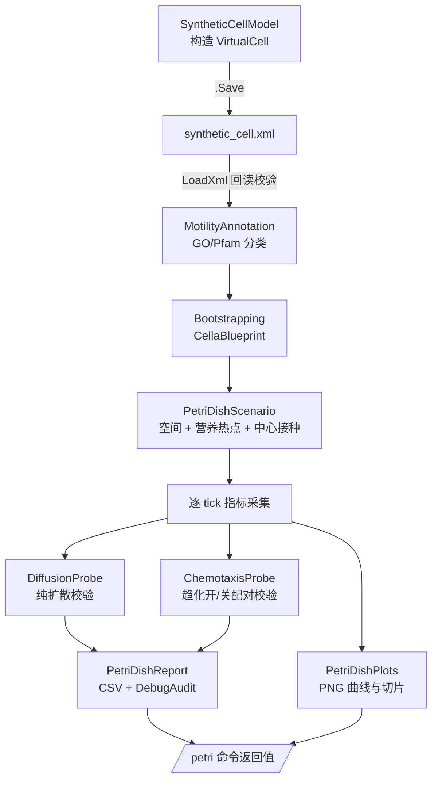

## 产品概述

在现有 Cella 虚拟细胞引擎之上，于 vCella 控制台工程中新增一个独立的「培养皿平板生长模拟」模块。该模块不依赖任何外部基因组尺度模型：先合成一份最小细胞模型 xml（GCMarkup v2 结构）并从该 xml 加载，然后在半径 r、厚度 h 的培养皿空间里中心接种细胞、四周随机播撒高浓度营养斑块，运行三维体素空间模拟，并对模拟结果做定量校验与出图。

## 核心功能

- 合成最小细胞模型：自动生成一份可回读的细胞模型 xml 文件，含基因组 / 操纵子 / 调控关系 / 代谢反应 / 区室 / 生理参数，基因携带 GO 词条与 Pfam 结构域注释。
- 鞭毛与趋化基因自动识别：不再手工指定基因 id，而是按基因的 GO 词条匹配，未命中时回退到 Pfam 结构域注释，并输出每个基因的命中证据表。
- 培养皿空间：半径与厚度可配置的圆盘形生长空间，格点外部为无效空间；支持复现用的随机种子。
- 随机营养分布：在培养皿内随机放置若干高浓度营养热点（避开中心区），呈现从热点向外衰减的空间浓度梯度；热点的位置、峰值、扩散半径均可配置。
- 中心接种与三维生长：在皿中心小范围内随机播种细胞，细胞可沿三维六个方向迁移、消耗局部营养、二分裂并向外扩张形成菌落。
- 浓度梯度扩散校验：无细胞对照场景下验证物质在体素格点间的扩散是否符合物理预期（总质量守恒、分布对称、峰值随时间单调衰减、分布方差单调上升、长时间趋于均匀）。
- 趋化运动校验：以同一随机种子、同一组营养热点做「趋化开 / 趋化关」配对实验，量化细胞上坡迁移比例、位移方向与局部浓度梯度方向的夹角、菌群质心漂移方向、细胞到最近热点的距离变化、菌落扩张是否偏向高浓度一侧。
- 结果导出：逐帧种群统计、逐细胞位置与状态、格点间迁移事件、浓度场切片、热点清单、径向浓度剖面等 CSV 表。
- 可视化：营养浓度随时间演化曲线、径向浓度剖面曲线、趋化漂移曲线、浓度场切片热图、细胞分布叠加图，全部输出为 PNG。
- 测试报告：以审计方式记录全部断言，输出文本与 JSON 两份报告，包含通过 / 失败条目与实测数值；存在失败项时命令返回非零退出码。

## 技术栈

- 语言与运行时：VB.NET / net10.0，沿用 `vCella.vbproj` 控制台工程（ServerGC、TieredPGO 已开启）。
- 模拟引擎（只读复用，不修改）：`Cella` 工程的 `SpaceInitializer`、`Environment`、`Spot`、`CellaFactory`、`CellLifecycle`、`FlagellarMotor`、`DiffusionConfig`。
- 模型层：`GCMarkupLanguage v2 Xml` 的 `VirtualCell`（用基类 `ModelBaseType.Save(path)` 序列化，用 `LoadXml(Of VirtualCell)` 回读）。
- 蓝图层：`CellaLoader.Bootstrapping.BlueprintFromModel`（Prior 由 `genome.regulations` × `operons` 现算，表达矩阵由 `CellaFactory.SyntheticBaseline` 合成）。
- 代谢拓扑：`Metaboliq` 的 `MetabolicReaction` / `MetabolicNetworkGraph`（边界代谢物由 `_ext` 后缀与 XOR 规则判定）。
- 测试报告：`Microsoft.VisualBasic.Imaging`→`Microsoft.VisualBasic.Debugger.DebugAudit`（`Check/Mark/Snapshot/Dump/ToJson/SaveReport/FailureCount`）。
- 出图：`Microsoft.VisualBasic.Data.Plots`（`LinePlot`、`HeatmapPlot`、`ScatterPlot` + `SavePng`）与 `Microsoft.VisualBasic.Imaging`（`IGraphics` 原语做切片叠加）。
- 依赖变更：`vCella.vbproj` 需新增 `..\..\..\runtime\sciBASIC#\Data_science\Visualization\DataPlot\DataPlot.vbproj`（imaging 不传递该引用）。

## 实现方案

整体思路：**先造细胞，再铺环境，再跑配对实验，最后用「纯物理探针 + 群体统计」双轨校验并出图**。所有新增代码落在 `vCella/src/PetriDish/`，由新增的 `/petri` 命令编排，Cella 引擎本体零改动。

1. **合成最小细胞并落盘为 xml**：用 `New VirtualCell` 组装 `taxonomy`、`genome`（一个 `replicon` → 若干 `TranscriptUnit`，基因必须挂在操纵子里）、`metabolome`（`compounds` + `reactions(enzymatic)` + `enzymes.catalysis`）、`compartments`、`physiology`。功能基因同时写 `<go>` 与 `<db_xref>PFAM:PFxxxxx</db_xref>`；`regulations` 每条都必须有 `regulator` 且 `mode="activator"`（`Bootstrapping` 用字面量判激活）。代谢网络设计为：`glc_ext→glc→g6p→f6p`、`o2_ext→o2`、末端氧化产生 `co2_ext` 外排，边界 id 一律 `_ext` 后缀，确保进入 `MetabolicNetworkGraph.BoundaryIds`；`gene.protein_id` 与 `Enzyme.proteinID` 对齐，保证 `ReactionGeneMap` 生效。构造完成后 `.Save(xml)`，再 `LoadXml(Of VirtualCell)` **回读**并用 `DebugAudit` 断言结构完整（操纵子数、基因数、反应数、GO/Pfam 注释数），最后 `BlueprintFromModel` 得蓝图。xml 默认生成到输出目录，便于人工检查；也允许 `--model` 指向已有模型做对照（扩展点，不改变主流程）。
2. **GO / Pfam 基因分类**：内置两张词条表——GO 表（`GO:0009288` 细菌鞭毛、`GO:0071973` 鞭毛依赖运动、`GO:0044780/GO:0044781` 鞭毛组装、`GO:0001539` 鞭毛/纤毛依赖运动 → 鞭毛类；`GO:0006935` 趋化、`GO:0050918` 正趋化、`GO:0050920` 趋化调控 → 趋化类）与 Pfam 表（`PF00669`/`PF00700` 鞭毛蛋白、`PF01052` MotA/TolQ/ExbB、`PF01706` FliG → 鞭毛类；`PF00015` MCP 信号域、`PF00672` HAMP、`PF01584` CheW → 趋化类）。匹配顺序为 GO 精确命中 → 未命中再解析 `gene.dbLinks` 与 `protein.domains[].featureType` 中的 Pfam accession 回退；词条可由 `--flagellar-go` / `--chemotaxis-go` / `--flagellar-pfam` / `--chemotaxis-pfam` 追加，便于接入用户自有注释。分类结果写 `annotation.csv`（基因、类别、命中词条、证据来源），并断言所得基因集合非空且全部属于 `blueprint.Genes`。
3. **空间与营养场**：`CreatePetriDishSpace(r, h, medium, dt)` 建圆盘空间（内部即半径 r、高 h 的圆柱，包围盒 `(2r+1)×(2r+1)×h`，皿外格点为 Nothing）；创建后显式 `env.Rand = New Random(seed)` 覆盖默认种子以保证复现。营养场按 `c(x) = baseline + Σ_k peak·exp(-d_k²/(2σ²))` 逐格点写入 `spot.Medium(nutrientId)`；热点位置在 `0.35R..0.9R` 的环带内均匀随机（角度均匀、半径平方根采样保证面均匀），从而既有明确方向性又保留随机性。可选把每格点 `NormalizedRadius` 设为 `ρ/R`，让子代扩散优先选择同半径邻居，形成盘状向外推进的菌落。
4. **中心接种**：在距圆心 `seedRadius` 内随机挑选空位，每格 1 个细胞并遵守 `MaxCellsPerSpot`；播种前 `CellaFactory.EnsureMediumCoverage` 补齐边界成分。蓝图侧设定：`NutrientMetabolites` 只含 `glc_ext`（否则 `NutrientLevel` 会把废物一起求和，梯度失真）、`MotilityBaseProbability`、`MotilityGradientBias`、`MotilityGradientScale`、`DaughterDispersal = True`、`MaxCellAge` 提到远大于总步数（避免衰老死亡截断生长）、`StarvationThreshold` 与基线浓度匹配。
5. **逐 tick 指标采集**：每步 `env.Tick(dt)` 后记录——全体细胞数、总营养质量、细胞质心、平均局部营养；逐细胞位置/代数/生物量/局部营养/最近热点与距离；从 `env.LastMigrations` 记录每次迁移的起止坐标与 `nutrient_before/nutrient_after`（直接支撑「上坡迁移比例」指标）；按采样间隔记录 z 中层浓度切片与 XY 投影细胞分布。
6. **校验策略（双轨）**：

- *纯扩散探针*（无细胞、`EnableLifecycle/EnableMotility` 关闭、单一孤立方源）：质量守恒（相对误差阈值）、x/y 对称性与格点镜像对称、峰值单调衰减、浓度方差单调上升、长时趋向均匀（变异系数下降）、径向平均剖面随距离单调不增、通量方向与浓度差同号。
- *趋化配对探针*（同一热点坐标 + 同一 seed，仅 `ChemotaxisGenes` 置空即「趋化关」）：上坡迁移比例、位移向量与局部梯度单位向量余弦均值、质心位移在「质心→最近热点」方向上的投影、细胞到最近热点平均距离随时间的趋势、菌落质心相对初始位置的朝向偏移；每项都要求「趋化开」显著优于「趋化关」，阈值集中为常量并同时记录实测值。

7. **导出**：CSV（`frames`/`cells`/`migrations`/`field_slices`/`hotspots`/`radial_profile`/`annotation`）、PNG（浓度演化、径向剖面、趋化漂移、切片热图、细胞分布）、`summary.txt` 与 `audit_report.txt` / `audit_report.json`；命令返回码沿用 `/run` 约定 `If(DebugAudit.FailureCount = 0, 0, 1)`。

性能与可靠性：默认盘面取 `r=24, h=6`（约 7.3k 有效格点），细胞数默认 64，步数默认 200。主要开销是 `Environment.Diffuse`（每 tick 为全部格点分配字典与数组缓冲）与细胞内部网络推进；因此切片与逐细胞 CSV 按 `--sample-interval` 采样，避免输出体积线性爆炸；复用 `CellaThreading.SetThreads/Warmup`，`VBDebugger.Mute` 静音引擎诊断日志。显式差分稳定性约束 `6·D·dt < 1`（默认 0.05×1.0 安全），`--dt` 越界时告警并自动收缩。

## 执行要点

- 培养基字典的键必须与 `State.BoundaryNames` 完全一致（即 `glc_ext` / `o2_ext`），名字不一致会让胞外浓度恒读 0、细胞完全不摄取。
- 边界代谢物判定依赖 `_ext` 后缀或「只消耗 / 只生成」，所以在 xml 里坚持 `_ext` 命名，并在探针中断言 `BoundaryIds` 含营养物。
- `ChemotaxisGenes` / `FlagellarGenes` 为空时运动能力恒为 0 且不报错——必须在蓝图构建后显式赋值并断言 `FlagellarMotor.MotilityOf > 0`、`ChemotaxisOf > 0`。
- 配对两条实验臂共享热点坐标与随机种子；但细胞 id 由全局序列号生成，两臂不同，比较只能基于坐标与统计量，不可按 id 对齐。
- 不修改 `Cella` 引擎任何文件；如需径向扩散偏好，仅通过写入 `Spot.NormalizedRadius` 实现。
- 代码风格沿用工程既有约定：中文注释块头、`Call` 前缀、`Module` + `Namespace PetriDish` 分层、`Console.WriteLine` 诊断输出。

## 架构设计



## 目录结构

新增模块全部落在 `vCella/src/PetriDish/`，产物写到 `vCella/output/petri_dish/`（该目录已在工程中被 `Compile Remove` 排除，不会参与编译）。

```
engine/vCella/
├── vCella.vbproj                        # [MODIFY] 新增 DataPlot.vbproj 的 ProjectReference（LinePlot/HeatmapPlot/SavePng 来源）
├── Program.vb                           # [MODIFY] 新增 <ExportAPI("/petri")> + <Usage>，并在顶部命令清单注释补一行；转发到 PetriDishCommand.Run
├── src/PetriDish/
│   ├── SyntheticCellModel.vb            # [NEW] 合成最小细胞：构建 taxonomy/genome(operons+genes 带 GO 与 PFAM db_xref)/regulations(mode=activator, regulator 必填)/metabolome(compounds+enzymatic reactions+enzymes.catalysis)/compartments/physiology；调用 .Save(xml) 落盘、LoadXml 回读、DebugAudit 断言结构完整；提供 BuildBlueprint(xml) 封装 BlueprintFromModel 与蓝图参数覆盖
│   ├── MotilityAnnotation.vb            # [NEW] 内置 GO 词条表与 Pfam 词条表；MotilityGeneSet{FlagellarGenes,ChemotaxisGenes,Evidence}；Classify(model, options) 先 GO 后 Pfam 回退；支持 CLI 追加词条；输出 annotation 行集合供 CSV 与报告使用
│   ├── NutrientField.vb                 # [NEW] Hotspot 记录（x/y/z/peak/sigma）；PlaceHotspots 在环带内随机布点并去重叠；Apply(env) 按 Gaussian 叠加写入指定营养物；ConcentrationAt / NearestHotspot / GradientAt 提供解析参考与梯度查询；生成 hotspots.csv 数据
│   ├── PetriDishScenario.vb             # [NEW] ScenarioOptions（半径、厚度、细胞数、接种半径、步数、dt、seed、热点数/峰值/σ/基线、扩散系数、趋化开关、生命周期开关、采样间隔）；Create 建空间+铺场+播种；Run() 逐 tick 采集 FrameMetric/CellRecord/MigrationRecord/FieldSlice；返回可复用于导出的结果对象
│   ├── DiffusionProbe.vb                # [NEW] 无细胞纯扩散实验：单位点源，断言质量守恒、镜像/轴向对称、峰值单调衰减、方差单调上升、长时趋同、径向剖面单调、通量方向与浓度差一致；稳定性前置检查 6·D·dt<1
│   ├── ChemotaxisProbe.vb               # [NEW] 趋化配对实验（同热点同 seed，趋化开/关两臂）：计算上坡迁移比例、位移-梯度余弦、质心漂移投影、最近热点距离趋势、菌落朝向偏移；阈值常量化并逐项断言，实测值 Mark 记录
│   ├── PetriDishReport.vb               # [NEW] CSV 写出（frames/cells/migrations/field_slices/hotspots/radial_profile/annotation）、summary 构建、DebugAudit.Dump/ToJson/SaveReport 落盘与返回码计算
│   ├── PetriDishPlots.vb                # [NEW] PNG 出图：LinePlot 画浓度演化与径向剖面与趋化漂移；HeatmapPlot 画 z 切片浓度场；IGraphics 手绘细胞分布/叠加图；统一色阶与尺寸，失败时降级为仅出 CSV 并 Mark 记录
│   └── PetriDishCommand.vb              # [NEW] /petri 流程编排：参数校验 → 生成/加载模型 xml → 蓝图与基因分类 → 扩散探针 → 趋化配对 → 导出；控制台进度与耗时输出
└── output/petri_dish/                   # [NEW] 运行产物目录：synthetic_cell.xml、*.csv、*.png、summary.txt、audit_report.txt/json
```

## 关键代码结构

```
''' <summary>GO/Pfam 分类结果：鞭毛与趋化基因集合及其命中证据</summary>
Public Class MotilityGeneSet
    Public Property FlagellarGenes As String()
    Public Property ChemotaxisGenes As String()
    ''' <summary>gene locus_tag -> (category, term, source[GO|PFAM])</summary>
    Public Property Evidence As List(Of (gene As String, category As String, term As String, source As String))
End Class
```

```
<ExportAPI("/petri")>
<Usage("/petri [--output='/dir/petri_dish' --radius=24 --height=6 --cells=64 --seed-radius=0.15
                 --steps=200 --dt=1 --seed=2024
                 --hotspots=4 --hotspot-peak=10 --hotspot-sigma=0 --hotspot-baseline=0.5
                 --nutrient=glc_ext --diffusion=0.05 --chemotaxis --no-lifecycle
                 --motility-p=0.15 --motility-bias=1.5
                 --flagellar-go=... --chemotaxis-go=... --flagellar-pfam=... --chemotaxis-pfam=...
                 --sample-interval=10 --model='/optional/existing.xml'
                 --no-plots --verbose]")>
Public Function Petri(output As String,
                      Optional radius As Integer = 24,
                      Optional height As Integer = 6,
                      Optional cells As Integer = 64,
                      Optional seed_radius As Double = 0.15,
                      Optional steps As Integer = 200,
                      Optional dt As Double = 1.0,
                      Optional seed As Integer = 2024,
                      Optional hotspots As Integer = 4,
                      Optional hotspot_peak As Double = 10.0,
                      Optional hotspot_sigma As Double = 0,
                      Optional hotspot_baseline As Double = 0.5,
                      Optional nutrient As String = "glc_ext",
                      Optional diffusion As Double = 0.05,
                      Optional chemotaxis As Boolean = True,
                      Optional no_lifecycle As Boolean = False,
                      Optional motility_p As Double = 0.15,
                      Optional motility_bias As Double = 1.5,
                      Optional flagellar_go As String = Nothing,
                      Optional chemotaxis_go As String = Nothing,
                      Optional flagellar_pfam As String = Nothing,
                      Optional chemotaxis_pfam As String = Nothing,
                      Optional sample_interval As Integer = 10,
                      Optional model As String = Nothing,
                      Optional no_plots As Boolean = False,
                      Optional verbose As Boolean = False) As Integer
```

## Agent Extensions

### SubAgent

- **code-explorer**
- Purpose: 在实现阶段按需核对 `VirtualCell` xml 各元素的精确名称与序列化特性、`DataPlot` 的 `LinePlot/HeatmapPlot/SavePng` 实际签名、`Environment.Diffuse` 与 `FlagellarMotor` 的最新实现细节，避免凭记忆写错 API。
- Expected outcome: 每个待用 API 都能拿到带路径与行号的确切签名，新增代码一次编译通过。

### Skill

- **lsp-code-analysis**
- Purpose: 对 `VirtualCell`、`CellaBlueprint`、`FlagellarMotor`、`MetabolicNetworkGraph` 做符号级定位与引用查找，确认字段可写性（如 `Blueprint.FlagellarGenes`、`Spot.NormalizedRadius`）以及无遗漏的调用点。
- Expected outcome: 所有对引擎类型的读写点都被核实，避免出现改了却无人消费、或写入不存在字段的问题。