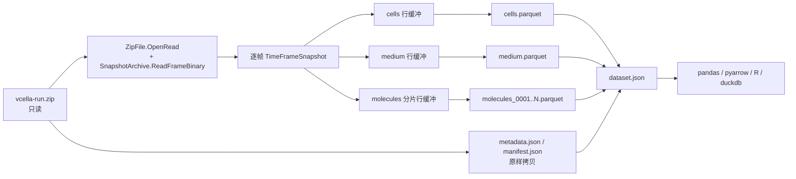

## 产品概述

在 `vCella` 命令行中新增 `/export` 离线导出命令，把既有 `/run` 生成的 `SnapshotArchive` zip 结果转换为开放的列式 Parquet 数据集，供 pandas / pyarrow / R / duckdb 等外部工具直接读取。本次采用「并列导出通道」策略：不修改仿真热路径、不替换 `Cella\Snapshots` 的自定义二进制帧格式、不改动 sciBASIC 的 Parquet 实现。验收样本固定为 `N:\GMNDesigner\Acetoin\models_test2\GEMs\vcella-run.zip`。

## 核心功能

- 以只读方式打开输入 zip，绝不改写或清空源归档
- 逐帧解析 `frames/frame_N.bin`，导出三张逻辑表：`cells`、`medium`、`molecules`（完整胞内状态，默认开启）
- `molecules` 约千万行，按分片写出多个 parquet 文件，由 `dataset.json` 登记分片清单
- 原样拷贝 `metadata.json` 与 `manifest.json` 到输出目录
- 生成 `dataset.json`：源 zip、生成时间、时间轴、空间维度、物种数、Parquet 选项、各表行数与列 schema
- 支持 `--no-molecules`、`--compression`、`--row-group-size`、`--shard-rows`、`--report`、`--verbose`
- 内置 `pq.read_table` 回读自检、导出报告与输入归档完整性校验

## 技术栈

- 语言与运行时：VB.NET，`net10.0`，沿用 `Microsoft.VisualBasic.CommandLine` 的 `RunCLI` + `<ExportAPI>` / `<Usage>` 模式
- 列式存储：`src\runtime\sciBASIC#\Data\BinaryData\Parquet\Parquet.vbproj`，使用 `pq.write_table` / `pq.read_table` / `pq.read_schema` / `ParquetOptions`
- 表格模型：`Microsoft.VisualBasic.Data.Framework.DataFrame` + `FeatureVector`
- 归档读取：`System.IO.Compression.ZipFile.OpenRead` + `SnapshotArchive.ReadFrameBinary`（`Public Shared`）
- 元数据：`System.Text.Json` 反序列化 `Metadata` / `Manifest`，并序列化新增的 `DatasetDescriptor`

## 实现思路

采用「只读归档 → 逐帧流式解析 → 行缓冲 → 分片写出 → 索引清单」的离线转换流水线。关键决策与权衡：

1. **不实例化 `SnapshotArchive` 读取输入**：其构造函数使用 `FileMode.Create`，会清空已有 zip；`ReadMetadata` / `ReadFrame` / `FrameIndexes` 又依赖实例字段与 `m_closed`。因此直接用 `ZipFile.OpenRead` 枚举条目，对帧流调用 `Public Shared ReadFrameBinary`，对 JSON 条目用 `StreamReader` 读取。这样无需修改 `Cella` 项目，且从根源上消除「误清空 67 MB 生产结果」的风险。
2. **分子字典摊平为长表而非宽表/MAP**：`pq` 不支持 `Dictionary` 直接列；宽表会产生约 1.7 万列、每个叶子列一个 DataPage，MAP 在 VB 读回时是 JSON 文本列。长表 `frame, time, x, y, z, cell_id, species, taxonomy, pool, molecule_id, value` 全为标量列，外部分析最友好。
3. **千万行必须分片**：`CreateWritePlan` 要求每列是长度等于 rowCount 的强类型数组，`WriteColumnChunk` 又把整列 raw 与 compressed 同时放内存，且 `pq.write_table` 无 append 能力。故按 `--shard-rows`（默认 1,000,000）切成 `molecules_0001.parquet` …，每片写完释放缓冲；`RowGroupSize` 默认 100,000 以限制单页内存。`cells` / `medium` 行数很小，各写单文件。
4. **输出目录型 dataset 而非写回 zip**：`ParquetWriter` 读取 `output.Position`，`ZipArchiveEntry` 流不可定位；写真实文件路径同时规避该限制并符合「方便与其他软件交换」的目标。
5. **空间坐标取自 `SpotSnapshot`**：`CellSnapshot.x/y/z` 虽存在但二进制帧未写入，读回恒为 0；`cells` / `molecules` 的 `x/y/z` 必须取所在 `SpotSnapshot.x/y/z`。
6. **不改既有行为**：`/run`、`/compile`、`/context`、`SnapshotArchive` 二进制格式、sciBASIC Parquet 实现全部保持原样，本次为纯新增导出通道。

## 性能与规模

- 输入：67.06 MB，10 帧，每帧 60 细胞、6 物种、1 格点，`flags=1` 含完整状态
- 预估行数：`cells` ≈ 10×60 = 600；`medium` = Σ帧 Σ格点 `externals` 条数；`molecules` ≈ 10×60×1.7万 ≈ 1,000 万行
- 分片：默认 10 片左右；单片约 10 列 × 1e6 行的强类型数组，加 Parquet 页面双缓冲，峰值内存可控在 1–2 GB 量级
- 复杂度：时间 O(分子条目总数)，空间 O(单片行数 + 单帧状态)，避免一次性物化整帧全部帧
- 逐帧处理完立即释放 `TimeFrameSnapshot`，不保留 10×16.8 MB 常驻对象

## 架构设计



## 目录结构

```
engine/vCella/
├── ParquetExport.vb   # [NEW] 导出实现。只读打开 zip；枚举 frames/frame_N.bin；逐帧生成 cells/medium/molecules 行；按 shard-rows 分片调用 pq.write_table；原样拷贝 metadata.json/manifest.json；写 dataset.json 与 export_report.txt；pq.read_table 回读自检；返回 0/2/3/4
├── Program.vb         # [MODIFY] 新增 <ExportAPI("/export")> 与 Usage；沿用私有 getOption(Of T) 补读带连字符参数；模块头注释补充 /export；默认 output = 输入去扩展名 + ".export"
└── vCella.vbproj      # [MODIFY] 新增 <ProjectReference Include="..\..\..\runtime\sciBASIC#\Data\BinaryData\Parquet\Parquet.vbproj" />；不改既有 Compile Remove 与 ServerGC/TieredPGO 配置

N:/GMNDesigner/Acetoin/models_test2/GEMs/vcella-run.export/   # [产物，验收输出，不写入仓库]
├── cells.parquet
├── medium.parquet
├── molecules_0001.parquet ... molecules_NNNN.parquet
├── metadata.json          # 字节级原样拷贝
├── manifest.json          # 字节级原样拷贝
├── dataset.json
└── export_report.txt      # --report 时生成
```

## 关键代码结构

```
Friend Class ExportOptions
    Public Property Compression As String = "snappy"
    Public Property RowGroupSize As Integer = 100000
    Public Property ShardRows As Integer = 1000000
    Public Property IncludeMolecules As Boolean = True
    Public Property WriteReport As Boolean = False
    Public Property Verbose As Boolean = False
End Class

Friend Function ExportArchive(inputZip As String, outputDir As String, options As ExportOptions) As Integer
```

`DatasetDescriptor` 承载 `source_zip`、`generated_at`、`format_version`、`time_frames`、`space`、`species_count`、`parquet_options`、`tables(name, files, rows, columns, skipped_reason)`，用 `System.Text.Json` 以 `WriteIndented=True` 写出。

## 实现要点

- 复用既有约定：`SnapshotArchive.MetadataEntryName`、`ManifestEntryName`、`FrameEntryName(i)`、`SnapshotWriter.sanitizeValue`、`Program.getOption`、`FeatureVector(name, typedArray)`、`DataFrame.add`
- `ParquetOptions` 显式设置 `WriteIndexColumn=False`（不写 `__index__`）、`WriteStatistics=True`、`RowGroupSize=100000`、`Compression` 由 `--compression` 映射到 SNAPPY / GZIP / UNCOMPRESSED
- 字符串列：`Nothing` 转空串或交由 `pq` 的 String nullMask 处理；数值列导出前做 `Double.IsNaN/IsInfinity → 0` 防御
- `flags=0`（`--no-state` 归档）时三个池为 `Nothing`：跳过 `molecules` 表，在 `dataset.json` 写 `skipped_reason`，不报错
- 日志：每帧进度、每分片耗时与体积、总行数、总耗时、峰值工作集；不输出大对象内容，不记录敏感路径以外信息
- 可靠性：入口校验 `input` 存在且 `metadata.json` 存在；帧号按正则 `frames/frame_(\d+)\.bin` 排序；导出前后比对输入文件大小与 SHA256；输出目录不存在则创建，已存在时只覆盖同名产物
- 影响面控制：不触碰 `Cella`、`CellaLoader`、`smoke` 的现有逻辑；仅 `vCella` 三个文件变动，便于回退
- 外部互操作：本轮以 `pq.read_table` 自验证为准；`pyarrow` 交叉读取列为可选，并在 `export_report.txt` 明示「VB 写入端仅 PLAIN + DataPageV1、SNAPPY 为自有实现」的已知风险

## Agent Extensions

### SubAgent

- **code-explorer**
- Purpose: 实施前复核 `pq.vb` 与 `DataFrame` 的公开 API、`vCella` 到 `Parquet.vbproj` 的引用链，以及 `src\runtime\sciBASIC#\Data\BinaryData\` 根目录散落的 `ParquetWriter.vb` / `DataFrame.Mapping.vb` 副本是否会造成重复类型定义
- Expected outcome: 确认仅新增一条 `Parquet.vbproj` 引用即可编译、无类型冲突、无需修改 sciBASIC；输出核对结论供实现与验收使用