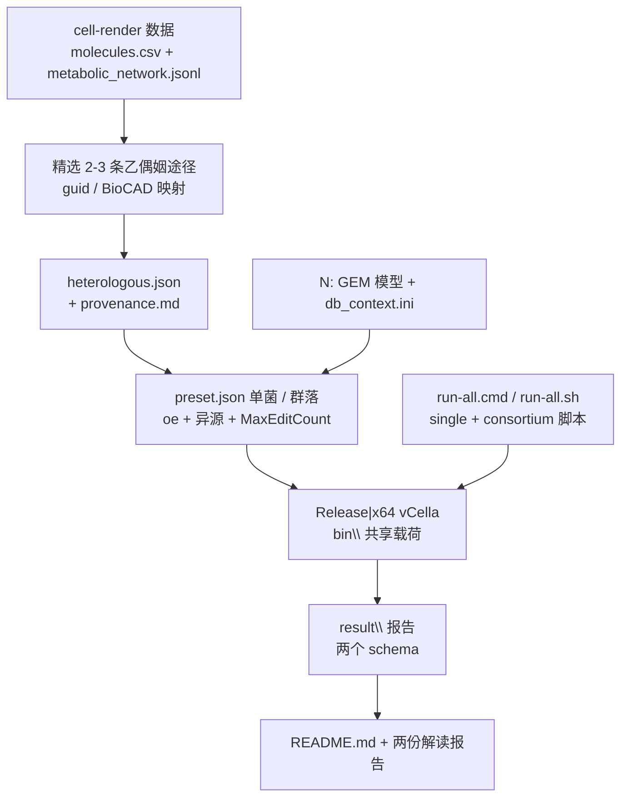

## 产品概述

在 `G:\fermenter\data` 更新"单菌株培养"与"合成菌群混合培养"两个可整体拷贝、一键运行的代谢网络优化 demo。用 Release|x64 生产版 vCella 实跑，目标统一为最大化分泌产物 `S_Acetoin`，并完整展示本轮新增的三类突变能力：基因过表达（oe）、引入外源基因的异源反应、以及按"编辑条数"限制单个设计复杂度的参数。交付 Windows 批处理与 Ubuntu bash 两套脚本、使用说明、以及依据真实结果文件撰写的两份解读报告。

## 核心 Features

- **生产版工具**：`Release|x64` 构建 0 error，产物同步到共享 `data\bin\`；两个优化命令的帮助文本可查到全部新参数。
- **异源反应清单**：从 `molecules.csv` + `metabolic_network.jsonl` 精选 2–3 条乙偶姻经典途径（ALS / ALDC / 双乙酰还原等），手工构造 JSON 清单，每条附 jsonl guid 与 BioCAD 编号的来源表；化合物 id 一律换算成 GEM 里真实存在的 id，且新反应/新基因 id 不与模型冲突。
- **新参数全量演示**：两个 preset 同时启用 `ko,oe,kcat` 三类编辑、过表达倍数档位、`MaxEditCount` 复杂度上限、异源变体数量上限，并提高评估预算，让含 oe / 异源反应的设计有机会进入推荐集。
- **一键复现**：`run-all.cmd` + `single\run.cmd` + `consortium\run.cmd`，以及 `run-all.sh` + `single\run.sh` + `consortium\run.sh`；全部相对路径、自动检查运行时、打印命令与耗时、失败分级提示、可整体拷贝。
- **文档与解读**：README（工具说明、新参数表、清单格式、输出文件、排错）＋ 单菌与菌群两份结果解读报告；数字、命令、文件名均与实跑产物逐项对应，并显著标注"未训练模板，结果仅供链路验证"。
- **目录整洁**：清除历次性能实验产生的临时目录与日志，仅保留交付所需文件。

## 技术栈选型

沿用现有工程，不引入新依赖：VB.NET / `net10.0`（`vCella` CLI、`CellaOptimization` 优化引擎、`Cella` 引擎）；配置用 `OptimizationPreset` / `ConsortiumPreset` 的 JSON 序列化；异源反应用 `HeterologousReaction` 的 JSON 目录；脚本为 Windows `cmd` batch 与 `bash`；文档为 Markdown；构建 `dotnet build -c Release -p:Platform=x64`，产物落 `engine\App\net10.0`。

## 实施策略

**先确定契约，再生成配置，最后实跑取证。** 这轮风险集中在"配置文件写错但程序不报错"：异源清单的 `Validate` 只检查 id/gene 冲突与空值，**并不校验化合物是否存在于模型**，因此一个用了错误化合物 id 的清单会静默产生错误结果。据此：

1. **以 GEM 的化合物 id 为唯一真相源**：从模型 XML 的 `compound ID` 提取可用 id 集合，任何清单条目都先过一遍白名单校验；名称/来源映射写进 provenance 表，不直接把 `register_name` 当 id。
2. **异源反应必须"静默插入 + 过表达开启"**：`expression=0` 保证变体基线与野生型一致，只有 `oe` 编辑命中新基因才产通量，所以 `EditKinds` 必须含 `oe`；这组因果要写进 README 与解读报告。
3. **成本校准**：先用极小预算探针确认"异源变体已构造、oe 候选已出现、目标池解析正确"并测得单次评估耗时，再按 10–30 分钟档冻结 `EvaluationBudget` 与 `HeterologousMaxVariants`；探针结果写进 README 的"实测耗时"栏。若必须降档，明确写出降档原因与提高档位的方法。
4. **可移植性靠脚本约定而非环境变量**：`%~dp0` / `BASH_SOURCE` 定位、`bin\vCella.exe` 与 `bin/vCella.dll` 共享一份载荷、零绝对路径、退出码分级、`VCELLA_NOPAUSE` 抑制子脚本暂停。

**性能与复杂度**：异源变体每个都要重建拓扑与模板，代价高（预算与变体数近似线性放大耗时）；`S_Acetoin` 位于分泌/边界池，单菌 `TargetPool=boundary`、群落 `shared` 是硬约束；`expression=0` 保证零新增边界代谢物，避免维度扩展破坏模板。脚本侧只做串行调度，无并行复杂度。

## 实施要点（执行细节）

- `Release|x64` 产物用 `robocopy /E /XF *.pdb` 同步到 `data\bin\`，保留 `*.dll.config`、`*.json`、`runtimes\`；门禁为 `data\bin\vCella.exe --help /optimize` 与 `--help /optimize-consortium` 的 Usage 里出现 `--edit-kinds` / `--overexpress-levels` / `--heterologous`。
- **字段名一致性**：CLI 的 `--max-edits` 写入的 preset 属性是 `MaxEditCount`（不是 `MaxEdits`）；`EditKinds` 的合法 token 是 `ko` / `oe` / `kcat`（`IsKindEnabled` 按此匹配，未知 token 视为允许）；`OverExpressMin` 必须大于 1、`OverExpressLevels` 全大于 1、各上限不得为负，否则 `OptimizationConfig.Validate` 抛错。JSON preset 里必须用序列化后的真实属性名。
- **相对路径规则**：`OptimizationPreset.ResolveRelativePaths` 会把 `ContextMap`、`MediumFile`、`HeterologousPath` 按 **preset 文件所在目录**解析，因此 preset 中写 `config\heterologous.json` 即可随目录搬迁；命令行显式给的路径优先。
- **清单硬自检**（写脚本或 PowerShell 做一次并留日志）：每个 `left`/`right` 的 `id` 都能在 GEM 的 `compound ID` 中查到；`id` 与 `gene` 不与 GEM 已有反应/基因冲突（一律用 `HET_*` 新 id）；产物不引入新边界代谢物。已核实可用：`S_2-Acetolactate`、`S_Acetoin`、`CO2`、`H+`、`2-Acetolactate`、`R_Acetoin`、`ACETOIN`、`DIACETYL`、`PYRUVATE`、`NAD/NADH/NADP/NADPH`；**不可用**（仅出现在反应名/note）：`CARBON-DIOXIDE`、`PROTON`、`S_Acetolactate`、`S_Pyruvate`。
- **结果取证**：单菌 `DesignReport`（schema `cella-optimization/1.0`）产出 `best_design.json`、`candidates.csv`、`pareto.csv`、`scan_hits.csv`、`stage_summary.md`、`config.json`；群落 `CommunityDesignReport`（schema `cella-optimization/2.0`）产出 `community.csv`、`candidates.csv`（含 species 维度）、`crossfeeding.csv`、`best_design.json`、`config.json`、`stage_summary.md`；`--report` 额外写审计报告；默认还有 `performance.json` / `performance.md` / `performance.evaluations.csv`。解读报告只能引用这些文件里的真实数字。
- **爆炸半径**：只写 `G:\fermenter\data\`；唯一对 `G:\GCModeller` 的写入是 Release 构建产物（既有 `App\net10.0`）；`N:\GMNDesigner` 与 `G:\cell-render` 只读。不改任何源码语义。
- **可移植回归**：从 `C:\` 外部 cwd 调用 `single\run.cmd` 能启动；`bash -n` 通过三个 `.sh`；脚本内 `G:\` / `N:\` 命中数为 0。

## 架构设计



数据流要点：`Expression=0` 静默插入 → `oe` 编辑开启新基因 → 目标池 `boundary`/`shared` 读 `S_Acetoin` → 报告落盘 → 文档只引用实跑产物。

## 目录结构

```
G:\fermenter\data\
├── README.md                              # [MODIFY] 重写：目录结构、前置条件（.NET 10 / cmd / bash）、两种 OS 一键运行、
│                                          #   新增参数表（edit-kinds / max-edits / overexpress-* / heterologous*，含默认值与
│                                          #   "oe 是异源反应生效前提"）、异源清单格式与 provenance、JSON 覆盖语义、
│                                          #   两个 schema 的输出文件清单、FAQ（Acetoin vs S_Acetoin、化合物 id 必须用 GEM 真实 id、
│                                          #   未训练模板警告、耗时估算、跨机复现步骤）
├── run-all.cmd                            # [MODIFY] 顺序 call single\run.cmd 与 consortium\run.cmd；设 VCELLA_NOPAUSE=1；汇总退出码
├── run-all.sh                             # [NEW] set -euo pipefail；依次 bash 调用两个 demo 的 run.sh；打印总耗时与分级提示
├── run.sh                                 # [MODIFY] 原"通用启动器"改名为 bin\vcellactl.sh 或并入新脚本，避免与 run-all.sh 语义冲突
├── bin\                                   # [MODIFY] Release|x64 全量重拷（robocopy /E /XF *.pdb），含 vCella.exe/dll、
│                                          #   *.runtimeconfig.json、*.deps.json、依赖 dll、runtimes\
├── bin\vcellactl.sh                       # [NEW] 可选：保留通用 Linux 启动器（Server GC / CELLA_THREADS / numactl）
├── single\
│   ├── models\Acetobacter pasteurianus IFO 3283-01 IFO 3283.xml   # [KEEP] 只读保留
│   ├── config\db_context.ini              # [KEEP] 上下文映射
│   ├── config\heterologous.json           # [NEW] 精选异源反应清单（HET_* id、expression=0、GEM 真实化合物 id）
│   ├── config\heterologous.provenance.md  # [NEW] 来源表：HET id | 途径 | jsonl guid | 原反应式 |
│   │                                      #   molecule_id→BioCAD→register_name→GEM id | 是否边界 | 备注
│   ├── preset.json                        # [MODIFY] 新增 EditKinds/MaxEditCount/MaxOverExpressions/OverExpressLevels/
│   │                                      #   OverExpressMin/Max/HeterologousPath/HeterologousMaxVariants；提高预算；
│   │                                      #   保持 TargetCompound=S_Acetoin、TargetPool=boundary、Seed=2024、OutputDirectory=result
│   ├── run.cmd                            # [MODIFY] 打印新参数与异源清单路径、--output=result --report --threads、分级排错、pause
│   ├── run.sh                             # [NEW] bash 版：dotnet ../bin/vCella.dll、.NET 10 自检、date/SECONDS 计时、exit code 提示
│   └── result\                            # [MODIFY] 清空后按新结果重写（best_design.json / candidates.csv / pareto.csv /
│                                          #   scan_hits.csv / stage_summary.md / config.json / optimize_report.txt /
│                                          #   performance.json / performance.md / performance.evaluations.csv / run.log）
├── consortium\
│   ├── models\{3 个 GEM}.xml              # [KEEP] Acetobacter / Lentilactobacillus buchneri / Limosilactobacillus fermentum
│   ├── config\db_context.ini              # [KEEP]
│   ├── config\heterologous.json           # [NEW] 同精选清单；必要时按 species 字段分组归属
│   ├── config\heterologous.provenance.md  # [NEW] 同上（与单菌共用来源，注明群落归属策略）
│   ├── preset.json                        # [MODIFY] 同上新字段 + 群落专属（Species、Cells、SurrogateMode、Objective=community、
│   │                                      #   MinSpeciesAbundance、CheckSpeciesDropout）；TargetPool=shared；提高预算
│   ├── run.cmd                            # [MODIFY] 同上，命令为 /optimize-consortium
│   ├── run.sh                             # [NEW] bash 版 /optimize-consortium
│   └── result\                            # [MODIFY] 清空后重写（community.csv / candidates.csv / crossfeeding.csv /
│                                          #   best_design.json / config.json / stage_summary.md / consortium_report.txt /
│                                          #   performance 三件套 / run.log）
├── reports\
│   ├── single-strain.md                   # [MODIFY] 按新结果重写：实验设置（含 oe / 异源 / MaxEditCount / 预算 / 耗时）、
│   │                                      #   野生型与最佳设计（是否含 oe 或异源反应）、阶段摘要表、Pareto、
│   │                                      #   机理解读（乙偶姻途径）、醒目"未训练模板"前提、局限与提升建议
│   └── consortium.md                      # [MODIFY] 同上 + 逐物种丰度/贡献/生长、交叉喂养边、共存约束、
│                                          #   跨物种编辑解读、醒目"未训练模板"前提
└── <清理>                                 # [DELETE] single\ab_* / ab_cache / bisect / clone_fix / epochfix / fast_probe /
                                           #   parbeam / perf_run* / release_run / steps3 / transposefix / boundaryfix /
                                           #   probe* / demo.log / gf*.log / gs.log / par.log 等历次实验目录与临时日志
```

## 关键数据结构（1 个，异源清单条目契约）

```
{
  "id": "HET_ALDC_S",
  "name": "acetolactate decarboxylase (heterologous) | source guid=6c9c5672d06bcb9f492b80fa3de75732; BioCAD00000000913/960/8728",
  "gene": "HET0001",
  "left":  [ { "id": "S_2-Acetolactate", "coefficient": 1 } ],
  "right": [ { "id": "S_Acetoin", "coefficient": 1 }, { "id": "CO2", "coefficient": 1 } ],
  "reversible": false,
  "spontaneous": false,
  "expression": 0.0,
  "species": null
}
```

要点：`id`/`gene` 为全新 `HET_*`（避免与模型冲突）；`expression=0` 静默，`EditKinds` 含 `oe` 才会开启；化合物 id 必须用 GEM 真实 id（`CO2` 而非 `CARBON-DIOXIDE`）；`species` 为空时群落按代谢物交集自动推断。