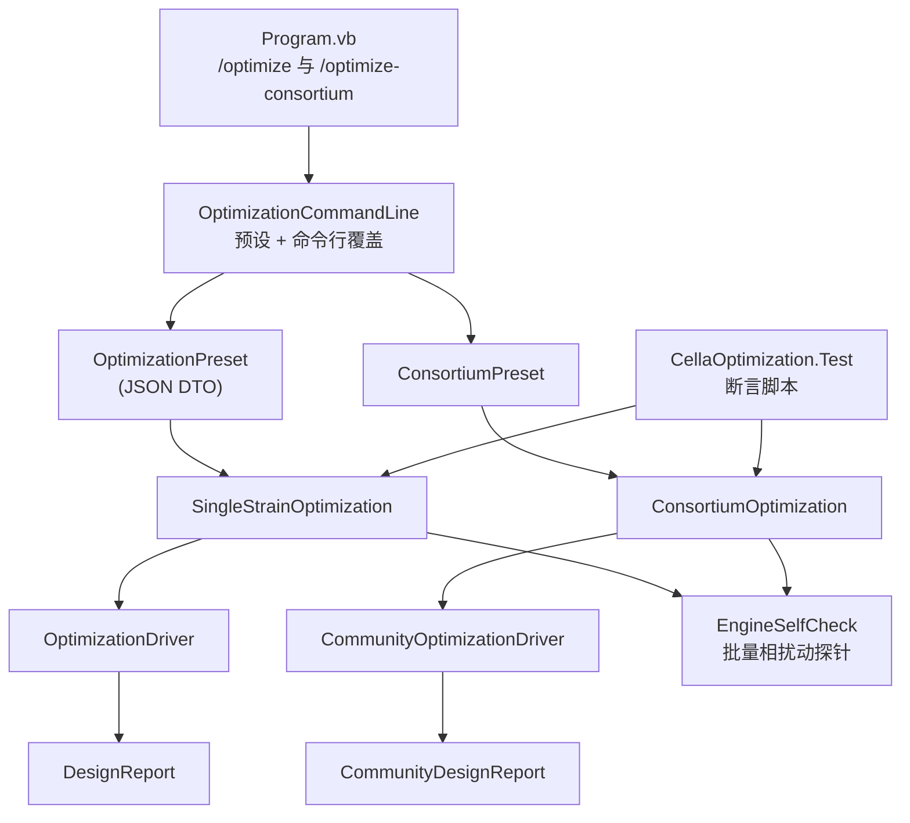

## 用户需求

把 `CellaOptimization/test/CellaOptimization.Test.vbproj` 中的优化流程代码抽象为 vCella 项目内可复用、可配置的命令行工具，并在 `vCella/Program.vb` 中按现有命令风格新增两个命令：

- `/optimize`：单菌株培养的代谢网络自动优化；
- `/optimize-consortium`：合成菌群多菌混合培养的代谢网络自动优化。

## 产品概述

优化能力从「只存在于测试工程里的演示脚本」升级为「vCella 命令行的一等公民」：同一套流程既可被终端直接调用，也可被其他程序在进程内调用；测试工程退化为纯粹的断言脚本，不再持有流程实现。

## 核心功能

### 1. 两个新命令

- `/optimize` 接收单个模型文件（也接受目录/通配，取首个），输出完整的单菌优化报告；
- `/optimize-consortium` 接收模型集合（目录/通配/分号分隔），按物种数截断，输出带物种维度的群落优化报告；
- 两者都遵循既有输出惯例：`=== 命令名 ===` 头部、分步进度、阶段摘要、最佳设计、推荐方案、`elapsed`、报告目录，并返回标准退出码（0 成功，非 0 失败）。

### 2. 命令行参数 + JSON 配置叠加

- 所有可调参数均可用命令行直接指定；
- 额外支持 `--config=*.json` 读取一份完整配置，用于复现与批处理；
- **命令行显式给出的参数优先**，未给出的沿用 JSON 值，JSON 也没有则用内置默认值。

### 3. 单菌优化参数

目标化合物与目标池（胞内/边界）、产量指标（终点/均值/AUC/累计分泌）、时间网格（步数、步长）、培养基（字符串或 CSV）、上下文映射、编辑约束（敲除上限、kcat 上限、倍数档位）、候选空间（搜索半径、候选上限、TopK、Beam 宽度、早停耐心、最大轮数）、进化参数（种群、代数、精英、锦标赛、交叉率、变异率）、评估预算与随机种子、两级评估（慢层复核数量）、稳健性（培养基因子、kcat 抖动、TopN）、模板准入策略。

### 4. 群落优化参数

在单菌参数基础上追加：物种列表与逐物种接种数、共享培养基、群落目标（群落滴度/生产者贡献/均衡滴度）、共存阈值与逐物种生长地板、快层档位（开环/定点闭环/跳过快层）与迭代次数/收敛容差、接种比例抖动因子、物种缺失复核开关、确定性开关（关闭分裂/死亡/运动/并行）。

### 5. 模板策略

默认允许未训练模板，但必须打印显著警告，并在阶段摘要与报告中标注「未训练模板，结果仅供链路验证」；`--require-trained` 时直接拒绝运行并返回非 0 退出码。

### 6. 测试工程精简

- 删除测试工程中的单菌与群落流程实现；
- 保留合成网络数值自检（KnockOut 通量为 0、kcat 放大精确、扰动可复位、重复模拟确定性）；
- 其余断言改为调用 vCella 的流程模块并校验返回结果（最佳设计非空、推荐集合非空、逐物种预算合规、快层确定性）；
- 测试报告继续由统一审计模块生成。

## 视觉/交互效果

纯命令行工具，无图形界面。终端输出保持与 `/run`、`/context` 一致的排版风格；社区运行时对「未训练模板」「定点迭代不收敛」「目标化合物不在培养基中」等情形给出显式提示而不是静默降级。

## 技术栈

沿用现有技术栈，不引入新依赖：

- 语言 / 框架：VB.NET，`net10.0`
- 宿主项目：`vCella.vbproj`（`OutputType=Exe`，`RootNamespace=vCella`）
- 优化引擎：`CellaOptimization.vbproj`（`RootNamespace=SMRUCC.genomics.GCModeller.ModellingEngine.Optimization`）
- 引擎与加载：`Cella.vbproj`、`CellaLoader.vbproj`、`Metaboliq.vbproj`
- 序列化：`System.Text.Json`（框架内置，项目内已有使用）
- 命令行框架：`Microsoft.VisualBasic.CommandLine`（`RunCLI` + `<ExportAPI>` / `<Usage>`）
- 测试审计：`Microsoft.VisualBasic.ApplicationServices.Debugging.DebugAudit`

## 实施策略

**总原则：流程下沉、命令做薄、测试做纯。**

1. **流程下沉**：把「加载模型 → 构建蓝图/上下文 → 组装配置 → 跑驱动 → 解析结果 → 落盘报告」封装成 vCella 内的公开模块，命令函数只负责参数绑定与调用，不写业务逻辑。
2. **单一来源**：测试工程通过项目引用调用同一模块，彻底消除「vCella 与 test 各存一份流程」的漂移风险。
3. **配置两段式**：先反序列化 `--config` 得到预设 DTO，再用「命令行是否显式给出该参数」决定是否覆盖。判断依据必须是 `CommandLine.ContainsParameter(name, False)`，不能靠「值等于默认值」推断，否则用户显式传默认值会被误判为未指定。
4. **零语义改动**：不修改 `CellaOptimization` 库中任何算法语义；仅新增文件、新增项目引用、把 `Simulation` 模块中少量 `Private` 辅助提升为 `Friend`。

关键决策与权衡：

- **不直接序列化 `OptimizationConfig` / `CommunityConfig`**：后者的 `SpeciesConfig.Blueprint` 持有反应网络与预训练张量，直接 JSON 化会产出数 GB 垃圾。因此定义纯标量 DTO（`OptimizationPreset` / `ConsortiumPreset`），蓝图在运行时由模型路径重建。
- **单菌入口由 `FromModel` 改为 `FromBlueprint`**：只有这样才能把 `--context-map` 的跨膜被动通透配置带进蓝图（`WildTypeContext.FromModel` 内部固定传 `Nothing`）。不传上下文映射时行为与原来逐位一致。
- **群落默认目标为 `auto`**：实测 `Acetoin` 并不在这些 GEM 的边界集合里，真正的分泌产物是 `S_Acetoin`；硬编码默认值会让命令开箱即败，因此默认自动选择，并在用户显式指定失败时透出「名称相近的边界代谢物」诊断。
- **`--cells` 复用 `CellCounts.Create`**：它已支持「整数统一」与「JSON 逐物种」两种形态，正好覆盖接种比例需求，无需新写解析器。

性能与预算：

- 单菌成本 ≈ 一次野生型录制 + `budget × (快层 Simulate 或慢层细胞步)`；
- 群落成本 ≈ `物种数 × 接种细胞数 × 步数` 个细胞步/次评估，且快层闭环还要乘迭代次数；
- 命令启动时打印预估规模，并在 `species > 3` 或 `steps > 50` 且模型为基因组尺度时提示「预计运行时间较长，建议先用小预算冒烟」。

## 实现要点

**目录与命名**

- 新代码放在 `vCella/Optimization/` 子目录，`RootNamespace=vCella` 自动生成 `vCella.Optimization` 命名空间；
- 与引擎侧 `SMRUCC...Optimization` 无冲突（引用处显式 `Imports`，不使用同名短别名）。

**错误处理**

- 输入错误（模型/配置/培养基文件不存在，`--species < 1`）→ 打印明确路径与原因，返回 2；
- 运行期异常（上下文构建失败、目标化合物不在培养基中）→ 打印异常消息（上下文已带「名称相近的边界代谢物」提示），返回 3；
- 策略拒绝（`--require-trained` 且模板未训练）→ 返回 4；
- 预算耗尽属正常收尾，打印「已完成 N 次评估，预算 M」，返回 0。

**日志**

- 默认 `VBDebugger.Mute = True`（与 `/run` 一致），`--verbose` 时放开；
- 不新增逐候选日志；阶段级信息统一走 `StageSummary.Message` 并在末尾表格化打印；
- `--report` 时用 `DebugAudit` 写 `*_report.txt`，与既有 `/run --report` 约定一致。

**爆炸半径控制**

- `CellaOptimization` 库不改；
- `Simulation` 只改 4 个辅助的可见性（`parseMedium`、`resolveDefinition`、`resolvePassiveSwitch`、`collectCompounds`/`getSpeciesName`），不改签名与实现；
- `vCella.vbproj` 仅新增一个 `ProjectReference` 与若干 `Compile` 文件；
- 测试工程删除流程代码但**保留全部既有命令行开关**（`--mode`、`--steps`、`--budget`、`--target`、`--diag` 等），确保既有脚本继续可用。

## 架构设计



数据流：`CommandLine` → `--config` 反序列化预设 → 命令行覆盖 → 构建 `OptimizationConfig` / `CommunityConfig` → 驱动 → 结果 → 报告 + 终端摘要；测试工程直接调用 `Execute` 拿到强类型结果做断言。

## 目录结构

```
engine/
├── vCella/
│   ├── vCella.vbproj                                # [MODIFY] 新增 CellaOptimization 项目引用
│   ├── Program.vb                                   # [MODIFY] 新增 /optimize 与 /optimize-consortium 两个命令
│   ├── Optimization/
│   │   ├── OptimizationPreset.vb                    # [NEW] 纯标量预设 DTO（单菌/群落两套）+ JSON 读写
│   │   ├── OptimizationCommandLine.vb               # [NEW] 命令行绑定器：Has/Str/Integer/Double/Bool/Doubles + 预设叠加 + 输出目录与打印辅助
│   │   ├── OptimizationOutcome.vb                   # [NEW] 流程返回对象（ExitCode + 强类型 Result + 报告路径），供命令与测试共用
│   │   ├── SingleStrainOptimization.vb              # [NEW] 单菌流程：加载模型→蓝图→配置→驱动→报告；Execute 返回强类型、Run 返回退出码
│   │   ├── ConsortiumOptimization.vb                # [NEW] 群落流程：多模型→共享培养基→CommunityConfig→驱动→报告
│   │   └── EngineSelfCheck.vb                       # [NEW] 批量相扰动探针（全 1 酶水平复现旧重载 / 敲除后通量为 0）
│   └── Simulation.vb                                # [MODIFY] parseMedium/resolveDefinition/resolvePassiveSwitch/collectCompounds/getSpeciesName 改 Friend
└── CellaOptimization/
    └── test/
        ├── CellaOptimization.Test.vbproj            # [MODIFY] 新增 vCella 项目引用
        ├── Program.vb                               # [MODIFY] 删除流程实现，改为调用 vCella 模块 + 断言
        ├── CommunityRun.vb                          # [DELETE] 流程已下沉到 vCella/Optimization/ConsortiumOptimization.vb
        └── DemoNetwork.vb                           # [KEEP] 合成网络数值自检
```

## 关键代码结构

```
' vCella/Optimization/OptimizationPreset.vb
Public Class OptimizationPreset
    Public Property TargetCompound As String              ' Nothing = auto
    Public Property TargetPool As String = "internal"     ' internal | boundary
    Public Property Metric As String = "mean"             ' endpoint | mean | auc | secreted
    Public Property Steps As Integer = 100
    Public Property TimeStep As Double = 1.0
    Public Property Medium As String                      ' "glc=10;o2=1"
    Public Property MediumFile As String                  ' CSV
    Public Property ContextMap As String                  ' db_context.ini
    Public Property MaxKnockouts As Integer = 3
    Public Property MaxKcatEdits As Integer = 3
    Public Property KcatLevels As Double() = {0.25, 0.5, 2.0, 4.0}
    Public Property ScanLevels As Double() = {0.5, 2.0}
    Public Property SearchRadius As Integer = 2
    Public Property MaxCandidates As Integer = 40
    Public Property TopK As Integer = 20
    Public Property BeamWidth As Integer = 8
    Public Property Patience As Integer = 3
    Public Property MaxRounds As Integer = 8
    Public Property PopulationSize As Integer = 32
    Public Property Generations As Integer = 30
    Public Property EliteCount As Integer = 4
    Public Property TournamentSize As Integer = 3
    Public Property CrossoverRate As Double = 0.8
    Public Property MutationRate As Double = 0.15
    Public Property EvaluationBudget As Integer = 5000
    Public Property Seed As Integer = 2024
    Public Property WholeCellTopN As Integer = 2
    Public Property RobustnessTopN As Integer = 3
    Public Property RobustnessMediumFactors As Double() = {0.5, 1.0, 2.0}
    Public Property RobustnessKcatJitter As Double = 0.1
    Public Property GrowthFloor As Double = 0.6
    Public Property RequireTrained As Boolean = False
    Public Property OutputDirectory As String
    Public Shared Function Load(path As String) As OptimizationPreset
    Public Sub Save(path As String)
End Class

' vCella/Optimization/ConsortiumPreset.vb（同文件或独立）
Public Class SpeciesPreset
    Public Property SpeciesId As String                   ' 缺省取模型文件名
    Public Property Model As String
    Public Property InoculumCells As Integer = 1
    Public Property MaxKnockouts As Integer = 3
    Public Property MaxKcatEdits As Integer = 3
End Class

Public Class ConsortiumPreset : Inherits OptimizationPreset
    Public Property Species As SpeciesPreset()
    Public Property SpeciesLimit As Integer               ' --species
    Public Property Cells As String                       ' --cells：整数或 JSON
    Public Property SurrogateMode As String = "fixed"     ' fixed | open | none
    Public Property SurrogateIterations As Integer = 3
    Public Property SurrogateTolerance As Double = 0.001
    Public Property Objective As String = "community"     ' community | producer | balanced
    Public Property MinSpeciesAbundance As Double = 0.05
    Public Property InoculumFactors As Double() = {}
    Public Property CheckSpeciesDropout As Boolean = False
    Public Property Deterministic As Boolean = True
End Class

' vCella/Optimization/OptimizationOutcome.vb
Public Class SingleStrainOutcome
    Public Property ExitCode As Integer
    Public Property Result As OptimizationRunResult
    Public Property Reports As ReportFiles
    Public Property TargetId As String
    Public Property UntrainedTemplate As Boolean
End Class

Public Class ConsortiumOutcome
    Public Property ExitCode As Integer
    Public Property Result As CommunityRunResult
    Public Property Reports As CommunityReportFiles
    Public Property Problems As String()
End Class
```

```
' vCella/Program.vb（新增，沿用既有模式）
<ExportAPI("/optimize")>
<Usage("/optimize --model='/path/to/model.xml' [--output='/path/to/dir'
                    --config='/path/to/optimize.json'
                    --target='compound-id|auto' --pool=internal|boundary
                    --metric=endpoint|mean|auc|secreted
                    --steps=<100> --dt=<1.0>
                    --medium='glc=10;o2=1' --medium-file='/path/to/medium.csv'
                    --context-map='/path/to/db_context.ini'
                    --max-knockouts=<3> --max-kcat-edits=<3>
                    --kcat-levels='0.25,0.5,2,4' --scan-levels='0.5,2'
                    --topk=<20> --beam-width=<8> --budget=<5000>
                    --whole-cell-topn=<2> --robustness-topn=<3>
                    --require-trained --self-check --report --verbose]")>
Public Function Optimize(model As String, Optional output As String = Nothing, ...) As Integer

<ExportAPI("/optimize-consortium")>
<Usage("/optimize-consortium --model='<dir|glob|a.xml;b.xml>'
                    [--species=<all> --cells='1|/path/to/inoculum.json'
                    --config='/path/to/consortium.json'
                    --target=auto --surrogate-mode=fixed|open|none
                    --surrogate-iterations=<3> --objective=community|producer|balanced
                    --min-species-abundance=<0.05> --inoculum-factors='0.5,2'
                    --check-species-dropout --non-deterministic
                    --steps --dt --budget --output --report --verbose]")>
Public Function OptimizeConsortium(model As String, Optional output As String = Nothing, ...) As Integer
```

`--config` 示例（可复现的最小文件）：

```
{
  "TargetCompound": "auto",
  "Steps": 2,
  "TimeStep": 0.1,
  "EvaluationBudget": 4,
  "ContextMap": "N:\\GMNDesigner\\Acetoin\\models_test2\\GEMs\\db_context.ini",
  "SpeciesLimit": 2,
  "SurrogateMode": "none",
  "Objective": "community"
}
```

## Agent Extensions

### SubAgent

- **code-explorer**
- Purpose: 在把 `Simulation` 的私有辅助提升为 `Friend`、给 `vCella.vbproj` 新增项目引用、以及在 `vCella` 内新增 `Optimization` 命名空间之前，穷举确认：这些辅助的全部调用点、是否存在同名符号冲突（尤其 `Optimization` 与引擎侧命名空间）、以及测试工程引用 Exe 项目后是否出现类型/命名空间歧义。
- Expected outcome: 输出一份「文件 + 行号 + 调用形式」的清单，并明确指出需要同步调整的 `Imports` 或需要改用全限定的位置，确保改造后三个工程一次性编译通过。