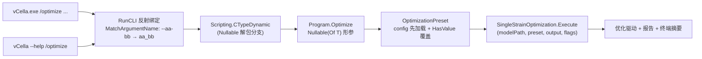

## 用户需求

为 `vCella` 命令行工具模块补齐参数文档，并让「Usage 里列出的每个选项」都成为真实的 VB 函数参数。

## 产品概述

`vCella/Program.vb` 现有 6 个命令（`/compile`、`/run`、`/context`、`/export`、`/optimize`、`/optimize-consortium`）。当前状态：`/run` 有 19 个参数但仅 2 个有 `<param>`；`/context`、`/export`、`/compile` 完全没有参数文档；两个优化命令的 Usage 各列出 35~45 个选项，签名却只有 `model`/`output`/`args`，其余全部靠 `args` 隐式读取。这种「文档与签名不一致」使 `--help` 无法反映真实契约，也让参数成为隐式全局状态。

## 核心功能

### 1. 完整 XML 文档

- 每个命令补齐 `<summary>`、每个参数一个 `<param>`、以及 `<returns>`；
- 文档语言统一为**英文**；
- 目标：`GenerateDocumentationFile=True` 下不再产生「缺少 XML 注释」告警。

### 2. 参数即唯一真相源

- Usage 字符串中的每一个选项都对应一个 VB 形参，反之亦然，不存在「只写在 Usage 里」或「只在 args 里读」的选项；
- `/run`、`/context`、`/export` 删除 `Optional args As CommandLine` 与 `getOption` 补读块（绑定层已支持 `--aa-bb` → `aa_bb`）；
- `/optimize`、`/optimize-consortium` 把全部选项展开为可选参数。

### 3. 「未指定」语义保留

- 数值参数用 `Nullable(Of T)`（`Optional steps As Integer? = Nothing`），`Nothing` 表示未指定；
- 布尔开关为 `Boolean`，出现即生效；
- 文本参数用 `String`，`Nothing` 表示未指定；数值列表类选项（kcat 档位、稳健性因子）用逗号/分号分隔的 `String` 传入后在内部解析。

### 4. 与 JSON 预设叠加

- `--config=*.json` 仍是可选的一等配置源：先加载预设，再只用「用户显式给出的参数」覆盖；
- 未指定参数不得把 JSON 值冲掉；`--non-deterministic` 是把 `Deterministic` 置 False 的反向开关。

### 5. 底层框架获得 Nullable 绑定能力（可复用）

`Nullable(Of T)` 形参能否从命令行拿到值，取决于 `Microsoft.VisualBasic.Core` 的字符串转换层。若当前不支持，则**在 `Core.vbproj` 中补齐对 `Nullable(Of T)` 的转换支持**，使其对所有基于 `Microsoft.VisualBasic.CommandLine` 反射绑定的项目（以及直接调用 `CTypeDynamic` 的代码）自动生效，而不是在 `vCella` 里做局部妥协。

### 6. 可验证性

- 6 个命令逐个执行 `vCella --help /<cmd>`，退出码 0 且打印对应 Usage；
- 用 `vCella /optimize --model=... --steps 2 --budget 3` 实测证明 Nullable 参数确实被绑定（而不是静默取默认值）；
- Usage 与形参集合做集合比对，必须完全相等。

## 交互效果

纯命令行：`vCella --help /optimize` 输出的 Usage 与函数签名严格一致；参数缺失时由绑定层抛出既有的 `MissingMemberException`，而不是悄悄用默认值运行。运行时行为、输出排版、报告落盘均保持不变。

## 技术栈

沿用现有技术栈，不引入新依赖：

- 语言/框架：VB.NET，`net10.0`
- 宿主项目：`vCella.vbproj`（`OutputType=Exe`，`RootNamespace=vCella`，`GenerateDocumentationFile=True`）
- 底层框架：`runtime/sciBASIC#/Microsoft.VisualBasic.Core/src/Core.vbproj`（`Microsoft.VisualBasic.CommandLine` 与 `Scripting.CTypeDynamic` 的宿主）
- 命令行框架：`Microsoft.VisualBasic.CommandLine`（`RunCLI` + `<ExportAPI>` / `<Usage>`）
- 配置序列化：`System.Text.Json`（`OptimizationPreset` / `ConsortiumPreset` 已有）
- 流程实现：`vCella/Optimization/` 下的 `SingleStrainOptimization`、`ConsortiumOptimization`、`OptimizationPreset`、`OptimizationCommandLine`

## Implementation Approach

**核心策略：把「隐式 args 契约」改为「显式签名契约」；Nullable 绑定若不受支持，就在框架层补齐能力而不是降级类型。**

1. **绑定规则已确认可用**：`Delegate.MatchArgumentName`（`Microsoft.VisualBasic.Core/src/CommandLine/Reflection/EntryPoints/Delegate.vb:227-246`）会把 `--no-passive` 归一为 `no_passive` 后与形参名匹配，因此 `/run`、`/context`、`/export` 的补读块是纯历史包袱，删除不改行为。

2. **值转换是唯一风险点**：`Delegate.Execute` 用 `Scripting.CTypeDynamic(val_str, 参数类型)` 转换（`Delegate.vb:209-214` → `Scripting/InputHandler.vb:197-232`）。该函数先查 `_CasterString`（只登记原始类型），未命中再 `Conversion.CTypeDynamic`，而 `Nullable(Of T)` 不在该表内；`IsNullablePrimitive`（`InputHandler.vb:278-287`）虽然**已存在**，但 CLI 绑定路径**从未调用**。若 `Conversion.CTypeDynamic` 也不支持 Nullable，绑定会静默返回 `Nothing`（不报错、选项无效）。

3. **验证门口径**：`vCella /optimize --model=Z:\nonexistent --steps 2 --budget 3`。单菌流程在加载模型**之前**就会打印 `grid : steps=..., dt=..., budget=...`，因此模型不存在也能立刻读到绑定结果，探针成本近乎为零（秒级）。

4. **探针失败 → 改框架，不改 vCella**：在 `Core.vbproj` 的 `Scripting/InputHandler.vb` 中让 `CTypeDynamic(expression$, target As Type)` 识别 `Nullable(Of T)` 并解包到基础类型后走原有 caster：

```
Public Function CTypeDynamic(expression$, target As Type) As Object
If target Is GetType(String) Then Return expression
ElseIf expression.StringEmpty OrElse expression.ToLower = "null" Then Return Nothing
End If

' Nullable(Of T) support: the CLI reflection binder passes the declared
' parameter type directly, so unwrap to the underlying primitive and let
' the regular caster handle it. A boxed T is accepted by MethodBase.Invoke
' for a T? parameter, so no further adaptation is required.
If IsNullablePrimitive(target) Then
target = target.GenericTypeArguments.First()
End If
...
```

要点：

- 只新增一个分支，非 Nullable 调用路径逐位不变，零回归；
- 复用已有的 `IsNullablePrimitive` + `CasterString` 注册表，`Integer?`/`Double?`/`Boolean?`/`Long?` 等自动全部可用；
- 位置必须在 `StringEmpty`/`"null"` 判断之后、`_CasterString` 查找之前，这样「显式传空值」仍然映射为 `Nothing`（= 未指定）；
- 反射 `MethodBase.Invoke` 允许用装箱的 `T` 填充 `T?` 形参，故 `Delegate.Execute` 无需改动；
- `CTypeDynamic(Of T)` 委托到该重载，因此泛型路径一并获得能力。

5. **能力复用性**：补丁落在 `Microsoft.VisualBasic.Core`，任何使用 `RunCLI` 反射绑定、或直接调用 `CTypeDynamic` 的项目都会自动受益，无需各自写解析。

6. **叠加顺序**：`preset = Load(config) ?? New` → 逐个 `If x.HasValue Then preset.X = x.Value`。这套写法天然满足「显式才覆盖」，不依赖 `args` 做存在性判断。

7. **流程层只加不改**：新增 `Execute(modelPath, preset, output, selfCheck, report, verbose)` 与群落对应重载；现有 `Execute(..., Optional cli As OptimizationCommandLine)` 保留并委托，`CellaOptimization.Test` 的调用路径不受影响。

8. **`--pool` 语义上移**：群落「默认共享培养基」由命令行层写入 `preset.TargetPool = "shared"`，流程层不再推断 `poolExplicit`，减少一个隐式状态。

性能：改造只发生在参数绑定与配置装配，运行期零额外开销；文档注释不进入运行时代码路径；框架补丁只在 `Nullable` 目标类型上多一次 `IsGenericType` 判断。

## Implementation Notes

- **执行顺序（有依赖，不能颠倒）**：补文档（`/compile`~/`export`）→ 展开 `/optimize` 形参 → **Nullable 探针**（失败则改 Core 并重测）→ 展开 `/optimize-consortium` → 总验收。探针必须排在 `/optimize` 展开之后，因为探针需要 `steps`/`budget` 已经是形参。

- **不要用「值等于默认值」判断是否显式给出**：`Nullable` 的 `HasValue` 是唯一可靠信号；布尔开关用「为 True 才写回」。

- **数组类选项统一解析函数**：把 `OptimizationCommandLine.Doubles(name, fallback)` 的解析逻辑抽成 `Public Shared Function ParseDoubles(text As String) As Double()`，实例方法改为调用它，避免两套解析规则漂移。

- **枚举文本不要提前转换**：`preset.TargetPool / Metric / SurrogateMode / Objective` 存的是字符串，命令行只需原样写回；`TargetPoolOf` 等只在流程装配 `CommunityConfig/OptimizationConfig` 时使用。

- **必填参数保持必填**：`data`、`model`、`models`、`input` 不加默认值，缺失时仍由绑定层抛 `MissingMemberException`，与现状一致。

- **删除 `getOption(Of T)` 前确认零引用**：三处补读删除后该私有辅助应无引用，必须一并移除，避免留下死代码与「两套绑定路径」。

- **文档注释不要写实现细节**：`<param>` 说明「该选项控制什么、取值格式、默认值来源（内置默认/JSON 预设）」，与 Usage 措辞一致。

- **框架补丁的回归口径**：改 `Core.vbproj` 后必须验证「非 Nullable 路径不变」——`/run`、`/context`、`/export` 的行为与改造前一致，且 `--help` 六个命令全部正常（这些命令大量使用 `String`/`Integer`/`Boolean` 转换，是天然的回归样本）。

- **爆炸半径**：`vCella/Program.vb`、`vCella/Optimization/{SingleStrainOptimization,ConsortiumOptimization,OptimizationCommandLine}.vb`，以及（仅在探针失败时）`Microsoft.VisualBasic.Core/src/Scripting/InputHandler.vb`。`CellaOptimization` 库、`CellaOptimization.Test` 不改。

- **Usage 与签名一致性校验**：改造后用脚本/正则把每个 `<Usage>` 里的 `--xxx` 与函数形参（`_`→`-`）做集合比对，必须完全相等（既防遗漏也防多余）。

## Architecture Design



数据流：`CommandLine` → 反射绑定到形参 →（`Nullable(Of T)` 目标类型由框架层解包转换）→ 形参（`Nothing` = 未指定）覆盖预设 → 预设驱动既有流程。`--help` 走同一条绑定路径的 `Help(cmd)` 分支，只输出 `<Usage>`，不执行命令。

## Directory Structure

```
runtime/sciBASIC#/Microsoft.VisualBasic.Core/src/
└── Scripting/InputHandler.vb                    # [MODIFY，仅探针失败时] CTypeDynamic(String, Type)
                                                 #   增加 Nullable(Of T) 解包分支（复用 IsNullablePrimitive）

engine/vCella/
├── Program.vb                                   # [MODIFY] 六个命令：补全英文 XML 注释、全部选项提升为形参、
│                                                #          删除 args 与 getOption 补读、删除私有 getOption
└── Optimization/
    ├── SingleStrainOptimization.vb              # [MODIFY] 新增 Execute(modelPath, preset, output, selfCheck, report, verbose)；
    │                                            #          旧 cli 重载保留并委托
    ├── ConsortiumOptimization.vb                # [MODIFY] 同上；群落 pool 默认值由调用方写入 preset
    └── OptimizationCommandLine.vb               # [MODIFY] 抽出 Public Shared ParseDoubles(text)；Doubles 改为调用它
```

## Key Code Structures

```
' Program.vb —— 以 /optimize 为例的签名形状（节选，实际 43 个参数）
''' <summary>
''' Optimize the metabolic network of a single-strain culture.
''' </summary>
''' <param name="model">Model xml path; a directory or wildcard is also accepted (the first match is used).</param>
''' <param name="output">Output directory; defaults to <c>&lt;model&gt;.optimize</c> next to the model file.</param>
''' <param name="config">Optional JSON preset; explicitly supplied options override the preset values.</param>
''' <param name="steps">Simulation steps; unspecified keeps the preset value (default 100).</param>
''' <param name="budget">Evaluation budget; unspecified keeps the preset value (default 5000).</param>
''' <param name="kcat_levels">Comma separated kcat scales, e.g. <c>0.25,0.5,2,4</c>.</param>
Public Function Optimize(model As String,
                         Optional output As String = Nothing,
                         Optional config As String = Nothing,
                         Optional steps As Integer? = Nothing,
                         Optional budget As Integer? = Nothing,
                         Optional kcat_levels As String = Nothing,
                         Optional require_trained As Boolean = False,
                         Optional self_check As Boolean = False,
                         Optional report As Boolean = False,
                         Optional verbose As Boolean = False) As Integer

' 预设覆盖（Program 内部）
Dim preset = If(config.StringEmpty, New OptimizationPreset(), OptimizationPreset.Load(config))
If steps.HasValue Then preset.Steps = steps.Value
If budget.HasValue Then preset.EvaluationBudget = budget.Value
If Not kcat_levels.StringEmpty Then preset.KcatLevels = OptimizationCommandLine.ParseDoubles(kcat_levels)

' 流程层新增重载（单菌；群落同构）
Public Function Execute(modelPath As String, preset As OptimizationPreset, output As String,
                        selfCheck As Boolean, report As Boolean, verbose As Boolean) As SingleStrainOutcome
```

```
' Microsoft.VisualBasic.Core/src/Scripting/InputHandler.vb（仅探针失败时新增）
Public Function CTypeDynamic(expression$, target As Type) As Object
    If target Is GetType(String) Then Return expression
    ElseIf expression.StringEmpty OrElse expression.ToLower = "null" Then Return Nothing
    End If

    ' Nullable(Of T) support: the CLI reflection binder passes the declared
    ' parameter type directly, so unwrap to the underlying primitive and let
    ' the regular caster handle it.
    If IsNullablePrimitive(target) Then
        target = target.GenericTypeArguments.First()
    End If

    If _CasterString.ContainsKey(target) Then
        Dim caster As LoadObject = _CasterString(target)
        Return caster(expression$)
    End If
    ' ... 其余逻辑不变
```

## Agent Extensions

### SubAgent

- **code-explorer**
- Purpose: 在删除 `/run`、`/context`、`/export` 的 `args` 形参与补读块、并改造两个优化命令的签名之前，穷举这些符号的全部引用点（`getOption`、`OptimizationCommandLine.Doubles/ApplySingle/ApplyConsortium`、`SingleStrainOptimization.Execute|Run`、`ConsortiumOptimization.Execute|Run`），确认没有遗漏的调用方（尤其 `CellaOptimization/test/Program.vb`）。另外确认 `IsNullablePrimitive` 与 `CasterString` 在 `Core` 内的可见性，以及是否有其它模块依赖 `CTypeDynamic` 当前的 Nullable 行为。
- Expected outcome: 一份「文件 + 行号 + 调用形式」的清单，明确指出哪些重载必须保留、哪些成员可以安全删除，保证改造后三个工程一次性编译通过且测试工程调用路径不断。