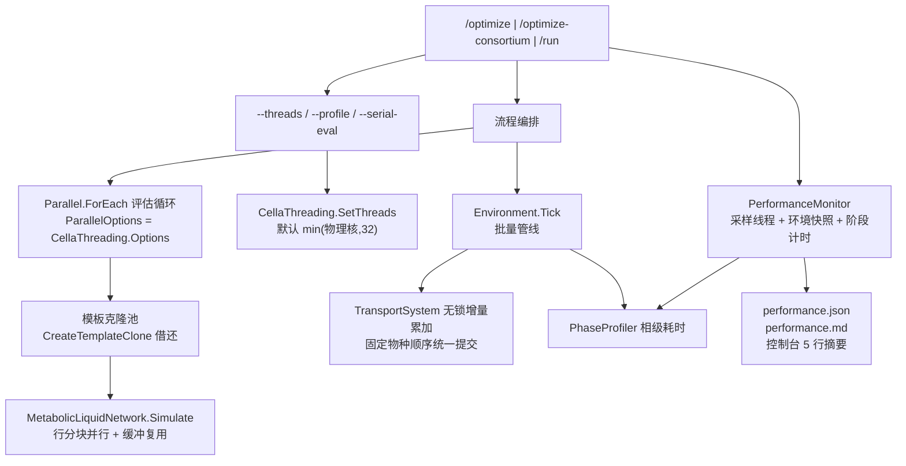

## 用户需求

基于生产服务器（Ubuntu 24.04 + .NET 10.0.11，AMD EPYC 7542 ×2 = 64 物理核 / 128 逻辑核，2 NUMA 节点，无 GPU、无 MKL）的实测硬件画像，解决 `vCella` 三个计算命令**资源利用率低**的问题，并为其加装**可回传的性能采集**能力。

### 核心诉求

1. **性能采集**：为 `/optimize`、`/optimize-consortium`、`/run` 增加覆盖整个计算过程的性能数据采集代码，并生成可阅读的性能报告文件；默认开启、开销低于 1%，`--no-profile` 可关闭。
2. **性能优化**：基于服务器硬件（16–32 线程为效率甜点区：16T 74.5% / 32T 58.3% / 64T 42.5% / 128T 27.6%）提升多核利用率，而不是盲目堆线程。允许改到 `Cella` 引擎核心。
3. **确定性取舍**：接受"评估内部也并行"带来的浮点累加顺序变化，候选不再逐位可比；需在文档与报告中显式声明数值漂移范围。
4. **Linux 配套**：生产机是 Ubuntu，现有 demo 只有 `run.cmd`，需补 `run.sh` 与 NUMA / 线程 / GC 环境变量建议。
5. **报告自解释**：用户会把 `performance.json` 回传做下一轮调优，因此报告必须包含环境快照、完整命令行实参、阶段耗时、CPU 利用率分布、有效并行度、GC/内存、逐评估直方图、线程预算实际取值。

### 已定位的根因（利用率低的直接证据）

- 整个 `CellaOptimization` 项目**零 `Parallel.*`**：扫描、Beam、进化、复核、稳健性全是串行 `For Each`，每次评估就是一个单线程 `MetabolicLiquidNetwork.Simulate`。
- `SurrogateEvaluator` 用 `SyncLock _sync` 把共享模板的 `Template.Simulate` 整段串行化，评估之间无法并发；`WildTypeContext.CreateTemplateClone` 已存在但从未被使用。
- `CommunityOptimizationDriver.Run` 在 `Deterministic=True`（默认）时直接 `CellaThreading.SetThreads(1)`，导致 `/optimize-consortium` 默认真空跑单核。
- `/optimize` 与 `/optimize-consortium` **没有 `--threads` 参数**（仅 `/run` 有），命令行无法调节并行度。
- 群落 3 个 22 MB GEM 的加载是串行；`TransportSystem` 用 `SyncLock spot.SyncRoot` 包住整步培养基读写，跨物种并行时锁竞争严重。
- `vCella.runtimeconfig.json` 已含 `System.GC.Server=true`，但需在运行期自证（打印 `GCSettings.IsServerGC`）。

### 预期效果

- 三命令跑完后在 `--output` 目录产出 `performance.json` + `performance.md`，控制台末尾打印 5 行摘要。
- 本机（24 逻辑核）对照：单菌 demo（steps 3 / budget 6）由 14:04 降到 ≤5 分钟；群落 demo（3 物种 / steps 2 / budget 4 / open）由 16:40 降到 ≤6 分钟；平均 CPU 利用率从约 1 核提升到 ≥8 核。
- 单菌最优方案与改造前逐位一致（回归基线）；群落数值差异量化后写入报告。

## Tech Stack Selection

沿用现有技术栈，不引入新依赖：

- 语言/运行时：VB.NET，`net10.0`（生产机 .NET 10.0.11 / Ubuntu 24.04）
- 宿主项目：`vCella.vbproj`（`OutputType=Exe`，`RootNamespace=vCella`，已开 `ServerGarbageCollection`/`TieredPGO`）
- 计算引擎：`Cella.vbproj`（虚拟细胞、`Environment`、`CellBatchRunner`、`TransportSystem`）、`sub-system/Metaboliq`（`MetabolicLiquidNetwork`）
- 优化引擎：`CellaOptimization.vbproj`（五阶段搜索、评估服务、报告）
- 并行原语：`System.Threading.Tasks.Parallel` + `CellaThreading.Options`（`MaxDegreeOfParallelism = ProcessorCount/2`，可用 `CELLA_THREADS` 覆盖）
- 采集设施：复用 `Cella/Environment/PhaseProfiler.vb`（线程安全分段墙钟累加器，已被 `Environment`/`CellBatchRunner` 持有）
- 序列化：`System.Text.Json`
- 运行期指标：`Process.TotalProcessorTime`、`GC.GetTotalPauseDuration`、`GC.GetTotalAllocatedBytes`、`GCSettings`、`ThreadPool`

## Implementation Approach

**总策略：先建"测量"，再做"并行"，最后用同一份测量做前后对比。** 测量代码是交付物的一部分，因此必须与优化同步落地，且默认开启。

四层改造，按收益排序：

1. **编排层解耦（最大收益，改动最小）**
`Deterministic` 的语义从"整轮单线程"收窄为"关闭生命周期/运动 + 固定 seed + 固定物种遍历顺序"，不再调用 `SetThreads(1)`。新增 `--serial-eval` 保留旧的单线程行为以支持严格复现。这样群落优化立刻从 1 核变成"评估间并行"。

2. **评估循环并行（核心技术改造）**
`ScanStage`/`GreedyBeamStage`/`EvolutionStage`/`RobustnessStage`/`WholeCellEvaluator` 的 TopN 全部改为 `Parallel.ForEach(..., CellaThreading.Options, ...)`。前置三件事：

- `SurrogateEvaluator` 的 `SyncLock` 换成**模板克隆池**：每个 worker 独占一个 `CreateTemplateClone()`（该方法已存在、带独立隐藏状态），用 `ConcurrentBag` 借还；
- `EvaluationService` 的预算计数改 `Interlocked.Increment`，结果集合换并发容器；
- `EvaluationCache` 现有细粒度锁保留，但确认锁内不做重活。
单菌侧并行只发生在**评估之间**，因此结果应保持逐位一致，可作为回归断言。

3. **引擎热路径（用户已授权）**

- `TransportSystem.tickCore`：把"整步持有 `spot.SyncRoot`"改为"每细胞在自己的缓冲累计摄入/分泌增量 → 按固定物种顺序单线程一次性提交到 `Spot.Medium`"，消除跨物种锁竞争；
- `CellBatchRunner` 分组键从"物种"细化为"物种 × 细胞块"，让同物种 60 个细胞也能并行到多核；
- `MetabolicLiquidNetwork.Simulate`：反应数（14386）足够大时，把每步矩阵-向量乘按行分块并行；同时复用 Tensor 缓冲降低每 tick 分配（诊断显示 GC 暂停占 3.25%）。

4. **I/O 与加载**
群落 3 个 GEM 改为 `Parallel.ForEach` 加载；`/run` 核对 `SnapshotArchive` 并行写帧与 zip 压缩是否重复做功。

**线程预算取值**：默认 `min(物理核数, 32)`（服务器上 32），因为 32T 效率 58.3% 而 128T 只有 27.6%；`--threads` 暴露给两个优化命令，`CELLA_THREADS` 仍可覆盖。

**性能与开销**：采样线程 1 s 一次（`TotalProcessorTime` 增量、工作集、线程池计数），阶段计时是一次字典加法，逐评估只保留聚合直方图（不逐条存），总开销目标 <1%。

**避免技术债**：不新造计时轮子（复用 `PhaseProfiler`）；不改变现有报告 schema（性能文件独立命名）；`--serial-eval` 与 `--no-profile` 保证可回退。

## Implementation Notes

- **单菌零回归**：并行只在评估之间，`CreateTemplateClone` 保证每次评估拿到独立隐藏状态；`Seed` 不变时结果应逐位一致，验证脚本要比对 `best_design.json` 的 `TargetValue` 与 `FoldChange`。
- **群落允许漂移**：`TransportSystem` 改为"增量后统一提交"会改变浮点累加顺序，`performance.md` 必须打印"本次运行 Deterministic / 并行度 / 漂移声明"，并在文档给出"要逐位复现请加 `--serial-eval`"。
- **线程数不要超过物理核**：`CellaThreading.Cores` 的默认值 `ProcessorCount/2` 在 128 逻辑核机器上正好是 64，但实测 32 线程效率更高；建议 `--threads 32`，并在 `run.sh` 里给三种预设（保守 16 / 均衡 32 / 极限 64）。
- **NUMA 局部性**：2 个 NUMA 节点，模型与 Tensor 都很小（进程工作集 106 MB），跨节点访问影响有限，但 `run.sh` 仍提供 `numactl --localalloc --cpunodebind=0` 可选分支，并在报告中记录是否绑定。
- **GC 自证**：`performance.json` 记录 `GCSettings.IsServerGC`、`GCSettings.LatencyMode`、`AppContext` 中的 `System.GC.*`，避免再次出现"诊断工具说 Server GC 关闭"的误判。
- **失败可见**：采集器内部任何异常都必须吞掉并写入 `performance.json` 的 `Warnings`，绝不能让诊断代码影响主计算。
- **爆炸半径**：`vCella/Program.vb`（新增参数与接线）、`vCella/src/Diagnostics/`（新增）、`vCella/src/Optimization/*`（阶段计时）、`CellaOptimization/Search/*` 与 `Evaluation/*`（并行化）、`Cella/Environment/{TransportSystem,CellBatchRunner}.vb` 与 `Metaboliq/MetabolicLiquidNetwork.vb`（热路径）。`CellaOptimization.Test` 只做回归验证，不改逻辑。
- **编译门禁**：`Cella`、`CellaOptimization`、`vCella`、`CellaOptimization.Test` 四个工程必须 0 error；改动 `Cella` 后需连带验证 `CellaLoader`（其 bench 也引用 `PhaseProfiler`/`CellaThreading`）。

## Architecture Design



数据流：命令入口创建 `PerformanceMonitor` → 各阶段用 `PhaseProfiler.Measure` 包裹 → 评估循环上报逐次耗时（聚合为直方图）→ `Environment.Profile`/`CellBatchRunner.Profile` 在阶段结束时快照合并 → 结束写出 JSON/Markdown 并打印摘要。

## Directory Structure

```
engine/
├── vCella/
│   ├── Program.vb                                   # [MODIFY] /optimize 与 /optimize-consortium 新增
│   │                                               #   --threads / --no-profile / --profile-detail / --serial-eval，
│   │                                               #   三个命令统一接线 PerformanceMonitor
│   ├── run.sh                                       # [NEW] Linux 启动脚本：DOTNET_gcServer、CELLA_THREADS、
│   │                                               #   numactl 可选分支、dotnet vCella.dll 调用与自检
│   └── src/
│       ├── Diagnostics/
│       │   ├── PerformanceMonitor.vb                # [NEW] 采样线程、环境快照、阶段表、直方图、
│       │   │                                       #   GC/内存/线程池指标、汇总计算
│       │   └── PerformanceReport.vb                 # [NEW] performance.json 模型 + performance.md 渲染
│       │                                           #   + 控制台摘要（含漂移声明与线程预算实值）
│       ├── Simulation.vb                            # [MODIFY] /run 接线采集：模型加载、建空间、播种、
│       │                                           #   逐 tick、快照写盘、zip 压缩分阶段计时
│       └── Optimization/
│           ├── SingleStrainOptimization.vb          # [MODIFY] 四个阶段接入计时 + 结束落盘性能报告
│           ├── ConsortiumOptimization.vb            # [MODIFY] 五个阶段接入计时 + 模型并行加载 + 落盘
│           ├── OptimizationCommandLine.vb           # [MODIFY] 新增 --threads/--no-profile/--profile-detail
│           │                                       #   /--serial-eval 的解析
│           └── OptimizationPreset.vb                # [MODIFY] 新增 Threads/ProfileEnabled/ProfileDetail/
│                                                   #   SerialEvaluation 字段（不影响既有 JSON 兼容）
├── CellaOptimization/
│   ├── Evaluation/SurrogateEvaluator.vb             # [MODIFY] SyncLock 模板 -> 克隆池（借用/归还）
│   ├── Evaluation/EvaluationService.vb              # [MODIFY] 预算计数 Interlocked、结果集合并发安全
│   ├── Evaluation/WholeCellEvaluator.vb             # [MODIFY] TopN 复核并行 + 逐次耗时上报
│   ├── Evaluation/CommunitySurrogateEvaluator.vb    # [MODIFY] 同上（群落版）
│   ├── Evaluation/CommunityWholeCellEvaluator.vb    # [MODIFY] 同上
│   ├── Search/ScanStage.vb                          # [MODIFY] 候选并行评估
│   ├── Search/GreedyBeamStage.vb                    # [MODIFY] 前沿扩展并行
│   ├── Search/EvolutionStage.vb                     # [MODIFY] 种群评估并行（保留确定性选择顺序）
│   ├── Search/RobustnessStage.vb                    # [MODIFY] 扰动条件并行
│   ├── Search/Community{Scan,Beam,Evolution,Robustness}Stage.vb
│   │                                                # [MODIFY] 群落版同构并行化
│   └── Search/CommunityOptimizationDriver.vb        # [MODIFY] 去掉 SetThreads(1)；
│                                                   #   Deterministic 仅控制生命周期/运动/种子/物种顺序
└── Cella/
    ├── Environment/TransportSystem.vb                # [MODIFY] 细胞级增量缓冲 + 固定顺序统一提交，
    │                                                #   去掉整步 SyncLock spot.SyncRoot
    ├── Environment/CellBatchRunner.vb                # [MODIFY] 分组键细化为 物种 x 细胞块，提升同物种并行度
    └── sub-system 对应位置（Metaboliq）
        └── MetabolicLiquidNetwork.vb                # [MODIFY] Simulate 每步矩阵-向量乘按行分块并行；
                                                     #   Tensor 缓冲复用，降低每 tick 分配
```

## Key Code Structures

```
' vCella/src/Diagnostics/PerformanceMonitor.vb
Public NotInheritable Class PerformanceMonitor
    Implements IDisposable

    ''' <summary>环境快照：核数、GC 模式、运行时、线程预算、NUMA/亲和、AppContext 开关</summary>
    Public ReadOnly Property Environment As PerformanceEnvironment

    ''' <summary>阶段计时（复用 Cella 的 PhaseProfiler 语义）</summary>
    Public Function BeginPhase(name As String) As PhaseScope   ' 支持 Using 语法，Dispose 时累加

    ''' <summary>上报一次评估耗时（毫秒）；内部只做直方图聚合，不逐条保存</summary>
    Public Sub RecordEvaluation(milliseconds As Double)

    ''' <summary>合并 Cella 相级耗时（Environment.Profile / CellBatchRunner.Profile）</summary>
    Public Sub MergeCellaPhases(profile As PhaseProfiler)

    ''' <summary>写 performance.json + performance.md，并打印 5 行控制台摘要</summary>
    Public Sub WriteReport(outputDirectory As String)

    Public Sub Dispose()   ' 停止采样线程、补最后一次采样
End Class

' vCella/src/Diagnostics/PerformanceReport.vb
Public Class PerformanceReport
    Public Property Schema As String = "vcella-performance/1.0"
    Public Property CommandLine As String
    Public Property Parameters As Dictionary(Of String, String)
    Public Property Environment As PerformanceEnvironment
    Public Property Totals As PerformanceTotals          ' wall/cpu/avgCpu%/peakCpu%/effectiveParallelism
    Public Property Phases As PerformancePhase()         ' name, ms, share, count, thread
    Public Property Evaluations As PerformanceHistogram  ' count, p50, p90, p99, max, throughput
    Public Property Memory As PerformanceMemory          ' workingSet, allocatedBytes, gcPauseRatio
    Public Property CpuTimeline As PerformanceSample()   ' 1s 采样点，供绘图
    Public Property Warnings As String()
End Class
```

```
' 并行评估的取用范式（所有 Stage 统一）
Dim options As New ParallelOptions With {.MaxDegreeOfParallelism = CellaThreading.Cores}

Call Parallel.ForEach(candidates, options,
    Sub(candidate)
        Dim evaluator = pool.Rent()          ' 独占克隆：独立隐藏状态
        Try
            Dim result = evaluator.Evaluate(candidate.Spec)
            service.Add(result)              ' 并发安全 + Interlocked 预算
        Finally
            pool.Return(evaluator)
        End Try
    End Sub)
```

## Agent Extensions

### SubAgent

- **code-explorer**
- Purpose: 在改 `TransportSystem`（去整步锁）、`CellBatchRunner`（分组键细化）、`MetabolicLiquidNetwork.Simulate`（行分块）与 `CellaOptimization` 各 Stage（并行化）之前，穷举这些符号的全部调用点与共享状态（`spot.SyncRoot`、`Template`/`CreateTemplateClone`、`EvaluationService` 预算与结果集合、`PhaseProfiler` 的持有者），并确认 `CellaLoader/bench` 等下游是否依赖当前的串行语义。
- Expected outcome: 一份「文件 + 行号 + 调用形式 + 是否线程安全」的清单，明确哪些改动是纯增量、哪些会改变浮点累加顺序，作为并行化改造与回归验证的依据。