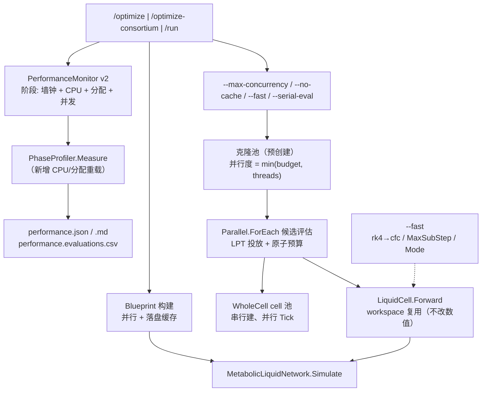

## 需求

基于 `Z:\perf` 四份生产实测数据，制定下一轮性能优化计划并落地，目标是把"单核排队"的时间真正换到多核上，同时把异常的内存/GC 开销压下去。

## 实测基线（四份报告已解析）

| run | 墙钟 | 有效并行度 | <2 核采样 | 峰值 RSS | 托管分配 | GC 暂停 |
| --- | --- | --- | --- | --- | --- | --- |
| 单菌 t16 | 29.70 min | 4.60 | 69.1% | 31.6 GB | 850.9 GB | 4.30% |
| 单菌 t32 | 29.93 min | 5.66 | 67.9% | 34.0 GB | 850.9 GB | 5.13% |
| 群落 t32 | 32.44 min | 3.10 | 80.5% | 73.0 GB | 890.7 GB | 2.81% |
| `/run` 3 物种 | 5.08 min | 1.16 | 98.3% | 33.2 GB | 116.4 GB | 1.60% |


三条结论：

- **线程预算无效**：16 与 32 线程耗时几乎相同（29.70 vs 29.93 min），瓶颈是串行段。
- **单菌 29.9 min 的构成**：`optimize.search` 占 97.2%；其中 6 次评估 981.6 s（55%，均值 163.6 s，串行）、WT 录制+基线+枚举约 590 s（33%，单核）、`GetMetabolicGraph` 49.8 s（2.8%）。
- **`/run` 完全被建蓝图吃掉**：`blueprint` 2.33 min（97.1%），`simulate.ticks` 只有 2.26 s；3 个物种的蓝图是串行构建的。

## 目标

1. 候选评估并行化（激进：并行度拉到预算上限）。
2. 压掉 850 GB 托管分配与 5% GC 暂停。
3. 蓝图落盘缓存 + 并行构建，消掉 `/run` 的 97%。
4. 提供 `--fast` 数值档位（默认关闭），用于量化"速度换精度"的边界。
5. 所有归因仍写进 `performance.json`（生产机只能用进程内采集）。

## 验收阈值

| 场景 | 当前 | 目标 |
| --- | --- | --- |
| `/optimize`（steps 3 / budget 6） | 29.9 min，par 5.66 | ≤ 8 min，par ≥ 12 |
| `/optimize-consortium`（3 物种 / budget 4 / open） | 32.4 min，par 3.10 | ≤ 10 min，par ≥ 8 |
| `/run`（3 物种 / 2 tick） | 5.08 min | 首次 ≤ 1.5 min；缓存命中 ≤ 0.6 min |
| 托管分配 | 850–890 GB | < 100 GB |
| GC 暂停占比 | 5.13% | < 1% |


## 技术栈

沿用现有工程，不引入新依赖：VB.NET / `net10.0`；`vCella`（CLI + 采集）、`CellaOptimization`（搜索/评估）、`Cella`（引擎/`PhaseProfiler`）、`LNN`（LTC 内核）、`CellaLoader`（蓝图构建）。构建 `dotnet build`，生产 `Release|x64`。

## 关键事实（已核实，决定方案取向）

- `CellaBlueprint` 默认 `MetabolicMode=LTC`、`MetabolicSolver="rk4"`、`TauMin=2.0`、`TauMax=60.0`、`MaxSubStep=1.0`（`Cella/State/CellaBlueprint.vb:71-82`）。
- `MetabolicLiquidNetwork.Simulate`（`sub-system/Metaboliq/MetabolicLiquidNetwork.vb:598`）每步只分配少量小张量并调用一次 `Liquid.Forward`；`StepInterval` 在 `dt=1.0`、`MaxSubStep=1.0` 时 `n=1`，**积分子步不是分配放大器**。
- `LiquidNeuralNetwork.Forward`（`LNN/LiquidNeuralNetwork.vb:237`）→ `_LiquidLayer.Forward(input, dt, SolverType)`（`LNN/LiquidLayer.vb:254`）→ 逐 `LiquidCell.Forward`；`LiquidCell` 的 rk4 会做 4 次右端求值并登记 `StepRecord`（`k1..k4/s1..s4`）。每步 54 s 与 47 GB 分配几乎全部落在这条链上。
- 上一轮已具备但未在生产验证的基础设施：`EvaluationService` 原子预算 + 结果加锁、`SurrogateEvaluator` 的 `CreateTemplateClone` 克隆池、群落 `SerialEvaluation` 开关。

## 实施策略

**先归因，再并行，最后才动数值。** 现有 `optimize.search` 是一个 97% 的黑盒，直接并行只是把未知的串行段换成未知的并行段；上一轮 8 线程试验未提速就是这个原因。因此：

1. **采集 v2（原生进程内）**：阶段仪表从"墙钟"升级为"墙钟 + 进程 CPU 时间 + 线程分配字节 + 观测并发度"，并把黑盒拆开：

- 单菌：`search.wt-record`、`search.baseline`、`search.enumerate`、`search.scan`、`search.beam`、`search.evolution`、`search.whole-cell`、`search.robustness`；
- 群落：`community.wt-record` 细分为 `wt-record.<species>`、`search.scan/…` 同上；
- `/run`：`blueprint` 拆为 `blueprint.model`、`blueprint.graph`、`blueprint.boundary`、`blueprint.pathway`；
- 逐评估明细默认写 `performance.evaluations.csv`（`spec_id, stage, ms, alloc_mb, species`），是定位"哪类候选慢"的直接证据。

分配量用 `GC.GetAllocatedBytesForCurrentThread` 前后差值（线程内累加后汇总），CPU 时间用 `Process.TotalProcessorTime` 增量。零侵入复用 `PhaseProfiler`，新增 `Measure(name, action)` 的重载同时记录三量。

2. **定位 LTC 分配热点**：拿到阶段级分配后，再用 `--profile-detail` 逐评估记录核对"每次 `Forward` 的分配量 ≈ ?"，产出「文件:行号 + 每次调用分配 + 是否可复用」清单。预期在 `LiquidCell.Forward`（rk4 的 4 个求值点、`WeightRecurrent`/`WeightInput` 乘、`StepRecord`）与 `LiquidLayer` 的 LayerNorm 临时张量。

3. **缓冲复用（不改数值）**：把每次调用都 `New Tensor` 的中间量改为成员 workspace（`k1..k4`、`xhat`、`result`、`Wh`、`Uu` 等），只在形状变化时重建；`Training=False` 时不登记 `StepRecord`。这条路径的规则是"运算顺序、算子、类型全部不变"，因此结果必须逐位一致（可直接用单菌 `best fold` 回归）。

4. **激进并行**：候选评估并行度 = `min(budget, threads)`；扫描/Beam/进化/稳健性全部并行；

- 克隆池预创建（并行度个）而不是评估中反复 `new`，避免上一轮"克隆初始化成本吃掉收益"；
- `WholeCellEvaluator` 的 `BuildCell` 会写蓝图模板引用 → 改为**串行预建 cell 池**，并行只做 `Tick`；
- `EvolutionStage` 的共享 `Random` 按代/按线程隔离（`Random(seed + threadId)`），保证可复现；
- 调度按"单次评估耗时降序"投放（LPT），减少尾部空转；
- 安全阀：`--max-concurrency` 默认 = budget；启动时按"单评估峰值 RSS × 并行度"预估，超过可用内存 70% 打印警告并给出降档建议（不强制阻断，尊重"激进"选择）。

5. **蓝图缓存 + 并行构建**：`/run` 的物种循环改并行；蓝图缓存落盘到 `<model>.vcella-blueprint-<hash>.bin`（或 `--cache-dir`），指纹 = 模型 SHA256 + 上下文映射指纹 + `deriveBoundary/passive/passivePermeability/MaxSubStep/MetabolicSolver/MetabolicMode` + 引擎版本；`--no-cache`、`--refresh-cache` 可关闭/强制重建。缓存只存**蓝图**（可序列化 DTO），不存运行期派生的 graph，命中后仍走 `GetMetabolicGraph`（49.8 s 那一步再单独优化或一并缓存）。

6. **`--fast` 档位（默认关闭）**：把"可量化偏差"的加速打包成一个开关——`MetabolicSolver: rk4 → cfc`（解析解，单步一次求值）、`MaxSubStep` 放大、`MetabolicMode` 切 CfC；报告里打印 `fast mode` 与偏差声明，并提供 `--fast-compare` 对同模型跑双份做偏差量化（成本高，仅用于标定）。

## 架构与数据流



## 目录结构与改动清单

```
engine/
├── vCella/
│   ├── Program.vb                          # [MODIFY] 新增 --max-concurrency / --no-cache /
│   │                                       #   --refresh-cache / --cache-dir / --fast / --fast-compare，
│   │                                       #   Usage 与 <param> 同步（维持三者一致口径）
│   └── src/
│       ├── Diagnostics/PerformanceMonitor.vb  # [MODIFY] 阶段级 CPU 时间 + 线程分配字节 + 并发度；
│       │                                      #   逐评估明细默认落盘
│       ├── Diagnostics/PerformanceReport.vb   # [MODIFY] 报告新增"分配 Top-N 阶段""并发度直方图"
│       ├── Simulation.vb                      # [MODIFY] 蓝图循环并行；blueprint 拆四段；
│       │                                      #   接入缓存（命中即跳过 Bootstrapping）
│       ├── Optimization/SingleStrainOptimization.vb
│       │                                      # [MODIFY] 拆分 search 子阶段；并行度与缓存参数透传
│       ├── Optimization/ConsortiumOptimization.vb
│       │                                      # [MODIFY] 同上 + 逐物种 wt-record 计时
│       └── Optimization/BlueprintCache.vb     # [NEW] 蓝图指纹、序列化 DTO、命中/失效、原子写盘
├── Cella/
│   ├── Environment/PhaseProfiler.vb        # [MODIFY] 新增 CPU/分配重载与 Snapshot 字段
│   └── Factory/CellaFactory.vb             # [MODIFY] BuildCell 去掉对蓝图模板引用的写操作
│                                           #   （或提供 BuildCellDetached），让 cell 池可并行
├── CellaOptimization/
│   ├── Search/ScanStage.vb                 # [MODIFY] 恢复并行（克隆池 + LPT）
│   ├── Search/GreedyBeamStage.vb           # [MODIFY] 前沿扩展并行
│   ├── Search/EvolutionStage.vb            # [MODIFY] 种群评估并行 + rng 隔离
│   ├── Search/RobustnessStage.vb           # [MODIFY] 扰动条件并行
│   ├── Search/OptimizationDriver.vb        # [MODIFY] whole-cell 走 cell 池并行
│   ├── Evaluation/SurrogateEvaluator.vb    # [MODIFY] 克隆池预创建 + 归还回收上限
│   └── Evaluation/CommunitySurrogateEvaluator.vb  # [MODIFY] 按物种克隆池（SpeciesContext.Template 不得并发）
└── runtime/sciBASIC#/Data_science/MachineLearning/LNN/
    ├── LiquidCell.vb                       # [MODIFY] rk4/heun 求值点与激活/门控中间量改为 workspace；
    │                                       #   Training=False 不登记 StepRecord
    └── LiquidLayer.vb                      # [MODIFY] LayerNorm 的 xhat/result 复用
```

## 关键接口

```
' PhaseProfiler v2：一次调用同时记三量
Public Sub Measure(name As String, action As Action)
Public Function Snapshot() As IReadOnlyList(Of PhaseStat)
'   PhaseStat: Name, Source, Milliseconds, CpuMilliseconds, AllocatedBytes, Count, MaxConcurrency

' 蓝图缓存
Public Class BlueprintCache
    Public Function TryLoad(modelPath As String, fingerprint As String,
                            ByRef blueprint As CellaBlueprint) As Boolean
    Public Sub Store(modelPath As String, fingerprint As String, blueprint As CellaBlueprint)
End Class
```

## 性能与可靠性

- 分配归因用线程本地差值累加，开销为每阶段两次 `GC.GetAllocatedBytesForCurrentThread`（纳秒级），并行下按线程汇总后相加，不引入锁竞争。
- 并行度收益上限受 Amdahl 约束：单菌串行部分（WT 录制 + 基线）约 33%，即便评估全并行，理论上限约 3 倍（30 → 10 min）；要达到 ≤8 min 必须同时压缩 `Forward` 的单次成本，这也是"缓冲复用"与"阶段拆分"必须同轮落地的原因。
- 激进并行后峰值 RSS 会从 34 GB 升到并行度 × 单评估增量；报告必须给出"并行度 × 峰值 RSS × eval 吞吐"三列，供后续定档。
- `--fast` 关闭时逐位一致：`--serial-eval` 单菌必须复现 `best fold 3.77E+05 / KC[6c9c5672…x2]`。

## 风险与应对

| 风险 | 应对 |
| --- | --- |
| 并行后内存放大到 150 GB+ | `--max-concurrency` 安全阀 + 启动内存预估警告；报告记录每档并行度实测 RSS |
| `BuildCell` 写蓝图模板引用导致数据竞争 | 改为串行预建 cell 池后再并行 `Tick`；或提供不写蓝图的 `BuildCellDetached` |
| `SpeciesContext.Template` 并发污染（群落） | 按物种克隆池，与单菌同构 |
| 缓冲复用改变数值 | 严格保持算子顺序，用单菌基线逐位回归；差异即回退 |
| 蓝图缓存命中后行为不一致 | 指纹覆盖所有影响蓝图的选项 + 引擎版本；提供 `--refresh-cache` 与命中日志 |
| 采集本身影响被测对象 | 阶段级只做差值累加；1 s 采样线程沿用；`--no-profile` 保持可关 |


## Agent Extensions

### SubAgent

- **code-explorer**
- Purpose: 在改 `LiquidCell.Forward`（rk4 求值点、`StepRecord`、权重矩阵乘）与 `LiquidLayer` 的 LayerNorm 之前，穷举这两个文件里所有的 `New Tensor` 分配点、循环层数、以及 `Training` 分支的实际走向，给出"行号 + 分配形状 + 每次调用次数 + 可否复用"的清单；同时确认 `CellaFactory.BuildCell` 对蓝图写入的具体字段（决定 cell 池能否并行）。
- Expected outcome: 一份可直接照着改的分配热点清单与蓝图写入点清单，避免在 39 KB 的 `LiquidCell.vb` 里靠猜定位缓冲复用位置。