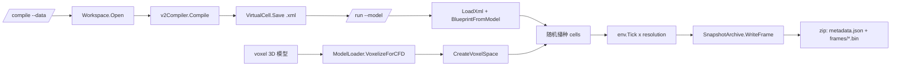

## 产品概述

为 `engine\vCella` 命令行程序补齐两个子命令：`/compile` 把 BioCyc 数据库编译成 GCMarkup 虚拟细胞 XML 模型；`/run` 加载该模型，在三维模型体素化得到的生长空间（或 1×1×1 单格点）中推进模拟，并把逐帧快照写入单个 zip 压缩包。

## 核心功能

- **`/compile`**
- 输入 `--data`（BioCyc 工作目录，如 `F:\ecoli\29.0`），输出 `--output`（XML 模型文件，默认 `<data>.vcella.xml`）。
- 复用现有 `v2Compiler` 完成全量编译（区室、证据、分类、代谢、调控等），保存为 GCMarkup_3.0 模型文件。
- 输出编译统计（基因/反应/化合物/调控数量）、耗时；`--verbose` 附加缺失数据文件清单。

- **`/run`**
- `--model` 加载模型；`-t` 为模拟总时长，`--resolution` 为 tick 数，时间步 `dt = t / resolution`，共执行 `resolution` 步。
- `voxel` 为可选三维模型路径（stl/obj/3mf 等）；为空时创建 1×1×1 单格点空间，仅运行一个细胞。
- 提供 `--voxel-resolution`（最长边体素数，默认 128）控制空间离散精度。
- 播种：`--cells`（默认 1）个细胞随机放入有效格点（体素内部为有效空间）。
- 逐帧导出到 zip：顶层 `metadata.json`（空间维度、时间轴、细胞/通路注释）+ `frames/frame_N.bin`（二进制帧）。
- 默认每帧包含完整胞内状态（rna/protein/metabolite），`--no-state` 可关闭以控制体积。
- 同目录输出 `population.csv`（时间、总数、存活数、占用格点、物种分布），控制台输出每步耗时与归档大小。
- 运行前按 `细胞数 × 步数 × 单细胞状态` 估算磁盘占用并提示；有效格点为 0 或空间规模过大时给出明确错误/警告。

- **视觉与交互效果**：控制台工具，输出结构化的阶段日志（编译统计、空间构建摘要、每步进度与 ETA、最终产物路径与体积）。

## 技术选型

- 语言/运行时：VB.NET，`net10.0`，沿用 `vCella.vbproj` 现有工程与 `Microsoft.VisualBasic.CommandLine` 的 `RunCLI` + `<ExportAPI>` 机制。
- 新增项目引用：`IO\BioCycCompiler\BioCycCompiler.vbproj`（`BioCyc.vbproj` 传递引用）。`Landscape.vbproj`、`Cella.vbproj`、`CellaLoader.vbproj`、`GCMarkupXML.NET5.vbproj` 已在引用列表中。
- 体素化：`Microsoft.VisualBasic.Imaging.Landscape.Data.ModelLoader.VoxelizeForCFD(path, resolution)` → `Voxelization.VoxelModel`。
- 快照：`SNAPSHOT.SnapshotArchive`（`metadata.json` + `frames/frame_N.bin`，`flags` bit0 表示是否含完整状态）。
- 测试记录：`Microsoft.VisualBasic.ApplicationServices.Debugging.DebugAudit`（Mark/Check/AreEqual/SaveReport）。

## 实现策略

1. **体素空间在 Cella 侧构建，不让 Cella 依赖 Landscape**：`SpaceInitializer` 内部的 `NewEnvironment` / `CreateSpot` 为 Private，因此在 `SpaceInitializer.vb` 新增公开工厂 `CreateVoxelSpace(shape, width, height, depth, medium, timeStep)`：`True` 处创建 `Spot`，`False` 处置 `Nothing`，并设置 `NormalizedRadius = -1`；`vCella` 只负责把 `VoxelModel` 转成 `Boolean()`。
2. **CLI 参数扩展走 `args` 而非签名**：`RunCLI` 按方法签名绑定参数，新增开关（`--cells`、`--voxel-resolution`、`--no-state`、`--seed`、`--medium`、`--verbose`、`--report`）统一在方法体内解析 `CommandLine`，保持 `/run`、`/compile` 既有签名不变。
3. **逻辑分层**：`Program.vb` 仅做参数解析与调用；新增 `vCella\Compilation.vb`（编译）与 `vCella\Simulation.vb`（模型加载→蓝图→空间→播种→推进→归档→元数据/CSV），避免巨型方法，便于单元验证与后续复用。
4. **空体素判定**：`VoxelModel` 只标记实体内部；若 `shape` 中 `True` 数量为 0（非封闭外壳模型），直接报错退出，避免"空空间 + 0 个格点"的静默失败。
5. **规模与体积控制**：体素空间维数 = 包围盒 / 体素尺寸，`512³` 即 1.3 亿格点，`Environment.Space` 为 `Spot()()()` 交错数组；在 `--voxel-resolution` 超过阈值（如 256）时打印内存警告；完整状态归档按 `cells × resolution × ~150KB` 估算并在启动前比对可用磁盘。

## 关键实现细节

- `/compile`：
- `Workspace.Open(data)` → `checkValid()`（失败返回非 0 并打印缺失的主数据文件）
- `Dim model = New v2Compiler(workspace).Compile()`；`model.Save(output)`；打印 `VirtualCell.Summary(model)`
- 输出目录不存在时创建；`Save` 失败或模型为空时返回非 0
- `/run`：
- `LoadXml(Of VirtualCell)(model)` → `Bootstrapping.BlueprintFromModel(model)`
- 空间：`voxel.StringEmpty` → `CreateCuboidSpace(1,1,1, medium, dt)`；否则 `ModelLoader.VoxelizeForCFD(voxel, voxelResolution)` → `CreateVoxelSpace(...)`
- 介质：默认 `glc=10, o2=1`；`--medium "glc=10;o2=1"` 覆盖，`SpaceInitializer.CreateMedium` 构造模板并写入 `env.MediumTemplate`
- 播种：缓存 `env.GetAllSpots()` 结果；随机抽取；`CellaFactory.BuildCell(blueprint, model.taxonomy)` + `BindToSpot`
- 推进：`For i = 1 To resolution: env.Tick(dt); archive.WriteFrame(env, i, env.CurrentTime)`；累加 `times`
- 元数据：`SnapshotWriter.BuildMetadata(env, blueprint, times, W, H, D, cellMetadata, pathwayTable)`（`cellMetadata`/`pathwayTable` 由模型侧构建，逻辑参考 `CellaLoader\test\Program.vb`）
- 收尾：`WriteMetadata` → `Close()` → 写 `population.csv`（`Report.SaveTable`）→ 若 `--report` 写 `audit_report.txt/json`

## 架构设计



## 目录结构

```
engine/
├── vCella/
│   ├── Program.vb                # [MODIFY] 实现 /compile 与 /run 入口，解析扩展参数并调用下层模块
│   ├── Compilation.vb            # [NEW] BioCyc → VirtualCell → XML：工作区校验、编译、保存、统计输出
│   ├── Simulation.vb             # [NEW] 模型加载、蓝图构建、体素/立方空间构建、随机播种、逐步推进、快照归档、metadata/population.csv
│   └── vCella.vbproj             # [MODIFY] 新增 ProjectReference: ../../IO/BioCycCompiler/BioCycCompiler.vbproj
└── Cella/
    └── Environment/
        └── SpaceInitializer.vb   # [MODIFY] 新增 CreateVoxelSpace(shape, width, height, depth, medium, timeStep) 公开工厂
```

## 关键代码结构

```
' engine\Cella\Environment\SpaceInitializer.vb
Public Function CreateVoxelSpace(shape As Boolean(), width As Integer, height As Integer, depth As Integer,
                                 Optional medium As Dictionary(Of String, Double) = Nothing,
                                 Optional timeStep As Double = 1.0) As Environment

' engine\vCella\Compilation.vb
Friend Module Compilation
    Function CompileDatabase(data As String, output As String, Optional verbose As Boolean = False) As Integer
End Module

' engine\vCella\Simulation.vb
Friend Module Simulation
    Function RunModel(modelFile As String, Optional voxel As String = Nothing, Optional output As String = Nothing,
                      Optional totalTime As Double = 60, Optional resolution As Integer = 1000,
                      Optional cells As Integer = 1, Optional voxelResolution As Integer = 128,
                      Optional includeState As Boolean = True, Optional seed As Integer = 2024,
                      Optional mediumText As String = Nothing, Optional writeReport As Boolean = False) As Integer
End Module
```

### SubAgent

- **code-explorer**
- 用途：在实现前核对 `SpaceInitializer` 私有工厂 / `Environment` 初始化不变量、`SnapshotArchive`/`SnapshotWriter` 当前签名、`VoxelModel` 索引约定，并确认 `vCella.vbproj` 引用链（BioCycCompiler → BioCyc）与 `RunCLI` 参数绑定行为。
- 预期产出：精确到文件与行号的调用清单与索引约定，避免体素空间映射错位或命令行参数无法绑定。

### Skill

- **lsp-code-analysis**
- 用途：对 `SpaceInitializer.CreateVoxelSpace`、`SnapshotArchive.WriteFrame`、`ModelLoader.VoxelizeForCFD` 等符号做引用/调用层级分析，确认所有调用点与新签名一致，并评估对既有 `CellaLoader\test`、`bench` 工程的影响面。
- 预期产出：完整引用清单与受影响项目列表，保证改动不破坏既有模拟与基准程序。