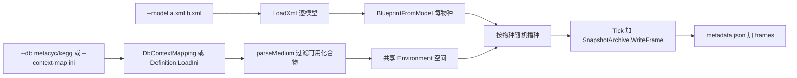

## 需求概述

在现有 vCella 命令行模拟程序基础上完成三项工作：让 `/run` 支持多物种细胞共同培养；审查并扩充上下文映射配置 `Definition`；基于该映射实现默认培养基的初始化。

## 核心功能

**一、多物种共培养（Program.vb 与 Simulation.vb）**

- `--model` 支持分号分隔的多个模型文件，例如 `--model "ecoli.xml;bsub.xml"`，每个模型对应一个物种
- `--cells` 支持统一值（`100`）或按物种对齐的列表（`100;50`）；数量不足时按有效格点与各自 `MaxCellsPerSpot` 自动收缩并告警
- 多个物种共享同一个生长空间与培养基，各物种独立蓝图与随机播种，天然支持交叉喂养
- 快照的物种计数、`population.csv`、最终摘要按物种分别统计

**二、上下文映射配置扩充（Definition.vb 与 DbContextMapping.vb）**

- 新增培养基配方实体：碳源、氮源、磷硫源、矿物离子、微量元素、维生素与辅因子、分泌废物
- 新增离子表、辅因子表、废物表，并扩展“无限来源”（水、氧、CO2、氨）
- 补全 MetaCyc、BioCyc、KEGG 三套数据库的编号映射与默认培养基浓度
- 修复 `Definition.LoadIni(Nothing)` 的空引用风险，`GenericEnumerator` 去重并覆盖新字段

**三、默认培养基初始化（parseMedium）**

- 未指定 `--medium` 时，按 `Definition` 中的培养基配方生成默认培养基，并仅保留模型中真实存在的化合物编号
- 指定 `--medium` 的 csv（两个字段：`compound`、`value`）时按文件覆盖，未知编号剔除并告警
- 过滤后为空时给出明确错误提示（数据库编号不匹配或需显式指定 csv）

## 效果

控制台输出结构化阶段日志：模型清单与物种名、空间摘要、每物种播种数、培养基成分与数量、每步进度、最终归档与统计表路径。

## 技术选型

- 语言与运行时：VB.NET、net10.0，沿用 `engine\vCella\vCella.vbproj`、`engine\Dynamics\Dynamics.NET5.vbproj`、`engine\Cella\Cella.vbproj` 与 `Microsoft.VisualBasic.CommandLine` 的 `RunCLI` 加 `ExportAPI` 机制
- 模拟引擎：`CellaEnvironment`（共享空间）、`CellaFactory.BuildCell` 与 `BindToSpot`、`CellBatchRunner`（按 `CellaBlueprint` 分组批量推进）
- 快照：`SnapshotArchive`（`metadata.json` 加 `frames/frame_N.bin`）、`SnapshotWriter.BuildMetadata`
- 测试记录：`DebugAudit`（Mark、Check、AreEqual、Dump、ToJson）

## 实现方案

### A. 上下文映射的数据模型（`engine\Dynamics\Config\Definition\`）

新增 `MediumComponent.vb`：

```
Public Class MediumComponent
    Public Property role As String            ' glucose / oxygen / ammonium / phosphate ...
    Public Property id As String              ' 目标数据库的化合物编号
    Public Property concentration As Double   ' 默认浓度(mM)
End Class
```

`Definition.vb` 新增成员：

- `CultureMediumComponents As MediumComponent()`：默认培养基配方，唯一驱动 `parseMedium`
- `Ions As Dictionary(Of String, String)`：K、Na、Mg、Ca、Cl、Fe2、Fe3、Zn、Mn、Cu、Co、Ni、Mo、H、OH
- `Cofactors As Dictionary(Of String, String)`：NAD、NADH、NADP、NADPH、FAD、FADH2、CO-A、ACETYL-COA、THIAMINE-PP、PYRIDOXAL-P、COBALAMIN
- `WasteProducts As Dictionary(Of String, String)`：CO2、HCO3、LACTATE、ETHANOL、FORMATE、ACETATE、H2、H2S、NH3
- `GetInfinitySource()` 扩展为 Water、Oxygen、CO2、Ammonia（空值跳过）
- `LoadIni(file)` 增加判空：`file` 为空时返回 Nothing，由调用方决定回退策略
- `GenericEnumerator` 覆盖新表并去重，避免枚举重复项

`Roles.vb` 的 `GeneralCompound` 可选新增 `Lipid` 与 `Metabolite`（不破坏既有成员顺序，追加在末尾）。

### B. 数据库编号映射（`DbContextMapping.vb`）

- `MetaCyc`：补 `CultureMediumComponents`（约 18 项）、`Ions`、`Cofactors`、`WasteProducts`，`transmembrane.passive` 追加 CARBON-DIOXIDE 与 AMMONIA，`CultureMedium` 设为 `Extracellular`
- `BioCyc`：新增函数，直接委托 `MetaCyc`（EcoCyc 与 MetaCyc 化合物编号同源）
- `KEGG`：补同样的四组表（C 编号），并补 `PPI`、`PI`、`GTP`、`GDP`、`transmembrane`、`CultureMedium`

默认培养基配方（MetaCyc 编号，浓度 mM）：
`GLC 10`、`OXYGEN-MOLECULE 1`、`AMMONIUM 5`、`Pi 1`、`SULFATE 1`、`K+ 1`、`MG+2 0.5`、`CA+2 0.1`、`CL- 1`、`FE+2 0.01`、`FE+3 0.01`、`ZN+2 0.001`、`MN+2 0.001`、`CU+2 0.0005`、`CO+2 0.0005`、`NI+2 0.0005`、`WATER 55.5`、`PROTON 1.0E-4`。

KEGG 对应编号：`C00031`、`C00007`、`C00014`、`C00009`、`C00059`、`C00238`、`C00035`、`C00076`、`C00115`、`C14818`、`C14819`、`C00038`、`C19610`、`C00070`、`C00175`、`C19609`、`C00001`、`C00080`。

### C. 多物种模拟（`engine\vCella\Simulation.vb`）

`RunModel` 调整为：

- `modelFile` 允许分号分隔；解析为 `String()`，逐个 `LoadXml(Of VirtualCell)`，每个模型构建独立 `CellaBlueprint`
- `cells` 改为 `String`：`"100"` 表示每物种相同，`"100;50"` 表示按模型顺序对齐；长度不匹配时回退统一值并告警
- 空间与培养基只构建一次（`CreateCuboidSpace` 或 `CreateVoxelSpace`），所有物种共享
- 播种按物种顺序：随机选择有效格点，遵守该物种 `blueprint.MaxCellsPerSpot`；参考既有 `CellaFactory.SeedMixedCulture` 的随机抽样方式
- 元数据：`buildCellMetadata` 改为接收 `VirtualCell()`，返回 `taxonomy` 到 `CellMetadata` 的字典（重名时追加序号）；`buildPathways` 取多模型并集
- 摘要按物种分别输出播种数、存活数
- 默认输出文件名以第一个模型为基准（`TrimSuffix` 加 `.output_snapshot.zip`）

### D. 培养基解析（`parseMedium`）

新签名：
`parseMedium(csv As String, define As Definition, available As HashSet(Of String)) As Dictionary(Of String, Double)`

逻辑顺序：

1. `csv` 非空：文件必须存在，按 `compound` 与 `value` 两列加载（沿用 `ProfileStreams.LoadKeyValueProfiles(...).AsNumeric`）；逐项与 `available` 比对（忽略大小写），剔除不存在项并打印告警
2. `csv` 为空：遍历 `define.CultureMediumComponents`，仅保留 `id` 非空、`concentration` 大于 0 且存在于 `available` 的项
3. 结果为空时回退：`define.Oxygen`、`define.Water`（若存在）；仍为空则抛出带指引的异常（提示使用 `--medium` 指定 csv 或切换 `--db`）
4. `available` 取所有模型 `metabolismStructure.compounds` 的 ID 并集，同时用于 `env.MediumTemplate`

### E. 命令行接线（`engine\vCella\Program.vb`）

- `cells` 参数类型改为 `String = "1"`，保持 `--cells=5` 单值兼容
- 新增可选参数：`context_map As String = Nothing`（Definition ini 路径）、`db As String = "metacyc"`
- 未提供 `context_map` 时，按 `db` 调用 `DbContextMapping.MetaCyc`、`BioCyc` 或 `KEGG`，传入所有模型化合物并集构造 `Definition`
- `medium` 保持 csv 路径语义

### F. 兼容性与性能

- `CellBatchRunner.CollectGroups` 已按蓝图分组，多物种自动分批推进，无需改动
- `Spot.Medium` 为格点共享，跨物种交叉喂养与既有行为一致
- 参数共享（`MetabolicTemplate`、`_FluxWeight`）作用域是蓝图，多物种各持一份常量矩阵，内存随物种数增长，需在日志中提示
- 采用串行构建蓝图与播种，避免并发写共享环境

## 架构设计



## 目录结构

```
engine/
├── vCella/
│   ├── Program.vb                 # [MODIFY] cells 改为字符串、新增 context_map 与 db、多模型传递
│   ├── Simulation.vb              # [MODIFY] 多模型加载与多蓝图播种、元数据合并、parseMedium 重写
│   └── (Compilation.vb 不变)
├── Dynamics/Config/Definition/
│   ├── MediumComponent.vb         # [NEW] 培养基配方项(role/id/concentration)
│   ├── Definition.vb              # [MODIFY] 配方/离子/辅因子/废物/无限来源/LoadIni 判空/枚举去重
│   ├── DbContextMapping.vb        # [MODIFY] MetaCyc/BioCyc/KEGG 的培养基与实体编号映射
│   └── Roles.vb                   # [MODIFY][可选] GeneralCompound 追加 Lipid/Metabolite
└── Cella/ (无改动)
```

## 关键代码结构

```
' engine\Dynamics\Config\Definition\MediumComponent.vb
Public Class MediumComponent
    Public Property role As String
    Public Property id As String
    Public Property concentration As Double
End Class

' engine\Dynamics\Config\Definition\Definition.vb
Public Property CultureMediumComponents As MediumComponent()
Public Property Ions As Dictionary(Of String, String)
Public Property Cofactors As Dictionary(Of String, String)
Public Property WasteProducts As Dictionary(Of String, String)

' engine\vCella\Simulation.vb
Public Function RunModel(modelFiles As String, Optional voxel As String = Nothing,
                         Optional output As String = Nothing, Optional totalTime As Double = 60,
                         Optional resolution As Integer = 1000, Optional cells As String = "1",
                         Optional voxelResolution As Integer = 128, Optional includeState As Boolean = True,
                         Optional seed As Integer = 2024, Optional mediumTable As String = Nothing,
                         Optional contextMap As String = Nothing, Optional db As String = "metacyc",
                         Optional writeReport As Boolean = False, Optional verbose As Boolean = False) As Integer

Private Function parseMedium(csv As String, define As Definition,
                             available As HashSet(Of String)) As Dictionary(Of String, Double)
```

## 风险与应对

- 编号不匹配：模型来自 EcoCyc 而指定 `--db kegg` 时过滤后培养基为空，需明确报错并提示切换 `--db metacyc` 或提供 `--medium`
- 单格点空间：1x1x1 时第二物种受 `MaxCellsPerSpot` 限制无法播种，需给出提示而非静默失败
- `--cells` 类型由 Integer 改为 String，需保证命令行单值仍可绑定
- 多物种内存随物种数增长（每物种一份常量矩阵），需在启动时打印估算

### SubAgent

- **code-explorer**
- Purpose: 核对 `Definition` 各字段的既有消费方（`transmembrane.passive`、`context`、`GenericCompounds`、`GetInfinitySource`）与 `parseMedium`/`RunModel` 的全部调用点，避免扩充字段或修改签名后破坏既有模拟调用链
- Expected outcome: 输出字段与符号的引用清单（含文件与行号），作为改造范围与回归验证的依据

### Skill

- **lsp-code-analysis**
- Purpose: 对 `Simulation.RunModel`、`parseMedium`、`Definition.LoadIni` 执行引用与调用层级分析，确认 `Program.vb` 及测试工程的所有调用点同步更新
- Expected outcome: 得到完整引用清单与受影响文件列表，保证签名变更无遗漏