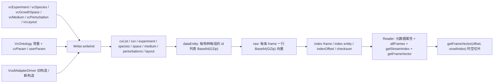

## 用户需求

完善 `G:\GCModeller\src\GCModeller\engine\IO\Raw\vcXML` 下的 vcXML 实现（`vcXML.NET5.vbproj`），保持其「仿 mzXML 的 XML 容器 + Base64(GZip) 二进制块」定位，补齐虚拟细胞模拟结果的实验元数据与空间维度表达能力。

## 产品概述

vcXML 从当前仅含「3 组学 × 质量/通量」的扁平帧格式，升级为带完整实验描述的时空数据格式：文件头部声明本体词表与实验参数，中部描述物种、生长空间、培养基与虚拟扰动，数据区按「物种 × 体素 × 组学」布局存储帧向量，尾部保留随机访问索引与校验和。

## 核心功能

- **Ontology term（mzML 风格）**：`cvList` 声明 VC/UO/MS 词表；所有实验字段用 `cvParam`（accession/name/value/unitCvRef/unitAccession/unitName）表达，非标准字段用 `userParam`；内置约 40 条 VC 词条常量与 UO 单位常量。
- **实验元数据**：模拟引擎、随机种子、总时长、时间步长、帧数、被动扩散/边界推导等运行开关，以及命令行原文。
- **物种清单**：每个物种的 id、学名、分类学、菌株、来源模型文件、mRNA/蛋白/代谢物 id 数量。
- **生长空间模型**：网格宽高深、体素尺寸、边界类型（立方体/STL/球）、占用掩码、体素列表（index + x/y/z）。
- **培养基环境**：培养基名、pH、温度、各组分初始浓度与单位、补料模式与稀释率、扩散系数。
- **虚拟扰动**：扰动 id/类型/起止 tick，以及按物种与分子定位的靶点及倍数因子。
- **多物种 + 体素布局**：`layout` 描述 species/voxel/group 三个轴与块顺序；向量按 `voxel × molecule` 展平；支持 dense（每物种每帧一条）与 sparse（每物种每体素每帧一条）两种模式。
- **随机访问索引**：`index` 的 `offset` 增加 species/voxelStart/voxelCount；尾部 `indexOffset` + `checksum` 保证按需读取单帧、单物种、单体素切片。
- **不兼容旧格式**：Reader 遇到 1.x 命名空间直接抛出明确异常，不再静默错读。

## 技术栈

- 语言/运行时：VB.NET，`net10.0`，沿用现有 `vcXML.NET5.vbproj`（`RootNamespace=SMRUCC.genomics.GCModeller.ModellingEngine.IO`）。
- 序列化：`System.Xml.Serialization.XmlSerializer` + 现有 `XmlHelper.getXmlFragment`（单行片段写盘，随机访问依赖「一帧一行」）。
- 压缩/编码：沿用 `binarydata-netcore5` 的 `BinaryDataWriter/Reader`、`GZipStream`、`Convert.ToBase64String`。
- 依赖策略：**不新增项目引用**，尤其不引用 `Cella`，元数据全部由本项目内 DTO 承载，调用方（R# vcellkit / 未来的 Cella 导出器）自行映射。

## 实现思路

以「格式契约先行、读写两端对称、旧 API 签名保留」为原则重写 4 个文件、新增 2 个文件 + 1 个测试工程。

1. **版本与命名空间**：升为 `https://biocad.gcmodeller.org/XML/schema_revision/vcellXML_2.0`；Reader 读取根元素命名空间，非 2.0 立即抛 `NotSupportedException`。
2. **布局语义（关键设计）**：`layout` 声明三个轴与 `frameMode`：

- `dense`：每 `(tick, species, group)` 一条 `frame`，向量长度 = `voxelCount × entityCount`，按 `blockOrder`（默认 `voxel,molecule`）展平；
- `sparse`：每 `(tick, species, group, voxel)` 一条 `frame`，`voxelCount=1`、`voxelStart` 指向 layout 中的体素序号，只写有细胞的体素；
- `entityCount` 必须等于该 `(species, group)` 的 id 列表长度，Reader 据此切片并校验，避免越界。

3. **元数据块顺序固定**：`cvList → run → vcExperiment → speciesList → growthSpace → cultureMedium → perturbations → layout → dataEntity → raw → index → indexOffset → checksum`，保证流式写出与流式解析对称。
4. **兼容策略（保编译）**：`Reader` 与 `VcellAdapterDriver` 的现有公开签名全部保留（`Reader(file)`、`allFrames`、`getStreamIndex(module)`、`getStreamEntities(module,type)`、`getFrameVector(offset:Long)`、`New VcellAdapterDriver(file, model, args)`），新维度只加重载与新属性；`XML.offset` 的 `id/tick/module/content_type/offset` 字段保持不变。因此 `workbench\R#\vcellkit\RawXmlKit.vb` 与 `engine\IO\Raw\Extensions.vb` **零改动即可编译**。
5. **修三个既有缺陷**：`frame.tick` 由 `Double` 误赋改为 `Integer` 与 `frameTime` 分离；`vector.compressedLen`/`uncompressedLen` 正确写出；`indexOffset` 定位窗口从末尾 128 B 扩到 4 KB 并保证索引落在尾部。
6. **大帧保护**：`Writer` 增加 `maxFrameBytes`（默认 64 MB），dense 帧超限时按体素自动拆分为多条 `frame` 并打印告警，防止单条 Base64 行过大导致 Reader 必须整行载入。

### 性能与规模

- 元数据块只随物种数/体素数增长，不随帧数增长；2500 体素约 150 KB。
- 单帧读取仍是「seek + 读一行 + Base64 解码」，复杂度 O(单帧字节)；新增 `getFrameVector(offset, voxelIndex)` 只在解码后做一次切片，O(voxelCount × entityCount)。
- `sparse` 模式下文件条目数 = 有细胞体素数 × 物种数 × 组学数 × 帧数，可与现有格式同量级；`dense` 仅在调用方显式选择时使用。

### 架构设计



### 目录结构

```
engine/IO/Raw/vcXML/
├── XML.vb          # [MODIFY] vcellXML_2.0 schema DTO。重写 vcXMLFile 为 cvList/run/vcExperiment/speciesList/
│                   #   growthSpace/cultureMedium/perturbations/layout/dataEntity/raw/index/indexOffset/checksum；
│                   #   frame 增 species/voxelStart/voxelCount/entityCount 并把 tick 改为 Integer；
│                   #   vector 增 uncompressedLen 并支持 precision=32；offset 增 species/voxelStart/voxelCount，
│                   #   保留 id/tick/module/content_type/offset（R# 依赖）；omicsDataEntities 增 species/count。
├── Experiment.vb   # [NEW] 元数据 DTO：vcCVList/vcCV、cvParam/userParam、vcExperiment、vcSpecies、vcGrowthSpace、
│                   #   vcVoxel、vcShape、vcMedium、vcMediumComponent、vcFeeding、vcPerturbation、
│                   #   vcPerturbationTarget、vcLayout、vcAxis、vcAxisItem。全部用 Public Property + XmlAttribute/
│                   #   XmlElement 标注，List(Of T) 直接序列化；提供 Clone/Validate（entityCount、voxelCount 一致性）。
├── VcOntology.vb   # [NEW] VC/UO/MS 词表常量（实验/物种/空间/培养基/扰动/布局/组学约 40 条）与
│                   #   Unit(accession, name) 辅助；提供 VcOntology.CvList() 返回默认 cvList。
├── Writer.vb       # [MODIFY] 重写。新增 writeInit(experiment, species, space, medium, perturbations, layout)；
│                   #   保留 writeInit(VcellAdapterDriver, FluxBaseline) 并转调；writeHeader 增 species/count；
│                   #   addFrame 旧签名保留 + 新重载(tick, frameTime, module, type, species, voxelStart,
│                   #   voxelCount, entityCount, data)；修 tick/compressedLen/uncompressedLen；
│                   #   writeIndex 写 frame/entity 两个 index + indexOffset + checksum，并保证尾部 128 B 内可见；
│                   #   增 maxFrameBytes 自动拆分与告警。
├── Reader.vb       # [MODIFY] 重写尾部索引定位（4 KB 窗口，优先 128 B）；解析 2.0 元数据到只读属性
│                   #   CVList/Experiment/Species/GrowthSpace/CultureMedium/Perturbations/Layout；
│                   #   保留 allFrames/getStreamIndex/getStreamEntities/getFrameVector/basename/ToString；
│                   #   新增 getStreamIndex(module, species)、getStreamEntities(module, type, species)、
│                   #   getFrameVector(offset, voxelIndex)、getFrameVector(offset, voxelIndex, entityIndex)、
│                   #   getFrames(tick?, species?, module?, type?)；1.x 文件抛 NotSupportedException；
│                   #   按 vector.precision 选择 Double/Single 解码，按 byteOrder 处理端序。
├── VcellAdapterDriver.vb # [MODIFY] 保留 New(file, CellularModule(), FluxBaseline)：内部构造默认 experiment/
│                   #   species（1x1x1 空间、单物种布局）后转调新 Writer；新增 New(file, experiment, species,
│                   #   space, medium, layout, perturbations) ；新增 Experiment/Species/GrowthSpace/
│                   #   CultureMedium/Perturbations/Layout 属性与 AddPerturbation/SetSpeciesState 稀疏写入入口；
│                   #   MassSnapshot/FluxSnapshot 签名不变。
├── XmlHelper.vb    # [MODIFY] 增 getXmlFragment(Of T)(obj, settings, writeRawFragment) 的重载与缩进控制，
│                   #   用于把元数据块写成「一行一个元素」，避免 XmlSerializer 默认换行破坏逐行读取。
└── test/
    ├── test.vbproj # [NEW] 控制台测试工程，引用 vcXML.NET5.vbproj。
    └── Program.vb  # [NEW] 构造 2 物种 × 8 体素 × 3 组学 × 5 帧合成数据，写 2.0 文件并逐项读回断言；
                    #   复现 R# 调用序列做兼容冒烟；断言 1.x 文件抛 NotSupportedException。
```

### 关键代码结构

```
' 布局契约：Writer 与 Reader 共同依赖
Public Class vcLayout
    Public Property frameMode As String = "sparse"   ' dense | sparse
    Public Property blockOrder As String = "voxel,molecule"
    Public Property species As vcAxisItem()
    Public Property voxels As vcAxisItem()
    Public Property groups As vcAxisItem()
End Class

' 帧索引：保留旧字段，新增时空维度
Public Class offset
    Public Property id As Integer
    Public Property tick As Integer
    Public Property [module] As String
    Public Property content_type As String
    Public Property species As String
    Public Property voxelStart As Integer
    Public Property voxelCount As Integer
    Public Property offset As Long
End Class
```

### 实现要点

- **格式契约**：`cvParam` 的单位统一走 `unitCvRef="UO"` + `unitAccession` + `unitName`；VC accession 使用 `VC:0000xxx` 并在文档中注明「本项目自定义 CV，URI 指向规划中的 vc.obo」，不冒充官方本体。
- **校验**：`Writer.writeInit` 校验 `layout.voxels.Count` 与 `growthSpace.shape.occupied`、`entityCount` 与 `dataEntity` 实际 id 数一致；`Reader.loadOffsets` 校验 `offset.voxelCount × entityCount` 与解码向量长度一致，不一致抛 `InvalidDataException`（含帧号与期望长度）。
- **性能**：写端继续「序列化单行 + WriteLine + Flush」，不把整帧拼进内存；读端继续 seek 单行，不做全文扫描（元数据解析只读头部，索引只读尾部）。
- **资源管理**：`Writer`/`Reader` 的 `Dispose` 保持现有模式；`writeIndex` 在 `Dispose` 中只执行一次（现有 `disposedValue` 已保证）。
- **影响面控制**：不修改 `RawXmlKit.vb`、`Extensions.vb`、`VCellMatrix`、`HDS` 目录；不改 `vcXML.XML` 命名空间与 `offset` 类名，避免 R# 的 `Imports XmlOffset = ...vcXML.XML.offset` 失效。
- **可观测性**：`Writer` 在 `maxFrameBytes` 触发拆分时打印 `[vcXML][warn]`；`Reader` 在元数据缺失时给出字段级提示（例如 `missing layout`），但元数据整体可选（最小文件仍可只含 `dataEntity` + `raw`）时退化为单物种、单体素、`voxelCount=1` 的默认布局，保证向后语义可用。
- **验证口径**：`getFrameVector(offset, voxelIndex)` 与原始写入切片逐值相等（容差 1e-12）；`allFrames.Length` 等于 `物种数 × 组学数 × 帧数`；`getStreamEntities(module, type, species)` 长度等于该物种该组学的 id 数；1.x 样本必须抛异常而不是返回空结果。

## Agent Extensions

### SubAgent

- **code-explorer**
- Purpose: 在改造前复核 `workbench\R#\vcellkit\RawXmlKit.vb`、`engine\IO\Raw\Extensions.vb`、`VCellMatrix`、`HDS` 对 `vcXML.Reader`/`VcellAdapterDriver`/`XML.offset` 的全部依赖点，确认保留签名后无需改动外部调用方。
- Expected outcome: 输出一份调用点清单（文件、行号、使用的成员），并确认不存在对 `vcXML.XML.frame/vector/index` 的直接构造依赖。

### Skill

- **lsp-code-analysis**
- Purpose: 在 Reader/Writer 重写后做语义级引用检索与类型检查，确认 `getStreamIndex`、`getStreamEntities`、`getFrameVector`、`allFrames` 的所有引用仍能解析到新实现，且新增重载不产生歧义调用。
- Expected outcome: 给出每个公开成员的定义-引用对照，并指出任何被破坏的调用点。