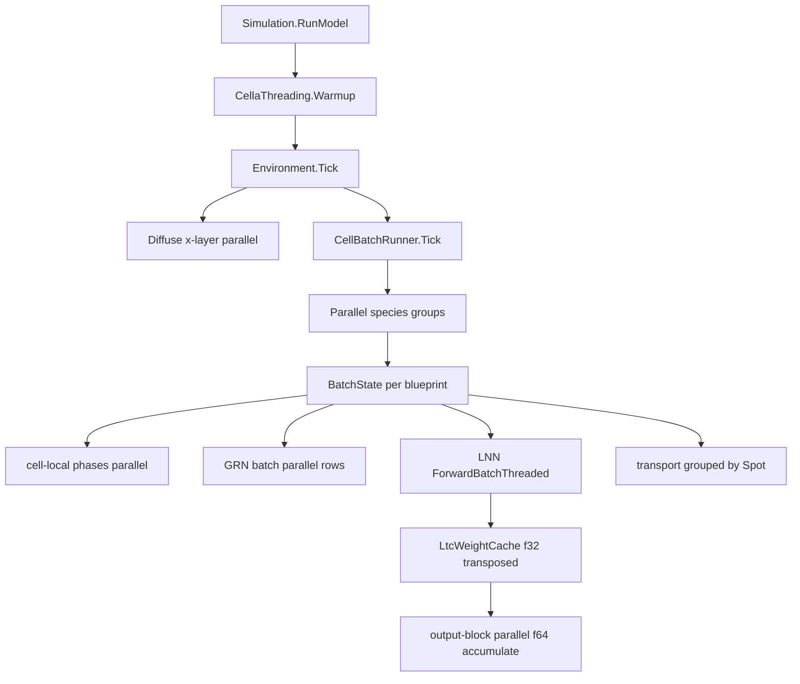

## 产品概述

在 96 逻辑核（48 物理核）/8 NUMA 节点的生产服务器上，让 Cella 虚拟细胞模拟真正吃满 CPU 资源。当前 6 物种共培养（每物种 1 个细胞）单步约 33 秒且只占用 1 个核，改造目标是把"跨物种/跨块并行 + 单细胞内并行 + float32 权重带宽优化 + 运行时配置"组合起来，使 48 物理核成为有效计算资源。

## 核心功能

- **线程预算统一管理**：默认 `ProcessorCount / 2`（本机 48），支持 `CELLA_THREADS` 与 `/run --threads` 覆盖；启动日志打印核数、GC 模式与堆数。
- **跨物种与跨块并行**：物种组之间并行推进，每组各自持有批处理缓冲；同一物种内的信号转导、翻译、周转、收尾相也按细胞并行；跨膜转运按格点分组并行以保持培养基扣减顺序；环境扩散按 x 层并行。
- **单细胞内并行（关键）**：LNN 前向改为"输出维分块并行"，batch=1 时也能占满所有核；为此新增 float32 转置权重缓存（Wrec/Win/门控/输出/通量读出头）与并行内核，权重 f32、状态与累加 f64。
- **载荷阶段并行**：模型文件并行加载、细胞并行播种（模板先建一次）、快照帧并行序列化后顺序写 zip。
- **可回退**：`CELLA_KERNEL=legacy|threaded`、`CELLA_DTYPE=double|float32`、`--threads`、`ORGANOID_PROFILE=1` 控制内核选择、精度、并行度与剖析。

## 效果

- 6 物种各 1 细胞：单步从约 33 s 降到个位数秒（目标 ≥5×），CPU 利用率从 1 核提升到 ≥70% 的 48 线程预算。
- 48 细胞规模：耗时随线程数近似线性增长至 32 线程，48 线程仍有正收益。
- 数值：权重 f32 + f64 累加，与 legacy 内核在 1e-6 容差内一致。

## 技术栈

- VB.NET / net100，沿用 `engine/Cella`、`engine/CellaLoader`、`sub-system/Metaboliq`、`engine/vCella`、`runtime/sciBASIC` Tensor 内核。
- 并行：`System.Threading.Tasks.Parallel` + `ParallelOptions`，SIMD 通过 `System.Runtime.Intrinsics`（AVX2，f32 宽 8）。
- 运行时配置：MSBuild `ServerGarbageCollection`、`ConcurrentGarbageCollection`、`TieredPGO`、`GCHeapCount`，线程池预热 `ThreadPool.SetMinThreads`。
- 测试与报告：`DebugAudit`、`PhaseProfiler`、`CellaLoader/bench`。

## 现状与根因（已核实）

| 位置 | 现状 | 影响 |
| --- | --- | --- |
| `Cella/Environment/CellBatchRunner.vb:173-185` | `For Each groups` 逐物种串行推进 | 6 物种只能串行使用 1 核 |
| `CellBatchRunner.vb:240-318` | signaling/translation/transport/turnover/finish 为单线程 for | 每块只 1 线程 |
| `CellBatchRunner.vb:114-134` | 批缓冲为实例级单份 | 物种组无法安全并行 |
| `SIMDTensor.LtcRk4Batch` | 仅 batch ≥ 4 才 `Parallel.For` | 每物种 1 细胞时全部退化为串行 |
| `MetabolicNetwork.TickBatch:503` → `StepIntervalBatch:737` → `ForwardBatch` | LNN 为热点（占比超过 90%） | 带宽受限，单核 33 s/步 |
| `Simulation` 播种 / 模型加载 / 快照写盘 | 串行 | 启动与导出阶段利用率低 |
| 运行时 | ServerGC 关闭、GCHeapCount 默认 | GC 单线程，易成多核瓶颈 |


## 实现方案

### P0 线程与运行时配置

新增 `engine/Cella/Environment/CellaThreading.vb`：

- `Cores`：`CELLA_THREADS` 优先，否则 `Environment.ProcessorCount \ 2`，下限 1
- `Options`：`ParallelOptions`（`MaxDegreeOfParallelism = Cores`）
- `Warmup()`：`ThreadPool.SetMinThreads(Cores, Cores)` + 一次预热并行循环，消除线程注入阶梯
- `Describe()`：返回核数/GC 模式/堆数，供 `/run` 与 bench 打印

工程配置（`vCella`、`CellaLoader/test`、`bench`、`smoke`）增加：
`ServerGarbageCollection=true`、`ConcurrentGarbageCollection=true`、`TieredPGO=true`、`GCHeapCount=8`（对齐 8 个 NUMA 节点）。
`/run` 新增 `--threads`，并在启动日志输出实际预算；运行指南给出 `numactl --localalloc --cpunodebind=0-7`。

### P1 跨物种/跨块并行（Cella）

- `CellBatchRunner` 引入每蓝图 `BatchState`（Tensor 缓冲、`GearsBatchWorkspace`、容量与尺寸度量），存入 `Dictionary(Of CellaBlueprint, BatchState)`，消除并行组之间的竞争。
- `Tick` 改为 `Parallel.ForEach(groups, CellaThreading.Options, ...)`；组内仍按块顺序执行。
- `TickChunk` 的细胞本地相（signaling / translation / turnover / finish）改为 `Parallel.For`；当 `count` 小于阈值（例如 4）时退化为串行，避免调度开销。
- `transport` 相：先按 `Spot` 分桶，桶内串行（同格点细胞共享培养基），桶间并行，保持原有扣减顺序与质量守恒。
- `Environment.Diffuse`：按 x 层并行（读相邻层、写本层，无冲突）；`Feed` 按格点并行；`GetAllCells/GetAllSpots` 的 `ToArray` 改为缓存或按需复用。

### P2 单细胞内并行 + float32 权重（最大收益）

在 `Metaboliq` 层实现，不改动 sciBASIC 通用内核接口（保留 `LtcRk4Batch` 回退）：

- `MetabolicLiquidNetwork` 内部新增 `LtcWeightCache`（每蓝图一份，首次前向惰性构建）：
- `WrecT_f32`（m×m）、`WinT_f32`（n×m）、`WgateT_f32`、`WgateInT_f32`
- `Wout_f32`（输出读出）、`Wv_f32`（通量读出头，语义等同 `_FluxWeight`）
- 各 bias 的 f32 副本与 `tauEff` 的 f64 副本
- 预估内存 0.9~1.2 GB/物种（252 GB 内存充足），构建时打印估算
- 新内核 `ForwardBatchThreaded(state, u, span, subSteps)`：
- 每个 RK4 stage 求 `z[j] = b[j] + Σ WrecT[j,k]·sw[k] + Σ WinT[j,k]·u[k]`
- 按输出块 j 并行（`Cores` 个块；块内 k 顺序读 f32 权重行，`sw/u` 常驻 L2），f64 累加
- 激活、门控、子步更新为 SIMD 逐元素循环
- `batch=1` 时同样吃满全部线程（这正是当前单核的根因）
- `ComputeOutputFromBatch` / `ComputeFluxBatch` / `SystemTauBatch` 同步改为 f32 权重 + 输出块并行
- 开关：`CELLA_DTYPE=float32|double`、`CELLA_KERNEL=auto|legacy|threaded`；`auto` 在 `Cores≥4` 且 `m≥1024` 时启用 threaded

### P3 载荷阶段并行

- 模型并行加载（`Parallel.For` over modelFiles，按 `Cores` 限流）
- 播种：先串行构建 1 个细胞以初始化 `MetabolicTemplate` 与 `Gears`，其余 `Parallel.For`；`Spot.cells` 写入按格点分桶或加锁
- 快照：按格点并行序列化为帧缓冲，单线程按序写 zip 条目；保留 `--no-state` 与压缩等级

### P4 验证与报告

- `bench` 新增 `--threads`、`--kernel`、CPU 利用率（`Process.TotalProcessorTime / wall / Cores`）与有效 GFLOPS 估算
- 缩放矩阵：`threads ∈ {8,16,32,48,96}` × `cells ∈ {1,6,48}` × 2~3 步，输出 `bench/output/cpu_scaling_report.md`
- 通过标准：
- 6 物种各 1 细胞单步 ≤6 s（相对 33 s 提升 ≥5×），48 线程 CPU 利用率 ≥70%
- 48 细胞：step 耗时在 32 线程前近似线性，48 线程仍正收益
- `CELLA_KERNEL=legacy` 与 `threaded` 的轨迹指纹在 1e-6 容差内一致

## 架构设计



## 目录结构

```
engine/
├── Cella/
│   ├── Environment/
│   │   ├── CellaThreading.vb            # [NEW] 线程预算、ParallelOptions、Warmup、Describe
│   │   ├── CellBatchRunner.vb           # [MODIFY] BatchState per blueprint、物种组并行、细胞本地相并行、transport 按 Spot 分组
│   │   └── Environment.vb               # [MODIFY] Diffuse 按 x 层并行、Feed 并行、GetAllCells 缓存
│   └── Networks/MetabolicNetwork.vb     # [MODIFY] 传递 kernel 选择与线程配置
├── sub-system/Metaboliq/
│   ├── LtcWeightCache.vb                # [NEW] f32 转置权重/偏置缓存与内存估算
│   └── MetabolicLiquidNetwork.vb        # [MODIFY] ForwardBatchThreaded 接入、三个读出头并行版本
├── CellaLoader/
│   ├── test/test.vbproj                 # [MODIFY] ServerGC/GCHeapCount 配置
│   └── bench/
│       ├── bench.vbproj                 # [MODIFY] 同上
│       └── Program.vb                   # [MODIFY] --threads/--kernel、CPU 利用率、缩放矩阵输出
└── vCella/
    ├── Program.vb                       # [MODIFY] /run --threads、启动日志
    ├── Simulation.vb                    # [MODIFY] 并行加载/播种、并行快照序列化
    └── vCella.vbproj                    # [MODIFY] ServerGC/GCHeapCount/TieredPGO
```

## 关键代码结构

```
' engine/Cella/Environment/CellaThreading.vb
Public Module CellaThreading
    ReadOnly Property Cores As Integer
    ReadOnly Property Options As ParallelOptions
    Sub Warmup()
    Function Describe() As String
End Module

' sub-system/Metaboliq/LtcWeightCache.vb
Public Class LtcWeightCache
    ReadOnly Property HiddenSize As Integer
    ReadOnly Property InputSize As Integer
    ReadOnly Property WeightRecurrentT As Single()
    ReadOnly Property WeightInputT As Single()
    ReadOnly Property WeightGateT As Single()
    ReadOnly Property WeightGateInputT As Single()
    ReadOnly Property OutputWeightT As Single()
    ReadOnly Property FluxWeightT As Single()
    Shared Function Build(network As MetabolicLiquidNetwork) As LtcWeightCache
End Class

' sub-system/Metaboliq/MetabolicLiquidNetwork.vb
Public Function ForwardBatchThreaded(state As Tensor, u As Tensor, span As Double, subSteps As Integer) As Integer
```

## 实现注意事项

- **精度**：仅权重 f32，状态与点积累加保持 f64；对拍容差 1e-6，超差时记录首个偏离元素索引。
- **带宽**：输出块并行要让权重行连续读取；`sw/u` 常驻 L2（约 65 KB/32 KB），块大小取 `m / Cores` 并对齐 8 个 f32。
- **嵌套并行**：内核按 `batch × blocks` 与 `Cores` 自适应，避免 `Parallel` 套 `Parallel` 造成线程爆炸；物种组并行时内核自动降级为串行。
- **transport 语义**：按 Spot 分桶后桶内串行，保持 `medium` 读写顺序；`UptakeMass/EffluxMass` 语义不变，交叉喂养归因不受影响。
- **内存**：缓存按蓝图共享（不按细胞复制）；构建前打印估算，`CELLA_DTYPE=double` 时不构建 f32 缓存。
- **可回退**：三个环境变量与 `--threads` 均可在不改代码的情况下关闭并行或内核改造。
- **性能预算**：单次 `Parallel.For` 的调度成本约数十微秒，细胞相并行仅在 `count ≥ 4` 时启用。

## 风险与对策

- f32 权重引入约 1e-6 偏差 → 仅权重 f32、累加 f64，提供 legacy 回退与对拍脚本。
- 内存增加约 1.2 GB/物种 → 252 GB 内存可容纳；日志给出估算并支持关闭。
- 并行写共享培养基 → 按 Spot 分组，杜绝竞争且保持扣减顺序。
- 超订阅（96 逻辑核效率仅 30%） → 默认 48 线程，`--threads` 可显式试 96。
- NUMA 远端访存 → ServerGC + `GCHeapCount=8`，运行指南给出 `numactl --localalloc`。
- 回归风险 → `ORGANOID_PROFILE=1` 相级剖析 + bench 基线 + `CELLA_KERNEL=legacy` 对照。

## Agent Extensions

### SubAgent

- **code-explorer**
- Purpose: 实施前核对 `CellBatchRunner` 缓冲字段的全部引用点、`Environment.Tick` 的相顺序、`MetabolicNetwork.TickBatch` 与 `Metaboliq` 前向链的调用签名，以及 `Spot.cells`/`Medium` 的全部写入点。
- Expected outcome: 输出精确到文件与行号的调用清单与受影响文件列表，确保 `BatchState` 重构与 Spot 分桶并行不遗漏任何写入路径。

### Skill

- **lsp-code-analysis**
- Purpose: 对 `CellBatchRunner.Tick/TickChunk`、`LTC` 内核入口 `ForwardBatch`、`Environment.Diffuse` 执行引用与调用层级分析，确认并行改造后所有调用点与签名保持一致。
- Expected outcome: 得到完整引用清单与调用层级，保证新增 `ForwardBatchThreaded` 与 `CellaThreading` 无遗漏适配、无编译回归。