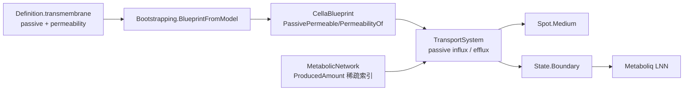

## 产品概述

在 Cella 虚拟细胞引擎中补上“跨膜被动扩散”通路，并把上下文映射配置 `Definition.transmembrane` 里声明的被动扩散物质真正接入模拟计算，使这些物质即使没有对应的转运蛋白基因，也能按各自的通透系数进出细胞。

## 核心功能

- **逐物质的通透系数**：`Definition.transmembrane` 从“只有物质清单”扩展为“物质清单 + 每个物质的 0~1 渗透系数 + 缺省系数”，旧 ini（只有清单）仍可使用。
- **被动摄取**：`TransportSystem` 在原有“转运蛋白门控 + 米氏动力学”之上叠加一个 Fick 项；被动物质缺少转运蛋白时摄取量不再恒为 0，且驱动浓度按 `max(转运能力, 渗透系数)` 折算。
- **被动外排**：对没有外排反应的被动物质，用“胞内产生池 − 池内剩余”的方式泄出到格点培养基；有外排反应时仍走原路径，避免重复记账。
- **边界一致性告警**：被动物质若不在 `BoundaryIds`（既不只产也不只耗、且无 `_e` 后缀）中，构建蓝图时明确打印清单，不修改 Metaboliq 图结构。
- **可关闭与可调**：`--no-passive`、`--passive-permeability`、环境变量 `CELLA_PASSIVE=0` 支持 A/B 对比与快速回退。
- **配置贯通**：`/context` 生成的 ini 自带渗透系数表；`/run --context-map` 读取后逐物种注入蓝图；smoke 测试校验 ini 往返与被动通量生效。

## 效果

默认开启被动扩散后，氧气、二氧化碳、氨、乙酸、乙醇、乳酸等物质在缺乏专用转运蛋白的物种上也能进入/离开细胞，交叉喂养与 pH/产物抑制的表现更符合生理；同时保留一键关闭能力，保证既有轨迹基线可复现。

## 技术栈

- 语言/运行时：VB.NET，`net10.0`，沿用 `engine\Cella\Cella.vbproj`、`engine\CellaLoader\CellaLoader.vbproj`、`engine\Dynamics\Dynamics.NET5.vbproj`、`engine\vCella\vCella.vbproj`。
- 配置序列化：`Definition.SaveIni/LoadIni`（`ClassMapper`，`[define]` 段内字典以 JSON 行存储，已验证 `Ions`、`Cofactors` 可用）。
- 测试与报告：`DebugAudit`（Mark/Check/AreEqual/Dump/ToJson）；基准用 `engine\CellaLoader\bench`。

## 现状核查结论（已核实的事实）

1. `Cella\Networks\TransportSystem.vb` **没有任何被动扩散通路**：

- `capacity` 仅在 `transporterSlot(i) >= 0` 时由蛋白丰度算出，否则为 0（:132-139）；
- `state.Boundary(slot) = external * capacity`（:142）→ 无转运蛋白时驱动浓度恒为 0；
- 摄取 `rate = vmaxEff * capacity * external/(kmEff+external)`（:160）；
- 外排仅当 `exportSlot(i) >= 0`（`blueprint.ExportSourceOf`）时才走米氏外排（:181-211）。

2. `Definition.transmembrane` **全库无消费方**：`Roles.vb:15-28` 只有 `passive As String()`；`Bootstrapping.BlueprintFromModel(cell, Optional define As Object = Nothing)`（:33-35）函数体（:37-118）完全未使用 `define`；`Simulation.RunModel`（`vCella\Simulation.vb:132`）也未传 `Definition`。
3. 边界代谢物来自 `MetabolicNetworkGraph` 的自动判定（`Metaboliq\MetabolicNetworkGraph.vb:140-174`：只产不耗 / 只耗不产 / `_e`、`_ext` 后缀）；`blueprint.ExplicitBoundary`（`CellaBlueprint.vb:51`）从未赋值。`CellularState.BoundaryNames` 即 `graph.BoundaryIds`（`CellaFactory.vb:121,205`），所以 `TransportSystem` 只能作用于这些通道。
4. 执行顺序（`Environment\CellBatchRunner.vb`）：signaling → grn → translation → **transport** → **metabolic** → turnover，因此 transport 读到的是上一步代谢通量（显式积分滞后一步）。
5. 既有可用字段：`CellaBlueprint.TransportVmax=0.05`、`TransportKm=0.5`、`Transporters`、`TransporterOf`、`ExportSourceOf`；`MetabolicNetwork.Graph`、`_fluxes`；`TransportSystem.UptakeRates/EffluxRates/UptakeMass/EffluxMass` 已被 `CrossFeedingRecorder` 使用。

## 实现策略

### A. 配置模型（Dynamics）

`Roles.vb` 的 `Transmembrane` 扩展为：

- `passive As String()`（成员表，保持兼容）
- `permeability As Dictionary(Of String, Double)`（物质 → 0~1）
- `defaultPermeability As Double = 0.2`
- `PermeabilityOf(id)`：不在清单 → 0；显式给出 → 该值；否则 `defaultPermeability`

字典沿用 `[define]` 段的 JSON 行序列化，与 `Ions/Cofactors` 同构。

### B. 蓝图配置（Cella）

`CellaBlueprint` 新增 `PassivePermeable`、`PassiveCoefficients`、`PassivePermeability`、`PassiveEfflux` 与 `PermeabilityOf(id)`（大小写不敏感、值域钳制到 `[0,1]`）。

### C. 配置注入（CellaLoader）

`BlueprintFromModel` 签名由 `define As Object` 收敛为 `define As Definition`（现有调用点均传 `Nothing` 或已加载 `Definition`，`FromModel` 原本就是强类型，向后兼容），并在蓝图初始化器中写入被动扩散配置。

### D. 被动摄取与外排（TransportSystem，核心）

构造期按 `BoundaryNames` 预计算 `permeability(i)` 与 `passive(i)`：

- 摄取：`active = vmaxEff * transporterCapacity * external/(kmEff+external)`；`passiveIn = P * vmaxEff * max(0, external − pool_i)/(kmEff+external)`；`Boundary = external * max(transporterCapacity, P)`。
- 外排：`exportSlot >= 0` 时保持原路径（跳过池，避免双重记账）；否则 `P > 0` 且 `PassiveEfflux` 时：
`pool_i += produced_i*dt` → `effluxRate = P*vmaxEff*pool_i/(kmEff+pool_i)` → `pool_i −= effluxRate*dt` → `remain += effluxRate*dt`；`pool_i` 下限 0，`dt <= 0` 直接返回。
- 统计：`GetStats()` 增加 `passive_uptake_total`、`passive_efflux_total`、`passive_pool_total`；`UptakeMass/EffluxMass` 保持原语义并计入被动通量，保证交叉喂养归因正确。

### E. 胞内产生量索引（MetabolicNetwork）

新增 `ProducedAmount(boundaryId)`：构造期从 `Graph.Stoichiometry`（形状 = 代谢物 × 反应，`S(i,j)=产物−反应物`）按边界物质行抽出正系数，得到稀疏表 `[(reactionIndex, coeff)]`；运行时 `Σ coeff*flux` 取 `max(0, ·)`，无对应反应返回 0（因此无产生即无外排，不会凭空产生质量）。

### F. 告警与开关（vCella）

- `Simulation.RunModel` 把已解析的 `Definition`（`map`）传给 `BlueprintFromModel`；
- 构建蓝图后用 `CellaFactory.GetMetabolicGraph` 求交，打印/审计“passive 但不在边界通道”的清单；
- 新增 `passive As Boolean = True`、`passivePermeability As Double = -1`（<0 沿用 ini）参数；`/run` 暴露 `--no-passive`、`--passive-permeability`，并支持 `CELLA_PASSIVE=0` 全局关闭。

### G. 生成器与校验

`ContextMappingBuilder` 在写 `transmembrane` 时同时写入 `permeability`（水/氧/CO2 = 1.0，NH3/H2/H2S = 0.8~0.9，乙酸/乙醇 = 0.6，甲酸 = 0.4，乳酸/丙酮醇/丁二醇 = 0.3~0.4）；smoke 增加 ini 往返与“被动物质在无转运蛋白时摄取量 > 0”的断言。

## 架构与数据流



关键点：被动扩散只改变“转运层”的边界驱动与介质收支，不改变 LNN/GEARS 的输入维度，因此不影响已完成的 SIMD/并行优化路径与轨迹基线（除非显式关闭）。

## 目录结构

```
engine/
├── Dynamics/Config/Definition/
│   └── Roles.vb                     # [MODIFY] Transmembrane 增加 permeability/defaultPermeability/PermeabilityOf，ini 往返
├── Cella/
│   ├── State/CellaBlueprint.vb      # [MODIFY] 新增被动扩散成员与 PermeabilityOf（大小写不敏感、钳制 0~1）
│   └── Networks/
│       ├── TransportSystem.vb       # [MODIFY] 被动摄取 Fick 项、被动外排池、诊断统计、边界驱动折算
│       └── MetabolicNetwork.vb      # [MODIFY] 新增 ProducedAmount 及构造期稀疏产生量索引
├── CellaLoader/
│   ├── Bootstrapping.vb             # [MODIFY] define 收敛为 Definition，注入 transmembrane 配置
│   └── bench/Program.vb             # [MODIFY] 增加 --no-passive / --passive-permeability，输出 A/B 相位耗时
└── vCella/
    ├── Simulation.vb                # [MODIFY] 传递 Definition、边界告警、passive 参数与日志/summary
    ├── Program.vb                   # [MODIFY] /run 新增 --no-passive、--passive-permeability（含 args 回退）
    ├── ContextMappingBuilder.vb     # [MODIFY] 生成 permeability 表
    └── smoke/Program.vb             # [MODIFY] ini 往返断言 + 被动摄取生效断言 + 报告
```

## 关键代码结构

```
' Dynamics\Config\Definition\Roles.vb
Public Class Transmembrane
    Public Property passive As String()
    Public Property permeability As Dictionary(Of String, Double)
    Public Property defaultPermeability As Double
    Public Function PermeabilityOf(id As String) As Double
End Class

' Cella\State\CellaBlueprint.vb
Public Property PassivePermeable As String()
Public Property PassiveCoefficients As Dictionary(Of String, Double)
Public Property PassivePermeability As Double
Public Property PassiveEfflux As Boolean
Public Function PermeabilityOf(id As String) As Double

' Cella\Networks\MetabolicNetwork.vb
Public Function ProducedAmount(boundaryId As String) As Double
```

## 实现注意事项

- **质量守恒**：外排只从 `pool` 扣减，`pool` 只由 `ProducedAmount` 补充；`exportSlot >= 0` 时强制走反应路径，禁止双记账。
- **数值安全**：`P` 钳制 `[0,1]`；`kmEff` 下限 `1e-6`；`pool`、`medium` 非负；NaN/Inf 归零。
- **性能**：产生量索引构造期一次性构建，每步代价 `O(#passive × 平均产生反应数)`（#passive 约十余个），相对 LNN 可忽略；不引入新的每步分配（复用现有 `uptake/efflux` 数组）。
- **兼容性**：`BlueprintFromModel` 由 `Object` 收敛为 `Definition`，现有调用（`CellaLoader\test`、`bench`、`Simulation`）传 `Nothing` 仍成立；旧 ini 无 `permeability` 时统一取 `defaultPermeability`。
- **可复现性**：默认开启会改变轨迹（尤其乙酸/乳酸/CO2），必须提供 `--no-passive`/`CELLA_PASSIVE=0` 并在报告中列出 A/B 差异。

## 验证

1. 编译：`Cella`、`CellaLoader`、`vCella`、`CellaLoader\test`、`CellaLoader\bench` 全部 0 error。
2. ini 往返：`/context` 重新生成 → `Definition.LoadIni` 校验 `passive`、`permeability`、`defaultPermeability` 逐项一致。
3. 被动摄取：GEMs 单细胞单步，`CELLA_PASSIVE=0/1` 对比 `UptakeRates`（被动物质由 0 变正）且 `Spot.Medium` 相应减少。
4. 质量守恒：单细胞 20 步，`Σmedium₀ − Σmedium₁ ≈ Σuptake_mass − Σefflux_mass`（1e-6），`pool >= 0`，无 NaN。
5. 无回归：`bench --cells 8 --steps 2` 在关闭态与既有基线一致（±10%）；开启态记录相耗时与产物变化。
6. 报告：`bench\output\passive_diffusion_report.md` 记录 A/B 数字、边界告警清单与复现命令。

## 风险与对策

- 被动扩散使乙酸/乳酸等弱酸通透被高估 → 逐物质系数（0.3~0.6）+ 可关闭开关 + A/B 报告。
- 池代理浓度导致外排偏差 → 只按净产生量补充、按净通量扣减，并以质量守恒单测兜底。
- 边界外物质不生效 → 构建期显式告警与审计标记，不静默失败。
- 修改 `BlueprintFromModel` 签名 → 全量检索调用点（`Simulation`、`test`、`bench`、`FromModel`）逐一核对。

## SubAgent

- **code-explorer**
- Purpose: 实施前核对 `TransportSystem`、`MetabolicNetwork._fluxes/Graph.Stoichiometry`、`Bootstrapping`、`CellaBlueprint`、`CrossFeedingRecorder` 的全部调用点与字段访问，确认 `ProducedAmount` 与被动通量不会破坏交叉喂养归因与既有批量执行顺序。
- Expected outcome: 输出精确到文件与行号的调用清单、`Stoichiometry` 行列语义确认、以及需要同步修改的调用点列表。

## Skill

- **lsp-code-analysis**
- Purpose: 对 `BlueprintFromModel`（签名收敛）、`TransportSystem.UptakeRates/EffluxRates/UptakeMass/EffluxMass`、`CellaBlueprint` 新增成员做引用与调用层级分析，确保 `CellaLoader\test`、`bench`、`vCella` 及快照/交叉喂养模块同步适配。
- Expected outcome: 完整的引用清单与受影响文件列表，保证签名变更与新增成员无遗漏、无编译回归。