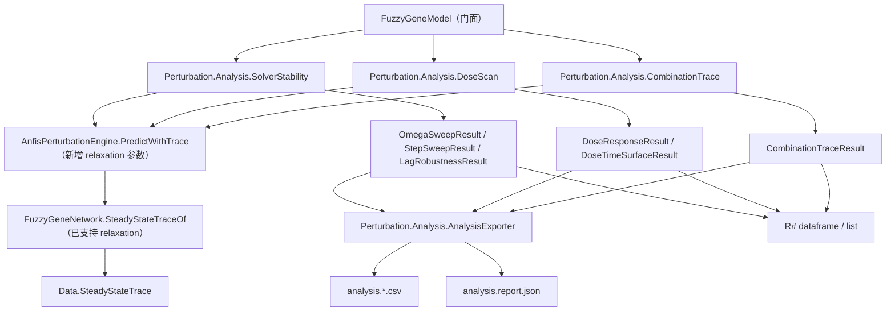

## 产品概述

在现有 FuzzyGene 虚拟扰动能力的基础上，补齐"需要多次求解才能完成"的模型可信度自检与剂量学分析，并把结果通过 R# 脚本接口导出为可分析的表格文件。

现有的稳态轨迹导出只做一次求解，因此无法回答"结果是否依赖求解参数"以及"扰动强度与时间如何共同决定响应"这两类问题。本次新增的流程模块在同一模型上批量求解，产出可直接用于作图与判定的表格。

## 核心功能

### 一、模型自检（多运行）

- **ω 不变性自检**：在 ω ∈ {0.2, 0.5, 0.8, 1.0} 上各跑一次稳态轨迹，比较终态相对参考 ω 的最大绝对偏差与相对偏差，并报告每次运行的收敛状态、实际迭代步数、末步最大变化量。
- **步数不变性**：在 steps ∈ {50, 200, 500} 上各跑一次，以最长步数为参考给出同样的偏差表。
- **lag 排序稳健性**：在每个 ω 下计算每个基因"首次偏离野生型并达到自身终态变化量 10%"的帧号，只保留在所有 ω 下都响应的基因，跨 ω 两两计算 Spearman 秩相关（并列使用平均秩）。

### 二、剂量学分析

- **剂量-响应曲线**：剂量 d ∈ [0, 1]，钳制值 = 基线 × (1 − d)；d = 0 表示钉住基线、d = 1 表示完全敲除。对每个剂量点输出全基因的 fold change、百分比变化、Z 分数与显著性。
- **剂量-时间曲面**：剂量 × 迭代步的二维网格，输出响应最强的若干基因在每个网格点上的表达变化量，形成可直接画等高线或三维曲面的长表。

### 三、组合非加性

- 显式给定两个靶基因，分别跑单扰动 A、单扰动 B 与联合扰动 AB，计算加性期望与联合结果之差；终态与逐步轨迹两个口径同时给出，并支持按非加性效应排序取前若干名。

### 四、导出与脚本化

- 新增 4 个可独立调用的分析接口与 1 个一键批量导出接口；后者把全部表格写成 CSV 并附一份汇总清单，产物风格与现有轨迹导出保持一致。
- 更新示例脚本，按"载入模型 → 选自检靶点 → 四项分析 → 批量导出"的顺序重跑一遍，并把结果落到测试目录。

## 边界与约定

- 不修改跨子系统共享的干预结果类型；分析结果用 FuzzyGene 自有的结果对象承载。
- 剂量轴统一使用"0 = 不改变、1 = 完全敲除"的方向，避免与"残余比例"的方向混淆。
- 组合分析的靶基因只接受显式传入，不做自动挑选。
- 列号仍是迭代步而非生物学时间这一语义，在新增的曲面与曲线表里同样成立。

## 技术栈

- 语言/运行时：VB.NET（.NET 10），沿用 `FuzzyGene.vbproj` 与 `biosystem.vbproj`，不新增工程。
- 求解层复用：`FuzzyGeneNetwork.SteadyStateTraceOf(initial, clamps, steps, relaxation, tolerance)`，该签名已支持 relaxation，无需改求解器。
- 表格与落盘：`SMRUCC.genomics.Analysis.HTS.DataFrame.DataFrameRow` / `Matrix`；CSV 通过 `SaveTo(path, New UTF8Encoding(False))`，JSON 通过 `GetJson(indent:=True)`。
- R# 侧：`dataframe` / `list` + `RInternal.debug.stop`，与现有 16 个 API 完全同构。
- 验证：console 测试 + `DebugAudit`（`AuditTest` 本地包装同时计数）。

## 实现方案

### 总体策略

把"多次求解 + 汇总"从门面里抽成独立的分析器（analyzer），每个分析器只做一件事：接收一个已拟合的模型与该分析的网格参数，返回一个可序列化的结果对象。门面（`FuzzyGeneModel`）只负责转发，R# 层只负责把结果对象摊平成 dataframe / list 并落盘。

这样做的理由：ω 扫描、步数扫描、剂量扫描共享同一套"设置参数 → 跑轨迹 → 收集终态/逐帧"骨架，如果都塞进门面会让该类继续膨胀（当前已 900 余行）；而分析器之间又不需要互相调用，拆开后每个文件都能单独读懂。

### 关键决策与取舍

**1. 复用 `SteadyStateTraceOf` 而不是新写求解循环**
已有求解器已经支持 `relaxation` 参数并在钳制回写后逐帧快照，分析器只需要组合调用。代价是每次调用都会重新计算野生型轨迹（ω 不同时无法复用），ω 扫描 4 次合计 8 次求解；以实测 50 步约 1.5 秒/次计算，4 个 ω 约 12 秒，在可接受范围内，换来的是不需要在分析器里复制一份阻尼迭代逻辑。

**2. 给 `PredictWithTrace` 补 `Optional relaxation As Double = Double.NaN`**
当前它固定读 `_network.Config.Relaxation`，ω 扫描必须能按次覆盖。加可选参数（默认 `NaN` 表示取配置）不破坏任何现有调用点，也不需要临时改全局配置——这点很重要，因为 R# 的 `fuzzygene_relaxation` 会改全局 config，两套机制混用会出现"扫描途中参数被上一次调用改掉"的隐性 bug。

**3. 剂量走 Custom 钳制而不是改 `KnockdownResidual`**
`InterventionValueOf` 对 Custom 直接返回 `spec.Value`，因此不需要碰配置里的 `KnockdownResidual`。钳制值由分析器按 `baseline × (1 − dose)` 算好再传入，语义集中在一处。**必须文档化的陷阱**：d = 0 时钳制值等于基线，此时被扰动基因被钉住不动，而野生型轨迹会从基线自由漂走，所以 d = 0 并不等价于"没有扰动"，只是"被钉在基线"。报告里会把这一条写进注释与清单。

**4. lag 用相对阈值，且只统计敲除场景**
阈值取"自身终态变化量的 10%"，避免强响应基因永远最早、弱响应基因永远不触发。lag 只在 dose = 1（完全敲除）下计算，因为剂量小于 1 时被钳制基因本身的变化量变小，而其他基因可能完全不响应，lag 会退化成大量 NaN。

**5. Spearman 在库层实现（平均秩）**
lag 是整数，并列极多；直接用 Pearson 或简易秩次会让相关性虚高。分析器内部实现 `Rank(values) → Double()`（并列取平均秩）再算皮尔逊，约 30 行，避免为这一个统计量引入外部依赖，也让 R# 侧只做展示。

**6. 剂量-时间曲面只保留 Top-K 基因**
完整网格是 `doses × steps × 18533`，5 × 61 × 18533 ≈ 565 万个双精度（45 MB），虽然放得下，但落盘 CSV 会到几十 MB。改为先按"最大剂量下的绝对 Z 分数"排序取前 K（默认 20），三维数组降到 6100 个格点，CSV 只有几百 KB，信息密度反而更高。完整网格可通过调大 K 获得。

**7. 组合非加性同时给终态与轨迹两个口径**
终态口径与既有 `PredictCombination` 一致（便于对拍）；轨迹口径的加性期望按 `control(t) + (A(t) − control(t)) + (B(t) − control(t))` 逐帧计算，能看出"联合扰动的偏差是同步出现还是延迟出现"。两个口径都输出，但只有终态参与 `invariant/converged` 这类布尔判定。

### 性能与可靠性

| 阶段 | 调用次数 | 预估耗时（18533 基因、50 步） |
| --- | --- | --- |
| ω 扫描 | 4 × 2（突变 + 野生） | 约 12 s |
| 步数扫描 | 3 × 2（最大 500 步） | 约 40 s |
| lag 提取 | 0（复用 ω 扫描的轨迹） | 纯计算，小于 0.5 s |
| 剂量响应 | doses × 2 | 5 点约 15 s |
| 剂量-时间曲面 | 0（复用剂量响应的轨迹） | 纯计算 |
| 组合 | 3 × 2 | 约 9 s |
| 合计 |  | 约 75 s（不含 10 s 模型加载） |


- 复杂度：每次求解 `O(steps × N × 规则数)`；lag 与 Spearman 是 `O(ω × N)` 与 `O(ω² × N log N)`，与求解代价相比可忽略。
- 内存峰值：ω 扫描只保留终态（4 × 18533 doubles），lag 矩阵 `4 × N`；剂量曲面只保留 Top-K；组合保留 3 条轨迹（3 × 18533 × steps）。整体峰值在 150 MB 以内。
- 可靠性：任一分析器的单次求解抛异常时，向上抛出由门面转成可读错误，不静默跳过——静默跳过会让"不变性通过"这个结论变得没有意义。分析结果对象在生成时做形状自洽检查（维度、基因数、帧数），不一致立即失败而不是写出半成品。
- 数值判定：`Invariant` 的默认阈值是最大相对偏差 1e-3，可通过参数覆盖；阈值只影响布尔字段，不影响已计算出的偏差数值。

### 日志

沿用 `[$"{nameof(...)}] warning: ...".debug` 风格；每次分析开始时打印一行网格定义（ω 列表、步数列表、剂量点、Top-K），每次求解后不打印（会刷屏），只在结束时打印一行汇总（运行次数、总耗时、判定结果）。

## 架构设计



分层职责：

- 求解层（`FuzzyGeneNetwork`）：不做任何分析语义，只产出轨迹。
- 分析层（`Perturbation.Analysis`）：定义网格、编排多次求解、做统计算术，产出纯数据对象。
- 导出门面（`FuzzyGeneModel`）：一行转发，保持门面 API 的对称性。
- R# 层：只做类型摊平与错误包装，不含业务计算。

## 目录结构

```
g:\GCModeller\src\GCModeller\sub-system\FuzzyGene\
├── Perturbation\
│   ├── AnfisPerturbationEngine.vb        # [MODIFY] PredictWithTrace 增加 Optional relaxation 参数，
│                                         #   并把"用哪组 omega/steps/tolerance"显式记入 PerturbationTrace；
│                                         #   Predict 与 PredictCombination 的对外行为保持不变。
│   ├── Analysis\
│   │   ├── AnalysisTypes.vb              # [NEW] 六个结果对象：OmegaSweepResult / StepSweepResult /
│   │   │                                 #   LagRobustnessResult / DoseResponseResult /
│   │   │                                 #   DoseTimeSurfaceResult / CombinationTraceResult。
│   │   │                                 #   字段全部是基础类型或数组/列表，保证 GetJson 可直接序列化；
│   │   │                                 #   每个对象提供 ToString 单行摘要与内部形状自洽检查。
│   │   ├── SolverStability.vb            # [NEW] ω 扫描、步数扫描、lag 提取、Spearman。
│   │   │                                 #   SweepOmega(model, gene, mode, omegas, steps, referenceOmega, tolerance)
│   │   │                                 #   SweepSteps(model, gene, mode, stepsList, omega)
│   │   │                                 #   LagRobustness(model, gene, mode, omegas, steps, thresholdRatio)
│   │   │                                 #   私有 Rank(values) 平均秩 + Spearman(a, b)。
│   │   │                                 #   lag 定义：第一个使 |mutant(t) − control(t)| 达到
│   │   │                                 #   0.1 × |mutant_final − control_final| 的 t（t 从 1 起，排除靶基因自身）。
│   │   ├── DoseScan.vb                   # [NEW] DoseResponse(model, gene, doses, steps, omega) 与
│   │   │                                 #   DoseTimeSurface(model, gene, doses, steps, omega, top)。
│   │   │                                 #   钳制值 = baseline(idx) × (1 − dose)，走 InterventionMode.Custom；
│   │   │                                 #   Top-K 按最大剂量下的 |Z| 选取，三维数组 [dose, step, gene]。
│   │   ├── CombinationTrace.vb           # [NEW] Analyze(model, geneA, geneB, mode, steps, omega)。
│   │   │                                 #   分别跑 A、B、A+B 三次轨迹与一次对照轨迹；
│   │   │                                 #   additive(t) = control(t) + (A(t) − control(t)) + (B(t) − control(t))；
│   │   │                                 #   nonAdditive(t) = joint(t) − additive(t)；
│   │   │                                 #   同时保存终态口径（与既有 PredictCombination 对拍）。
│   │   └── AnalysisExporter.vb           # [NEW] 把四类结果写成 CSV + JSON：
│   │                                     #   analysis.sensitivity.csv（ω 表 + 步数表 + Spearman 矩阵长表）
│   │                                     #   analysis.lag.csv（gene × omega 宽表）
│   │                                     #   analysis.dose_response.csv（dose, gene, fold_change, z_score, ...）
│   │                                     #   analysis.dose_time_surface.csv（dose, iteration, gene, delta）
│   │                                     #   analysis.combination.csv（gene, additive, joint, non_additive）
│   │                                     #   analysis.report.json（网格定义 + 判定结果 + 运行次数 + 耗时）
│   │                                     #   另提供 ExportAll(model, gene, geneA, geneB, dir, options) 一键编排。
│   └── CombinationPerturbationResult.vb  # 不变
├── FuzzyGeneModel.vb                     # [MODIFY] 新增六个门面方法（TracePerturbation 重载带 relaxation、
│                                         #   SweepOmega / SweepSteps / LagRobustness / DoseResponse /
│                                         #   DoseTimeSurface / CombinationTrace）与一个
│                                         #   ExportAnalysisReport(dir, gene, geneA, geneB, options)。
│                                         #   统一先 EnsureTrained()，再转发到对应分析器。
└── test\
    └── Program.vb                        # [MODIFY] 新增 --analysis 命令行入口：用真实模型跑一遍四项分析，
                                          #   用 AuditTest 断言（见下）并 SaveReport。
```

```
g:\GCModeller\src\workbench\R#\biosystem\fuzzyGene.vb
# [MODIFY] 新增 5 个 API：
#   fuzzygene_sensitivity       → list($omega, $steps, $lag, $spearman, $summary)
#   fuzzygene_dose_response     → dataframe(dose, clamp_value, gene, fold_change, percent_change, z_score, significant)
#   fuzzygene_dose_time_surface → dataframe(dose, iteration, gene, delta)
#   fuzzygene_combination       → list($summary, $single_a, $single_b, $joint, $non_additive)
#   fuzzygene_analysis_report   → character(写出的文件路径)，一次跑完 4 项并落盘
# 同时在模块 XML 注释的 workflow 列表里补上这 5 个 API 的说明。
```

```
Z:\test\fuzzygene_api_test.R
# [MODIFY] 追加第 8~12 步：候选排序取 Top-2 后显式传给 fuzzygene_combination；
#   依次调用 sensitivity / dose_response / dose_time_surface / combination，
#   最后调用 analysis_report 一键导出到 Z:/test/fuzzygene-analysis；
#   沿用现有注释风格，为每张新表补上"每列是什么、怎么读"的说明。
```

## 关键代码结构

```
' Analysis/AnalysisTypes.vb —— 只列公开表面
Namespace Perturbation.Analysis

    Public Class OmegaSweepResult
        Public Property Gene As String
        Public Property ReferenceOmega As Double
        Public Property InvariantTolerance As Double          ' 默认 1e-3
        Public Property Omegas As Double()
        Public Property Converged As Boolean()
        Public Property Iterations As Integer()
        Public Property LastMaxDelta As Double()
        Public Property MaxAbsDeviation As Double()            ' 相对 ReferenceOmega
        Public Property MaxRelativeDeviation As Double()
        Public Property Invariant As Boolean
        Public Property GeneNames As String()
        Public Property FinalStates As List(Of Double())
    End Class

    Public Class LagRobustnessResult
        Public Property Gene As String
        Public Property Omegas As Double()
        Public Property ThresholdRatio As Double               ' 默认 0.1
        Public Property GeneNames As String()                  ' 所有 omega 都响应的基因
        Public Property GeneIndices As Integer()
        Public Property Lag As Double(,)                       ' [omega, gene]，NaN = 未响应
        Public Property Spearman As Double(,)                  ' [omega, omega]
        Public Property SpearmanN As Integer(,)
        Public Property MeanRho As Double
    End Class

End Namespace
```

```
' Analysis/SolverStability.vb —— 关键签名
Public Function SweepOmega(model As FuzzyGeneModel, gene As String,
                           Optional mode As InterventionMode = InterventionMode.Knockout,
                           Optional omegas As Double() = Nothing,      ' 默认 {0.2, 0.5, 0.8, 1.0}
                           Optional steps As Integer = 50,
                           Optional referenceOmega As Double = 0.5) As OmegaSweepResult

Public Function SweepSteps(model As FuzzyGeneModel, gene As String,
                           Optional mode As InterventionMode = InterventionMode.Knockout,
                           Optional stepsList As Integer() = Nothing,  ' 默认 {50, 200, 500}
                           Optional omega As Double = Double.NaN) As StepSweepResult

Public Function LagRobustness(model As FuzzyGeneModel, gene As String,
                              Optional omegas As Double() = Nothing,
                              Optional steps As Integer = 50,
                              Optional thresholdRatio As Double = 0.1) As LagRobustnessResult

' 并列取平均秩，再算 Pearson —— 这是 Spearman 的等价定义
Private Function Spearman(a As Double(), b As Double()) As Double
```

## 测试断言清单（`--analysis` 入口）

1. ω 扫描返回的条目数等于 omega 数组长度，且每个 `FinalStates` 长度等于基因数。
2. `referenceOmega` 那一项的 `MaxAbsDeviation` 与 `MaxRelativeDeviation` 恒为 0。
3. `Invariant` 与"所有 `MaxRelativeDeviation` 都小于等于 `InvariantTolerance`"一致。
4. 步数扫描以最大步数为参考，参考项偏差为 0；`ActualIterations` 不超过请求的步数。
5. lag 矩阵中靶基因自身不在 `GeneNames` 里；所有保留基因的 lag 都不为 NaN。
6. Spearman 矩阵对角线为 1（存在退化情形时允许 NaN，但需显式记录）；矩阵对称；`|rho|` 不超过 1。
7. 剂量响应里 d = 1 的时间点钳制值为 0，d = 0 的钳制值等于基线。
8. 剂量响应在 d = 0 时，被扰动基因的 fold change 为 0（它被钉在基线）。
9. 剂量曲面三维数组的三个维度分别等于 doses 数、帧数、Top-K 数。
10. 组合分析：`nonAdditive` 与 `joint − additive` 逐位相等；单扰动结果与独立调用 `TracePerturbation` 的终态一致。
11. 一键导出写出的 6 个文件都存在且非空；`analysis.report.json` 能被 `System.Text.Json` 解析且 `runs` 字段等于实际求解次数。
12. `PredictWithTrace` 传入 relaxation 时，`PerturbationTrace.Mutant.Relaxation` 等于该值；传 `NaN` 时等于配置值。

## Agent Extensions

### SubAgent

- **code-explorer**
- Purpose: 在实现 R# 层之前，核对 `biosystem` 包内 `dataframe` / `list` 的构造惯例、`Optional` 数组参数（如 `Optional genes As String() = Nothing`）在 R# 侧的调用方式，以及 `fuzzygene_regulation_matrix` 这类返回多元素的 API 是如何组织返回值的，避免新增 API 与既有风格不一致。
- Expected outcome: 得到一份可直接照抄的返回值构造模板（list 的 slots 键名约定、dataframe 的列顺序与类型），确保 5 个新 API 能被 R# 正确渲染。

- **code-explorer**
- Purpose: 在写 Spearman 与 lag 提取之前，确认仓库里是否已有可复用的秩相关实现（`Microsoft.VisualBasic.Math` 或 `Math.Statistics` 项目），避免重复造轮子；同时确认 `csv` 落盘时是否需要处理区域设置（小数点/千分位）。
- Expected outcome: 明确「复用」还是「自实现」的结论，并拿到既有的数值格式化与 CSV 写出约定。