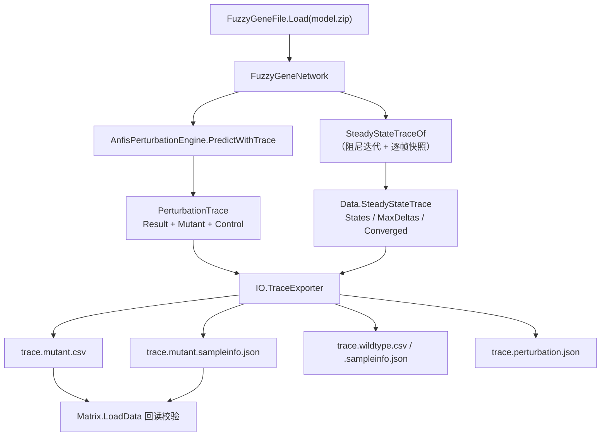

## 用户需求

为**单次**虚拟扰动实验记录全基因组在稳态求解过程中的逐帧表达量轨迹（不做全基因组扰动扫描），用 HTS_matrix 的 `Matrix` 对象承载并导出为 CSV，同时按矩阵样本维度生成 `SampleInfo` 样本元数据；野生型与突变型轨迹**分成两个矩阵文件**；最后在 test 项目中用真实模型 `G:\vcc2026\model\model.zip` 做端到端验证，目标基因**自动选响应最强者**，通过独立命令行入口运行。

## 核心功能

1. **带轨迹的稳态求解**：在现有阻尼迭代器上增加逐帧快照，返回每帧表达量、每帧最大变化量、实际迭代步数、是否收敛。
2. **扰动轨迹组装**：一次调用同时给出突变型轨迹、野生型（对照）轨迹，以及原有的标准干预结果（`FoldChanges` / `ZScores` / `IsSignificant`），三者数值自洽。
3. **矩阵导出**：把轨迹写成 `gene × 迭代步` 的 CSV（行=基因、列=迭代步），并为每一列生成对应的 `SampleInfo` 元数据 JSON，另附一份扰动摘要清单。
4. **最强响应靶点扫描**：在有限候选池上逐个跑稳态，按"未被扰动基因的最大 |Z|"排序选出演示靶点。
5. **真实模型验证**：`--trace-model` 入口加载 399 MB 真实模型，跑通"选靶点 → 记录轨迹 → 导出矩阵 → 回读校验"全链路，并用 `DebugAudit` 输出断言与报告。

## 边界与约定

- 不修改 `InterventionResult`（BNLearn / GPS / CellPhenotype 共享契约）；轨迹走 FuzzyGene 自有包装类型。
- 不改动 `SimulateCascade` 与 `Record`（无阻尼、不判收敛，语义与本次轨迹不同）。
- 不导出二进制 `.bin`，只出 CSV + sidecar JSON。
- x 轴语义为**迭代步**而非时间：`metadata` 中同时写 `iteration` 与可解析的 `time`（默认 `iteration × dt`，`dt` 缺省 1.0）。

## 技术栈

- 语言/运行时：VB.NET（.NET 10.0），沿用仓库现有项目，不新增工程。
- 轨迹矩阵：`SMRUCC.genomics.Analysis.HTS.DataFrame.Matrix` / `DataFrameRow`（`analysis\HTS_matrix`）。
- 样本元数据：`SMRUCC.genomics.GCModeller.Workbench.ExperimentDesigner.SampleInfo`（`workbench\modules\ExperimentDesigner`）。
- JSON：`Microsoft.VisualBasic.Serialization.JSON` 的 `GetJson` + `System.Text.Json` 校验回退（照抄 `vCella\src\SampleInfoExport.vb` 的做法）。
- 测试：console 型测试 + `DebugAudit`（`Microsoft.VisualBasic.ApplicationServices.Debugging`）。

## 实现方案

### 总体策略

不新增"第二套迭代器"，而是把现有 `SteadyState` 的函数体降级为私有 `Solve(..., trace)`，公开的 `SteadyState` 传入 `Nothing`，新增的 `SteadyStateTraceOf` 传入收集器。所有记录代码都写在 `If trace IsNot Nothing` 分支里、只读 `z`、不参与任何浮点运算，因此 `SteadyState` 的返回值保持**逐位不变**（用现有合成数据自测 + 新增"Final 与 SteadyState 逐位相等"断言双重保险）。

### 关键决策与取舍

1. **快照点必须落在钳制回写之后**。循环体顺序是 `StepZInto → BlendInto → 钳制回写 → 交换 dirty`，只有在钳制回写后取帧，被扰动基因才是一条水平线；放在 `BlendInto` 之后会让它在曲线上逐帧漂移，是明确的错误。
2. **记录全部基因，不做子集/步长裁剪**。18384 基因 × 51 帧 × 8 B ≈ 7.5 MB，`Array.Copy` 每帧约 25 μs，而每帧前向本身是 6~24 ms，开销低于 0.4%。加 `genes` / `stride` 参数属于 YAGNI。
3. **`Converged` 与 `Iterations` 一并返回**。现有实现在 `Exit For` 后直接 `Return`，调用方无法区分"真收敛"与"步数耗尽"，这直接决定轨迹后半段平台是否可信，必须补上。
4. **对照轨迹必须单独跑**。`AnfisPerturbationEngine.ControlSteadyState()` 目前直接返回训练基线（原迭代实现已被注释掉），所以野生型稳态名义值其实是基线，而不是不动点。导出从 `_baseline` 迭代出的 wildtype 轨迹，用户才能把"基线漂移"与"扰动效应"分开看。
5. **不新增 `InterventionResult` 属性**。它是跨子系统的共享 DTO，加字段会波及 BNLearn / GPS / CellPhenotype 的序列化与语义；改用 `Perturbation` 命名空间下的 `PerturbationTrace` 包装 `Result + Mutant + Control`。
6. **复用 `BuildResult` 而不是重跑一次 `SteadyState`**。把 `Predict` 的"解析干预 → 生成 clamps → 求解 → 回写 → 组装结果"抽成私有共享步骤，`PredictWithTrace` 复用轨迹的末帧组装结果，避免 2 倍计算；风险由"`PredictWithTrace(...).Result.FoldChanges` 与 `Predict(...)` 逐位相等"的断言兜住。
7. **候选扫描必须限定池子**。18379 个模型逐个跑稳态约需数小时；默认按等距抽样取 24 个有模型的基因，单个候选约 0.3~1 s，总耗时 10~25 s。
8. **CSV 走 `Matrix.SaveMatrix`**。`.NET Core 3.0+` 的 `Double.ToString()` 是最短可往返表示，回读可做到 1e-9 相对误差内一致；表头为 `geneID,sample1,...`，行标签带引号，`Matrix.LoadData` / `ParseHeaders` 能正确解析。

### 性能与可靠性

- 稳态单帧：前向 `O(N × 规则数)`；快照 `O(N)` 拷贝，占比 < 0.4%。
- 导出：18384 × 51 ≈ 94 万个数值，每文件约 20 MB 文本，写盘毫秒级。
- 真实模型加载是唯一的重负载：manifest 113 MB + 18379 个模型 JSON（约 700 MB 文本），预计数十秒到数分钟、RSS 数 GB；入口必须打印阶段日志，并提示以 x64 运行。
- 可靠性：导出前校验 `matrix.sampleID.Length = trace.States.Count` 且每行 `experiments.Length` 一致（`Matrix.checkMatrix` 同类检查），不一致立即抛异常而不是写出半成品；sidecar 序列化失败时回退到字段镜像 DTO，保证下游拿到的 schema 稳定。

### 日志

沿用 `[AnfisPerturbationEngine] warning: ...`.debug 风格；`--trace-model` 用 `Console.WriteLine` 分阶段输出（加载 / 扫描 / 轨迹 / 导出 / 校验）并配 `Stopwatch` 计时，同时 `DebugAudit.Mark` 记录关键数值。

### 影响面控制

- 只新增 4 个文件，改动 4 个既有文件；`Solve` 重构对 `SteadyState` 行为零影响。
- `Matrix`、`SampleInfo`、`InterventionResult` 三个共享类型均只读消费。`test.vbproj` 无需新增引用（`HTS_matrix` 与 `designer-netcore5` 已在）。

## 架构设计



分层：

- **求解层**（`FuzzyGeneNetwork`）：只负责产生轨迹，不认识 `Matrix`，也不认识 `SampleInfo`。
- **组装层**（`Perturbation`）：把一次干预包装成"结果 + 两条轨迹"。
- **导出层**（`IO`）：负责 `Matrix` 组装、CSV 落盘、sidecar 生成。

## 目录结构

```
g:\GCModeller\src\GCModeller\sub-system\FuzzyGene\
├── Data\
│   └── SteadyStateTrace.vb          # [NEW] 轨迹容器。Namespace Data（与 RegulationEdgeModel 同层）。
│                                     # 字段：GeneNames、States As List(Of Double())、MaxDeltas As List(Of Double)、
│                                     # Relaxation、Tolerance、Converged、Iterations(只读)、Final(只读)、Lagged。
│                                     # 方法：Push(z, maxDelta)、PushDelta(maxDelta)、Seal(final)（保证最后一帧与
│                                     # SteadyState 返回值逐位一致）、ToMatrix() → Matrix（行=基因，列=t0..tN）。
│                                     # 需 Imports SMRUCC.genomics.Analysis.HTS.DataFrame。公开成员必须写 XML 注释
│                                     # （FuzzyGene.vbproj 开了 GenerateDocumentationFile）。
├── IO\
│   └── TraceExporter.vb             # [NEW] 导出模块。Namespace IO，Module TraceExporter，风格照抄 NetworkExporter。
│                                     # 1) TraceExportOptions：Role(mutant/wildtype)、SamplePrefix(mut/wt)、
│                                     #    GroupName、TargetGene、Mode、ClampValue、Dt(默认 1.0)、Color、Shape；
│                                     # 2) <Extension> ToMatrix(trace, options)：组装 Matrix（tag 形如
│                                     #    "fuzzygene steady-state trace (mutant, Knockout:TP53, omega=0.5)"）；
│                                     # 3) <Extension> Export(trace, dir, options) As String()：dir.MakeDir，
│                                     #    trace.ToMatrix().SaveMatrix(csv)，再写同名 .sampleinfo.json，
│                                     #    返回写出的文件路径；
│                                     # 4) 私有 BuildSampleInfo(trace, options)：每帧一个 SampleInfo，
│                                     #    ID=$"{prefix}_t{index:000}"、sample_name 同 ID、sample_info=GroupName、
│                                     #    batch=1、injectionOrder=index+1、color/shape 由 options 给、metadata 含
│                                     #    time(=iteration×dt)、iteration、max_delta、converged、omega、tolerance、
│                                     #    role、target_gene、perturbation_mode、clamped；
│                                     # 5) 私有 WriteSidecar：GetJson(indent:=True) → System.Text.Json 校验
│                                     #    （数组/长度/ID 非空/metadata.time 可解析）→ 失败回退 SampleInfoDto →
│                                     #    File.WriteAllText(UTF8 无 BOM)。
│                                     # 6) WriteManifest：trace.perturbation.json，含 target_gene、mode、
│                                     #    clamp_value、iterations、converged、omega、tolerance、max_deltas 序列、
│                                     #    n_genes、files，用 GetJson(indent:=True)。
├── Perturbation\
│   ├── PerturbationTrace.vb         # [NEW] 包装类型。Namespace Perturbation。
│                                     # Result As InterventionResult、Mutant As Data.SteadyStateTrace、
│                                     # Control As Data.SteadyStateTrace、TargetGene、Mode、ClampValue、ElapsedMs。
│                                     # <Extension> Export(dir, dpi/dt) 委托给 IO.TraceExporter，各写一个矩阵。
│   └── AnfisPerturbationEngine.vb   # [MODIFY] 抽取共享步骤：把 Predict 内"解析干预 → clamps → 求解 →
│                                     # 回写 → BuildResult"整理为私有 ResolveIntervention / SolveMutant，
│                                     # 供 Predict 与新增的 PredictWithTrace 共用。
│                                     # 新增 PredictWithTrace(specs) As PerturbationTrace：Control 轨迹用
│                                     # SteadyStateTraceOf(_baseline, Nothing)，Mutant 轨迹用 SteadyStateTraceOf(_baseline, clamps)，
│                                     # 末帧按 indices 回写干预值后交给 BuildResult。Predict 的对外行为必须逐位不变。
├── FuzzyGeneNetwork.vb              # [MODIFY] 344~413 行 SteadyState 函数体降级为私有
│                                     # Solve(initial, clamps, steps, relaxation, tolerance, trace As Data.SteadyStateTrace)；
│                                     # 循环内新增两处：循环前记录第 0 帧（此时 ResolveClamps 已写入钳制值），
│                                     # 每步在钳制回写与 dirty 交换之后记录一帧并登记 maxDelta；
│                                     # 收敛分支置 trace.Converged = True。
│                                     # 新增 Public SteadyStateTraceOf(initial, clamps, steps, relaxation, tolerance)
│                                     # As Data.SteadyStateTrace，返回前用终态 Seal 补帧。
│                                     # 不得改动 StepZInto / BlendInto / BlendRange / SimulateCascade。
├── FuzzyGeneModel.vb                # [MODIFY] EnsureTrained 后新增：
│                                     # TracePerturbation(geneName, mode, steps) As PerturbationTrace；
│                                     # RankPerturbations(candidates, mode) As PerturbationCandidate()
│                                     # （等距抽样有模型的基因，score = 未被扰动基因的最大 |ZScores|，
│                                     #   并列时按 NAffected 降序）；
│                                     # FindStrongestPerturbation(candidates, mode) As String（取首位）。
│                                     # 新增 PerturbationCandidate 类（GeneName / MaxAbsZScore / NAffected / ElapsedMs）。
└── test\
    └── Program.vb                   # [MODIFY] Main 分派新增 --trace-model：
                                      # args(1)=zip 路径（缺省 G:\vcc2026\model\model.zip）；
                                      # 可选 --gene NAME / --mode Knockout|Knockdown|Overexpression /
                                      # --steps N / --candidates N / --out DIR（缺省 %TEMP%\fuzzygene-trace-<时间戳>）。
                                      # 流程：DebugAudit.Reset() → 加载模型（计时+Mark）→ 未指定基因则
                                      # FindStrongestPerturbation → TracePerturbation → Export →
                                      # Matrix.LoadData 回读校验 → DebugAudit.Dump() + SaveReport → 退出码。
                                      # 默认自测流程保持不变（不加载真实模型）。
```

## 关键代码结构

```
' Data/SteadyStateTrace.vb —— 只列公开表面，实现略
Namespace Data
    Public Class SteadyStateTrace
        Public Property GeneNames As String()
        Public Property States As New List(Of Double)()          ' [frame][gene]，原始表达量
        Public Property MaxDeltas As New List(Of Double)()       ' 每帧的 maxDelta（z 空间）
        Public Property Relaxation As Double
        Public Property Tolerance As Double
        Public Property Converged As Boolean
        Public Property Lagged As Boolean
        Public ReadOnly Property Iterations As Integer           ' States.Count - 1
        Public ReadOnly Property Final As Double()
        Friend Sub Push(z As Double(), maxDelta As Double)
        Friend Sub PushDelta(maxDelta As Double)
        Friend Sub Seal(finalState As Double())
        Public Function ToMatrix() As HTS.DataFrame.Matrix
    End Class
End Namespace
```

```
' FuzzyGeneNetwork.vb —— 循环内两处插入点（其余不动）
Public Function SteadyStateTraceOf(initial As Double(),
                                   Optional clamps As Dictionary(Of String, Double) = Nothing,
                                   Optional steps As Integer = 0,
                                   Optional relaxation As Double = Double.NaN,
                                   Optional tolerance As Double = Double.NaN) As Data.SteadyStateTrace

Private Function Solve(initial As Double(), clamps As Dictionary(Of String, Double),
                       steps As Integer, relaxation As Double, tolerance As Double,
                       trace As Data.SteadyStateTrace) As Double()
```

```
' IO/TraceExporter.vb —— 样本元数据的键约定（下游 ReadGeneExpressionMatrix 依赖 time）
Public Class TraceExportOptions
    Public Property Role As String          ' "mutant" / "wildtype"
    Public Property SamplePrefix As String  ' "mut" / "wt"
    Public Property GroupName As String     ' "mutant:Knockout:TP53" / "wildtype"
    Public Property TargetGene As String
    Public Property Mode As String
    Public Property ClampValue As Double    ' wildtype 为 Double.NaN
    Public Property Dt As Double = 1.0
    Public Property Color As String = "#D62728"
    Public Property Shape As String = "21"
End Class
' metadata 必写键：time / iteration / max_delta / converged / omega / tolerance / role / target_gene
```

## 测试断言清单（`--trace-model` 入口）

1. `trace.States.Count = trace.Iterations + 1`，且 `Iterations <= steps`。
2. `mutant.Final` 与 `net.SteadyState(baseline, clamps, steps, omega, tol)` **逐位相等**。
3. `mutant.Result.MutantMeans` 与 `mutant.Final` 逐位相等（回写生效）。
4. 被钳制基因在**每一帧**恒为钳制值（最大偏差 &lt; 1e-9）。
5. `control.Final` 与 `net.SteadyState(net.BaselineRaw)` 逐位相等，且两者都明显偏离 `net.BaselineRaw`（证明基线不在不动点上，对照轨迹有必要单列）。
6. CSV 回读（`Matrix.LoadData`）：`size = NGene`、`sample_count = States.Count`、`sampleID` 顺序与 sidecar 的 `ID` 顺序逐位一致。
7. CSV 回读数值与内存值相对误差 &lt; 1e-9（抽样 3 基因 × 3 帧 + 首末帧全量）。
8. sidecar：数组长度 = 样本数、每项 `ID` 非空、`metadata.time` 可被 `Double.TryParse`、`metadata.iteration` 与列序号一致。
9. `PredictWithTrace(spec).Result.FoldChanges` 与 `Predict(spec).FoldChanges` 逐位相等（保护 `Predict` 重构）。
10. `RankPerturbations` 只含有模型的基因、按分数严格降序。
11. 产物清单：`trace.mutant.csv`、`trace.mutant.sampleinfo.json`、`trace.wildtype.csv`、`trace.wildtype.sampleinfo.json`、`trace.perturbation.json` 全部存在且非空。

## Agent Extensions

### Skill

- **lsp-code-analysis**
- Purpose: 在重构 `SteadyState` 之前，用 LSP 查清 `SteadyState`、`Predict`、`ControlSteadyState`、`BuildResult` 的全部引用点，确认除 `AnfisPerturbationEngine` 与测试外没有其他调用方依赖"无轨迹"语义。
- Expected outcome: 得到一份完整的引用清单，确保 `Solve` 重构与 `Predict` 拆分不会破坏既有调用点；重构后的 `SteadyState` 行为保持逐位一致。

### SubAgent

- **code-explorer**
- Purpose: 在实现导出层前，快速核对 `Matrix.SaveMatrix` / `Matrix.LoadData` / `SampleInfo` 序列化在仓库中的既有用法（尤其是 `vCella\src\SampleInfoExport.vb` 的校验回退细节与 `NetworkExporter` 的落盘约定），避免写出与下游不兼容的 sidecar。
- Expected outcome: 确认 CSV 表头格式、行标签引号处理、`metadata.time` 契约与 UTF-8 无 BOM 写法，导出文件可被 `Matrix.LoadData` 直接回读。