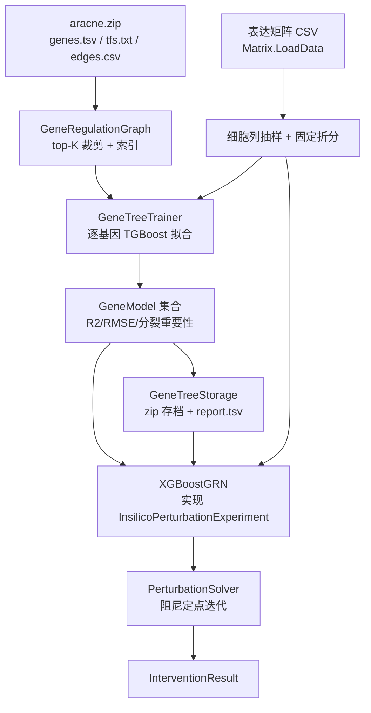

## 产品概述

在 `GeneTree` 项目中把 ARACNE 推断出的互信息网络升级为**可仿真的非线性动力学模型**：为网络中的每个靶基因 \(i\) 训练一个 XGBoost 回归器 \(f_i(X_{Reg(i)})\)，再通过实现 `InsilicoPerturbationExperiment` 接口，用阻尼定点迭代求解扰动后的新稳态，从而支持虚拟敲除、过表达、下调以及组合/批量扰动实验。

## 核心功能

- **网络拓扑加载**：从 `aracne.zip` 读取基因列表、转录因子标记与调控边（regulator / target / mi / correlation / interaction / prior / regulation）；也支持直接接收已加载的 `AracneNetwork` 对象。
- **表达数据加载**：通过 `Matrix.LoadData` 读取原始表达矩阵 CSV（行=基因、列=样本），作为训练特征/标签与野生型基线的唯一数值来源。
- **逐基因非线性拟合**：按 mi 降序为每个靶基因选取 top-K 调控因子作为特征，用梯度提升树拟合；无调控者或数据不足的基因退化为常数模型。
- **训练报告**：每个基因模型的 R²、RMSE、与“均值基线”的对比、被选中调控因子的分裂重要性，输出为可读表格文件。
- **虚拟扰动求解**：初始化表达状态→固定被扰动基因的取值→其余基因按 \(x_i^{new}=(1-\alpha)x_i^{old}+\alpha f_i(X_{Reg}^{old})\) 迭代，带训练值域裁剪、非负约束、收敛判定与多起点一致性检查；最终给出突变均值、绝对/百分比变化、Z-score 与显著性标记。
- **接口方法**：提供敲除（置 0）、过表达（均值+3SD）、下调（均值−2SD）三个标准方法，并额外提供组合扰动与批量扰动入口。
- **模型持久化**：训练结果可保存为 zip 存档，加载后无需重新训练即可继续做扰动实验。
- **测试工程**：提供参数化 console 测试程序，用 `DebugAudit` 记录检查点与耗时并生成审计报告（本次仅编译通过，不实际运行大数据）。

## 技术栈

- 语言/框架：VB.NET，`net10.0`（沿用 `GeneTree.vbproj` 现有设置：RootNamespace `SMRUCC.genomics.Analysis.GeneTree`）
- 机器学习：`xgboost.vbproj` 的 TGBoost 训练实现 `Microsoft.VisualBasic.MachineLearning.XGBoost.train.GBM`（`fit` / `predict(features As Single()())`）+ `train.ModelSerializer.save_model/load_model` 做模型文本持久化；训练集/验证集通过 `XGBoostDataSet` 项目的 `ToTrainingSet / ToValidateSet / ToTestDataSet` 扩展方法构建（因为 `TrainData/ValidationData` 的关键字段是 `Friend`，只能经此入口填充）
- 指标：复用 `Microsoft.VisualBasic.DataMining.Evaluation.Metric.r2_score / root_mean_square_error / mean_square_error`
- 网络：`Network.Regulons.vbproj` 的 `SMRUCC.genomics.Model.Network.Regulons.ARACNE`（`AracneEdge`、`StorageFile`）
- 表达矩阵：`HTS_matrix-netcore5.vbproj` 的 `SMRUCC.genomics.Analysis.HTS.DataFrame.Matrix`（`LoadData`、`rownames`、`sampleID`、`expression`、`IndexOf`）
- 扰动接口/结果：`InteractionModel.vbproj` 的 `SMRUCC.genomics.BioSystem.InsilicoPerturbationExperiment`、`Intervention.InterventionResult / InterventionSpec / InterventionMode`
- 归档：`System.IO.Compression.ZipArchive`（与 `StorageFile.vb`、`GEARSStorage` 相同风格）
- 测试：`ApplicationServices.Debugging.DebugAudit`（`Watch / Check / AreEqual / Mark / SaveReport`）

## 实现方案

### 关键决策

1. **拓扑与数值分离（避免 4.5 GB 白读）**：`aracne.zip` 的 `expression.bin` 为 18452×30409 的 `double`（实测 4.49 GB），而 `StorageFile.Load` 会完整读入；但存档向量已被 `rankTransform=1` 变成秩值，与用户指定的原始表达矩阵 CSV 不同源、也不可用。因此新增 `GeneRegulationGraph.LoadFromArchive(path)` **只读** `genes.tsv / tfs.txt / edges.csv` 三个条目（按表头名解析，不硬编码列序），同时保留 `GeneRegulationGraph.FromAracne(network)` 供已有 `AracneNetwork` 的调用方使用。这样内存峰值只由表达矩阵决定（约 4.5 GB），避免叠加到 ~9 GB。
2. **特征裁剪**：实测 784209 条有向边、1887 个调控因子、18404 个靶基因（平均 ~42.6 个调控者），必须按 `mi` 降序裁剪到 `MaxRegulators`（快速档默认 10）。特征顺序一旦确定即固定并随模型一起保存，预测时必须严格沿用，否则会静默错位。
3. **逐基因独立模型 + 常数回退**：调控者为空/全部缺失/样本不足的基因不训练 GBM，直接记录常数（训练集标签均值），避免破坏 `AttributeList/ColumnSampler` 在极小特征维度下的稳定性假设，同时保证求解器可以统一处理所有基因。
4. **训练抽样（用户确认的快速档）**：在全部 30409 个细胞上做**一次性、可复现**的列抽样 `min(MaxSamplesPerModel, nSamples)`，再按 `ValidationRatio`（默认 0.2）固定折分；样本数过小时取消早停（`valset = Nothing`）并把 `rowsample` 提到 1.0（`RowSampler` 是逐行伯努利采样，小样本全 0 会造成空训练集）。
5. **训练超参即 readme 的工程化建议**：`loss:="squareloss"`、`eval_metric:=Metrics.mse`、`maximize:=False`、`eta:=LearningRate(0.05)`、`num_boost_round:=40`（快速档）、`max_depth:=3`（浅树更平滑，利于定点迭代收敛）、`min_child_weight:=max(2, n*0.05)`、`rowsample:=0.8`、`colsample:=0.8`、`lambda:=5`、`gamma:=0`。
6. **自定义批量打分器（性能关键）**：`GBM.predict` 内部对**每棵树**调用 `Tree.predict`，而 `Tree.predict` 每次都用 PLINQ + 排序重建数组；扰动求解每轮要对上万个基因各做一次批量预测，PLINQ 开销会主导耗时。因此实现 `GeneModel.PredictBatch`：直接在 `GBM.trees`（`Public`）上用 `Tree.root` 与 `TreeNode`（`is_leaf / split_feature / split_threshold / left_child / right_child / nan_go_to / nan_child` 公有，叶值经 `leafValue` 公有属性）做紧凑循环，数值等价于 `first_round_pred + Σ(eta × leaf)`（模型使用 `SquareLoss`，其 `transform` 为恒等），并复刻缺失值分支（`Data.NA = -Single.MaxValue`）与 `nan_go_to = 3` 的“样本多的一侧”回退。该实现只读模型，不修改 xgboost 任何代码。
7. **扰动求解（Jacobi 双缓冲 + 按靶基因并行）**：读 `current`、写 `next`，避免同轮内先更新后读造成的顺序依赖；`Parallel.For` 按靶基因切分（每个基因只写自己的列，无竞争），每轮结束交换缓冲并计算最大相对变化；被扰动基因每轮强制写入干预值。求解复杂度 `O(iterations × targets × population × trees × depth)`，默认 `population=100`、`maxIterations=100`，16 核下每轮约 0.1–0.3 s。
8. **外推与多稳态**：预测值裁剪到训练标签 `[min, max]` 上下各放宽 `ClipFactor`（默认 1.2 缓冲，与 readme 一致），再叠加非负约束与阻尼；`PopulationSize` 个初始状态取自真实细胞（并做多起点一致性检查，输出“未收敛/疑似多稳态”标记而不是静默返回）。
9. **统计口径对齐 `InterventionResult`**：`WildtypeMeans/WildtypeSDs` 来自基线细胞；`MutantMeans` 为种群稳态均值；`FoldChanges = mutant − wildtype`（与 GEARS 现有实现一致，`PercentChanges` 按 `|wildtype|` 归一，`ZScores = FoldChange / SD`）；`IsSignificant = 被扰动基因 OrElse |z| > SignificanceZScore(默认 2)`；`Undefined = True` 表示目标基因不在网络中。`DynamicTrajectory` 语义在现有代码中存在歧义（`Double(,)()` 嵌套），本实现**不填充**，轨迹改由求解器结果对象暴露。
10. **`nSamples` 语义**：与 GEARS 保持一致——`nSamples > 0` 时用随机子集临时重算基线均值/标准差并据此抽取初始状态，实验结束后还原（`Try/Finally`），`0` 表示沿用训练时的基线。

### 可复现性与线程安全

`RowSampler` / `ColumnSampler` 使用全局随机数流（`Microsoft.VisualBasic.Math.RandomExtensions`）。多线程训练时逐基因 `SetSeed` 无法保证确定性，因此：`MaxDegreeOfParallelism > 1`（默认）时训练结果不完全可复现；`=1` 且在拟合前 `SetSeed(Seed + geneHash)` 时可复现。此行为在 XML 注释中显式说明，不隐藏。

### 主要执行流程



## 实施注意事项

- **不改动依赖项目**：`xgboost`、`XGBoostDataSet`、`ARACNE`、`InteractionModel` 一律只引用、不修改；所有适配逻辑放在 GeneTree 内。
- **不要自行格式化/解析 GBM 文本**：保存/加载统一走 `train.ModelSerializer`（其内部按当前区域文化格式化与解析，两端一致；自行 `ToString` 易引入 locale 不一致）。
- **显式类型转换**：`GeneTree.vbproj` 未设置 `OptionStrict`，但依赖项目大量使用 `Single`（`TrainData.origin_feature As Single()()`），所有 `Double→Single` / `Single→Double` 一律写 `CSng/CDbl`，避免隐式转换在不同配置下行为不一致。
- **内存**：表达矩阵约 4.5 GB（18533×30409 `double`）；训练时只保留当前基因的 `Single()()` 特征块，不做全量特征缓存；`GeneTreeConfig.MaxGenes` 提供限制规模的开关。
- **日志与进度**：复用现有 `.debug` / `VBDebugger` 风格，进度按“每 N 个基因”或“每 10 轮迭代”输出一次，避免 18404 行日志洪水；错误信息必须包含基因名与原因（缺失基因数量只打印前 10 个）。
- **数值健壮性**：表达值出现 `NaN`/负值时按缺失或截断处理（可配置）；`Single` 与 `NA = -Single.MaxValue` 判等必须用相等比较而非 `IsNaN`（`NA` 不是 NaN）。
- **存档体积**：18404 个模型（每个约 40 棵树）单文件文本约数百 MB，压缩后明显减小；保存时用 `CompressionLevel.Optimal` 并对模型条目使用 `BufferedStream` 流式写入，避免整块字符串驻留内存。
- **测试工程隔离**：`GeneTree.vbproj` 增加 `<Compile Remove="test\**" />`（及 `EmbeddedResource`/`None`），否则 `test/Program.vb:Main` 会被打进库导致“多个入口点”错误；测试工程只编译不运行。

## 目录结构

以下路径均位于 `G:\GCModeller\src\GCModeller\sub-system\GeneTree\`：

```
GeneTree/
├── GeneTree.vbproj            [MODIFY] 增加 XGBoostDataSet / DataMining / HTS_matrix 的 ProjectReference；
│                                        增加 <Compile Remove="test\**" /> 等排除项；其余属性保持不变
├── GeneTreeConfig.vb          [NEW] 全量超参与求解参数 + Fast/Balanced/Full 预设 + Validate()。
│                                    字段：MaxRegulators、MaxSamplesPerModel、ValidationRatio、NumBoostRound、
│                                    MaxDepth、LearningRate、RowSample、ColSample、Lambda、Gamma、MinChildWeight、
│                                    MinSampleSplit、EarlyStoppingRounds、Seed、MaxDegreeOfParallelism、
│                                    ClippingFactor、DampingAlpha、MaxIterations、ConvergenceTolerance、
│                                    PopulationSize、SignificanceZScore、MinSamples、ClipNegative、MaxGenes
├── GeneRegulationGraph.vb     [NEW] 拓扑模型：Genes/TfFlags/TargetRegulators（含 mi、correlation、prior、
│                                    regulation）/RegulatorIndex。提供 FromAracne(network)、
│                                    LoadFromArchive(path|stream)（仅读 genes.tsv/tfs.txt/edges.csv，按表头解析）、
│                                    TopK 裁剪、基因名与矩阵行索引映射、统计摘要
├── GeneModel.vb               [NEW] 单基因模型：Gene、Regulators、RegulatorIndex、MinValue/MaxValue、
│                                    Booster(train.GBM)、Constant、Performance。PredictBatch(Single()()) 为
│                                    自定义紧凑树遍历（含缺失分支与 nan_go_to=3 回退），与 GBM.predict 等价
├── GeneTreeTrainer.vb         [NEW] 训练编排：抽取细胞列、构建特征/标签、ToTrainingSet/ToValidateSet、
│                                    GBM.fit、留出集 R²/RMSE 与均值基线对比、分裂重要性统计、
│                                    Parallel.For 训练 + 进度回调 + 失败基因降级
├── TrainingReport.vb          [NEW] 报告数据结构与写盘：report.tsv（gene,nRegulators,nTrain,nValidate,
│                                    r2,rmse,baselineR2,kind,trees）与 importance.tsv
│                                    （gene,regulator,mi,correlation,splits,weight,rank）+ 汇总摘要
├── PerturbationSolver.vb      [NEW] 阻尼定点迭代：双缓冲、按靶基因并行、干预值钉定、裁剪/非负、
│                                    相对收敛判据、多起点一致性、SolveResult（稳态矩阵、轨迹、轮数、收敛标志）
├── XGBoostGRN.vb              [NEW] 门面 + 接口实现：Open(zipPath, expressionCsv, config)、FromAracne、
│                                    Fit、Predict(specs)、KnockoutGene/OverexpressGene/KnockDownGene、
│                                    PredictCombination、BatchPerturbation、CreateUndefinedResult、
│                                    nSamples 临时基线、ToString 摘要
├── GeneTreeStorage.vb         [NEW] zip 存档：manifest.tsv / genes.tsv / graph.tsv / baseline.bin
│                                    （mean,sd,min,max）/ population.bin（初始种群）/ models/index.tsv /
│                                    models.txt（ModelSerializer 分段）/ report.tsv；Save(Stream)/Load(Stream)
└── test/
    ├── test.vbproj            [NEW] OutputType=Exe、net10.0，引用 GeneTree.vbproj 与所需依赖
    ├── Program.vb             [NEW] Main(args)：解析参数、异常兜底、返回退出码（参考 GEARS/test/Program.vb）
    └── GeneTreeDemo.vb        [NEW] 参数化演示：拓扑加载 → 矩阵加载 → Fit → DebugAudit 检查（R²>0、
                                      模型数>0、扰动显著基因数≥1）→ Save/Load → 单基因敲除 → SaveReport；
                                      文件缺失时打印用法并安全退出（本次不运行）
```

## 关键代码结构

```
''' <summary>单个基因的非线性调控函数 f_i 及其训练统计</summary>
Public Class GeneModel
    Public Property Gene As String
    Public Property Regulators As String()          ' 特征顺序，必须与训练时一致
    Public Property RegulatorIndex As Integer()     ' 在表达矩阵中的行下标
    Public Property MinValue As Double              ' 训练标签下界（外推裁剪用）
    Public Property MaxValue As Double              ' 训练标签上界
    Public Property Booster As XGBoost.train.GBM    ' Nothing 表示退化为常数模型
    Public Property Constant As Double
    Public Property Performance As ModelPerformance ' R2、RMSE、baselineR2、importance

    ''' <summary>批量预测；返回顺序与 features 行序一致</summary>
    Public Function PredictBatch(features As Single()()) As Double()
End Class
```

```
''' <summary>XGBoost 拟合的基因调控网络虚拟扰动实验（门面）</summary>
Public Class XGBoostGRN : Implements InsilicoPerturbationExperiment

    Public Shared Function LoadTopology(zipPath As String) As GeneRegulationGraph
    Public Shared Function Open(zipPath As String, expressionCsv As String,
                                Optional config As GeneTreeConfig = Nothing) As XGBoostGRN
    Public Shared Function FromAracne(network As AracneNetwork, expression As Matrix,
                                      Optional config As GeneTreeConfig = Nothing) As XGBoostGRN

    Public Function Fit(Optional progress As Action(Of Integer, Integer) = Nothing) As TrainingReport
    Public Function Predict(specs As IEnumerable(Of InterventionSpec)) As InterventionResult
    Public Function PredictCombination(genes As IEnumerable(Of String),
                                       Optional mode As InterventionMode = InterventionMode.Knockout) As InterventionResult
    Public Function BatchPerturbation(genes As IEnumerable(Of String),
                                      Optional mode As InterventionMode = InterventionMode.Knockout) As List(Of InterventionResult)

    Public Sub Save(file As Stream)
    Public Shared Function Load(file As Stream) As XGBoostGRN

    Public Function KnockoutGene(geneName As String, Optional nSamples As Integer = 0) As InterventionResult Implements InsilicoPerturbationExperiment.KnockoutGene
    Public Function OverexpressGene(geneName As String, Optional nSamples As Integer = 0) As InterventionResult Implements InsilicoPerturbationExperiment.OverexpressGene
    Public Function KnockDownGene(geneName As String, Optional nSamples As Integer = 0) As InterventionResult Implements InsilicoPerturbationExperiment.KnockDownGene
End Class
```

## 性能与风险

| 环节 | 复杂度/开销 | 缓解措施 |
| --- | --- | --- |
| 拓扑加载 | 784209 行 CSV 解析，`O(E)`；每靶基因 top-K 选取 `O(E·log k)` | 只读 3 个条目；跳过 4.5 GB `expression.bin` |
| 训练 | 18404 个模型 × 40 轮 × ≤10 特征 × ≤1000 行；整体 `O(T·R·k·n)` | 并行 + 抽样 + 浅树；快速档预计分钟级 |
| 扰动求解 | 每轮 `O(T·P·trees·depth)`，16 核约 0.1–0.3 s | 紧凑打分器、双缓冲、按基因并行、`MaxIterations` 上限 |
| 存档 | 模型文本数百 MB | 流式写入 + Optimal 压缩 + `BufferedStream` |
| 主要风险 | 树模型外推平台化、迭代震荡/多稳态、rank 与原始值混用 | 训练值域裁剪、阻尼 0.1、多起点一致性检查、数值只取自 CSV 原始矩阵 |


## 验证方式

1. `dotnet build` 编译 `GeneTree.vbproj` 与 `test/test.vbproj`，确保接口实现与依赖引用全部通过（本次不运行）。
2. 代码层面自查：`Implements` 三个方法签名与接口一致；`GeneModel.Regulators` 顺序在训练、预测、存档三处一致。
3. 用户侧运行 `GeneTreeDemo`（参数：zip 路径、CSV 路径、输出目录、预设档）后，查看 `DebugAudit` 报告与 `report.tsv` / `importance.tsv`。

## Agent Extensions

### SubAgent

- **code-explorer**
- Purpose: 在动工前复核 `train.GBM / ModelSerializer / TreeNode / Conversion / Matrix` 的精确成员签名与可见性，避免基于 README 中已过时的示例 API（例如 README 提到的 `XGBoostModel.Load`、`TGBoost.Train`、`CsvLoader` 在代码中并不存在）写出无法编译的调用。
- Expected outcome: 输出一份“实际可用 API 清单”（含命名空间、可见性、参数顺序），作为实现 `GeneTreeTrainer` 与 `GeneModel` 的唯一依据。

### Skill

- **lsp-code-analysis**
- Purpose: 用语言服务确认 `InsilicoPerturbationExperiment` 的实现者与 `InterventionResult` 的成员类型（例如 `DynamicTrajectory As Double(,)()`），保证新门面类与既有 GEARS 实现保持同一契约。
- Expected outcome: 得到接口实现位置与成员引用清单，确保 `XGBoostGRN` 的签名、命名空间导入与返回对象填充全部对齐既有实现，不产生契约偏差。