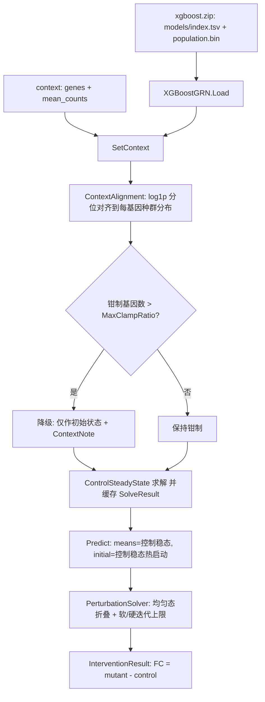

## 产品概述

修复 GeneTree（XGBoost 非线性基因调控网络）虚拟扰动实验中“扰动后变化几乎为零”的问题，使 `G:\vcc2026\scripts\xgboost_predict.R` 在**不修改脚本**的前提下，基于 `xgboost.zip` 与 pseudobulk context A/B/C 产出有统计意义、可与 Perturb-seq 真值比较的 fold-change 矩阵。

## 核心功能

- 上下文（context）注入语义修正：全基因组 context 不再把整个网络钳死，超过阈值时自动降级为“仅作迭代初始状态”，并给出诊断信息。
- 上下文数值对齐：每次 `set_context` 都对 context 做强制分位对齐，把外部管线（mean_counts）的数值映射到模型自身的表达尺度，且保证落在每个基因的训练值域内。
- 扰动幅度语义修正：敲低为“保留野生型的 20%”、过表达为“2 倍”，均可配置，取值为负时夹取为 0。
- 差异基线修正：有 context 时以“同一 context 下无扰动的控制稳态”作为 Wildtype 基线并作为热启动点，使 FoldChange 只反映扰动响应、自动扣除模型自身漂移。
- 求解稳定性与性能：迭代硬上限保证多级级联收敛；初始状态各细胞完全一致时自动折叠为单细胞，单次扰动从分钟级降到秒级。
- 诊断可见性：`get_context` / `solver_history` / 控制台消息输出“是否对齐、钳制是否降级、是否收敛、是否超出软上限”，便于判定结果可信度。
- R# 包 API 同步升级并保持既有调用兼容（`set_context(..., fix = TRUE)` 仍可运行）。

## 技术栈

- 语言：VB.NET，`net10.0`；项目 `G:\GCModeller\src\GCModeller\sub-system\GeneTree\GeneTree.vbproj`（RootNamespace 已置空，源码内 `Namespace SMRUCC.genomics.Analysis.GeneTree`）。
- 机器学习：`Microsoft.VisualBasic.MachineLearning.XGBoost.train.GBM`（TGBoost，`GBM.predict` = `first_round_pred + eta×Σtree`，现走 `kernels/FlatTree.AccumulateAll`）；`GeneModel.PredictBatch` 的紧凑遍历与之语义等价（已核对 `Tree.fit` 保留 `_root`、`ClassList.update_pred(eta)` 与 predict 缩放一致，**未发现 xgboost 侧缩放 bug，本次不修改 xgboost**）。
- 数值/统计：`System.Math`、经验分位数（排序 + 线性插值）。
- R# 前端：`G:\GCModeller\src\workbench\R#\biosystem\geneTreeTools.vb`（`<Package("geneTree")>`、`RInternal.debug.stop`、`RInternal.Object.list/dataframe`、`CLRVector.asCharacter/asNumeric`、`env.AddMessage`）。
- 归档：`GeneTreeStorage`（zip + `manifest.tsv` 的 `opt.*` 键，`readConfig` 对缺键有默认值，可向后兼容）。

## 问题定位（实测证据，作为修改依据）

1. 决定性：`pert_context_A/foldchange_matrix.csv` 抽样 278,100 个值，仅 14 个非零（maxAbs 4.5、meanAbs 8.2e-5）。原因 `pseudobulk_context_A.csv` 含 18533 个基因（等于模型全部基因），`fix = TRUE` 把它们全部放进 `pinned`，`PerturbationSolver.iterate` 每轮强制写回 context 值 → 网络无自由度，FoldChange ≡ 0。
2. 尺度不一致：模型 `baseline.bin` 逐基因训练均值（log1p 后 q25/q50/q75/q95 = 0.018/0.087/0.209/0.476）与 context（0/0.177/0.842/1.765）差异显著（q95 差 1.29 个 log 单位），3008 个基因超训练上界；两者来自不同归一化管线（log10 相关 0.67）。
3. 模型灵敏度固有偏低：`importance.tsv` 抽样 20 万条，调控边 `sensitivity` 中位数 0.0114、p90 0.118、p99 0.423（表达量标度 0~5），单边平均只带来约 1% 变化。属训练超参问题（`opt.maxRegulators=0`、`maxDepth=4`、`lambda=5`），本次通过语义修正让这些真实信号显现，不做任何无依据放大。
4. 基线混入漂移与迭代不足：原实现 `means = m_means.Clone()` 作为 Wildtype；`maxIterations=60 × alpha=0.1` 对多级级联不足；且每次 `Predict` 都 `clonePopulation()`（18533×1000 双精度，148 MB），300 次扰动产生巨量分配。

## 实施方案（关键决策）

1. **钳制自动降级**（用户确认）：`SetContext` 中若钳制基因数 > `MaxClampRatio`（默认 0.05）× 模型基因数，则把 `m_contextFix` 置为 `False`（仅作初始状态），把原因写入 `ContextNote`，R# 侧用 `env.AddMessage(..., WRN)` 提示。保留真正的小规模 knock-in 能力。
2. **强制分位对齐**（用户确认）：`set_context` 每次执行对齐。算法：对 context 值取 `log1p` → 在“跨基因经验分布”上求分位 `p_i` → 在该基因自身种群分布（`m_population(g)`，1000 个观测）上取 `p_i` 分位（线性插值）→ `expm1` → 夹取非负。保证值落在训练值域内、保留跨基因排序、消除管线尺度差。复杂度 `O(G·P log P)`，`G=18533, P=1000`，一次调用约 2–4 s；结果缓存进 `m_context`，仅重算一次。
3. **KD/OE 比例语义**（用户确认）：`Knockout → 0`、`Knockdown → baseline × KnockdownResidual(0.2)`、`Overexpression → baseline × OverexpressionFactor(2.0)`、`Custom → spec.Value`，负值按 `ClipNegative` 夹取为 0；不再依赖 `mean ± k·SD`（共享类型 `InterventionSpec` 不改，避免影响 BNLearn/GEARS）。
4. **控制稳态基线 + 热启动**（用户确认）：`ControlSteadyState` 重构为缓存 `SolveResult`（`m_controlSolve`），`Predict` 在 `HasContext AndAlso BaselineFromControlSteadyState` 时使用其 `GetMeans()` 作为 `WildtypeMeans`、其 `SteadyState` 克隆作为迭代起点；无 context 时保持原行为（不改变历史结果语义）。
5. **求解器性能与收敛**：`SolveResult` 增加 `Collapsed`、`ExceededSoftLimit`；`Solve` 检测初始状态各细胞完全一致（context 覆盖全基因组时必然发生）则折叠为 `P=1`（1000→1）；迭代上限改为“软上限 `MaxIterations` + 硬上限 `MaxIterationsHardCap`（默认 max(60×5, 300)）”，超过软上限继续迭代并在结果中标记，保证深层层级联也收敛。
6. **不改变导出器**：`BNLearn/Intervention/InterventionComparison.vb` 的 `FormatVal(fmt:="F4")` 保持不动；修复后 |FC| 处于 1e-3~1e0 量级，4 位小数足够分辨。
7. **性能预期**：折叠后单次扰动 `≈1–3 s`（18533 基因 × ~200 树 × 深度 4 × 1 细胞 × ≤300 轮），每 context 一次控制求解（~3 s），900 次扰动约 15–45 min；若某 context 仅部分覆盖基因则不会折叠，需靠迭代/并行度控制。

## 实施注意事项

- `SetContext` 在未拟合模型上调用时需要 `m_population` 做对齐：`IsFitted = False` 且 `align = True` 时抛出明确异常（“请先 fit_tree 或加载已训练模型”）。
- 对齐与降级都必须写入模型状态（`ContextAligned`、`ContextNote`、`ContextClampGenes`），并让 `get_context` 可读，避免“静默改语义”。
- 缓存一致性：`SetContext`/`ClearContext`/`Fit`/`RestoreState` 必须失效 `m_controlSolve`、`m_control`、`m_lastSolve`；`solver_opts` 需失效 `m_solver`。
- `PerturbationSolver` 并行体保持不变（Jacobi 双缓冲 + 线程局部 `SolverBuffer`），折叠只影响 `population` 维度，避免引入新的竞态。
- z-score：`sds(i) ≤ 1e-6` 时 `zscore = 0`；显著性 = 被干预基因或 `|z| > SignificanceZScore`，保持现状。
- 存档兼容：新增 `opt.*` 键在旧 zip 缺失时走默认值，`FORMAT_VERSION` 不升级。
- 数值安全：对齐输入中 `NaN/∞` 直接报错；负值先夹 0 再 `log1p`；单值/常量基因回退到其均值。
- 日志：不做逐基因打印；仅在 context 变更、控制求解、未收敛、超出软上限时输出一行。
- 不改动 `xgboost`、`XGBoostDataSet`、`ARACNE`、`InteractionModel`、`BNLearn` 的既有行为（若确需改动 xgboost 才触发 `R_system.NET5.slnx` 编译）。

## 架构设计

数据流（修改后）：



## 目录结构

以下均位于 `G:\GCModeller\src\GCModeller\sub-system\GeneTree\`：

```
GeneTree/
├── GeneTreeConfig.vb        [MODIFY] 新增 KnockdownResidual/OverexpressionFactor/MaxClampRatio/
│                                     MaxIterationsHardCap/BaselineFromControlSteadyState/
│                                     CollapseUniformPopulation/ContextQuantileAlignment；
│                                     扩展 GetValidationErrors()、ToString()
├── ContextAlignment.vb      [NEW]    log1p 域分位对齐：跨基因经验分布求 p，再按每基因自身
│                                     种群分布取分位；常量/空分布回退；O(G·P log P)
├── XGBoostGRN.vb            [MODIFY] SetContext(强制对齐 + 钳制自动降级 + 诊断属性)、
│                                     ClearContext、ContextAligned/ContextNote/ContextClampGenes、
│                                     GetControlSolve() 缓存 SolveResult、Predict 使用控制稳态基线 +
│                                     热启动、predictInternal 改为 KD/OE 比例语义并夹取非负、
│                                     ResetSolver()
├── PerturbationSolver.vb    [MODIFY] 均匀初始态折叠为 P=1；软/硬迭代上限；
│                                     SolveResult 增加 Collapsed/ExceededSoftLimit
├── GeneTreeStorage.vb       [MODIFY] writeManifest/readConfig 增加新 opt.* 键（缺键走默认）
├── test/GeneTreeDemo.vb     [MODIFY] context 示例适配新语义（对齐/降级/控制稳态基线）
└── (GeneModel/GeneTrainer/TrainingReport/GeneRegulationGraph 不改)
```

R# 侧：

```
G:\GCModeller\src\workbench\R#\biosystem\geneTreeTools.vb  [MODIFY]
    set_context(tree, genes, expression, fix = FALSE, align = TRUE, env)
        → tree.SetContext(...) 后把 ContextNote 以 env.AddMessage(..., WRN) 输出，返回 tree
    get_context → 增加 aligned / note / clamp_genes 槽位
    solver_opts(tree, iterations, damping, tolerance, hard_cap) → 修改 tree.Config 并 tree.ResetSolver()
```

## 关键代码结构

```
' GeneTreeConfig.vb 新增（其余字段保持不变）
Public Property KnockdownResidual As Double = 0.2            ' KD 后保留的野生型比例 [0,1)
Public Property OverexpressionFactor As Double = 2.0         ' OE 倍数 >= 1
Public Property MaxClampRatio As Double = 0.05               ' 允许钳制的基因比例上限 (0,1]
Public Property MaxIterationsHardCap As Integer = 300        ' 迭代硬上限 >= MaxIterations
Public Property BaselineFromControlSteadyState As Boolean = True
Public Property CollapseUniformPopulation As Boolean = True
Public Property ContextQuantileAlignment As Boolean = True
```

```
' ContextAlignment.vb
Public Module ContextAlignment
    ''' context: 基因名→表达值；population: 基因主序的表达种群(gene)(cell)
    Function Align(context As IDictionary(Of String, Double),
                   population As Double()(),
                   geneIndex As IDictionary(Of String, Integer)) As Dictionary(Of String, Double)
End Module
```

```
' PerturbationSolver.vb / SolveResult 新增
Public Property Collapsed As Boolean          ' 初始状态各细胞一致时折叠为单细胞
Public Property ExceededSoftLimit As Boolean  ' 超过 MaxIterations 但仍在硬上限内继续迭代
```

## 编译与验证（用户指定流程）

1. 本次不改 `xgboost`（已核对 predict/fit 缩放一致），因此**跳过** `R_system.NET5.slnx`；若执行过程中确实改了它，先跑：
`dotnet build "G:\GCModeller\src\R-sharp\R_system.NET5.slnx" -c Rsharp_app_release -p:Platform=x64`
2. GCModeller 库编译：
`dotnet build "G:\GCModeller\src\GCModeller.slnx" -c Rsharp_app_release -p:Platform=x64`
3. 运行（脚本保持原样）：
`cd G:\GCModeller\src\R-sharp\App\net10.0`
`R#.exe "G:\vcc2026\scripts\xgboost_predict.R" --attach G:\GCModeller\ --debug=none`
4. 验收：

- `pert_context_{A,B,C}/foldchange_matrix.csv` 非零比例从 ~0.005% 提升到多数非零；|FC| p50 预期 1e-3~1e-2、p99 达 1e-1~1e0（跑完后用只读脚本统计非零比例与分位数）。
- 控制台 `solver_history` 显示 `iterations`、`converged`、`collapsed`、`exceeded_soft_limit`；每 context 只打印一次“已自动降级/已对齐”的警告。
- 单次扰动耗时与 900 次总耗时在 15–45 min 量级。
- 回归检查：不设 context 时 `test/GeneTreeDemo` 仍可跑通（语义与旧行为一致）。