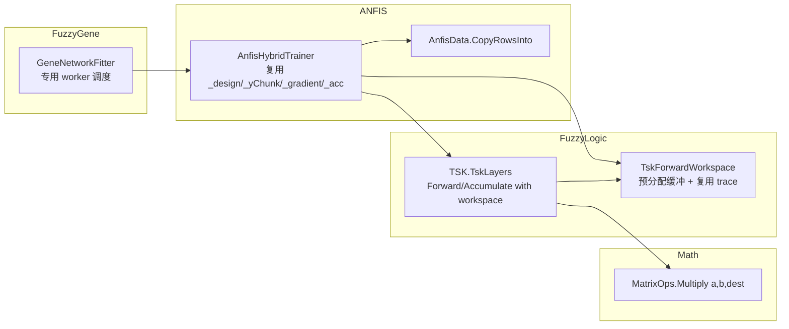

## Product Overview

把 ANFIS 训练热路径上"每 chunk 重新分配"的缓冲改为**每线程复用**，并把 FuzzyGene 的逐基因并行调度从 `Parallel.For` 换成 N 个专用长任务，使 128 核服务器能真正跑满、单基因训练成本显著下降。

## Core Features

- **消除每 chunk 的大对象分配**：设计矩阵、前向 trace、梯度缓冲、最小二乘累加器、`MatrixOps` 的 jagged 转换全部改为预分配后复用。
- **调度器改造**：`GeneNetworkFitter` 用 N 个 `LongRunning` worker + `Interlocked` 取号，保留动态负载均衡，并输出实际并发 worker 数。
- **可测量的收尾**：训练报告新增"分配字节数 / Gen2 GC 次数 / 实际 worker 数"，改造前后可直接在服务器上对比。
- **行为不变**：R²、边集（source, target）与符号保持一致；允许权重末位差异。

## Tech Stack

- 语言/运行时：VB.NET / .NET 10.0（沿用现有工程，不引入新依赖）
- 工程：`FuzzyLogic`（TSK 前向/反向）、`ANFIS`（训练器）、`Math.Net.Matrix`（矩阵内核）、`FuzzyGene`（逐基因编排）
- 构建：`dotnet build <vbproj> -c Debug -p:Platform=x64`；R# 插件 `-c Rsharp_app_release -p:Platform=x64 -p:Optimize=true`

## Implementation Approach

### 0. 先量化，再改造

用现有 300 基因 demo 矩阵（`K:\hsa_grn\20261025\small_demo_matrix.csv`，`maxTrainRows=4000, mfCount=2, maxEpoch=40`）建立基线：`GC.GetTotalAllocatedBytes(precise:=True)` 前后差、`GC.CollectionCount(2)`、wall time、`DOP={8,24}` 的扩展曲线。据此确认收益来自"消除分配"而非其他因素。

依据已核实的分配账（n=4, m=2, R=16, P=80, chunkRows=512, 每 epoch 8 个 chunk）：

| 分配点 | 单次大小 | 频次 |
| --- | --- | --- |
| `New LeastSquaresAccumulator`（`_xtx`+`_xty`+`_columnBuffer`） | ≈380 KB | **每 epoch 1 次** |
| `New Double(size-1, p-1)` 设计矩阵 | 328 KB | 每 chunk |
| `TskLayers.Forward` 内部整套缓冲（W/wbar/fValues/prod…） | ≈345 KB | 每 chunk × 2（LSE + 梯度） |
| `MatrixOps.Multiply` 的 jagged 转换 | 512 个小数组 | 每 chunk × 1 |
| `TskGradient`/`delta`/`coefficient`/`column`/`logGrad` | 数十 KB | 每 chunk |


合计约 9.5 MB/epoch，单基因 15~40 epoch ⇒ 140~380 MB/基因；按其服务器实测 18264 个基因、579469 CPU·s 推算，全量分配在 **2.6~7 TB** 量级。Server GC 已开启但无显著改善，说明必须从"少分配"入手，同时确认真实线程数。

### 1. Math 层：`MatrixOps.Multiply(a, b, dest)`

新增写入调用方缓冲的重载，内部不再构造 jagged 行数组（现有实现每次为 A 新建 rowsA 个行数组，这正是"小对象海量分配"的主要来源）。矩阵规模很小（A: 512×4，B: 4×16），用行主序三重循环 + 内层累加即可；用户已确认**允许末位差异**，因此不要求保留 `SimdMatrix.Dot`/`DotFma` 的累加顺序。现有 `Multiply(a,b)` 签名与语义不动。

### 2. FuzzyLogic 层：`TskForwardWorkspace`

新增工作区类型，按"容量 = 最大 chunk 行数"一次性分配 `xRows / mu / logMu / W / wbar / sumW / valid / fValues / pt / prod / Z`，并内嵌一个复用的 `TskInferenceTrace`（只更新 `RowStart` 与 `SampleCount`）。

- 新增 `Forward(x, rowStart, rowCount, workspace)`，写入工作区后返回 `workspace.Trace`；原 `Forward(x, rowStart, rowCount)` 保留（内部走原路径，保证其他消费者行为不变）。
- 新增 `BuildDesignMatrix(fwd, a, allowPadded)`，允许 `a.GetLength(0) >= fwd.SampleCount`；原三参重载保持严格校验。
- 新增 `Accumulate(fwd, y, computeThetaGradient, workspace)`：复用 `delta / coefficient / column / logGrad` 与一个复用的 `TskGradient`（每 chunk 前清零）。
- `Forward` 内把 `prod` 改为指向工作区缓冲（调用第 1 步的新重载）。

正确性要点：`TskInferenceTrace` 的所有消费者都只遍历 `t < fwd.SampleCount`，padding 区不会被读取；因此复用是安全的，但**调用方不得跨调用持有 trace 引用**，这一点写进 XML 注释。

### 3. ANFIS 层：`AnfisHybridTrainer` 复用

- 新增字段：`_workspace`、`_design`、`_yChunk`、`_gradient`、`_acc`，在构造/首次使用时按 `min(ChunkRows, rows) × P` 与 `capacity × P` 惰性分配。
- `LeastSquaresAccumulator` **移出 epoch 循环**，每轮 `Reset()`（该类已有 `_xtx/_xty` 清零方法，且 `EnsureColumnBuffer` 已带缓存；补一个"只扩容不缩容"的容量语义，避免 chunk 512/437 之间反复重建）。
- `SolveConsequent`：清空 `_design` 的前 `size` 行后 `BuildDesignMatrix` 写入；y 用新增的 `AnfisData.CopyRowsInto(dst, src, start, count)` 拷进 `_yChunk`，替代每次分配的 `SliceRows`。
- `GradientStep` / `ComputeRmse` / `ComputeRuleActivations` 统一走 workspace；`AnfisFitting.Evaluate` 与 `PruneRules` 内部的前向也接同一套（它们同样 per-chunk 分配 trace）。
- 每次真正写盘的数据（模型、历史曲线、`BuildResult` 的 `FittedValues/Residuals`）保持原样，只复用**中间**缓冲。

### 4. FuzzyGene 层：专用 worker 调度

把 `Parallel.For(0, n, options, work)` 换成 `workers = If(cfg.DegreeOfParallelism > 0, cfg.DegreeOfParallelism, Environment.ProcessorCount)` 个 `Task.Factory.StartNew(..., TaskCreationOptions.LongRunning)`，每个 worker 用 `Interlocked.Increment(cursor)` 领取基因下标：

- 保证 128 条线程**启动即就位**，不受 ThreadPool hill-climbing 影响；
- 仍是动态领取，避免 `VectorTask` 静态均分在"每基因耗时差异大"时的尾巴失衡；
- 进度日志追加 `workers=N`（并把已完成数与吞吐一起打印）；
- 异常处理：`FitOneGene` 已自带 try/catch 写入 `metrics`，worker 只需汇总未捕获异常，`Task.WaitAll` 后统一抛出。
- 顺带把 `layer.Forward`（`meanActivation` 与灵敏度网格）也接 workspace，属同一 sub 内复用。

### 5. 可观测性与验收

- `FuzzyGeneTrainingResult` 新增 `AllocatedMB`、`Gen2Collections`、`ParallelWorkers` 三项，写入 `report.txt`，服务器上直接可见。
- 验收：FuzzyGene 自测 66 条断言全通过；demo 矩阵 A/B 的 `mean R2` 差 < 1e-9、边集与符号完全一致；单基因分配下降 ≥80%，`CollectionCount(2)` 下降 ≥80%，24 线程 wall time 提升 ≥25%；给出 128 核上 DOP=24/72/128 的扩展曲线。

### 风险与边界

- **只新增重载/新类型，不改任何既有公共签名**（四个工程都有其他消费者）。
- `TskForwardWorkspace` 非线程安全：由 `AnfisHybridTrainer` 实例私有持有，而每个基因训练独占一个实例，因此天然是"每线程一份"。
- 复用后必须关注"脏数据"：设计矩阵与 `_gradient` 每 chunk 显式清零（只清实际用到的行，减少 memset 开销）。
- 不引入随机，同输入同 DOP 结果可复现；末位差异仅来自点积累加顺序，已在 q-1 中确认可接受。
- 明确不改 `ConcurenceRunner.vb` / `VectorTask`（其 `Run()` 同样是 `Parallel.For` + 静态均分，对本场景更差）。

## Architecture Design



数据流：`GeneNetworkFitter`（N 个 worker 各领基因）→ `AnfisHybridTrainer.Train`（epoch × chunk）→ `TskLayers.Forward(..., workspace)` 写入预分配缓冲 → `BuildDesignMatrix` 写 `_design` → `LeastSquaresAccumulator.AddChunk` 累加 → `Solve` 得 θ。全程只保留一次"每基因"的分配（模型本身与曲线）。

## Directory Structure

```
G:\GCModeller\src\
├── runtime\sciBASIC#\Data_science\
│   ├── Mathematica\Math\Math\Algebra\Matrix.NET\Extensions\
│   │   └── MatrixOps.vb                         # [MODIFY] 新增 Multiply(a, b, dest) 重载：不建 jagged，直接写入调用方缓冲；原 Multiply(a,b) 保留
│   ├── DataMining\FuzzyLogic\TSK\
│   │   ├── TskForwardWorkspace.vb               # [NEW] 前向/反向工作区：按容量预分配 xRows/mu/logMu/W/wbar/sumW/valid/fValues/pt/prod/Z，内嵌可复用 TskInferenceTrace 与 TskGradient；仅由单个训练器线程使用
│   │   └── TskLayers.vb                         # [MODIFY] 新增 Forward(...,workspace) / BuildDesignMatrix(fwd,a,allowPadded) / Accumulate(...,workspace) 重载；Forward 内 prod 走 dest 重载
│   └── MachineLearning\ANFIS\
│       ├── Training\AnfisHybridTrainer.vb        # [MODIFY] 持有 _workspace/_design/_yChunk/_gradient/_acc；acc 移到 epoch 外每轮 Reset；SolveConsequent/GradientStep/ComputeRmse 全部复用；只保留每基因一次的输出分配
│       ├── Training\AnfisData.vb                 # [MODIFY] 新增 CopyRowsInto(dst, src, start, count)，替代热路径上的 SliceRows 分配
│       └── AnfisFitting.vb                       # [MODIFY] Evaluate/ComputeRuleActivations/PruneRules 的分块前向改用 workspace
└── GCModeller\sub-system\FuzzyGene\
    ├── Fitting\GeneNetworkFitter.vb              # [MODIFY] Parallel.For -> N 个 LongRunning worker + Interlocked 取号；日志打印实际 worker 数；记录分配字节/Gen2 次数
    ├── Fitting\FuzzyGeneTrainingResult.vb        # [MODIFY] 新增 AllocatedMB / Gen2Collections / ParallelWorkers 并在 ToString 输出
    └── test\Program.vb                           # [MODIFY] 新增 --bench 模式：同一矩阵上量 wall time / 分配 / Gen2，并作为 A/B 对拍入口
```

## Key Code Structures

```
' FuzzyLogic/TSK/TskForwardWorkspace.vb —— 公开契约（仅接口级）
Public Class TskForwardWorkspace
    Public ReadOnly Property Capacity As Integer
    Public ReadOnly Property Trace As TskInferenceTrace      ' 复用对象，仅 SampleCount/RowStart 变化
    Public ReadOnly Property Gradient As TskGradient         ' 复用对象，每 chunk 清零
    Public Sub New(capacity As Integer, network As TskNetwork)
    Public Sub ClearGradient()
End Class

' TskLayers 新增重载
Public Function Forward(x As Double()(), rowStart As Integer, rowCount As Integer,
                        workspace As TskForwardWorkspace) As TskInferenceTrace
Public Sub BuildDesignMatrix(fwd As TskInferenceTrace, a As Double(,), allowPadded As Boolean)
Public Function Accumulate(fwd As TskInferenceTrace, y As Double(,), computeThetaGradient As Boolean,
                           workspace As TskForwardWorkspace) As TskGradient

' Math：写入给定缓冲
Public Sub Multiply(a As Double(,), b As Double(,), dest As Double(,))

' ANFIS：零分配的 y 切片
Public Shared Sub CopyRowsInto(dst As Double(,), src As Double(,), start As Integer, count As Integer)
```

# Agent Extensions

- **code-explorer**
- Purpose: 在改造前做一次"改动面"清点——枚举 `TskLayers.Forward`、`BuildDesignMatrix`、`Accumulate`、`MatrixOps.Multiply`、`AnfisHybridTrainer`、`AnfisData.SliceRows` 在四个工程（含 GPS、GEARS、biosystem 等消费者）里的全部调用点，确认新增重载不会与既有调用冲突、也没有别处依赖 `TskInferenceTrace` 跨调用存活。
- Expected outcome: 一份调用点清单（文件:行 + 调用形式），作为"只新增不改签名"这一约束的验证依据；若发现存在跨调用持有 trace 的地方，则在这些位置改用非工作区重载。