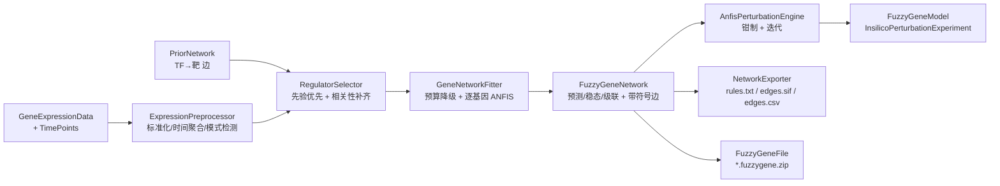

## 用户需求

在 `FuzzyGene` 工程中，基于现有的模糊逻辑推理引擎（TSK）与 ANFIS 训练栈，实现一套「基因表达调控网络（GRN）拟合建模」能力，并让拟合出的模型直接实现 `InsilicoPerturbationExperiment` 接口，从而复用 BNLearn 已有的虚拟扰动分析代码。方法学以 `FuzzyGene/method.md` 为准。

## 产品概述

输入一张基因表达矩阵（可含时间点标签）与可选的先验调控网络，输出一组「每个靶基因一套神经模糊（Takagi–Sugeno）模型」的调控网络：模型可用 IF-THEN 规则读懂，也可导出带符号的调控边；在此基础上做虚拟敲除/敲低/过表达的稳态与级联预测。无新增界面，产出以控制台摘要、规则文本、SIF/CSV 网络表与压缩包模型文件呈现。

## 核心功能

- **自动建模路线**：输入含多个时间点时按「x(t+1) = F(x(t))」的滞后形式训练；否则按「x_g = F(调控因子)」的静态形式训练。两者都提供单步预测、稳态求解与多步级联。
- **调控因子筛选**：每个靶基因只保留 3–6 个候选调控因子。优先采用先验网络给出的 TF→靶基因边（按置信度排序），数量不足时用与靶基因表达相关性最强的基因补齐；无先验时自动退化为纯数据驱动。
- **逐靶基因神经模糊拟合**：以候选调控因子为输入、靶基因表达为输出训练 ANFIS，训练后按规则触发强度剪枝；当规则数或参数规模超过预算时自动降级（减少模糊划分或裁掉最弱的输入），保证小样本下不爆规模、不中断整体拟合。
- **可解释输出**：导出每条 IF-THEN 规则（含平均触发强度、结论线性系数），并由此汇总成一条带符号、带权重、带置信度的有向调控边表，可导出 SIF 与 CSV。
- **虚拟扰动**：支持敲除、敲低（按残余比例）、过表达（按标准差倍数）与自定义值；结果给出野生型基线、突变型表达、变化量、变化百分比、Z 分数与显著性标记，并可输出多步级联轨迹。
- **模型持久化**：整个模型打包保存为单个压缩包，可读取重建为可直接推理与扰动的对象，无需重新训练。
- **统一接口与脚本入口**：模型对象可直接传入现有的敲除/敲低/过表达分析流程；同时提供脚本环境下的配置、建模、训练、规则/边导出与模型读写入口。
- **示例自测**：附带一个合成已知拓扑的端到端示例，覆盖拟合精度、边方向与符号恢复、三类扰动、保存加载往返与时序自动切换。

## 边界

定位为模块/子网尺度建模（全基因组两两建模会遭遇规则爆炸与参数不可辨识）；虚拟扰动属于分布外外推，需要同时报告规则触发强度、是否超出训练支持域，并对超出支持域的取值做限幅。

## 技术栈

- 语言与运行时：VB.NET / .NET 10（沿用 `FuzzyGene.vbproj` 现有 TFM 与平台配置），零新增第三方包。
- 推理内核：`FuzzyLogic.vbproj` 的 `Microsoft.VisualBasic.DataMining.FuzzyLogic.TSK`（`TskNetwork`、`TskInputVariable`、`FuzzyRuleBase`、`TskLayers`、`TskStructureOptions`、`TskNetworkBuilder`）。
- 训练与评估：`ANFIS.vbproj`（`AnfisFitting`、`AnfisHybridTrainer`、`AnfisOptions`、`AnfisFitResult`）。
- 数据与接口：`HTS_matrix` 的 `GeneExpressionData`；`BNLearn` 的 `InsilicoPerturbationExperiment`、`Intervention.InterventionResult/InterventionSpec/InterventionMode`、`Core.PriorNetwork/RegulatoryEdge`。
- 序列化：`System.Text.Json` + `System.IO.Compression.ZipArchive`（与 `GPSFile.vb` 同一套做法）。
- 脚本导出：R# `biosystem` 工程的 `Package`/`RTypeExport`/`ExportAPI`/`RInternal.generic`（与 `gpsTools.vb` 同构）。

## 实现方案

**总体策略**：把 GRN 建模拆成四层——数据层（标准化、时间聚合、模式检测）、结构层（候选调控因子筛选与规则预算规划）、拟合层（逐靶基因 ANFIS）、模型层（纯推理网络 + 扰动引擎 + 门面）。训练与推理彻底分离：模型层只依赖 `TskNetwork`，因此从压缩包重建后可以立即推理，不需要训练栈的任何现场状态。

**关键决策**

1. **逐靶基因独立建模**，而不是一个多输出大网络。原因：各靶基因的候选调控因子集合不同，独立建模可把每个子网压到 2–4 维输入，从根本上规避 `m^n` 规则爆炸；同时天然支持并行，且单个基因失败不影响其余基因（失败信息汇总进 `Warnings`）。
2. **统一用「状态更新算子」承载两种路线**。静态模型学到的是 `f_g(regulators)`，滞后模型学到的是 `x_g(t+1)`；两者对外的使用方式都收敛为 `next = F(state)`。于是一个带阻尼的不动点迭代器即可同时服务稳态求解、钳制扰动与多步级联，避免两套传播代码。
3. **在标准分空间训练、在原始表达量空间报告**。每个基因保存训练期的均值与标准差，训练在 z 空间进行（LSE 的岭项与条件数更稳），扰动结果再反变换回原始尺度，这样结果可与输入矩阵、其他扰动工具直接对比。
4. **敏感性用解析式而非数值差分**：`∂ŷ/∂x_j = Σ_r w̄_r · θ[r·(n+1)+j]`，一次前向即可得全部输入的局部导数，加权平均到训练集上即得该边的权重与符号（正为激活、负为抑制）。这比逐维差分快 `2n` 倍，且不会因隶属函数饱和产生数值噪声。
5. **预算降级前置**：`TskNetworkBuilder.CreateGrid` 在超限时直接抛异常，因此拟合器必须先按公式算出 `R = m^n` 与 `P = R·(n+1)`，超预算就先把模糊划分数降到 2，再逐个裁掉最弱的输入，最后才调用训练。默认 `MaxRules = 128`、`MaxConsequentParams = 512`（`A'A` 约 2 MB/基因，可直接并行）。
6. **先验边只作输入排序与置信度标注，不作硬约束**。先验给出方向时用于边的 `IsPrior` 标记与解释；不强制结论系数符号，避免与数据冲突导致拟合失败（如需硬约束可后续加罚项，本次不引入）。

**性能与可靠性**

- 相关性筛选：逐靶基因对标准化后的表达向量做一次 Pearson（`O(n·s)`），总体 `O(n²·s)`。默认 `MaxGenes = 2000`、样本数十至数百量级时可接受；按基因并行，且只对确定为靶基因的行做扫描（不预计算整张 n×n 相关矩阵，避免 `O(n²)` 额外内存）。
- 训练：每基因 `O(epoch · n_sample · P²)`（`A'A` 增量累加），P 上限 512；`System.Threading.Tasks.Parallel.For` 逐基因并行（各基因完全独立、`RandomSeed` 固定，结果确定）。
- 稳态迭代：热点是「每步对所有基因前向一次」。采用脏集传播——只有调控因子集合中任一值变化超过 `ConvergenceTolerance` 的基因才重新前向；收敛后提前退出。典型 2000 基因 × 4 输入 × 81 规则的网格，收敛在 10–30 步内。
- 数值安全：每步后对 z 值做训练支持域限幅（`ClampToSupport`，越界截到 `min−1` 与 `max+1`），非有限值回退到上一步的值；`AnfisData.Validate` 会拒绝 NaN，输入侧必须先做缺失/常数列清理，否则异常会被逐基因捕获并记入 warning，而不是让整次拟合失败。

## 架构设计



## 目录结构

```
sub-system/FuzzyGene/
├── FuzzyGene.vbproj                     # [MODIFY] RootNamespace/AssemblyName 改为 SMRUCC.genomics.Analysis.FuzzyGene；EmbeddedResource 嵌入 method.md；保持 Compile Remove test\**
├── method.md                            # 不改动（作为设计依据与嵌入资源）
├── Config/
│   └── FuzzyGeneConfig.vb               # [NEW] 继承 AnfisOptions，集中 GRN 专属超参：MaxRegulators、Selection、MinCorrelation、TargetMode、PropagationSteps、Relaxation、ConvergenceTolerance、SignificanceZScore、KnockdownResidual、OverexpressionSigmas、PruneRuleThreshold、Standardize、ClampToSupport、DegreeOfParallelism、MaxGenes、MinTimePoints；构造函数把 MaxRules/MaxConsequentParams 下调为 128/512；校验方法命名 ValidateGene 以避开父类 Validate 的返回类型冲突；提供 Shadows 版的 Clone
├── Data/
│   ├── ExpressionPreprocessor.vb        # [NEW] 可选 z-score（保存每基因 mean/SD）、高变异过滤（保留先验 TF）、常数列/缺失清理、按唯一时间点聚合重复样本、构造滞后训练对（t 的每个样本 → t+1 的均值）；输出训练矩阵与模式判定结果
│   ├── RegulatorSelector.vb             # [NEW] 先验边按 Confidence 降序（排除自身、非建模基因）→ 不足 K 用 |Pearson| 降序补齐（低于 MinCorrelation 丢弃）→ 失败退化纯相关；支持 PriorOnly/CorrelationOnly；返回每靶基因的输入顺序与来源标记
│   └── RegulationEdgeModel.vb           # [NEW] 带符号边记录：Source/Target/Weight/Confidence/IsPrior，附 SIF 与 CSV 行格式化
├── Fitting/
│   ├── GeneRegulationModel.vb           # [NEW] 单靶基因模型：TargetGene、Regulators、Network(TskNetwork)、指标(R2/RMSE/Iterations/Converged/PrunedRuleCount/Warnings)、RuleActivations、训练的 min/max 支持域；LocalSensitivity(x) 解析求 ∂ŷ/∂x_j；RulesText() 自行格式化 IF-THEN（不依赖 AnfisFitResult，保证加载后可复现）；ToJson/FromJson
│   ├── GeneNetworkFitter.vb             # [NEW] 编排：模式判定 → 逐基因选输入 → 规则预算降级 → AnfisFitting.Fit → 可选 PruneRules → 汇总边与指标；逐基因 try/catch 记 warning；可选并行
│   └── FuzzyGeneTrainingResult.vb       # [NEW] 训练汇总：模式、基因数、成功/失败数、平均 R2/RMSE、逐基因指标表、Warnings，ToString 摘要
├── FuzzyGeneNetwork.vb                  # [NEW] 纯推理模型：GeneNames、Models、Edges、Config、Mode、BaselineMeans/SDs、支持域；Predict(state)、Step(state)、SteadyState(initial, clamps, steps, relaxation, tolerance)（脏集 + 阻尼 + 支持域限幅）、SimulateCascade；RulesText()、EdgesToSif()、EdgesToCsv()；ToJson/FromJson
├── Perturbation/
│   └── AnfisPerturbationEngine.vb       # [NEW] 解析干预基因（大小写不敏感；未命中按 Strict 抛 MissingMemberException 或返回 Undefined=True 的降级结果）、计算钳制值（Knockout→0、Knockdown→残余比例×基线、Overexpression→mean+σ 倍数、Custom→Value）、对照基线缓存、迭代传播、填充 InterventionResult 全字段（含 ZScores/IsSignificant/GeneNames/WildtypeSDs/Spec）、SimulateCascade 生成 DynamicTrajectory
├── FuzzyGeneModel.vb                    # [NEW] 门面：构造(GeneExpressionData, Optional PriorNetwork, Optional FuzzyGeneConfig)、Train()、Implements InsilicoPerturbationExperiment（KnockoutGene/OverexpressGene/KnockDownGene）、Predict(specs)、PredictCombination、SimulateCascade、Strict、SetContext/ResetContext、Save/Load；未训练即调用扰动时给出明确异常
├── IO/
│   ├── FuzzyGeneFile.vb                 # [NEW] *.fuzzygene.zip：manifest.json（formatVersion/mode/config/基因名/均值方差/支持域/边数）、models/NNNN.json、edges.sif、edges.csv、rules.txt；用 ZipArchive(stream, Create|Read) 读写（不复用 ZipStream）；Load 后重建 FuzzyGeneNetwork 与扰动引擎
│   └── NetworkExporter.vb               # [NEW] 目录导出：rules.txt、edges.sif、edges.csv、summary.txt
└── test/
    ├── test.vbproj                      # 不改动
    └── Program.vb                       # [MODIFY] 端到端自测：合成 6 基因非线性网络 → 静态拟合（R2、边 precision/recall、符号）→ 三扰动自洽 → 未知基因 Undefined → zip 往返一致 → 时序数据自动切 Lagged 且级联轨迹有限；输出 PASS/FAIL 与退出码

workbench/R#/biosystem/
├── biosystem.vbproj                     # [MODIFY] 新增 ProjectReference：..\..\..\GCModeller\sub-system\FuzzyGene\FuzzyGene.vbproj
└── fuzzyGene.vb                         # [MODIFY] 填充空壳：Package FuzzyGene、RTypeExport fuzzygene/fuzzygene_config、ExportAPI fuzzygene_config/build_fuzzygene/train/fuzzygene_rules/fuzzygene_edges/write_fuzzygene、Sub Main 注册 writeBin 与 readBin.fuzzygene
```

## 关键代码结构

```
''' <summary>GRN 建模配置：结构/训练参数沿用 <see cref="AnfisOptions"/>，此处只放调控网络专属项。</summary>
Public Class FuzzyGeneConfig
    Inherits AnfisOptions

    Public Property MaxRegulators As Integer = 4
    Public Property Selection As RegulatorSelection = RegulatorSelection.PriorFirst
    Public Property MinCorrelation As Double = 0.3
    Public Property TargetMode As FuzzyTargetMode = FuzzyTargetMode.Auto
    Public Property PropagationSteps As Integer = 50
    Public Property Relaxation As Double = 0.5
    Public Property ConvergenceTolerance As Double = 0.000001
    Public Property SignificanceZScore As Double = 2.0
    Public Property KnockdownResidual As Double = 0.2
    Public Property OverexpressionSigmas As Double = 3.0
    Public Property PruneRuleThreshold As Double = 0.01
    Public Property Standardize As Boolean = True
    Public Property ClampToSupport As Boolean = True
    Public Property DegreeOfParallelism As Integer = 0
    Public Property MaxGenes As Integer = 2000
    Public Property MinTimePoints As Integer = 3

    Public Function ValidateGene() As FuzzyGeneConfig
    Public Shadows Function Clone() As FuzzyGeneConfig
End Class
```

```
''' <summary>带符号的调控边：Weight 由结论系数的规则触发强度加权平均得到。</summary>
Public Class RegulationEdgeModel
    Public Property Source As String
    Public Property Target As String
    Public Property Weight As Double
    Public Property Confidence As Double
    Public Property IsPrior As Boolean
End Class

''' <summary>在给定钳制条件下迭代到稳态（返回原始表达量尺度）。</summary>
Public Function SteadyState(initial As Double(),
                            Optional clamps As IReadOnlyDictionary(Of String, Double) = Nothing,
                            Optional steps As Integer = 0,
                            Optional relaxation As Double = Double.NaN,
                            Optional tolerance As Double = Double.NaN) As Double()
```

## 实施注意

- 不修改 `FuzzyLogic` / `ANFIS` / `BNLearn` / `GPS` / `GEARS` 任何源码；唯一的外部改动是 `biosystem.vbproj` 增加一条工程引用，以及填充已存在的空壳文件 `fuzzyGene.vb`。
- VB 陷阱：Module 成员不能 `Shared`；局部变量不能与所在函数名/类型名同名（大小写不敏感）；`Step`、`Call`、`Next`、`Error`、`Sub` 是保留字；XML 注释续行必须每行以 `'''` 开头且不能出现双连字符；`Parallel` 需全限定 `System.Threading.Tasks.Parallel`；`TskStructureOptions.ValidateStructure` 返回基类，派生类不得写同签名同参数的 `Validate()`。
- `InterventionResult.Spec` 必须赋值（`ToString()` 会解引用 `Spec.GeneName`）；`DynamicTrajectory` 的每个格子按现有约定放长度为 1 的数组。
- 模型加载后必须重建支持域与均值/方差，否则反标准化会把扰动结果整体平移。
- 训练数据少于 5 行时不会切验证集；样本极少时在 `Warnings` 与文档中明确说明精度上限。
- 校验命令：`dotnet build FuzzyGene.vbproj -c Debug -p:Platform=x64`、`dotnet build test\test.vbproj -c Debug -p:Platform=x64`、`dotnet build biosystem.vbproj -c Debug -p:Platform=x64`，要求 0 警告 0 错误（biosystem 的 `GenerateDocumentationFile=True`，新增 Public 成员需写 XML 注释）。