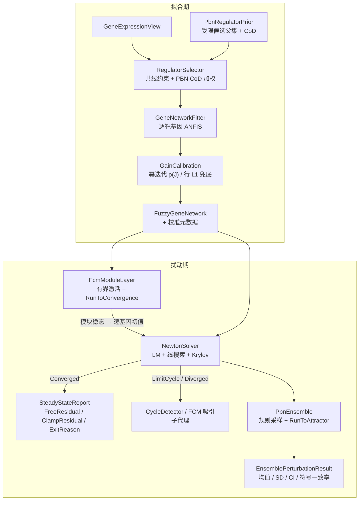

## 用户需求

对 `G:\GCModeller\src\GCModeller\sub-system\FuzzyGene\FuzzyGene.vbproj`（依赖 `FuzzyLogic.vbproj` 的 TSK/ANFIS 内核）做两件事：

1. **修复导致虚拟扰动迭代不收敛的缺陷**（含 P0 收敛判据 bug，以及野生型口径、输入侧外推、配置不自洽等连带问题）；
2. **按已审查结论做模型融合**：把神经模糊网络与 `FuzzyLogic.vbproj` 中现有的概率布尔网络（PBN）与模糊认知图（FCM）融合，以改善收敛语义与预测性能。

## 已确认的设计决策（用户明确选择）

| 项 | 决策 |
| --- | --- |
| 求解器 | 修判据 + **LM/牛顿求根**：静态路线解 `r(z)=F(z)−z=0`（解析 Jacobian + 线搜索），收敛判据与步数解耦；滞后路线独立为 `Advance` 时间推进模式，不再报稳态 |
| 增益校准 | **两者都做，谱半径为主**：默认组装稀疏 Jacobian + 幂迭代求谱半径；失败/退化回落到逐行 L1 上界；提供配置开关 |
| 融合范围 | **全部**：PBN 定性正则 + PBN 采样不确定性（填充目前被忽略的 `nSamples`）+ 模块级 FCM 粗粒度初值与吸引子语义 + 重写 `Hybrid.FuzzyCausalBridge` |
| 兼容性 | **允许新增重载/新类型**；旧 `.fuzzygene.zip` 必须仍可读；序列化只能追加字段 |


## 核心功能

### A. 收敛修复

- 残差口径拆分：`FreeResidual`（仅自由基因，用于判收敛）与 `ClampResidual`（被钳制基因的约束违背量，只作诊断），彻底消除「敲除基因自身的无约束更新量把 `maxDelta` 钉在高位」导致的假阴性。
- 静态路线改为带解析 Jacobian 的 LM/牛顿求根：残差 `r(z)=F(z)−z`，线搜索保证单调下降，`‖r‖<tol` 即收敛；小网络走稠密分解，大网络走「稀疏 matvec + BiCGStab」矩阵无关实现。
- 滞后路线独立为 `Advance`：时间推进不承诺不动点，改为检测并报告吸引子（周期 / 周期均值）。
- 野生型基线改为真正的不动点（迭代 + 缓存），`FoldChanges` 以野生型不动点为参照；同时保留 `BaselineRaw` 供对照，报告「基线自漂移」量级。
- 外推修复：输入侧按 `TskInputVariable.Minimum/Maximum` 夹断；规则全失活时不再返回常数 0.0，改为连续兜底；输出夹断改为可关闭并统计「贴界基因比例」。
- 拟合侧稳定性：共线调控因子约束 + 加大岭项 + **全局增益校准**（`γ=(1−ε)/ρ(J)`，逐行 L1 兜底），把拟合网络的谱半径拉进压缩域。
- 完整诊断：`ExitReason`（收敛/步数耗尽/发散/极限环/支持域饱和/约束不可行）、迭代数、Jacobian 评估次数、残差历史、主导基因、贴界与越界基因数。

### B. 模型融合

- **PBN 定性正则**：用 CoD / 父集对 TSK 的调控因子候选做硬过滤或加权，抑制「反向因果造环」与纯相关边；受候选池规模严格限制以避免组合爆炸。
- **PBN 采样不确定性**：按规则概率采样多次并跑到吸引子，得到 `EnsemblePerturbationResult`（逐基因均值、标准差、置信区间、符号一致率、吸引子周期分布），真正启用现在被忽略的 `nSamples`。
- **FCM 粗粒度层**：模块级有界激活（`SigmoidActivation`）+ `RunToConvergence` 为逐基因求根提供热启动初值；求解失败时用 `DetectCycle` 的吸引子作为代理结论并显式标注。
- **重写 `Hybrid.FuzzyCausalBridge`**：修掉「TSK 输出与 FCM 激活直接算术平均（量纲不一致）」和「布尔状态 `Mod ruleCount` 映射单条规则（任意映射）」，改为可配置的量纲映射 + 由布尔状态与隶属函数一侧一致性驱动的规则权重调制；保留旧构造与 `InferStep` 签名。

### C. 可验证性

- `test/Program.vb` 增加收敛、校准、PBN、FCM、集成五组断言，全部用 `DebugAudit.Mark/AuditTest` 记录并生成报告。
- 旧包（`.fuzzygene.zip`）可继续加载与推理；新字段缺失时回落到「不校准、旧阻尼求解」的等价行为。

## 技术栈

- 语言/框架：VB.NET（`net10.0`），沿用 `Microsoft.NET.Sdk`，`RootNamespace = SMRUCC.genomics.Analysis.FuzzyGene`，`GenerateDocumentationFile=True`。
- 复用现有引用：`FuzzyLogic.vbproj`（TSK/PBN/FCM/Hybrid）、`ANFIS.vbproj`（训练栈）、`Math.NET5`（`NumericMatrix`/`CholeskyDecomposition`/`OLS`）、`Math.Statistics`、`HTS_matrix`、`Bio.InteractionModel`（`InsilicoPerturbationExperiment`/`InterventionResult`）。**无需新增项目引用**。
- 并行：`System.Threading.Tasks.Parallel` + 现成的 `ChunkGenes/ShouldParallelize/EnsureThreadPool` 约定；保持「并行与串行逐位一致」。
- 测试：控制台 `test/test.vbproj` + `DebugAudit`（`G:\GCModeller\src\runtime\sciBASIC#\Microsoft.VisualBasic.Core\src\ApplicationServices\Debugger\DebugAudit.vb`）记录与出报告。

## 实现策略

### 1. 求解器重构：把「迭代」变成「求根」

核心是把现有 `FuzzyGeneNetwork.Solve`（`FuzzyGeneNetwork.vb` 404–493）拆成 `SolveCore`：

- **残差映射** `R(z)`：对被钳制基因先把 `z_k` 固定为 `clamp_k`，只对自由基因计算 `F_g(z) − z_g`；被钳制基因的残差单列为 `ClampResidual = |F_k(z) − clamp_k|`。这是 P0 的根因修复——现有代码在 `BlendInto` 里统计 `maxDelta` 时把钳制位置也算了进去（`ω|F_k−clamp_k|`），随后才回写覆盖，导致 `Converged` 恒为 False。
- **解析 Jacobian**：`J(g,j) = Σ_r w̄_r(z_g 的规则激活) · θ[r·(n+1)+j]`，与 `GeneRegulationModel.LocalSensitivity`（`GeneRegulationModel.vb` 103–128）完全同构，只是把「一行的灵敏度」扩展成「组装整张稀疏矩阵」。明确记录：该 Jacobian 忽略 `∂w̄/∂z`，属准牛顿（与现有边权重口径一致），实现里以注释固定这一约定。
- **LM/牛顿**：解 `(I − J + λI)·δ = −r`，`λ` 按成功/失败自适应（`λ /= 3` / `λ *= 10`），阻尼后残差必须下降否则收缩步长（回溯线搜索）。
- `N ≤ DenseThreshold`（默认 2048）走稠密 `NumericMatrix` + `OLS.Solve`；
- 更大规模走**矩阵无关**：`J` 通过 `N×K`（`K = MaxRegulators ≤ 6`）的稀疏表做 matvec，外层 `BiCGStab` 求解，每步成本 `O(m·N·K)`。
- 每轮 Newton 需要一次 `F(z)`（本来就要）+ 一次规则激活前向（新增），约等于 2 个「阻尼步」；10 轮 Newton ≈ 20 个阻尼步，**比现在的 50 步更便宜**。
- **回落链**：`Newton` → `Anderson(depth=5)` 加速的阻尼迭代 → `LegacyDamped`（现有行为，含脏位优化）。每次回落写入 `ExitReason`，绝不静默。
- **周期检测**：保留最近若干帧的哈希（参照 `BooleanNetworks.StateTrajectory.DetectAttractor` 与 `FuzzyCognitiveMap.DetectCycle` 的做法，但用 z 空间的 `G6` 量化键），检出周期即返回 `LimitCycle` 并把周期均值作为稳态代理。
- **语义分离**：`SolverMode.Auto` → 静态路线 `Newton`，滞后路线 `Advance`。`Advance` 复用 `SimulateCascade` 的 `forceAll` 路径，只输出轨迹 + 吸引子，不再报 `Converged`。

### 2. 增益校准：谱半径为主、行 L1 兜底

`GeneNetworkFitter` 已经算出逐靶基因的灵敏度向量 `weights(g)`（`GeneNetworkFitter.vb` 477–523），可直接复用：

- 用 `regulatorIndices` + `theta` 组装 `J`（z 空间，行 = 靶基因，列 = 调控因子），幂迭代求 `ρ(J)`（默认 20 次迭代、随机但固定种子的初值，失败退化为 `‖J‖₁` 行和上界）；
- `γ = min(1, (1−ε)/ρ)`，先全局缩放（保留基因间相对增益），再对仍满足 `Σ_j|J(g,j)| > 1−ε` 的行做逐行再缩放（防御性）；
- 缩放对象是 `theta` 的斜率列（不动截距），因此规则文本仍可读、符号不变；
- **在拟合阶段完成并序列化**：`GeneModelDto` 追加 `gainScale`、`FuzzyGeneNetworkDto` 追加 `spectralRadius`/`calibrationMode`/`preCalibrationR2`/`postCalibrationR2`。旧包缺这些字段时视为「未校准」，行为等价于当前版本；
- 训练报告记录 `ρ` 分布、γ 分位、ΔR²，避免「为了收敛牺牲精度」不可见。

### 3. PBN 正则与采样（严格限制规模）

关键工程约束：`PbnInference.Fit` 会对全部基因枚举 `k ≤ maxParents` 的**所有组合**（`InferenceHelper.Combinations`），全基因组规模是 `C(18532,3)` 量级，**不可直接调用**。因此：

- `PbnRegulatorPrior` 自己枚举：对每个靶基因，候选父集 = 先验 TF ∪ 该靶基因 top-`P`（默认 5）相关基因，只枚举大小 ≤ `PbnMaxParents`（默认 2）的子集 → 每基因 ≤ 21 个子集；直接复用公开的 `InferenceHelper.FitRule` / `ComputeCod`；
- 布尔化用 `FuzzyMembershipBinarizer`（`BooleanNetworks/BinarizationStrategy.vb` 115–164，本身复用 TSK 隶属函数，保证两层口径一致）或 `RangeThresholdBinarizer`；
- 结果对外只暴露 `CoDOf(target, regulator)` 与 `PriorWeight(target, regulator)`，供 `RegulatorSelector` 加权；
- 采样：用 `PbnInference` 的多规则 + `ProbabilisticBooleanNetwork.Sample`（`BooleanNode.vb` 122–144）逐次采样，`RunToAttractor`（`BooleanNetworkBase.vb` 239–266，有限状态空间必收敛）取吸引子 → 每次采样得到一个布尔稳态；
- 每次采样把布尔稳态转成「模式软约束」注入 TSK 求根（把 `z_g` 拉向对应模式的支持域），权重 `ModeBiasWeight` 默认 0（此时只做布尔一致性与吸引子分布统计，不改变数值结论），保证默认行为可回退。

### 4. FCM 粗粒度层

- 模块由表达聚类得到（复用 `Microsoft.VisualBasic.DataMining.KMeans`，与 `TskNetworkBuilder.CreateScatter` 同一套引擎），`k = min(FcmModuleCount, N/50)`；
- 模块权重 = 模块内 `J` 的均值（带符号），按行归一化到 `|w| ≤ 1`；
- `FuzzyCognitiveMap` + `SigmoidActivation`（值域 `[0,1]`，`Propagate` 内 `ClampToFunction` 保证有界）→ `RunToConvergence(1e-6, FcmMaxSteps)`；返回 `-1` 时调 `DetectCycle` 报告吸引子；
- 模块稳态反推逐基因 `z` 初值，作为 Newton 的 `initial`（热启动）；FCM 失败则回落到 `BaselineRaw`；
- 若 Newton 最终判定 `LimitCycle`，用 FCM 吸引子的周期均值作为代理结论并置 `SurrogateOf = "fcm-attractor"`，同时在诊断里显式标注（避免把代理值误读为定量预测）。

### 5. 重写 `Hybrid.FuzzyCausalBridge`

- 新增 `ITskActivationMapper`（`ToActivation(z)` / `FromActivation(a)`），把 TSK 的 z 值与 FCM 的 `[0,1]` 显式互换，杜绝现有 `(activations(i) + tskOutput(i)) / 2` 的量纲混算；
- `ToRuleActivations` 改为：先 `_tsk.GetRuleActivations(mapped)`，再用布尔状态与每条规则前件所属模糊集「一侧一致性」调制权重并归一化；删除 `code Mod ruleCount`；
- 保留原构造函数与 `InferStep` 签名（旧调用方不受影响），新增带 `ITskActivationMapper` 的构造重载；概念数 ≠ 基因数的情形改为显式的映射表参数，不再假设相等。

### 6. 兼容与回退

- `SteadyState` / `SteadyStateTraceOf` / `Predict` / `TracePerturbation` 的公开签名不变；新增 `SteadyStateWithReport(...) As SteadyStateReport`、`PredictEnsemble(specs, nSamples)`、`SimulateCascade(..., report)`；
- `SteadyStateTrace.Seal` 增加可选参数（旧调用位置仍合法）；
- `FuzzyGeneConfig` 新增 `Solver`/`Hybrid` 两个嵌套选项；由于现有 `Clone()` 用 `MemberwiseClone`（浅拷贝），必须显式深拷贝这两个属性，且属性 getter 要在反序列化得到 `Nothing` 时惰性新建（旧包没有这两个字段）；
- `InterventionResult` 位于 `Bio.InteractionModel`，是 BNLearn/GPS 共享契约，**不加字段**（沿用 `PerturbationTrace` 注释里已有的约定）；集成结果用 FuzzyGene 侧新类型 `EnsemblePerturbationResult` 包装。

## 性能与正确性约束

- **复杂度**：Newton 单轮 `2·Σ_g K_g` + Krylov `O(m·N·K)`；`K ≤ 6` 时 `J` 存储 `N×K` 双精度（18533×6×8 ≈ 0.9 MB）。幂迭代 20 次 matvec，可忽略。总体上 10 轮 Newton 与 20 个阻尼步等价，相对现有 50 步阻尼是**净加速**。
- **并行确定性**：`J` 的每个行只由负责该基因的线程写；逐行 `Σ_j|J|` 在单线程内按 `j` 升序累加（行内元素 ≤ 6，不存在跨块归约），因此与线程调度无关、逐位可复现。`max` 归约沿用现有「可结合」性质。
- **零分配**：`J`、残差向量、Newton 方向、Krylov 工作向量按最大规模一次性预分配，按需 `ReDim`；沿用 `_inputScratch` 的 `ThreadLocal` 与双缓冲模式；脏位优化只在 `LegacyDamped` / `Advance` 保留（Newton 需要完整 `F`，文档中写明这一取舍）。
- **模型语义变更需可见**：默认求解器变更会改变数值结果，`SolverMode.LegacyDamped` 保留旧行为；校准改变预测幅度，必须输出 pre/post R²；两者都写进 `FuzzyGeneTrainingResult` 与 `method.md`。
- **规模闸门**：`PbnMaxGenes`（默认 2000）、`PbnMaxParents`（默认 2）、`FcmModuleCount`（默认 48）三个门槛必须在 `ValidateGene()` 里校验，并在超限时给出可操作的告警而不是静默降级。

## 架构设计



## 目录结构

## 目录结构摘要

FuzzyGene 侧新增 `Solver/` 与 `Hybrid/` 两个文件夹承载求解器与三层融合；`FuzzyLogic` 侧只改 `Hybrid/FuzzyCausalBridge.vb` 并新增一个映射接口。所有既有公开签名保持可用，新增能力以重载/新类型/追加字段提供。

```
sub-system/FuzzyGene/
├── FuzzyGeneNetwork.vb                         # [MODIFY] 拆出 SolveCore(残差映射/初值/求解器派发)；SteadyState/SteadyStateTraceOf 保持签名并转调；新增 SteadyStateWithReport；StepZRange 改为按选项做输入侧支持域夹断、输出夹断可关闭并统计贴界；保留脏位路径供 LegacyDamped/Advance；应用 gainScale（反序列化后仍需重建 J 与校准元数据）
├── FuzzyGeneModel.vb                           # [MODIFY] 新增 PredictEnsemble(specs,nSamples)、SolveReport/TracePerturbation 的重载；TracePerturbation 拆分目标缺失/求解失败两种降级；EnableHybrid/DisableHybrid 门面；SweepOmega/SweepSteps 把新残差透出；Save/Load 保证新旧包互通
├── Config/FuzzyGeneConfig.vb                   # [MODIFY] 新增 Solver/Hybrid 两个嵌套选项属性（惰性新建以兼容旧包）、ValidateGene 递归校验、Clone 深拷贝这两个属性
├── Config/SolverOptions.vb                     # [NEW] SolverMode(Auto/Newton/AndersonDamped/LegacyDamped/Advance)、MaxNewtonIterations、MaxIterations、Lambda0/LambdaDown/LambdaUp、LineSearchMaxSteps、AndersonDepth、DenseThreshold、DivergenceFactor、CycleWindowLength、ClampInputToSupport、ClampOutputToSupport、ConvergenceTolerance 覆盖值、EnableDirtySet
├── Config/HybridOptions.vb                     # [NEW] PbnRegularization(None/Filter/Weighted)、PbnMinCod、PbnWeight、PbnMaxGenes、PbnMaxParents、PbnCandidateSize、EnsembleSamples、ModeBiasWeight、FcmWarmStart、FcmModuleCount、FcmAlpha、FcmMaxSteps、FcmFallbackAsSurrogate、StabilityCalibration(None/RowL1/SpectralRadius)、CalibrationTolerance(Epsilon)
├── Solver/SolverTypes.vb                       # [NEW] ExitReason 枚举、SteadyStateReport、SolverRunOptions、NewtonStepRecord；所有诊断字段的唯一来源，避免各处重复定义口径
├── Solver/ResidualMap.vb                       # [NEW] 残差映射 R(z)：钳制固定 + 支持域投影 + FreeResidual/ClampResidual 分开统计 + 越界/贴界计数；提供 Evaluate 与 EvaluateWithRow(单基因行，供 Jacobian 复用)
├── Solver/JacobianOperator.vb                  # [NEW] 按 _regulatorIndices + theta + 规则激活组装稀疏 J(N×K)；Matvec/Gradient；逐行 L1 范数；幂迭代 SpectralRadiusPowerIteration；所有缓冲预分配，行内累加顺序固定以保证逐位可复现
├── Solver/NewtonSolver.vb                      # [NEW] LM 主循环：残差 → 雅可比 → 自适应 λ → 稠密分解或 BiCGStab → 回溯线搜索 → 收敛/发散/步数耗尽判定；失败时按回落链交给 AndersonAcceleration/LegacyDamped
├── Solver/AndersonAcceleration.vb              # [NEW] 深度 m 的 Anderson 外推（最小二乘求系数），有界保护与正则化，避免外推放大
├── Solver/CycleDetector.vb                     # [NEW] 环形缓冲 + 量化键（G6）检测周期 2~CycleWindowLength，输出周期帧与周期均值
├── Solver/GainCalibration.vb                   # [NEW] 谱半径（主）/行 L1（兜底）→ γ 计算 → 逐行再缩放；返回 SpectralRadius/Gamma/PrePostR2；纯函数，便于单测
├── Data/SteadyStateTrace.vb                    # [MODIFY] 新增 FreeResidual/ClampResidual/ExitReason/OutOfSupportFraction/PinnedFraction/AttractorFrames；Converged 改为 ExitReason=Converged；Push/Seal 增加可选 report 参数并保持旧调用合法；导出 sidecar 增加诊断列
├── Data/RegulatorSelector.vb                   # [MODIFY] 迭代选择时加入「已选调控因子两两 |r| ≤ MaxRegulatorCollinearity」约束；接入 PbnRegulatorPrior 的 CoD 过滤/加权；保留 PriorFirst/CorrelationOnly/PriorOnly 与 NoveltyQuota 语义
├── Fitting/GeneNetworkFitter.vb                # [MODIFY] 拟合完成后调用 GainCalibration，把 gainScale 写回 GeneRegulationModel；报告新增 ρ 分布/γ/前后 R²；默认 Ridge 上调（经 Hybrid/Solver 选项）
├── Fitting/GeneRegulationModel.vb              # [MODIFY] 新增 GainScale 属性与 DTO 字段；新增 AssembleRowJacobian（供 J 组装，避免每基因重复取规则激活两次）；保留 LocalSensitivity 语义
├── Fitting/FuzzyGeneTrainingResult.vb          # [MODIFY] 新增 SpectralRadius/Gamma/PreCalibrationR2/PostCalibrationR2/CalibrationMode 与告警文案
├── Perturbation/AnfisPerturbationEngine.vb     # [MODIFY] ControlSteadyState 恢复迭代不动点并缓存（基线变更即失效）；Predict 统一走 SolveCore；PredictWithTrace 与 Predict 共用同一次求解路径保证逐位一致；nSamples 传递到集成路径；更新那段「ControlSteadyState 目前直接返回训练基线」的过期注释
├── Perturbation/Analysis/SolverStability.vb    # [MODIFY] ω/步数扫描改用 FreeResidual 判读，新增 ExitReasons 汇总；保持 Invariant 语义但不再受钳制残差污染
├── Perturbation/Analysis/AnalysisTypes.vb      # [MODIFY] OmegaSweepResult/StepSweepResult 追加 ExitReasons、FreeResidual、ClampResidual 数组与 Validate 对齐检查
├── Perturbation/Analysis/AnalysisExporter.vb   # [MODIFY] CSV/JSON 增加 ExitReason、FreeResidual、ρ、γ 列
├── Perturbation/Analysis/DoseScan.vb           # [VERIFY] 仅依赖 TracePerturbation，签名不变；确认剂量点全为 0 时不再被误判为未收敛
├── Perturbation/Analysis/CombinationTrace.vb   # [VERIFY] 同上；确认逐帧口径在 Advance 模式下不被当作稳态
├── Hybrid/PbnRegulatorPrior.vb                 # [NEW] 受限父集枚举 + InferenceHelper.FitRule/ComputeCod；暴露 CoDOf/PriorWeight/Edges；内置 PbnMaxGenes/PbnMaxParents 门槛与完整告警
├── Hybrid/PbnEnsemble.vb                       # [NEW] 多规则采样 → ProbabilisticBooleanNetwork → RunToAttractor → 布尔稳态；可选 ModeBias 软约束注入 ResidualMap；输出吸引子周期分布
├── Hybrid/FcmModuleLayer.vb                    # [NEW] 聚类模块、模块权重（J 均值）、SigmoidActivation、RunToConvergence/DetectCycle、模块稳态反推逐基因初值、吸引子代理结论
├── Hybrid/EnsemblePerturbationResult.vb        # [NEW] 逐基因均值/SD/置信区间/符号一致率、吸引子周期分布、成员结果集合、诊断字段（不改 InterventionResult）
├── Hybrid/HybridPerturbationPipeline.vb        # [NEW] 编排：PBN 正则（拟合期）→ FCM 热启动 → Newton 求解 → 失败走吸引子/代理 → 可选 PBN 集成；单次与组合扰动统一入口
├── method.md                                   # [MODIFY] 增补「为何要用求根而不是迭代」「谱半径校准」「三层融合的能力边界与默认开关」三节，保留原有理论论证
└── test/Program.vb                             # [MODIFY] 新增诊断套件：钳制残差不再污染收敛、Predict 与 Trace 在多步数下逐位一致、control 不动点稳定、ω/步数不变性、校准后 ρ ≤ 1−ε 且 ΔR² 可控、PBN 正则保留先验边、FCM 热启动不增加迭代、集成结果形状与置信区间；全部用 DebugAudit.Mark/AuditTest

runtime/sciBASIC#/Data_science/DataMining/FuzzyLogic/
├── Hybrid/FuzzyCausalBridge.vb                 # [MODIFY] 用 ITskActivationMapper 显式换算量纲；ToRuleActivations 改为「规则激活 × 布尔一侧一致性」加权归一化，删除 code Mod ruleCount；概念数≠基因数改为显式映射表；保留旧构造与 InferStep 签名
└── Hybrid/ITskActivationMapper.vb              # [NEW] ToActivation/FromActivation 抽象 + 基于 TskInputVariable 定义域的默认实现（[min,max] ↔ [0,1]）
```

## 关键代码结构

```
''' <summary>求解结束原因：收敛判定与退出条件的唯一口径。</summary>
Public Enum ExitReason
    Converged
    MaxIterations
    Diverged
    LimitCycle
    SupportSaturated
    ConstraintInfeasible
End Enum

''' <summary>一次稳态求解的完整诊断（被 SteadyStateTrace / Sweep / 导出共用）。</summary>
Public Class SteadyStateReport
    Public Property ExitReason As ExitReason
    Public Property Iterations As Integer
    Public Property JacobianEvaluations As Integer
    Public Property FreeResidual As Double          ' 仅自由基因，用于判收敛
    Public Property ClampResidual As Double         ' 被钳制基因的约束违背量，仅诊断
    Public Property OutOfSupportCount As Integer
    Public Property PinnedToBoundCount As Integer
    Public Property DominantGene As String
    Public Property AttractorPeriod As Integer
    Public Property AttractorMean As Double()
    Public Property ResidualHistory As Double()
    Public Property ElapsedMs As Double
End Class

''' <summary>PBN 定性先验：只暴露按基因查询的 CoD 与权重，内部枚举严格受限。</summary>
Public Class PbnRegulatorPrior
    Public Function CoDOf(targetGene As String, regulator As String) As Double
    Public Function PriorWeight(targetGene As String, regulator As String) As Double
    Public ReadOnly Property GeneNames As String()
    Public Shared Function Build(view As GeneExpressionView, config As HybridOptions,
                                 Optional prior As PriorNetwork = Nothing) As PbnRegulatorPrior
End Class
```

## Agent 扩展

### SubAgent

- **code-explorer**
- Purpose: 在改动 `SteadyState` / `ControlSteadyState` / `Solve` 语义前，全仓检索这两组 API 与 `PerturbationTrace`/`InterventionResult` 的消费方（FuzzyGene 之外是否还有 sub-system 调用），确认「签名不变但数值语义变化」的影响面。
- Expected outcome: 得到一份调用点清单与风险分级（哪几处必须回归验证、哪几处完全不受影响），避免在 18k 基因的场景下悄悄改坏下游。

### Skill

- **lsp-code-analysis**
- Purpose: 对 `FuzzyGeneNetwork.Solve`、`AnfisPerturbationEngine.ControlSteadyState`、`SteadyStateTrace.Seal`、`FuzzyCausalBridge.InferStep` 做 find-references / 调用层级分析，确认新增重载不会与既有调用产生重载解析歧义（VB 大小写不敏感、可选参数多的方法尤其容易冲突）。
- Expected outcome: 精确的重载签名候选与冲突清单，保证 `SteadyState`/`Seal`/`InferStep` 在保留旧签名的前提下可重载。